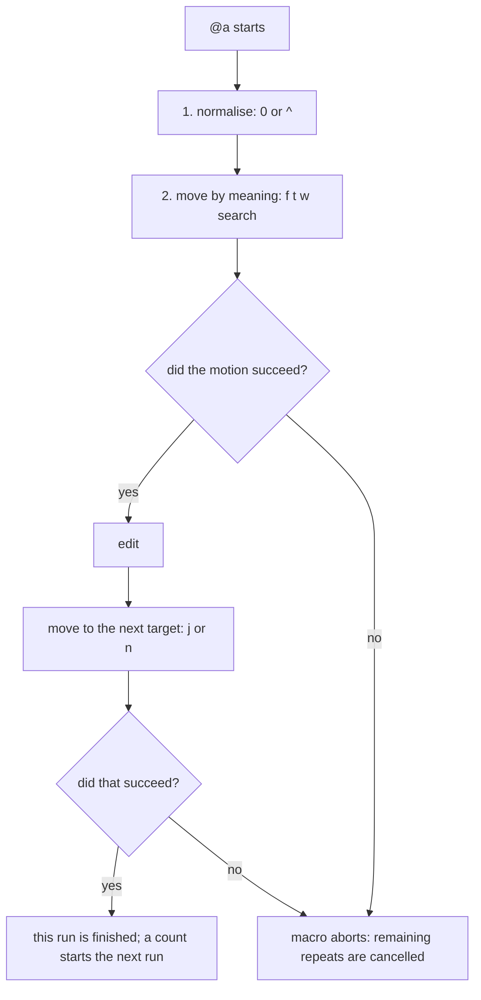

# Macros: record your keystrokes and play them back

> **Before this lesson:** you should be comfortable with [the dot command](#/lesson/vim/vim-dot-command), [operators and motions](#/lesson/vim/vim-normal-grammar) and [registers](#/lesson/vim/vim-registers). You do not need any programming knowledge beyond reading short code samples.

## In plain words

A **macro** is a recording of keys you pressed, saved so that the editor can press them again for you.

Think of a player piano, the kind that plays itself from a paper roll. Someone performs the piece once while the roll is punched; afterwards the piano repeats the performance as often as you like. A Vim macro is that roll. You do an edit once, slowly and carefully, with recording switched on. Then you ask Vim to perform it again on the next line, or on the next two hundred lines.

Why it matters at work: a large share of real editing is the same small transformation applied many times. Turning a list of names into code. Reformatting a column of data someone pasted from a spreadsheet. Adding the same wrapper around forty function calls. Doing this by hand is slow and error-prone, and writing a script for a one-off job is often more effort than the job. A macro sits in between: no programming, and the forty-first line is treated exactly like the first.

The dot command, which you already know, replays **one** change. A macro replays **any sequence**: several changes, with movements, searches and even commands typed after a colon in between.

In the tables, `[x]` marks the character the cursor is on. `<Esc>` is the Escape key and `<CR>` is the Enter key.

## The four keys

| Keys | What they do |
|---|---|
| `q{letter}` | start recording into the register named by that letter, for example `qa` |
| `q` | stop recording |
| `@{letter}` | play the recording stored in that register, for example `@a` |
| `@@` | play again whichever recording you played last |

A **register** is one of Vim's named storage slots for text (the previous lesson covered them). A macro is stored in a register as ordinary text: the characters you typed. That fact becomes useful later, because it means a macro can be looked at, pasted into a file, corrected and stored again.

While recording, the bottom line of the screen shows `recording @a`. Everything you type is both carried out and saved.

## The smallest possible macro

Start with something tiny so that the mechanics are clear. Three lines each need a full stop at the end.

| Step | Keys | What happens |
|---|---|---|
| 1 | `qa` | recording into register `a` begins |
| 2 | `A.<Esc>` | `A` jumps to the end of the line and starts typing; `.` is typed; `<Esc>` returns to Normal mode |
| 3 | `j` | the cursor moves down one line |
| 4 | `q` | recording stops |

| Before | Keys | After |
|---|---|---|
| `[F]irst point`<br>`Second point`<br>`Third point` | `qaA.<Esc>jq` | `First point.`<br>`Second poin[t]`<br>`Third point` |
| | `@a` | `First point.`<br>`Second point.`<br>`Third poin[t]` |
| | `@@` | `First point.`<br>`Second point.`<br>`Third point[.]` |

The first line was edited while recording. `@a` played the recording on the second line, and because the recording ends with `j`, the cursor was left on the third line, ready for the next playback. On the last line `j` had nowhere to go; the edit before it had already happened, so the line is still correct.

For this particular job the dot command would have been enough (`A.<Esc>` then `j.`). Macros earn their place when the edit has more than one step.

## A realistic macro, built step by step

A settings file contains lines like these:

```text
host=localhost
port=5432
user=admin
```

and they should become shell commands:

```text
export HOST="localhost"
export PORT="5432"
export USER="admin"
```

Each line needs four separate edits: upper-case the name, add an opening quote after the equals sign, add a closing quote at the end, and put `export ` at the front. Here is the recording, one piece at a time, on the first line.

| Keys | Meaning | Line afterwards |
|---|---|---|
| `qa` | start recording into `a` | `[h]ost=localhost` |
| `0` | go to the first column | `[h]ost=localhost` |
| `gUt=` | make upper case (`gU`) everything up to, not including, the next `=` (`t=`) | `[H]OST=localhost` |
| `f=` | move onto the `=` | `HOST[=]localhost` |
| `a"<Esc>` | append a quote after it | `HOST=["]localhost` |
| `A"<Esc>` | append a quote at the end of the line | `HOST="localhost["]` |
| `Iexport␣<Esc>` | insert `export` and a space at the start of the line (`␣` shows the space) | `export[ ]HOST="localhost"` |
| `j` | down one line | cursor on line 2 |
| `q` | stop recording | |

Typed without pauses, the whole recording is `qa0gUt=f=a"<Esc>A"<Esc>Iexport <Esc>jq`.

Now play it:

| Keys | Result |
|---|---|
| `@a` | line 2 becomes `export PORT="5432"` |
| `@@` | line 3 becomes `export USER="admin"` |

or, in one go, `2@a`: a number in front of `@a` plays the macro that many times.

## Three habits that make macros reliable

A macro repeats your keys blindly. It does not know what you meant. Whether it works on the *next* line depends entirely on whether the keys you recorded make sense there. Three habits take care of that.

### 1. Start from a known position

The first key of the realistic macro was `0`. It was not needed on the first line, where the cursor was already in column 0. It is there for every later line, so that the macro begins from the same place however it arrives. Typical openers are `0` (first column), `^` (first character that is not a space) and `gg` (first line of the file).

### 2. Move by meaning, not by counting

The recording used `t=`, `f=`, `A` and `I`. Each one describes a place by what is there: "up to the equals sign", "the end of the line", "the start of the line". None of them says "five characters to the right". Names and values have different lengths on every line, so counted steps such as `lllll` would land in the wrong place. Motions that name their target (word motions, `f` and `t`, searches, text objects such as `iw` and `i"`) adapt to each line.

### 3. Let a failed motion stop the macro

When a motion cannot be carried out, for example `f=` on a line that has no `=`, Vim gives an error and **abandons the rest of the macro**. That sounds like a nuisance and is in fact a safety catch: the macro stops instead of doing something wrong to a line that does not fit the pattern.

It also means you never have to count lines exactly. If there are somewhere around thirty lines to convert, type `100@a`. The macro runs until a motion fails, most often `j` on the last line of the file, and then stops by itself.



## Two ways to run a macro many times

### In series: one after another

This is what `10@a` does when the macro ends with `j`. Each run hands over to the next.

It has one weakness. Suppose a comment line sits in the middle of the settings:

```text
host=localhost
# database port
port=5432
user=admin
```

Running `10@a` from line 1 converts `host`, then reaches the comment. `t=` finds no equals sign there, the macro aborts, and all the remaining repeats are cancelled. The lines after the comment are left untouched. Like a chain of old fairy lights, one failure switches off everything after it.

### In parallel: each line on its own

The alternative is to hand the macro to every line separately, using the Ex command `:normal` (Ex commands are the ones typed after a colon; `:normal` types Normal-mode keys for you on each line of a range).

| Step | Keys | Meaning |
|---|---|---|
| 1 | record the macro **without** the final `j` | each run will be given its own line |
| 2 | `V` and move, to select the lines | Visual mode, line-wise |
| 3 | `:` | Vim fills in `:'<,'>`, meaning "the selected lines" |
| 4 | `normal @a<CR>` | play macro `a` on each selected line |

The complete command line reads `:'<,'>normal @a`. For the whole file it would be `:%normal @a`.

Now each line gets its own independent run. On the comment line the macro fails and that line is left alone; the lines after it are still processed.

| | In series (`10@a`) | In parallel (`:'<,'>normal @a`) |
|---|---|---|
| The macro must move to the next target itself | yes (`j`, `n`, `:next` …) | no |
| One line does not fit the pattern | everything after it is skipped | only that line is skipped |
| Targets are scattered (found by searching) | works: end the macro with `n` | not suitable |
| You can stop to inspect | yes, run it one at a time with `@@` | no, it is all or nothing (but one `u` undoes all of it) |

The model below imitates both styles with a "macro" that fails on lines without an equals sign, so that you can see the difference in the output.

```python-run
def macro(line):
    """The export macro. Raises an error where a motion would fail, as Vim does."""
    if "=" not in line:
        raise ValueError("E: '=' not found")      # t= fails
    name, value = line.split("=", 1)
    return f'export {name.upper()}="{value}"'

def run_in_series(lines, start=0, count=100):
    out, row = list(lines), start
    for _ in range(count):
        if row >= len(out):
            break                                  # j failed on the last line
        try:
            out[row] = macro(out[row])
        except ValueError:
            break                                  # abort: remaining repeats are cancelled
        row += 1
    return out

def run_in_parallel(lines):
    out = []
    for line in lines:                             # every line gets its own attempt
        try:
            out.append(macro(line))
        except ValueError:
            out.append(line)                       # failure affects this line only
    return out

settings = ["host=localhost", "# database port", "port=5432", "user=admin"]
print("series:  ", run_in_series(settings))
print("parallel:", run_in_parallel(settings))
```

The first output line shows that only `host` was converted before the comment stopped the series run. The second shows all three settings converted and the comment left as it was.

## Fixing a macro without recording it again

### Add steps to the end

If you stopped recording too early, for instance you forgot the `j`, record again using the **capital** letter of the same register. Vim then adds to what is there instead of replacing it.

| Keys | Effect |
|---|---|
| `qA` | resume recording, appending to register `a` |
| `j` | the missing step |
| `q` | stop |

### Look at a macro

`:reg a` displays register `a`. Special keys are shown in a two-character notation: `^[` is Escape and `^M` is Enter. The export macro looks like this:

```text
:reg a
"a   0gUt=f=a"^[A"^[Iexport ^[j
```

### Edit a macro as text

Because the recording is plain text in a register, you can paste it into the buffer, change it with ordinary editing commands and store it back.

| Step | Keys | What happens |
|---|---|---|
| 1 | `:put a<CR>` | the macro's text appears on a new line below the cursor |
| 2 | edit the line | for example change `export` to `setenv` with `cw` |
| 3 | `0` | cursor to the start of that line |
| 4 | `"ay$` | yank from the cursor to the end of the line into register `a` |
| 5 | `dd` | remove the scratch line |

Step 4 uses `y$` and not `yy` on purpose. `yy` would also store the line break at the end of the line, and that line break would be replayed as a key press (it moves the cursor down a line), which may or may not be harmless.

For a small correction you can also assign to the register directly. In Vim's scripting language a register is written with an `@` sign:

```vim
:let @a = substitute(@a, 'export', 'setenv', '')
```

This reads register `a`, replaces the first `export` with `setenv`, and stores the result back.

## Numbering lines with a counter

Macros can call on Vim's scripting language for things that plain keys cannot do, such as counting. Goal:

| Before | After |
|---|---|
| `apples`<br>`pears`<br>`plums` | `1) apples`<br>`2) pears`<br>`3) plums` |

| Step | Keys | Meaning |
|---|---|---|
| 1 | `:let i = 1<CR>` | create a variable named `i` holding the number 1 |
| 2 | `qa` | start recording |
| 3 | `I<C-r>=i<CR>)␣<Esc>` | insert at the start of the line: `<C-r>=` asks Vim to work out an expression, `i<CR>` gives it the variable, and its value is typed in; then `)` and a space |
| 4 | `:let i += 1<CR>` | add one to the variable |
| 5 | `j` | next line |
| 6 | `q` | stop recording |
| 7 | `2@a` | do the other two lines |

(For this specific job current versions of Vim have a shortcut: put `0) ` in front of every line, select the column of zeros and press `g<C-a>`, which numbers them upward. The counter technique remains useful when the number has to appear in the middle of a more involved edit.)

## Across many files

The same two styles work when the unit is a file instead of a line. First collect the files into the **argument list**, which is Vim's list of "the files I am working on" (see [buffers and the argument list](#/lesson/vim/vim-buffers)): for example `:args src/**/*.py`.

| Style | Commands | Notes |
|---|---|---|
| in parallel | `:argdo normal @a` then `:wall` | runs the macro once in each file; `:wall` writes all changed files |
| in series | record `:next<CR>` as the last step of the macro, then `50@a` | stops at the first file where something fails, or after the last file |

Two precautions. Run `:set hidden` first so that Vim may leave a changed file without saving it. And before the real run, try the macro in one file and inspect the result; if it is wrong, `:argdo edit!` reloads every file from disk, discarding the changes, as long as you have not yet written them.

## Why it works

A macro is not a separate feature bolted onto the editor. It follows directly from two things you already know:

- Every action in Vim is a sequence of key presses with a definite meaning, so recording keys records *intent*, as long as you choose keys whose meaning does not depend on exact positions.
- Registers hold text, and keys are text. So a recording can be stored, appended to, pasted, edited and run using the register tools from the previous lesson. `q` writes to a register; `@` reads one and types it.

The guidance about normalising, moving by meaning and relying on failure is the same advice given for the dot command, only applied to a longer sequence: **describe the edit in terms that stay true on the next target.**

> [!TIP]
> Before recording, say the steps out loud once in plain language: "go to the start, upper-case up to the equals sign, …". If any step contains a number ("move right six"), find a way to say it without the number.

> [!TIP]
> This site's code editor has a Vim mode in the ⚙ settings menu. Paste the three `host=…` lines into any editor pane and record the export macro yourself; `q`, `@a` and `@@` all work there.

> [!INTERVIEW]
> Macros rarely appear in an interview question, but the judgement behind them does: "how would you apply this change to five hundred lines?" A strong answer names the options and their limits. A substitute command when the change is one find-and-replace; a macro when each line needs several coordinated edits; a script when the logic needs conditions or the job will be repeated next month.

## Pitfalls

- **Recording into a register that holds something you need.** `qa` wipes register `a`. Macros and yanked text share the same twenty-six registers.
- **Pressing `q` twice by accident.** `qaq` records an empty macro, clearing the register. (People use this on purpose before building up a register with `qA`.)
- **Counted movements.** `5l`, `3w` and their relatives are the usual reason a macro works on the first line and nowhere else.
- **Forgetting the move to the next target.** Without a final `j` or `n`, `10@a` runs ten times on the same line.
- **A motion that "succeeds" in the wrong place.** `f=` aborts on a line with no `=`, but on a line with an unrelated `=` it carries on happily. Make the search specific enough.
- **Mistakes while recording.** Do not start again. Press `u` to undo the slip and continue; the undo is recorded and played back too, and the result is the same. Or finish, and fix the macro as text.
- **Undoing a long run.** A count such as `100@a` creates many separate undo steps, one per change; `:'<,'>normal @a` is undone by a single `u`.
- **`@@` right after `:normal @a`.** It repeats the macro once at the cursor, not over the range. Use `@:` to repeat the whole `:normal` command.

## Cheat sheet

| Task | Keys |
|---|---|
| Record into register `a` | `qa` … `q` |
| Play it | `@a` |
| Play it again | `@@` |
| Play it 20 times, or until it fails | `20@a` |
| Play it on each selected line | `:'<,'>normal @a` |
| Play it on every line of the file | `:%normal @a` |
| Play it in every file of the argument list | `:argdo normal @a` |
| Append to the recording | `qA` … `q` |
| See what was recorded | `:reg a` |
| Paste the recording to edit it | `:put a` |
| Store an edited line back | `0"ay$` |
| Clear a register | `qaq` |
| Repeat the last `:` command | `@:` |

## Summary

- `q{letter}` starts recording keys into a register, `q` stops, `@{letter}` plays, `@@` plays again, and a count repeats.
- Begin a macro by putting the cursor in a known place; move with motions that name their target; end by moving to the next target.
- A motion that fails aborts the macro. Use this: over-estimate the count and let the macro stop itself.
- Running in series (`10@a`) stops at the first line that does not fit; running in parallel (`:normal @a` over a range) skips only the lines that fail.
- A macro is text in a register: append with the capital letter, inspect with `:reg`, edit by putting, changing and yanking back.
- `:let` variables and `<C-r>=` bring counting into a macro; `:argdo` extends macros to many files.

## Glossary

| Term | Meaning |
|---|---|
| macro | a saved sequence of key presses that Vim can replay |
| register | a named storage slot for text; macros are stored in the same slots as copied text |
| recording | the state between `q{letter}` and `q`, during which keys are saved as well as carried out |
| normalise | put the cursor in a predictable position at the start of a macro |
| abort | Vim stopping a macro early because a command in it failed |
| in series | running a macro repeatedly, each run starting where the previous one ended |
| in parallel | running a macro separately on each line (or file) of a set |
| Ex command | a command typed on the line that opens when you press `:` |
| `:normal` | the Ex command that types Normal-mode keys on each line of a range |
| argument list | Vim's list of the files you have chosen to work on, set with `:args` |

## Check yourself

```quiz
[
  {"q": "Which keys record a macro into register w that appends a semicolon to the current line and moves down one line?",
   "options": ["qwA;<Esc>jq", "@wA;<Esc>jq", "qwA;<Esc>j@w", "wqA;<Esc>jq"],
   "answer": 0,
   "explain": "q followed by a register letter starts recording and a lone q stops it. A; Esc is the edit and j moves to the next line so that repeated playback continues downward."},
  {"q": "You recorded a macro in register a and played it once with @a. Which keys play it again?",
   "options": ["..", "@@", "qq", "a@"],
   "answer": 1,
   "explain": "@@ replays the macro that was played most recently. The dot command repeats a single change, not a macro."},
  {"q": "A file has about 40 lines to convert and your macro ends with j. Why is 200@a safe?",
   "options": ["Vim limits counts to the number of lines", "When j fails on the last line the macro aborts and the remaining repeats are cancelled", "Macros ignore counts above 100", "It is not safe; it will wrap around to the first line"],
   "answer": 1,
   "explain": "A failed motion aborts the macro, including any outstanding repeats, so an over-estimated count stops by itself."},
  {"q": "Lines 1 to 20 should be converted by macro a, but line 7 does not match the pattern and makes the macro fail. Which command still converts lines 8 to 20?",
   "options": ["20@a starting on line 1", ":1,20normal @a", "@@ twenty times without looking", "qA"],
   "answer": 1,
   "explain": ":normal runs the macro separately on each line of the range, so a failure affects only line 7. A series run would stop at line 7."},
  {"q": "You finished recording into register b and realise you forgot to add j at the end. Which keys add it without re-recording?",
   "options": ["qbjq", "qBjq", "@bjq", ":let b = j"],
   "answer": 1,
   "explain": "Recording with the capital letter appends to the existing register. qb would replace the whole macro with a single j."},
  {"q": "Why should a macro for lines of varying length use f= or t= instead of something like 8l?",
   "options": ["f= is fewer keys", "Counted steps land in different places on different lines, while f= finds the same landmark on each line and fails cleanly if it is missing", "8l cannot be recorded", "l does not work inside macros"],
   "answer": 1,
   "explain": "A macro replays keys blindly. Motions that name a target adapt to each line and abort the macro when the target is absent."},
  {"q": "After :put a you edited the macro text on a scratch line. Which keys store that line back into register a correctly?",
   "options": ["\"ayy", "0\"ay$", "\"ap", "qa"],
   "answer": 1,
   "explain": "0 moves to the start of the line and \"ay$ yanks to the end of the line without the line break. yy would include the line break, which would be replayed as a key."},
  {"q": "What does :argdo normal @q do?",
   "options": ["Plays macro q on every line of the current file", "Plays macro q once in every file of the argument list", "Records a macro across all files", "Opens every file in a new tab"],
   "answer": 1,
   "explain": ":argdo runs an Ex command in each file of the argument list; here the command is :normal @q, which plays the macro once per file."}
]
```

> **Source:** Neil, Practical Vim 2e, tips 65–72 (ch. 11, "Macros"). Examples and wording are original.
