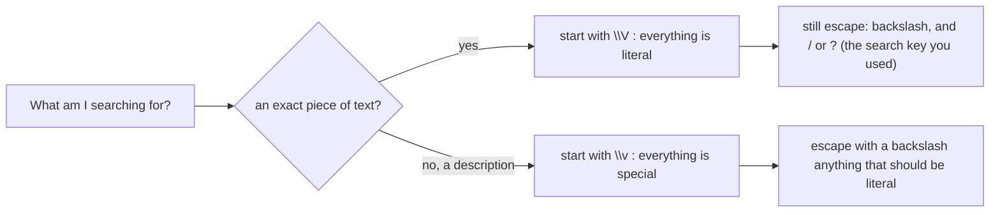

# Patterns and search

> **Before this lesson:** you should know how to move around with [motions](#/lesson/vim/vim-motions) and how [the dot formula](#/lesson/vim/vim-dot-formula) pairs `n` with `.`. No previous experience of regular expressions is assumed; they are introduced from zero here.

## In plain words

To **search** is to ask the editor "take me to the next place where this text appears". A **pattern** is a description of the text you are looking for. The simplest pattern is the text itself: search for `cat` and you are taken to the letters c, a, t.

Patterns become powerful when they describe a *kind* of text instead of one exact piece. Think of the wildcard tiles in a word game: a blank tile can stand for any letter. A pattern language gives you a whole set of such tiles: "any digit", "any letter", "one or more of the previous thing", "the start of a word". With them you can describe "a hash sign followed by six hexadecimal digits" or "the same word twice in a row" and let the editor find every instance. Such descriptions are called **regular expressions**, usually shortened to **regex**.

Why it matters at work: search is the main way to move around a large file, and patterns are the engine under three of Vim's strongest features: search (this lesson), substitution (find and replace, next lesson) and the global command (the lesson after that). An hour spent on patterns pays off in all three, and the same ideas carry over to `grep`, to log-search tools and to every programming language.

In the tables, `[x]` marks the character the cursor is on, `<CR>` is the Enter key and `<Esc>` is Escape.

## Searching, from the beginning

| Keys | What they do |
|---|---|
| `/text<CR>` | search **forward** (toward the end of the file) for `text` |
| `?text<CR>` | search **backward** (toward the start) |
| `n` | go to the next match in the same direction |
| `N` | go to the next match in the opposite direction |
| `*` | search forward for the whole word under the cursor |
| `#` | the same, backward |
| `/<CR>` | repeat the previous search (an empty pattern means "the last one") |

Pressing `/` opens a prompt at the bottom of the screen. You type the pattern and press Enter; the cursor moves to the first character of the next match. If there is no further match toward the end, the search wraps round to the top of the file (this is the `wrapscan` setting, which is on by default) and Vim tells you so.

| Before | Keys | After |
|---|---|---|
| `[l]evel = "info"`<br>`if level == "debug":`<br>`    print(level)` | `/level<CR>` | cursor on the `l` of `level` in line 2 |
| | `n` | cursor on the `l` of `level` in line 3 |
| | `n` | wraps: back to line 1 |
| | `N` | line 3 again |

### Three settings that make search comfortable

A **setting** (Vim calls it an *option*) is switched on with `:set name` and off with `:set noname`.

| Setting | Effect |
|---|---|
| `:set incsearch` | *incremental search*: the screen jumps to the first match while you are still typing the pattern, so you can stop as soon as you see the right place |
| `:set hlsearch` | *highlight search*: every match of the last pattern is highlighted |
| `:nohlsearch` (a command, short form `:noh`) | switch the highlighting off until the next search |

With incremental search on, two extra keys work while the prompt is open: `<C-g>` (Ctrl-G) steps to the next match and `<C-t>` to the previous one, without leaving the prompt. `<Esc>` cancels and puts the cursor back where it started, which makes `/` a convenient way to *look* at something further down and return.

### Upper and lower case

By default a search is case-sensitive: `/error` does not find `Error`.

| Setting or item | Effect |
|---|---|
| `:set ignorecase` | ignore case in every search |
| `:set smartcase` (together with `ignorecase`) | ignore case **unless the pattern contains a capital letter** |
| `\c` anywhere in the pattern | ignore case for this search only |
| `\C` anywhere in the pattern | respect case for this search only |

With both `ignorecase` and `smartcase` on, which is the common choice:

| Pattern | Finds `error` | Finds `Error` | Finds `ERROR` |
|---|---|---|---|
| `/error` | yes | yes | yes |
| `/Error` | no | yes | no |
| `/error\C` | yes | no | no |
| `/Error\c` | yes | yes | yes |

## The building blocks of a pattern

Most characters in a pattern stand for themselves. A few are **special**: they describe something instead of matching themselves. Here are the ones you will use most. The middle column shows how to write each in Vim's default mode; the last section of this table explains why some need a backslash (`\`) in front.

| Meaning | Written (default mode) | Example | Matches |
|---|---|---|---|
| any single character | `.` | `c.t` | `cat`, `cot`, `c9t` |
| zero or more of the previous item | `*` | `ab*c` | `ac`, `abc`, `abbbc` |
| one or more of the previous item | `\+` | `ab\+c` | `abc`, `abbbc`, not `ac` |
| the previous item is optional | `\?` or `\=` | `colou\?r` | `color`, `colour` |
| exactly n / between n and m of the previous item | `\{n}` / `\{n,m}` | `\d\{4}` | `2026` |
| one character from a set | `[...]` | `[aeiou]` | any one vowel |
| one character **not** in a set | `[^...]` | `[^,]` | anything except a comma |
| a digit | `\d` | `v\d` | `v1`, `v7` |
| a word character: letter, digit or underscore | `\w` | `\w\+` | `total_2` |
| a white-space character: space or tab | `\s` | `a\s*=` | `a=`, `a  =` |
| start of line / end of line | `^` / `$` | `^import` | lines beginning with `import` |
| start of a word / end of a word | `\<` / `\>` | `\<id\>` | `id`, but not `width` or `idle` |
| group items together | `\(...\)` | `\(ab\)\+` | `ab`, `abab` |
| either this or that | a backslash and a vertical bar between the alternatives | see the block below | |

Alternation written out, because it is easier to read outside a table:

```text
/red\|green\|blue          finds any of the three colour names
/\<\(get\|set\)_\w\+       finds get_name, set_total, ...
```

To search for a special character itself, put a backslash in front: `/3\.14` finds `3.14`, whereas `/3.14` would also find `3x14`.

### Worked example: building a pattern in steps

Goal: find colour codes such as `#1f9d55` in a style sheet. Build it up one idea at a time and check each stage with incremental search.

| Stage | Pattern | Thinking |
|---|---|---|
| 1 | `/#` | every code starts with a hash sign |
| 2 | `/#\x` | `\x` is "one hexadecimal digit": 0–9, a–f or A–F |
| 3 | `/#\x\{6}` | exactly six of them |
| 4 | `/#\x\{6}\>` | and then the word must end, so `#1f9d55ab` is not matched as six |

## Too many backslashes: the "very magic" switch

You will have noticed that some special items are written bare (`.`, `*`, `[`, `^`, `$`) and others need a backslash (`\+`, `\?`, `\(`, `\|`, `\{`, `\<`). That is a historical accident: the first group were special in the original `vi`, the rest were added later and had to be spelled with a backslash so that old patterns kept working. Vim calls this default behaviour **magic** mode.

Remembering which is which is tiresome, so Vim provides switches that you write at the start of a pattern:

| Switch | Name | Rule |
|---|---|---|
| `\v` | **very magic** | every character except letters, digits and underscore is special. To match one of them literally, put a backslash in front |
| `\m` | magic | the default described above |
| `\V` | **very nomagic** | nothing is special except the backslash. Everything else matches itself |

The same pattern in the default mode and in very magic mode:

```text
default:     /\<\(get\|set\)_\w\+\>
very magic:  /\v<(get|set)_\w+>
```

and the colour-code pattern, now also accepting the three-digit short form:

```text
default:     /#\(\x\{6}\|\x\{3}\)\>
very magic:  /\v#(\x{6}|\x{3})>
```

The very magic versions are close to what you would write in Python, JavaScript or `grep -E`. The differences worth remembering are that `<` and `>` are the word boundaries (other languages write `\b`), and `=` means "optional" alongside `?`.

Side by side:

| Meaning | Magic (default) | Very magic `\v` | Very nomagic `\V` |
|---|---|---|---|
| any character | `.` | `.` | `\.` |
| zero or more | `*` | `*` | `\*` |
| one or more | `\+` | `+` | `\+` |
| optional | `\?` | `?` | `\?` |
| group | `\( \)` | `( )` | `\( \)` |
| word boundaries | `\<` `\>` | `<` `>` | `\<` `\>` |
| a literal dot | `\.` | `\.` | `.` |
| a literal plus | `+` | `\+` | `+` |
| a literal parenthesis | `(` | `\(` | `(` |

**A practical rule:** start a pattern with `\v` when it is a regular expression, and with `\V` when you want to find a piece of text exactly as written.

| You want to find | Type | Why |
|---|---|---|
| the text `a.k.a.` | `/\Va.k.a.<CR>` | without `\V` each dot would match any character, so `backward` would also match |
| the text `price (USD)` | `/\Vprice (USD)<CR>` | nothing needs escaping |
| the text `items[0]` | `/\Vitems[0]<CR>` | in the default mode `[0]` would mean "the character 0" |



## Groups that remember: back-references

Parentheses do two jobs. They group, and they **capture**: Vim remembers what the group matched and lets you refer to it later in the same pattern as `\1` (first group), `\2` (second) and so on. Such a reference is called a **back-reference**.

A classic use is finding a word typed twice by mistake:

```text
/\v<(\w+)\s+\1>
```

Read piece by piece: `<` start of a word; `(\w+)` one or more word characters, remembered as group 1; `\s+` one or more spaces; `\1` the same text again; `>` end of a word.

| Line | Match |
|---|---|
| `this is is a test` | `is is` |
| `this island` | none: `<` and `>` prevent a match inside words |
| `that that works` | `that that` |

If you need grouping without remembering, write `%(` instead of `(` in very magic mode. It saves a group number and is slightly faster.

## Matching more than you select: `\zs` and `\ze`

Sometimes the *context* decides whether something should match, but you want the cursor, or a later replacement, to cover only part of it. Two markers set the boundaries of the match inside the pattern:

- `\zs` : the match **s**tarts here;
- `\ze` : the match **e**nds here.

Everything before `\zs` and after `\ze` must be present, but is not part of the match.

For example, to find the text inside double quotes, without the quotes themselves:

```text
/\v"\zs[^"]+\ze"
```

`"` an opening quote must be there; `\zs` the match begins after it; `[^"]+` one or more characters that are not a quote; `\ze` the match ends here; `"` a closing quote must follow.

| Line | Highlighted match |
|---|---|
| `title = "Annual report"` | `Annual report` |
| `title = ""` | none: `+` requires at least one character |

And "the number that follows `port=`", without the `port=` part: `/\vport\=\zs\d+`. (In very magic mode a literal equals sign needs its backslash.)

## Greedy and non-greedy

`*` and `+` are **greedy**: they take as much as they can. In the line

```text
<b>one</b> and <b>two</b>
```

the pattern `/<b>.*<\/b>` matches from the first `<b>` all the way to the **last** `</b>`, the entire line. Vim's "as few as possible" repeat is written `\{-}` (in very magic mode `{-}`): `/<b>.\{-}<\/b>` matches only `<b>one</b>`.

The same behaviour exists in most languages; here it is in Python, where the non-greedy form is written `*?`:

```python-run
import re

line = "<b>one</b> and <b>two</b>"
print("greedy:    ", re.findall(r"<b>.*</b>", line))      # .* takes as much as it can
print("non-greedy:", re.findall(r"<b>.*?</b>", line))     # .*? takes as little as it can

# \zs and \ze have no direct twin in Python; look-arounds do the same job.
config = 'name="total" port=8080 id="main"'
print("inside quotes:", re.findall(r'(?<=")[^"=]+(?=")', config))
print("after port=:  ", re.findall(r"(?<=port=)\d+", config))

# A doubled word: \b is Python's word boundary, \1 the back-reference.
print("doubled:", [m.group(0) for m in re.finditer(r"\b(\w+)\s+\1\b", "this is is a test, that that works")])
```

The first `print` shows one long match, the second two short ones. The next two show Python's way of saying "must be preceded by" (`(?<=...)`) and "must be followed by" (`(?=...)`), which is what `\zs` and `\ze` express more readably in Vim.

## Characters you must still escape

Even with `\V`, two characters keep a special role in the search prompt:

- the **backslash**, because it introduces every special item;
- the **search key itself**: `/` when searching forward, `?` when searching backward, because that character ends the pattern.

So to find the web address `https://example.org/a/b` you type `/\Vhttps:\/\/example.org\/a\/b`. Searching backward with `?` avoids escaping the slashes: `?\Vhttps://example.org/a/b`.

When the text comes from the buffer, let Vim do the escaping. Yank the text, then in the search prompt insert it through the expression register with the `escape()` function:

```text
/\V<C-r>=escape(@", '/\')<CR><CR>
```

`<C-r>=` asks Vim to evaluate an expression; `@"` is the text you yanked; `escape(…, '/\')` puts a backslash in front of every `/` and `\`; the first `<CR>` inserts the result into the prompt and the second runs the search.

## Search as part of editing

### Landing at the end of a match

Normally the cursor lands on the first character of a match. An **offset** after the pattern changes that. `/pattern/e` puts the cursor on the **last** character.

| Before | Keys | After |
|---|---|---|
| `[u]se the lang option; lang is short` | `/lang/e<CR>` | cursor on the `g` of the first `lang` |
| | `auage<Esc>` | `use the languag[e] option; lang is short` |
| | `n` | cursor on the `g` of the second `lang` (the offset is remembered) |
| | `.` | `… languag[e] is short` |

Typing `//e<CR>` re-uses the last pattern and adds the offset, which is handy after `*`.

### More offsets, and chaining searches with `;`

`/e` is one member of a family. An offset is a short tail after a closing slash, and it tells Vim "find the match, then move the cursor like this". Here is the sample line used below, with the match for `/lang` in brackets:

```text
use the [lang] option; lang is short
```

| Search | Where the cursor lands |
|---|---|
| `/lang` | on the `l`, the first character of the match |
| `/lang/e` | on the `g`, the last character |
| `/lang/e+1` | one character after the end: the space following `lang` |
| `/lang/e-1` | one character before the end: the `n` |
| `/lang/s+2` (or `b+2`) | two characters after the start: the `n` (`s` and `b` both mean "start" or "begin") |
| `/lang/+1` | the first column of the **line below** the match: a whole-line offset |

Two details worth knowing:

- **Operators care.** After `d/lang<CR>` Vim deletes up to but not including the match. After `d/lang/e<CR>` it deletes **through** the last character of the match, because an `e` offset makes the motion inclusive. A line offset such as `/lang/+1` makes the motion work on whole lines, so `d/lang/+0` deletes every line from the cursor to the line holding the match.
- **The offset sticks.** `n` and `N` reuse the pattern *and* its offset. To go back to plain landing spots, type `//<CR>`: an empty pattern means "the last pattern", and an empty offset means "no offset". (`//e<CR>` re-uses the pattern with a new offset.)

**Chaining with `;`.** Put a semicolon after an offset and Vim runs a second search starting from where the first one landed. `/option/;/lang<CR>` means "find `option`, then from there find the next `lang`". It is like giving directions: "go to the church, then take the second left after it". This is handy when the thing you want is only unique in context, such as the first `=` after the word `port`: `/port/;/=<CR>`. Each search in the chain may have its own offset, for example `/port/;/=/e+1`.

### Acting on a whole match: `gn`

`gn` is a text object meaning "the next match of the last search". It lets an operator act on exactly what the pattern matched, whatever its length:

| Keys | Effect |
|---|---|
| `dgn` | delete the next match |
| `cgn` | change it |
| `gUgn` | upper-case it |
| `.` | repeat on the following match |

For example, after the search `/\v<(yes|no)><CR>`, typing `gUgn` turns the next `yes` or `no` into capitals, and `.` does the same to the one after that, even though the two words have different lengths.

### Counting matches

`:%s/pattern//gn` reports how many matches there are without changing anything (the `n` flag means "count only"; the next lesson explains the rest). With an empty pattern, `:%s///gn`, it counts the last search. Recent versions of Vim also show a running position such as `[3/14]` while you press `n`.

### Counting matches, properly

Besides `:%s///gn`, Vim has a function for the same question. A **function** here is a built-in helper you call inside an expression, and `:echo` prints the result.

```vim
:%s/lang//gn
:echo searchcount()
:echo searchcount({'maxcount': 0}).total
```

- The first line prints a message such as `3 matches on 2 lines` and changes nothing. The `g` flag matters: without it, Vim counts at most one match per line, so you would see the number of *lines*, not of matches.
- `searchcount()` returns a **dictionary** (a set of named values). `current` is the number of the match under the cursor, `total` is the overall count, and `exact_match` says whether the cursor sits exactly on the start of a match.
- By default the count stops at 99 and reports `incomplete` as non-zero; `'maxcount': 0` removes the limit. A very large file may also hit a time limit, so trust `incomplete` over the number.
- `searchcount()` is in Vim 8.1 and later and in Neovim. It is what powers the `[3/14]` indicator in the command area when you press `n`; if that indicator is missing, check that `S` is not listed in `:set shortmess?`, and remove it with `:set shortmess-=S`.

Use `:%s///gn` for a quick look and `searchcount()` when you want the number inside a mapping, a status line or a script.

### Searching for what you selected

`*` works on a single word. To search for an arbitrary selection, yank it and paste it into the search prompt: select the text, then `y`, then `/\V<C-r>"<CR>`. Neovim (0.10 and later) has this built in: `*` pressed in Visual mode searches for the selected text.

### Search history

`/` followed by the up-arrow key steps back through earlier searches, and `q/` opens the history as an editable window, exactly like `q:` does for commands. Building a complicated pattern is usually a loop of "search, look at what got highlighted, press `/` and up-arrow, refine".

## Why it works

A search is a **motion**: a way of naming a destination. That one fact explains why it combines with everything else. `d/pattern<CR>` deletes up to the match. `n` is the "do it again" key for the motion, and pairs with `.` in the dot formula. `gn` turns the match into a text object so that operators can act on it. And the *last search pattern* is stored (in a register named `/`), which is why an empty pattern can re-use it in `//e`, in `:s//replacement/` and in `:%s///gn`.

The magic switches do not change what patterns can express. They only change which characters need a backslash. Choosing `\v` or `\V` at the start of every pattern is a way of never having to remember the default mode's irregular list.

> [!TIP]
> Turn on `incsearch` and `hlsearch` and build patterns in small steps, watching the highlighting grow or shrink as you add each piece. Seeing the matches is far more reliable than reasoning about a long pattern in your head.

> [!TIP]
> Practise in this site's editor: switch on Vim mode in the ⚙ settings menu, paste a paragraph, and try `/`, `n`, `N`, `*` and `cgn`. (The editor's Vim mode uses JavaScript-style regular expressions, which are close to very magic; `\v` itself is specific to real Vim.)

> [!INTERVIEW]
> Regular expressions come up constantly in practical interviews: validating input, pulling fields out of logs, search-and-replace across a code base. Be ready to explain greedy versus non-greedy matching, anchors (`^`, `$`, word boundaries), capture groups with back-references, and why you would escape user-supplied text before putting it into a pattern. Those ideas are identical in every regex dialect; only the spelling differs.

## Pitfalls

- **An unescaped dot matches anything.** `/v1.2` also finds `v1x2`. Use `\V` or `\.`.
- **`*` and `/word` differ.** `*` adds word boundaries, so it will not find the word inside a longer one; `g*` searches without them.
- **In very magic mode `=`, `<`, `>`, `@`, `%`, `&`, `{` and `~` are special.** Searching for an e-mail address or a comparison with `\v` needs backslashes; `\V` is the better choice for literal text.
- **`^` and `$` are positions, not characters.** `/^$` finds empty lines; `/\s\+$` finds white space at the end of a line.
- **Greedy matching across delimiters.** `".*"` runs from the first quote on the line to the last. Prefer `"[^"]*"` or the non-greedy `\{-}`.
- **The highlight lingers.** After a search every match stays lit until you search for something else or run `:nohlsearch`. Many people map a key to that command.
- **`smartcase` only applies to typed patterns.** Searches started with `*` use the word exactly as it is under the cursor and follow `ignorecase` alone.
- **Forgetting which direction `n` goes.** It continues in the direction of the original search; after `?`, `n` moves upward.

## Cheat sheet

| Task | Keys |
|---|---|
| Search forward / backward | `/pat<CR>` / `?pat<CR>` |
| Next / previous match | `n` / `N` |
| Word under cursor | `*` (whole word), `g*` (anywhere) |
| Regular-expression mode | start the pattern with `\v` |
| Literal mode | start the pattern with `\V` |
| Ignore / respect case once | `\c` / `\C` |
| Whole word | `\<word\>` or `\v<word>` |
| Group and refer back | `\v(…)` and `\1` |
| Match only part of the pattern | `\zs` … `\ze` |
| As few as possible | `\{-}` or `\v{-}` |
| Cursor at end of match | `/pat/e` |
| Operate on the next match | `cgn`, `dgn`, then `.` |
| Count matches | `:%s///gn` |
| Clear highlighting | `:noh` |
| Edit search history | `q/` |

## Summary

- `/` and `?` search forward and backward; `n` and `N` repeat; `*` searches for the word under the cursor.
- `incsearch`, `hlsearch`, `ignorecase` and `smartcase` make searching visible and forgiving.
- A pattern is built from literal characters and special items: any character, repeats, sets, character classes, anchors, groups and alternatives.
- In the default mode some items need a backslash and some do not. `\v` makes everything special; `\V` makes everything literal.
- Parentheses capture; `\1` refers back to what was captured. `\zs` and `\ze` narrow the match inside a longer pattern.
- Repeats are greedy unless you ask for the fewest with `\{-}`.
- A search is a motion, the last pattern is remembered, and `gn` lets operators act on a whole match.

## Glossary

| Term | Meaning |
|---|---|
| pattern | a description of the text to look for |
| regular expression (regex) | a pattern written in a small language of literal and special characters |
| match | a piece of text that fits a pattern |
| special character (metacharacter) | a character that describes something instead of standing for itself, such as `.` or `*` |
| escape | put a backslash in front of a character to switch its special meaning off (or, in some modes, on) |
| magic, very magic, very nomagic | Vim's three levels deciding which characters are special without a backslash |
| character class | a shorthand for a set of characters, such as `\d` for digits |
| anchor | an item that matches a position, such as the start of a line, not a character |
| word boundary | the position where a word starts or ends |
| capture group | a parenthesised part of a pattern whose matched text is remembered |
| back-reference | `\1`, `\2` …: "the same text that group 1, 2 … matched" |
| greedy | taking as many characters as possible while still allowing a match |
| offset | an addition after the pattern, such as `/e`, that adjusts where the cursor lands |
| incremental search | showing the first match while the pattern is still being typed |
| start offset (`s` or `b`) | an offset such as `/pat/s+2` that places the cursor a number of characters from the start of the match |
| line offset | an offset such as `/pat/+1` that moves by whole lines and makes operators work on lines |
| chained search (`;`) | a second search, written after `;`, that starts where the first one landed |
| `searchcount()` | a built-in function that returns the current position and total number of matches |
| dictionary | a set of named values, such as the `current` and `total` fields that `searchcount()` returns |

## Check yourself

```quiz
[
  {"q": "With both ignorecase and smartcase switched on, which lines does /Server find?",
   "options": ["server, Server and SERVER", "Only Server", "Server and SERVER", "None"],
   "answer": 1,
   "explain": "smartcase makes the search case-sensitive as soon as the pattern contains a capital letter, so only the exact spelling matches."},
  {"q": "Which search finds the text 3.5 exactly and not 315?",
   "options": ["/3.5", "/\\V3.5", "/\\v3.5", "/3*5"],
   "answer": 1,
   "explain": "In very nomagic mode the dot is an ordinary character. In the default and very magic modes an unescaped dot matches any character."},
  {"q": "Which very magic pattern matches the words cat and cats as whole words, but not concat or catalog?",
   "options": ["/\\vcats?", "/\\v<cats?>", "/\\v(cat|cats)", "/\\V<cats?>"],
   "answer": 1,
   "explain": "< and > are the word boundaries in very magic mode and s? makes the s optional. Without the boundaries the pattern also matches inside longer words; with \\V the characters would be taken literally."},
  {"q": "Line: 'the the quick brown fox'. What does /\\v<(\\w+)\\s+\\1> match?",
   "options": ["Nothing", "the the", "the quick", "The whole line"],
   "answer": 1,
   "explain": "The group captures a word, and the back-reference \\1 requires the same word again after some white space."},
  {"q": "In the line  path = \"/usr/lib\"  you want the match to be only /usr/lib, without the quotes. Which pattern does that?",
   "options": ["/\\v\"[^\"]+\"", "/\\v\"\\zs[^\"]+\\ze\"", "/\\v[^\"]+", "/\\v\"(.*)\""],
   "answer": 1,
   "explain": "\\zs and \\ze mark where the match starts and ends; the quotes on either side must be present but are not part of the match."},
  {"q": "Line: 'a <i>x</i> b <i>y</i> c'. Which pattern matches only '<i>x</i>'?",
   "options": ["`/<i>.*<\\/i>`", "`/<i>.\\{-}<\\/i>`", "`/<i>.\\+<\\/i>`", "`/<i>$`"],
   "answer": 1,
   "explain": "The repeat written `\\{-}` takes as few characters as possible. The greedy forms run on to the last closing tag on the line."},
  {"q": "After /lang<CR> you want the cursor to land on the last letter of each match so that you can append text. What do you type?",
   "options": ["/lang/e<CR>", "/lang$<CR>", "?lang<CR>", "/lang\\zs<CR>"],
   "answer": 0,
   "explain": "The e offset places the cursor at the end of the match, and n keeps using the same offset."},
  {"q": "You searched for a pattern and now type cgnDone<Esc>. What does pressing dot afterwards do?",
   "options": ["Repeats the search only", "Changes the next match of the pattern to Done", "Inserts Done at the cursor", "Undoes the change"],
   "answer": 1,
   "explain": "gn is the text object for the next match, so the stored change finds its own target each time it is repeated."},
  {"q": "The cursor is at the start of the line. Which command deletes everything up to and including the first full word `end` found ahead?",
   "options": ["d/end<CR>", "d/end/e<CR>", "d/end/s-1<CR>", "d/end/+1<CR>"],
   "answer": 1,
   "explain": "An e offset moves the target to the last character of the match and makes the motion inclusive, so the whole word goes. Plain d/end stops just before the match."},
  {"q": "What does /port/;/=<CR> do?",
   "options": ["Searches for the text port;/= literally", "Finds port, then finds the next = after that position", "Finds every port and every = at once", "Counts the matches of port"],
   "answer": 1,
   "explain": "The semicolon chains two searches: the second begins where the first landed."},
  {"q": "You run :%s/lang//n and it reports 2 matches on 2 lines, although one line holds lang twice. Why?",
   "options": ["The file changed", "Without the g flag, only one match per line is counted", "The n flag always counts lines", "searchcount() disagrees"],
   "answer": 1,
   "explain": "Add the g flag, as in :%s/lang//gn, to count every match on every line."}
]
```

> **Source:** Neil, Practical Vim 2e, tips 73–87 (ch. 12, "Matching Patterns and Literals", and ch. 13, "Search"). Examples and wording are original.
