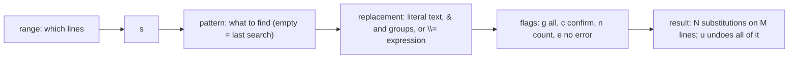

# Substitution: find and replace with `:s`

> **Before this lesson:** read [patterns and search](#/lesson/vim/vim-patterns-search) for how to describe text with a pattern, and [command-line mode](#/lesson/vim/vim-command-line) for what an Ex command and a range are. Both are summarised again where they are needed here.

## In plain words

**Substitution** means "find this text and put that text in its place". Every word processor has a Find and Replace window that does it. Vim's version is a single typed command, `:s`, short for *substitute*.

An everyday comparison: a form letter. You have a letter that says "Dear CUSTOMER" in six places and you want every one of them to say "Dear Ms Okafor". You could walk through the letter and retype each one. Or you could give one instruction: "wherever it says CUSTOMER, write Ms Okafor". The substitute command is that instruction, with extras: you can say *which lines* it applies to, ask to be consulted on each replacement, re-use parts of what was found, and even compute the replacement.

Why it matters at work: renaming a variable throughout a file, changing a date format in a data export, turning a list of names into code, fixing the same typo in two hundred places. These are daily tasks, and one well-formed `:s` command does each of them in a second, in a way you can check, undo and repeat.

Two terms from earlier lessons, restated. An **Ex command** is a command typed on the line that opens at the bottom of the screen when you press `:`. A **range** is the part in front of an Ex command that says which lines it should act on.

In the tables, `[x]` marks the cursor and `<CR>` is the Enter key.

## The shape of the command

```text
:[range]s/{pattern}/{replacement}/[flags]
```

| Part | Meaning | If left out |
|---|---|---|
| `range` | which lines to work on | only the line the cursor is on |
| `pattern` | what to look for (a pattern, exactly as in a search) | the pattern of the last search |
| `replacement` | what to put there | nothing: the match is deleted |
| `flags` | single letters that adjust the behaviour | replace only the **first** match on each line, without asking |

The slashes are separators. The parts in square brackets are optional; you do not type the brackets.

### The simplest case

| Before | Command | After |
|---|---|---|
| `[c]olour and colour` | `:s/colour/color/` | `[c]olor and colour` |

Two things to notice. Only the current line was touched. And only the **first** match on it changed; the second `colour` is still there. Both are defaults, and the next two sections change them one at a time.

### Every match on the line: the `g` flag

| Before | Command | After |
|---|---|---|
| `[c]olour and colour` | `:s/colour/color/g` | `[c]olor and color` |

`g` stands for *global* and here means "all matches on the line, not only the first".

### Every line: a range

| Range | Lines |
|---|---|
| (none) | the current line |
| `%` | every line of the file |
| `5,12` | lines 5 to 12 |
| `.,$` | from the current line to the last |
| `'<,'>` | the lines of the last Visual selection (Vim types this for you when you press `:` with text selected) |

Putting the two together gives the command people mean when they say "replace all":

```text
:%s/colour/color/g
```

Read it aloud as: on every line (`%`), substitute (`s`) `colour` with `color`, every time it appears (`g`).

| Before | Command | After |
|---|---|---|
| `colour = "red"`<br>`print(colour, colour)`<br>`# no match here` | `:%s/colour/color/g` | `color = "red"`<br>`print(color, color)`<br>`# no match here` |

Vim reports what it did at the bottom of the screen: `3 substitutions on 2 lines`.

## The flags

| Flag | Meaning |
|---|---|
| `g` | all matches on each line |
| `c` | **confirm**: ask before each replacement |
| `n` | **count only**: report the number of matches and change nothing |
| `e` | no error message if the pattern is not found (useful in scripts) |
| `i` / `I` | ignore case / respect case for this command |
| `&` | re-use the flags of the previous substitution (must be the first flag) |

Flags combine: `:%s/old/new/gc` means every match, on every line, asking each time.

### Being asked: the `c` flag

With `c`, Vim highlights each match in turn and shows a prompt:

```text
replace with new (y/n/a/q/l/^E/^Y)?
```

| Answer | Meaning |
|---|---|
| `y` | yes, replace this one |
| `n` | no, skip this one |
| `a` | replace this and **all** remaining matches without asking again |
| `q` | quit: stop here |
| `l` | replace this one and then stop ("last") |
| `<C-e>` / `<C-y>` | scroll the screen to see more context |

This is the careful person's "replace all". You still give one command, but nothing changes that you did not approve.

### Looking before you leap: the `n` flag

`:%s/TODO//gn` prints something like `7 matches on 5 lines` and changes nothing. Use it to check that a pattern finds what you expect before you run the real substitution.

## Special items in the replacement

The replacement is mostly plain text, with a few items that have a special meaning.

| In the replacement | Inserts |
|---|---|
| `&` or `\0` | the whole text that was matched |
| `\1`, `\2`, … `\9` | what the first, second, … group of the pattern matched |
| `\r` | a line break |
| `\t` | a tab character |
| `\\` | one backslash |
| `\&` | a real `&` character |
| `~` | the replacement text of the previous substitution |
| `\u` / `\l` | make the next character upper / lower case |
| `\U` / `\L` … `\E` | make everything upper / lower case until `\E` |
| `\={expression}` | the result of evaluating a piece of Vim script |

A **group** is a part of the pattern wrapped in parentheses; Vim remembers what each group matched. (In the examples below the patterns start with `\v`, "very magic" mode from the previous lesson, so that parentheses and `+` can be written without backslashes.)

### Re-using the whole match: `&`

Wrap every number in square brackets:

| Before | Command | After |
|---|---|---|
| `ports 80 and 443` | `:s/\v\d+/[&]/g` | `ports [80] and [443]` |

`\d+` matches a run of digits; `&` in the replacement stands for whichever digits were found.

### Rearranging with groups

A file of names is written `surname, forename` and should be `forename surname`.

| Before | Command | After |
|---|---|---|
| `Okafor, Ada`<br>`Lindqvist, Tove` | `:%s/\v(\w+), (\w+)/\2 \1/` | `Ada Okafor`<br>`Tove Lindqvist` |

Piece by piece: `(\w+)` is one or more word characters, remembered as group 1; then a comma and a space; `(\w+)` again, remembered as group 2. The replacement writes group 2, a space, then group 1.

The same idea reorders columns of comma-separated data. To swap the first and third of three fields:

| Before | Command | After |
|---|---|---|
| `2026-11-20,deploy,ok`<br>`2026-11-21,rollback,failed` | `:%s/\v^([^,]*),([^,]*),([^,]*)$/\3,\2,\1/` | `ok,deploy,2026-11-20`<br>`failed,rollback,2026-11-21` |

`[^,]*` means "any number of characters that are not a comma", which is one field. `^` and `$` pin the pattern to the start and end of the line.

### Changing case

| Before | Command | After |
|---|---|---|
| `status: active` | `:s/\v(\w+)$/\U\1/` | `status: ACTIVE` |
| `first second third` | `:s/\v<\w/\u&/g` | `First Second Third` |

In the second row `<\w` matches the first character of each word, and `\u&` writes it back in upper case.

### Splitting and joining lines

| Before | Command | After |
|---|---|---|
| `a, b, c` | `:s/, /\r/g` | `a`<br>`b`<br>`c` |
| `a`<br>`b`<br>`c` (all three lines in the range) | `:%s/\n/, /` | `a, b, c, ` |

There is an asymmetry to remember: in the **pattern**, a line break is written `\n`; in the **replacement**, it is written `\r`.

## Re-using the last search

If the pattern is left empty, `:s` uses the pattern of your most recent search. This leads to a very comfortable two-step way of working:

| Step | Keys | Purpose |
|---|---|---|
| 1 | `/\v<tmp_\w+><CR>` | search first; with highlighting on you can **see** exactly what matches |
| 2 | refine the search until the highlighting is right | |
| 3 | `:%s//value/g` | substitute with an empty pattern: "whatever I searched for last" |

Separating "what to find" from "what to do with it" means the complicated part, the pattern, is tested before anything is changed. If you want the pattern visible in the command, perhaps to keep it in your command history, press `<C-r>/` (Ctrl-R followed by a slash) at that point and Vim pastes the last search pattern in.

## Replacing with text you copied

To use yanked (copied) text as the replacement, the direct route is to paste it into the command with `<C-r>0`. That is fine for a plain word. If the yanked text contains `&`, `\` or a line break, those characters would be interpreted as special items. The robust form passes the register by *reference* instead:

```text
:%s//\=@0/g
```

`\=` says "the replacement is the result of an expression", and `@0` is how Vim script writes "the contents of register 0", the register that holds your last yank.

## Repeating a substitution

| Keys | Effect |
|---|---|
| `&` (in Normal mode) | repeat the last substitution on the current line, **without** its flags |
| `:&&` | repeat it on the current line **with** the same flags |
| `g&` | repeat it on **every line** with the same flags |
| `:'<,'>&&` | repeat it on the selected lines with the same flags |
| `u` | undo it |

`g&` rescues a common slip. You typed `:s/old/new/g` and only afterwards realised you had wanted the whole file. There is no need to retype anything: `g&` reruns the same substitution on all lines.

## Computed replacements: `\=`

When the replacement starts with `\=`, the rest is a Vim script **expression**, a small calculation whose result becomes the replacement. Inside it, the function `submatch(0)` gives the whole match and `submatch(1)`, `submatch(2)` … give the groups.

### Arithmetic

Every service in a configuration file must move to a port 1000 higher.

| Before | Command | After |
|---|---|---|
| `web: port=8080`<br>`api: port=8081` | `:%s/\vport\=\zs\d+/\=submatch(0)+1000/` | `web: port=9080`<br>`api: port=9081` |

The pattern says: the text `port=` must be there (`\=` is a literal equals sign in very magic mode), the match proper starts after it (`\zs`), and is a run of digits. The replacement takes those digits as a number and adds 1000.

### Swapping two words

Swapping `true` and `false` cannot be done with two ordinary substitutions, because the first would turn every `true` into `false` and the second would then turn *all* of them into `true`. One substitution with a lookup table does it in a single pass:

```text
:%s/\v<(true|false)>/\={'true':'false','false':'true'}[submatch(0)]/g
```

`{'true':'false','false':'true'}` is a **dictionary**: a table that pairs each key with a value. Following it with `[submatch(0)]` looks up the word that was matched and returns its partner.

| Before | After |
|---|---|
| `debug = true`<br>`cache = false` | `debug = false`<br>`cache = true` |

The same three ideas, first match versus all, groups, and a computed replacement, exist in most programming languages. Here they are in Python, which you can run and change:

```python-run
import re

line = "colour and colour"
print(re.sub("colour", "color", line, count=1))        # like :s/colour/color/   (first match only)
print(re.sub("colour", "color", line))                 # like :s/colour/color/g  (every match)

names = "Okafor, Ada"
print(re.sub(r"(\w+), (\w+)", r"\2 \1", names))        # groups: \1 and \2

config = "web: port=8080, api: port=8081"
bump = lambda m: str(int(m.group(0)) + 1000)           # like \=submatch(0)+1000
print(re.sub(r"(?<=port=)\d+", bump, config))

flags = "debug = true, cache = false"
swap = {"true": "false", "false": "true"}
print(re.sub(r"\b(true|false)\b", lambda m: swap[m.group(0)], flags))
```

The first two lines of output show the effect of the `g` flag (Python's default is "all", so the first-only behaviour needs `count=1`). The third shows groups being rearranged. In the last two, the replacement is a function that receives each match and returns what to put in its place, which is Python's equivalent of `\=`.

## Across many files

A substitution works on one buffer. To apply it to a set of files, combine it with a command that visits each file.

| Step | Command | Meaning |
|---|---|---|
| 1 | `:set hidden` | allow Vim to leave a changed file without saving it first |
| 2 | `:args src/**/*.py` | put every Python file under `src` into the argument list (Vim's list of files being worked on) |
| 3 | `:argdo %s/\v<old_name>/new_name/ge` | run the substitution in each of them; `e` stops Vim complaining about files with no match |
| 4 | look through a few files | |
| 5 | `:wall` | write all changed files |

A more precise variant first collects only the files that contain a match, using the *quickfix list* (a list of search results, covered in the Tools module):

```text
:vimgrep /\v<old_name>/ src/**/*.py
:cfdo %s//new_name/g | update
```

`:vimgrep` finds every match and remembers the files; `:cfdo` runs a command once in each of those files; the empty pattern re-uses the search; `update` saves a file if it changed.

## Choosing a different separator

When the pattern or replacement contains slashes, as file paths do, every one would need a backslash. Any punctuation character can serve as the separator instead:

| Awkward | Clear |
|---|---|
| `:s/\/usr\/local\/bin/\/opt\/bin/` | `:s#/usr/local/bin#/opt/bin#` |



## Why it works

`:s` is an Ex command, so it follows the Ex grammar: a range, a command, arguments. Because the pattern is the same kind of pattern that `/` uses, and because the last search is remembered, searching and substituting are two halves of one activity: get the highlighting right, then act on it.

One whole `:s` command counts as a single change for undo purposes, however many lines it touched: one `u` restores everything.

Compared with the dot formula (`n` and `.`), a substitution trades visibility for reach. The dot formula shows you each place and suits a handful of scattered changes. `:%s/…/…/g` changes hundreds of places at once; add `c` when you want the veto back.

> [!TIP]
> A safe routine for any substitution that matters: search first and look at the highlighting; run the command with the `n` flag to see the count; run it for real; glance at the "N substitutions on M lines" message; and remember that `u` undoes it in one step.

> [!INTERVIEW]
> "Rename this identifier everywhere, but not where it is part of a longer name" is a standard practical task. The points to make: use word boundaries (`\<name\>`, or `\v<name>`), add the `c` flag or check with `n` when unsure, and know the limits. A text substitution cannot tell a variable from a word in a comment or a string; for a rename that must respect the language's rules, the language server's rename is the right tool.

## Pitfalls

- **Forgetting `g`.** Without it only the first match on each line changes, which is easy to miss in a long file.
- **Forgetting `%`.** Without a range only the current line is touched.
- **Matching inside longer words.** `:%s/id/key/g` turns `width` into `wkeyth`. Use word boundaries.
- **`&` and `~` in the replacement are special.** To insert a real ampersand write `\&`.
- **`\n` versus `\r`.** A line break is `\n` when you are looking for one and `\r` when you are inserting one.
- **A trailing separator is optional only when there are no flags.** `:s/a/b` works; with flags the third slash is required: `:s/a/b/g`.
- **`&` in Normal mode drops the flags.** After `:s/a/b/g`, pressing `&` on another line replaces only the first match there; `:&&` keeps the `g`.
- **Substituting twice to swap two words** destroys one of them. Use a single substitution with a lookup, as shown above.
- **Case.** `ignorecase` affects `:s` as it affects searches; add `I` to the flags (or `\C` to the pattern) when the exact case matters.

## Cheat sheet

| Task | Command |
|---|---|
| First match on this line | `:s/old/new/` |
| All matches on this line | `:s/old/new/g` |
| All matches in the file | `:%s/old/new/g` |
| In the selected lines | `:'<,'>s/old/new/g` |
| Ask each time | add `c` |
| Count without changing | `:%s/old//gn` |
| Whole words only | `:%s/\<old\>/new/g` |
| Re-use the last search as the pattern | `:%s//new/g` |
| Re-use the matched text | `&` in the replacement |
| Re-use a group | `\1` in the replacement |
| Insert a line break | `\r` in the replacement |
| Replace with the last yank | `:%s//\=@0/g` |
| Compute the replacement | `\=submatch(0)+1` |
| Repeat on this line / on all lines | `:&&` / `g&` |
| Other separator | `:s#old#new#g` |
| In every file of the argument list | `:argdo %s/old/new/ge` then `:wall` |

## Summary

- `:[range]s/pattern/replacement/flags` replaces text. With no range it works on the current line; with no flags it replaces the first match per line.
- `%` means every line; `g` means every match on a line; `c` asks first; `n` only counts.
- In the replacement, `&` is the whole match, `\1`–`\9` are groups, `\r` is a line break, and `\=` introduces a computed value.
- An empty pattern re-uses the last search, so you can perfect the pattern with `/` and then substitute.
- `&`, `:&&` and `g&` repeat the last substitution on a line, on a line with flags, and on the whole file.
- `:argdo` and `:cfdo` carry a substitution across many files.

## Glossary

| Term | Meaning |
|---|---|
| substitution | replacing text that matches a pattern with other text |
| Ex command | a command typed after pressing `:` |
| range | the lines an Ex command acts on, written in front of the command |
| flag | a letter after the last separator that changes how the command behaves |
| separator (delimiter) | the character, usually `/`, that divides the pattern, the replacement and the flags |
| group | a parenthesised part of a pattern whose matched text is remembered |
| back-reference | `\1`, `\2` … in the replacement: the text a group matched |
| expression | a small calculation in Vim script whose result is used as a value |
| `submatch(n)` | inside `\=`: the text matched by group `n`, or the whole match for `0` |
| dictionary | a table of key and value pairs, written `{'key': 'value'}` |
| argument list | Vim's list of the files you chose to work on |
| quickfix list | a list of locations, such as search results, that Vim can step through |

## Check yourself

```quiz
[
  {"q": "Line: 'a-b-c-d'. What does :s/-/+/ produce?",
   "options": ["a+b+c+d", "a+b-c-d", "a-b-c+d", "No change"],
   "answer": 1,
   "explain": "Without the g flag only the first match on the line is replaced."},
  {"q": "Which command replaces every occurrence of foo with bar in the whole file?",
   "options": [":s/foo/bar/g", ":%s/foo/bar/", ":%s/foo/bar/g", ":g/foo/bar/"],
   "answer": 2,
   "explain": "The % range covers every line and the g flag covers every match on each line. The first lacks the range, the second lacks the flag, and the fourth is not a substitution."},
  {"q": "Line: 'width=10 height=20'. Which command produces 'width=<10> height=<20>'?",
   "options": [":s/\\v\\d+/<&>/g", ":s/\\v\\d+/<\\1>/g", ":s/\\v\\d+/<>/g", ":s/\\v\\d+/<&>/"],
   "answer": 0,
   "explain": "& in the replacement stands for the whole match. \\1 would be empty because the pattern has no group, and without g only the first number would change."},
  {"q": "Lines such as 'Mar 14' should become '14 Mar'. Which command does that for the whole file?",
   "options": [":%s/\\v(\\a+) (\\d+)/\\2 \\1/", ":%s/\\v(\\a+) (\\d+)/\\1 \\2/", ":%s/\\v\\a+ \\d+/\\2 \\1/", ":s/(\\a+) (\\d+)/\\2 \\1/"],
   "answer": 0,
   "explain": "Two groups capture the month and the day; the replacement writes them in the opposite order. The third option has no groups, and the fourth lacks both the range and the very magic switch."},
  {"q": "You want to see how many times 'deprecated' occurs without changing the file. Which command?",
   "options": [":%s/deprecated//g", ":%s/deprecated//gn", ":%s/deprecated/&/c", ":g/deprecated/d"],
   "answer": 1,
   "explain": "The n flag counts matches and makes no change. The first would delete every occurrence."},
  {"q": "A moment ago you ran :s/old/new/g on one line and realise it should apply to the entire file. What is the shortest way?",
   "options": ["&", "g&", ":&&", "u then retype with %"],
   "answer": 1,
   "explain": "g& repeats the last substitution on every line with the same flags. & and :&& act on the current line only."},
  {"q": "Line: 'one,two,three'. Which command puts each item on its own line?",
   "options": [":s/,/\\n/g", ":s/,/\\r/g", ":s/,/<CR>/g", ":s/\\r/,/g"],
   "answer": 1,
   "explain": "In the replacement a line break is written \\r. \\n in the replacement inserts a null character instead."},
  {"q": "In :%s//done/g the pattern is empty. What does Vim use?",
   "options": ["It matches every character", "The pattern of the most recent search", "The word under the cursor", "It reports an error"],
   "answer": 1,
   "explain": "An empty pattern means 'the last search pattern', which lets you build and check the pattern with / first."}
]
```

> **Source:** Neil, Practical Vim 2e, tips 88–97 (ch. 14, "Substitution"). Examples and wording are original.
