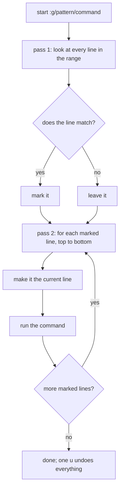

# The global command: do this on every line that matches

> **Before this lesson:** you need [command-line mode and Ex commands](#/lesson/vim/vim-command-line) (what `:d`, `:t`, `:m`, `:normal` and ranges are), [patterns](#/lesson/vim/vim-patterns-search) and [substitution](#/lesson/vim/vim-substitute). Each is recalled briefly when it is used.

## In plain words

The **global command**, written `:g`, combines two things you already know: a *pattern* that picks out lines, and a *command* to carry out on each of the lines picked.

Picture a teacher with a stack of exam papers and a highlighter. First pass: go through the whole stack and put a mark on every paper that has no name written on it. Second pass: do the same thing to each marked paper, say, put it in a separate tray. Selecting first and acting second is exactly how `:g` works. You say what to look for and what to do; Vim finds every line that qualifies and then does the job on each one.

Why it matters at work: "delete every line that contains DEBUG", "keep only the lines with ERROR", "copy all the TODO comments to the end of the file", "sort the entries inside every section". Each of those is a single `:g` command. It is one of the features that most clearly sets Vim apart from ordinary editors, and it is the direct ancestor of the Unix tool `grep`, whose name comes from the old editor command `g/re/p`: **g**lobally search for a **r**egular **e**xpression and **p**rint the matching lines.

Reminders of terms used below. An **Ex command** is a command typed after pressing `:`. A **pattern** is a description of text to look for. A **range** names the lines a command applies to; `%` means every line. `<CR>` is the Enter key.

## The shape of the command

```text
:[range]g/{pattern}/{command}
:[range]v/{pattern}/{command}
```

| Part | Meaning | If left out |
|---|---|---|
| `range` | the lines to examine | **the whole file** (unlike most Ex commands, which default to the current line) |
| `pattern` | lines containing a match are selected | the pattern of the last search |
| `command` | an Ex command to run on each selected line | `:print`, which shows the line |

`:v` is the **inverse**: it selects the lines that do **not** match. (The letter comes from the old name *inVert*; it can also be written `:g!`.)

## The smallest example: show the matching lines

Take this buffer:

```text
1  import os
2  # TODO: remove unused import
3  import sys
4
5  def main():
6      pass  # TODO: implement
```

| Command | What you see | Why |
|---|---|---|
| `:g/TODO` | lines 2 and 6 printed at the bottom of the screen | no command was given, so each selected line is printed |
| `:g/import/` | lines 1, 2 and 3 | line 2 contains the word too |
| `:g/^import/` | lines 1 and 3 | `^` means "at the start of the line" |
| `:v/import/` | lines 4, 5 and 6 | the lines **without** a match |

Nothing in the buffer changes. This is a quick way to get an overview, "show me every function definition", and it is `grep` running inside your editor.

## Deleting lines

The Ex command `:d` (short for *delete*) removes a line. Paired with `:g` it removes every line that matches; paired with `:v` it removes every line that does not.

| Before | Command | After |
|---|---|---|
| `x = load()`<br>`print("DEBUG", x)`<br>`y = clean(x)`<br>`print("DEBUG", y)`<br>`save(y)` | `:g/DEBUG/d` | `x = load()`<br>`y = clean(x)`<br>`save(y)` |
| `INFO  started`<br>`ERROR disk full`<br>`INFO  retrying`<br>`ERROR gave up` | `:v/ERROR/d` | `ERROR disk full`<br>`ERROR gave up` |
| `alpha`<br>(empty line)<br>`beta`<br>(empty line)<br>`gamma` | `:g/^$/d` | `alpha`<br>`beta`<br>`gamma` |
| lines, some containing only spaces or tabs | `:g/^\s*$/d` | every blank-looking line removed |

In the third row `^$` means "start of line immediately followed by end of line", an empty line. In the fourth, `\s*` allows any amount of white space in between.

"Keep only the lines that match" (`:v/pattern/d`) is the one to remember for log files: one command reduces ten thousand lines to the forty you care about, and `u` brings the rest back.

## How it works: two passes

The exam-paper picture is accurate in detail. `:g` runs in two separate stages:

1. **Mark.** Vim examines every line in the range and puts an internal mark on each one that matches the pattern.
2. **Execute.** Vim visits the marked lines one after another, from top to bottom. For each, it makes that line the current line and runs the command.



The separation matters whenever the command adds or moves lines, because lines created during the second pass were never marked and so are not processed again. Two examples show the consequences.

### Copying matches to the end

`:t` is the Ex command "copy this line **t**o below the given line"; `$` means the last line.

| Before | Command | After |
|---|---|---|
| `step one`<br>`NOTE check disk`<br>`step two`<br>`NOTE tell ops` | `:g/NOTE/t$` | `step one`<br>`NOTE check disk`<br>`step two`<br>`NOTE tell ops`<br>`NOTE check disk`<br>`NOTE tell ops` |

The copies at the end contain `NOTE` as well. If Vim tested lines while it worked, it would copy the copies for ever. Because marking finished first, only the two original lines are processed.

### Reversing a file

`:m` is "**m**ove this line to below the given line", and line `0` is the imaginary line above the first.

| Before | Command | After |
|---|---|---|
| `one`<br>`two`<br>`three` | `:g/^/m0` | `three`<br>`two`<br>`one` |

The pattern `^` (start of line) matches every line, so all three are marked. Then, in order: `one` is moved to the top (no visible change); `two` is moved to the top, above `one`; `three` is moved to the top, above `two`. Each line in turn jumps the queue, and the result is the original order reversed.

The model below reproduces both passes for three commands, so that you can trace them.

```python-run
import re

def global_command(lines, pattern, action):
    """Two-pass :g. `action` is 'print', 't$' (copy to end) or 'm0' (move to top)."""
    # Pass 1: mark. Each line is tagged once, before anything changes.
    tagged = [[text, re.search(pattern, text) is not None] for text in lines]
    marked = [item for item in tagged if item[1]]
    # Pass 2: execute on each marked line, in the original order.
    printed = []
    for item in marked:
        if action == "print":
            printed.append(item[0])
        elif action == "t$":
            tagged.append([item[0], False])          # the copy is NOT marked
        elif action == "m0":
            tagged.remove(item)
            tagged.insert(0, item)
    return printed if action == "print" else [text for text, _ in tagged]

notes = ["step one", "NOTE check disk", "step two", "NOTE tell ops"]
print(":g/NOTE/     ", global_command(notes, "NOTE", "print"))
print(":g/NOTE/t$   ", global_command(notes, "NOTE", "t$"))
print(":g/^/m0      ", global_command(["one", "two", "three"], "^", "m0"))
print(":g/NOTE/m0   ", global_command(notes, "NOTE", "m0"))
```

The last line of output is worth a look: moving only the `NOTE` lines to the top also reverses *their* order, for the same queue-jumping reason.

## Other commands to pair with `:g`

Any Ex command can follow the pattern. These pairings come up again and again.

### Collecting lines into a register

A **register** is a named storage slot for text; `:yank A` (capital letter) *appends* the current line to register `a`.

| Step | Command | Meaning |
|---|---|---|
| 1 | `qaq` | empty register `a` (it records an empty macro into it) |
| 2 | `:g/TODO/yank A` | append every line containing `TODO` to the register |
| 3 | `:put a` | put the collected lines below the cursor, or switch to another file first |

This gathers scattered lines without disturbing the originals: every `TODO` in a source file pasted into your notes, every heading of a document pasted as an outline.

### Running Normal-mode keys

`:normal` types Normal-mode keys for you. With `:g` it types them on each selected line.

| Before | Command | After |
|---|---|---|
| `name = "ada"`<br>`# comment`<br>`age = 36` | `:g/=/normal A;` | `name = "ada";`<br>`# comment`<br>`age = 36;` |
| `def load():`<br>`    pass`<br>`def save():`<br>`    pass` | `:g/^def /normal O` | an empty line is opened above each `def` line |
| `- [ ] write tests`<br>`- [x] fix bug`<br>`- [ ] update docs` | `:g/\[ \]/normal f]hrx` | `- [x] write tests`<br>`- [x] fix bug`<br>`- [x] update docs` |

In the last row the keys are `f]` (move onto the closing bracket), `h` (one step left, onto the space between the brackets) and `rx` (replace that character with `x`). `:g/pattern/normal @q` runs a recorded macro on every matching line in the same way.

### Substituting only on certain lines

A substitution after `:g` is applied to the selected lines only. This lets one pattern decide **which lines** and another decide **what to change**.

| Before | Command | After |
|---|---|---|
| `size = 10  # px`<br>`# size = 20`<br>`size = 30  # px` | `:g/^#/s/size/SIZE/` | only the comment line changes: `# SIZE = 20` |
| the same | `:v/^#/s/\d\+/0/` | the two lines that are **not** comments get `0` in place of the number |

### Indenting, moving, joining

| Command | Effect |
|---|---|
| `:g/pattern/>` | indent each matching line by one step |
| `:g/pattern/m$` | move the matching lines to the end, keeping their order |
| `:g/pattern/j` | join each matching line with the line after it |
| `:g/pattern/d _` | delete into the "black hole" register, so that your registers are left alone and large deletions are faster |

## A range inside the command: acting on a block

The command after the pattern may have its own range, measured from each matching line. That turns `:g` into "for every block that starts with this pattern, do something to the block".

A range of the form `.+1,/^$/-1` reads: from the line after the current one (`.+1`), down to the line before the next empty line (`/^$/` finds the next empty line and `-1` steps back one).

A settings file has sections whose entries should be in alphabetical order:

```text
[server]
port = 8080
host = localhost
debug = false

[database]
user = app
name = shop
```

```text
:g/^\[/ .+1,/^$/-1 sort
```

Read aloud: on every line that starts with an opening square bracket (`^\[`, a section heading), take the lines from the one below it to the one before the next empty line, and `sort` them.

Result:

```text
[server]
debug = false
host = localhost
port = 8080

[database]
name = shop
user = app
```

For this to work every section must be followed by an empty line, including the last one; otherwise the search for `^$` has nothing to find below the last heading. The same recipe sorts the properties inside each rule of a style sheet (`:g/{/ .+1,/}/-1 sort`), or the imports inside each group.

## Restricting where `:g` looks

A range in front of `:g` limits the lines that are examined:

| Command | Meaning |
|---|---|
| `:10,50g/print/d` | delete lines containing `print`, but only between lines 10 and 50 |
| `:'<,'>g/^$/d` | delete empty lines inside the Visual selection |
| `:.,$v/\S/d` | from here to the end, delete every line that has no non-blank character |

## Several commands at once

A vertical bar joins Ex commands. After `:g`, everything to the end of the line, bars included, belongs to the command that is run on each matching line. For example, `:g/^Chapter/t$` copies each chapter heading to the end, and writing `:g/^Chapter/ s/^/# / | t$` would first put `# ` in front of each heading and then copy the changed heading to the end.

## Why it works

`:g` is the third layer of the Ex grammar. A plain Ex command is *range + command*: "on these lines, do this". `:normal` lets the command be Normal-mode keys. `:g` puts a **filter** in front: "on the lines *that match*, do this". Because the pieces are independent, every Ex command, every Normal-mode key sequence and every macro becomes something you can aim at a set of lines chosen by content instead of by position.

Like any Ex command, one `:g` is a single undo step. However many lines it changed, one `u` restores them all, which makes it safe to experiment.

> [!TIP]
> Run the `:g/pattern/` part on its own first, with no command. Vim prints the lines that would be affected. When the list is right, press `:` and the up-arrow key to recall the command and add the action at the end.

> [!TIP]
> This site's editor has a Vim mode (⚙ settings menu) that understands `:g` and `:v` with the most common commands, though not every Ex command of real Vim. Paste the log example above and try `:v/ERROR/d` followed by `u`.

> [!INTERVIEW]
> Two questions the global command answers neatly: "how would you filter a large log to the relevant lines without leaving your editor?" (`:v/pattern/d`, or `:g/pattern/` to look without changing anything) and "where does the name grep come from?" (the editor command `g/re/p`). Mentioning that `:g` marks lines first and acts second shows you understand why commands like `:g/^/m0` behave as they do.

## Pitfalls

- **`:g` defaults to the whole file.** Most Ex commands default to the current line, so it is easy to delete far more than intended. Give a range when you mean part of the file.
- **Testing a destructive command blind.** Print first (`:g/pattern/`), then act.
- **A pattern that is too loose.** `:g/log/d` also deletes lines containing `catalog` or `login`. Use word boundaries: `:g/\<log\>/d`.
- **`:g/pattern/normal …` uses your key mappings.** Write `normal!` when the keys must have their built-in meaning.
- **The bar belongs to `:g`.** In `:g/a/d | echo "done"` the `echo` runs once per matching line, not once at the end.
- **Block ranges need their end marker.** `.+1,/^$/-1` fails for a block that is not followed by an empty line.
- **`:g` with `:s` and the `g` flag are different g's.** In `:g/x/s/a/b/g` the first selects lines, the last means "every match on the line".
- **Deleting thousands of lines fills the registers.** `:g/pattern/d _` avoids it.

## Cheat sheet

| Task | Command |
|---|---|
| Show lines that match | `:g/pattern/` |
| Show lines that do not match | `:v/pattern/` |
| Delete lines that match | `:g/pattern/d` |
| Keep only lines that match | `:v/pattern/d` |
| Delete empty lines | `:g/^$/d` |
| Delete blank lines (spaces only, too) | `:g/^\s*$/d` |
| Copy matching lines to the end | `:g/pattern/t$` |
| Move matching lines to the end | `:g/pattern/m$` |
| Reverse the file | `:g/^/m0` |
| Collect matching lines in register `a` | `qaq` then `:g/pattern/yank A` |
| Run keys on matching lines | `:g/pattern/normal {keys}` |
| Run a macro on matching lines | `:g/pattern/normal @q` |
| Substitute on matching lines only | `:g/pattern/s/old/new/g` |
| Sort the lines of each block | `:g/{start}/ .+1,/{end}/-1 sort` |
| Only within lines 10–50 | `:10,50g/pattern/…` |

## Summary

- `:g/pattern/command` runs an Ex command on every line that matches; `:v` (or `:g!`) on every line that does not.
- With no command the lines are printed, which is `grep` inside the editor and the safest way to preview.
- The default range is the whole file.
- It works in two passes, mark then execute, so lines created along the way are not processed again, and commands such as `:g/^/m0` have predictable results.
- Useful partners: `d`, `t`, `m`, `yank A`, `normal`, `s`, `>` and `sort`.
- The command may carry its own range relative to each matching line, which makes `:g` operate on blocks.
- Everything a single `:g` does is undone by one `u`.

## Glossary

| Term | Meaning |
|---|---|
| global command | `:g`, the Ex command that runs another command on every matching line |
| inverse global | `:v` or `:g!`, the same for lines that do not match |
| Ex command | a command typed after pressing `:` |
| pattern | a description of the text to look for |
| range | the lines a command applies to |
| mark (in this lesson) | Vim's internal note, made in the first pass, that a line matched |
| two-pass | selecting all lines first and acting on them afterwards |
| register | a named storage slot for text; a capital letter appends to it |
| `:normal` | the Ex command that types Normal-mode keys |
| black hole register | the register named `_`, which discards what is sent to it |
| grep | a Unix tool that prints lines matching a pattern, named after `g/re/p` |

## Check yourself

```quiz
[
  {"q": "A log file should be reduced to the lines that contain WARN. Which command does that?",
   "options": [":g/WARN/d", ":v/WARN/d", ":s/WARN//", ":g/WARN/"],
   "answer": 1,
   "explain": ":v selects the lines that do NOT match, and d deletes them, so only the WARN lines remain. :g/WARN/d would delete exactly the lines you want to keep."},
  {"q": "What does :g/TODO/ do when no command follows the pattern?",
   "options": ["Deletes the matching lines", "Prints the matching lines and changes nothing", "Jumps to the first match only", "Reports an error"],
   "answer": 1,
   "explain": "The default command is :print, so the matching lines are listed. That makes it a safe preview."},
  {"q": "Buffer lines: 'a', 'b', 'c', 'd'. What is the result of :g/^/m0 ?",
   "options": ["a b c d (unchanged)", "d c b a", "b c d a", "d a b c"],
   "answer": 1,
   "explain": "Every line is marked; each is then moved to the top in turn, so each later line ends up above the earlier ones. The buffer is reversed."},
  {"q": "With no range given, which lines does :g examine?",
   "options": ["Only the current line", "From the cursor to the end of the file", "Every line of the file", "The last Visual selection"],
   "answer": 2,
   "explain": "Unlike most Ex commands, :g defaults to the whole file."},
  {"q": "Which command appends a semicolon to every line that contains the word return?",
   "options": [":g/return/normal A;", ":g/return/s/;//", ":v/return/normal A;", ":normal A; /return/"],
   "answer": 0,
   "explain": ":normal A; types A; (append at end of line) on each line selected by :g. The :v version would do it on the lines without return."},
  {"q": "Why does :g/NOTE/t$ not loop for ever, even though each copied line also contains NOTE?",
   "options": ["Vim limits :g to 100 iterations", "Lines are marked in a first pass; the copies made in the second pass are not marked", "t$ does not copy the text, only a reference", "The copies are placed in a register, not the buffer"],
   "answer": 1,
   "explain": "Marking is complete before any command runs, so only the original matching lines are processed."},
  {"q": "You want every line containing FIXME collected into register a, leaving the buffer unchanged. Which sequence?",
   "options": [":g/FIXME/d a", "qaq then :g/FIXME/yank A", ":g/FIXME/yank a", ":v/FIXME/yank A"],
   "answer": 1,
   "explain": "qaq clears the register; yank with the capital letter appends each line. With a small a each yank would overwrite the previous one, leaving only the last line."},
  {"q": "What does :g/^#/s/foo/bar/g do?",
   "options": ["Replaces foo with bar everywhere in the file", "On lines that start with #, replaces every foo with bar", "Deletes lines starting with # that contain foo", "Replaces the first foo in the file only"],
   "answer": 1,
   "explain": "The :g part selects lines beginning with #; the substitution with its own g flag then replaces all matches on each of those lines."}
]
```

> **Source:** Neil, Practical Vim 2e, tips 98–101 (ch. 15, "Global Commands"). Examples and wording are original.
