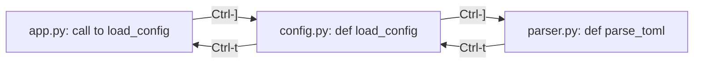
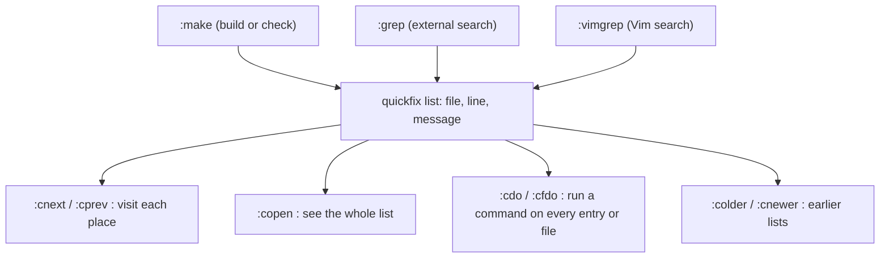

# Finding your way around a project: ctags, the quickfix list and grep

> **Before this lesson:** you should know how to [open files and move between buffers](#/lesson/vim/vim-buffers), how [jumps and `<C-o>`](#/lesson/vim/vim-jumps) work, and the basics of [search patterns](#/lesson/vim/vim-patterns-search) and [substitution](#/lesson/vim/vim-substitute). No knowledge of compilers or build tools is assumed.

## In plain words

So far every lesson has been about one file at a time. Real software is hundreds of files, and three questions come up all day long:

1. **"Where is this thing defined?"** You see a function being used and want to read the function itself.
2. **"Where does the tool say the problems are?"** You run a program that checks or builds your code and it prints a list of errors, each with a file name and a line number.
3. **"Where else is this text used?"** You want every place in the project that mentions a certain word.

Vim answers the first with an index and the other two with a list.

- An **index**, as at the back of a textbook: look up a term, get the page number. A program called `ctags` reads your source code and writes such an index to a file. Vim reads that file and can then jump from a name straight to where it is defined.
- A **to-do list of places**, like a building inspector's snag list: "kitchen, loose tile; bathroom, dripping tap". Vim calls it the **quickfix list**. Each entry is a file, a line and a message. Vim can walk you from entry to entry, opening the right file at the right line each time. Errors from a build tool and results from a text search both arrive as such a list.

Why it matters at work: reading unfamiliar code is most of a developer's first months in a job, and "jump to definition, come back" plus "show me every use" are the two movements it consists of. Modern editors do this through a *language server* (covered in the next module). The tools in this lesson are older, need no setup beyond one command, work on any machine including a bare server, and teach the ideas that the modern tools are built on.

`<C-]>` means: hold Ctrl and press `]`. `<CR>` is the Enter key.

## Part 1: ctags, an index of definitions

### What a tag is

A **tag** is a name that is defined somewhere in your code, such as a function, a class, a method or a variable, together with a note of where its definition is. A **tags file** is a plain text file listing every tag in a project, one per line, sorted by name.

The program that produces it is called **ctags**. The maintained version today is *Universal Ctags*, which understands well over a hundred programming languages. It is a separate program that you install once (through your system's package manager, for example `apt install universal-ctags` or `brew install universal-ctags`).

### Building the index

In a terminal, from the top directory of your project:

```text
ctags -R .
```

`-R` means *recursive*: look in this directory and every directory inside it. The result is a file named `tags`. You can run the same thing without leaving Vim, because `:!` runs a shell command: `:!ctags -R .`

Here are three lines from a tags file for a small Python project (a tab separates the columns):

```text
load_config	src/config.py	/^def load_config(path):$/;"	f
Order	src/models.py	/^class Order:$/;"	c
total	src/models.py	/^    def total(self):$/;"	m	class:Order
```

| Column | Content | In the first line |
|---|---|---|
| 1 | the tag's name | `load_config` |
| 2 | the file where it is defined | `src/config.py` |
| 3 | a search pattern that finds the defining line | the line `def load_config(path):` |
| 4 onward | extra facts | `f` for function; `c` class; `m` method (member) |

The third column is a search and not a line number on purpose: if you add lines above the definition, a number would be wrong but the search still finds it.

### Jumping to a definition and back

| Keys or command | Effect |
|---|---|
| `<C-]>` | jump to the definition of the name under the cursor |
| `<C-t>` | go back to where you were before that jump |
| `g<C-]>` | if several definitions share the name, show a numbered list to choose from; if only one, jump |
| `:tag {name}` | jump to the definition of `{name}` (press `<Tab>` to complete the name) |
| `:tjump {name}` | like `g<C-]>` but for a typed name |
| `:tag /{pattern}` | jump to a tag whose name matches a pattern |
| `:tselect`, `:tnext`, `:tprev` | choose among, or step through, several matches |
| `<C-w>]` | jump to the definition in a new split window |
| `:tags` | show the trail of tag jumps you have made |

A worked trail through three files:

| Step | You are in | Cursor on | Keys | You land in |
|---|---|---|---|---|
| 1 | `app.py` | `load_config` in the line `cfg = load_config("app.toml")` | `<C-]>` | `src/config.py`, on `def load_config(path):` |
| 2 | `src/config.py` | `parse_toml` inside that function | `<C-]>` | `src/parser.py`, on `def parse_toml(text):` |
| 3 | `src/parser.py` | | `<C-t>` | back in `src/config.py`, where you were |
| 4 | `src/config.py` | | `<C-t>` | back in `app.py`, on the original line |

Vim keeps these jumps on a **tag stack**. A stack is a pile where you add to the top and take from the top, like a pile of plates: `<C-]>` puts your current position on the pile and `<C-t>` takes the most recent one off and returns you there. Tag jumps are also ordinary jumps, so `<C-o>` works too.



### Keeping the index fresh

The tags file is a snapshot. When you add or rename a function, the index is out of date until `ctags` runs again. Three levels of automation:

| Approach | How |
|---|---|
| by hand | a key that runs the command, for example `:nnoremap <F5> :!ctags -R .<CR>` |
| on every save | an *autocommand* (a rule that runs a command when an event happens): `:autocmd BufWritePost * call system("ctags -R .")` |
| with version control | scripts called *hooks* that the Git version-control system runs after operations such as a checkout or a merge |

Vim finds tags files through the `tags` setting. The value `./tags;,tags` means: look for a file named `tags` next to the current file, then in each parent directory going upward (that is what the semicolon does), then in Vim's working directory.

### What ctags does not know

ctags reads text; it does not understand the language deeply. If two classes each have a method named `save`, the index lists both and cannot tell which one a particular call refers to. That is when `g<C-]>` shows a list. Language servers resolve this properly, at the cost of more setup. Many people use both: the language server where it is available and ctags everywhere else.

## Part 2: the quickfix list

### A list of places

Many tools report problems as lines of text in a common shape:

```text
src/models.py:14:9: undefined name 'totl'
src/app.py:3:1: 'sys' imported but unused
```

Each line says: this file, this line, this column, this message. The **quickfix list** is Vim's built-in way of holding such a list and walking through it.

| Command | Effect |
|---|---|
| `:copen` | open the **quickfix window**, a window showing the list |
| `:cclose` | close that window |
| `:cwindow` | open it only if the list has entries |
| `:cnext` (`:cn`) | go to the next entry: Vim opens the file and puts the cursor on the line |
| `:cprev` (`:cp`) | go to the previous entry |
| `:cfirst` / `:clast` | first / last entry |
| `:cc 5` | entry number 5 |
| `:cnfile` / `:cpfile` | first entry in the next / previous **file** |
| `:colder` / `:cnewer` | switch to an earlier / later list (Vim remembers the last ten) |

In the quickfix window itself, pressing `<CR>` on a line jumps to that entry.

Stepping through a list is so frequent that most people give `:cnext` and `:cprev` short keys, for example:

```vim
nnoremap ]q :cnext<CR>
nnoremap [q :cprev<CR>
```

### Filling the list from a build or check: `:make`

`:make` runs an external program, captures what it prints, and turns every line it recognises into a quickfix entry. Two settings control it:

| Setting | Meaning |
|---|---|
| `makeprg` | the program to run (by default the build tool `make`) |
| `errorformat` | a description of what the program's messages look like, so Vim can pick out the file name, line and message |

You rarely write an `errorformat` yourself. Vim ships ready-made combinations called **compiler plugins**, selected with `:compiler {name}`. To check a Python file with the `pylint` checker, for instance:

| Step | Command | What happens |
|---|---|---|
| 1 | `:compiler pylint` | sets `makeprg` and `errorformat` for that tool |
| 2 | `:make %` | runs it on the current file (`%` stands for the current file's name) and jumps to the first problem |
| 3 | fix the problem | |
| 4 | `:cnext` | jump to the next problem |
| 5 | repeat until `:cnext` says there are no more | |
| 6 | `:make %` again | confirm the list is now empty |

If you do not want the automatic jump to the first entry, type `:make!` with an exclamation mark.

The part of this that looks like magic, turning a tool's output into a list, is plain text processing. This model does it for the common `file:line:column: message` shape:

```python-run
import re

output = """\
src/models.py:14:9: undefined name 'totl'
checking src/app.py ...
src/app.py:3:1: 'sys' imported but unused
src/app.py:27:5: local variable 'tmp' is assigned to but never used
2 files checked
"""

# What Vim's errorformat  %f:%l:%c: %m  means, written as a regular expression:
#   %f = file name, %l = line number, %c = column number, %m = message
PATTERN = re.compile(r"^(?P<file>[^:]+):(?P<line>\d+):(?P<col>\d+): (?P<msg>.*)$")

quickfix = []
for text in output.splitlines():
    m = PATTERN.match(text)
    if m:                                   # lines that do not fit the shape are ignored
        quickfix.append((m["file"], int(m["line"]), int(m["col"]), m["msg"]))

for number, (f, line, col, msg) in enumerate(quickfix, start=1):
    print(f"{number}. {f} line {line} col {col}: {msg}")

files = sorted({entry[0] for entry in quickfix})
print("files touched (what :cfdo would visit):", files)
```

The output lists three entries; the two lines that are not error messages were skipped. The final line previews an idea used below: the list also tells you *which files* are involved.

### The location list

There is only one quickfix list at a time for the whole of Vim. A **location list** is the same thing attached to a single window, so that two windows can each have their own. Every quickfix command has a twin that starts with `l` instead of `c`: `:lmake`, `:lgrep`, `:lopen`, `:lnext`, `:lprev`.

## Part 3: searching the whole project

### `:vimgrep`: search with Vim's own patterns

```text
:vimgrep /{pattern}/[g] {files}
```

searches the named files and puts every match into the quickfix list.

| Command | Meaning |
|---|---|
| `:vimgrep /TODO/ **/*.py` | lines containing `TODO` in every Python file here and below (`**` means "any depth of directories") |
| `:vimgrep /TODO/g **/*.py` | with `g`, a line with two matches gives two entries instead of one |
| `:vimgrep /\v<load_config>/ src/**` | whole-word search using the "very magic" switch |
| `:vimgrep //g %` | an empty pattern re-uses your last search; `%` is the current file. A quick outline of where a word appears |
| `:vimgrep /pattern/ ##` | `##` stands for all the files in the argument list |

Because it uses Vim's pattern language, anything you worked out with `/` can be pasted in unchanged. Its weakness is speed: Vim loads each file to search it, which is slow for thousands of files.

### `:grep`: let an external program search

`:grep` hands the job to an external search program and reads its results into the quickfix list.

```text
:grep load_config src
```

The program is chosen by the `grepprg` setting. The classic choice is the Unix tool `grep`. A widely used modern alternative is **ripgrep** (the command `rg`), which is much faster and skips files that your version-control system ignores:

```vim
set grepprg=rg\ --vimgrep
set grepformat=%f:%l:%c:%m
```

The first line says "run `rg --vimgrep`" (the backslash keeps the space as part of the value); the second tells Vim how to read its output: file, line, column, message.

Two things differ from `:vimgrep`: the pattern is in the **external tool's** dialect, not Vim's, and the arguments are passed to a shell, so special characters may need quoting.

| | `:vimgrep` | `:grep` |
|---|---|---|
| Who searches | Vim itself | an external program (`grep`, `rg`, …) |
| Pattern language | Vim's | the tool's |
| Speed on big projects | slow | fast |
| Needs anything installed | no | yes, the tool |
| Results go to | the quickfix list | the quickfix list |

### From "find" to "change": `:cfdo` and `:cdo`

Because search results are a quickfix list, you can do more than read them.

| Command | Runs the given command |
|---|---|
| `:cdo {command}` | once on **each entry** (each matching line) |
| `:cfdo {command}` | once in **each file** that has at least one entry |

That gives a precise project-wide find and replace:

| Step | Command | Meaning |
|---|---|---|
| 1 | `:set hidden` | let Vim leave changed files without saving first |
| 2 | `:vimgrep /\v<load_config>/ **/*.py` | collect every place the name is used |
| 3 | `:copen` | look at the list; is it what you expected? |
| 4 | `:cfdo %s//read_config/g` | in each file on the list, replace the last search with the new name |
| 5 | `:cfdo update` | save each file that changed |

Step 4 uses an empty pattern, which means "the last search", which `:vimgrep` set in step 2. Only files that actually contain the name are opened and changed.



## Why it works

All three tools reduce a big question about a project to something Vim already knows how to handle.

- A tag is a stored *search*: "open this file and find this line". Jumping to a tag is a jump like any other, so the jump list and `<C-o>` apply, and the tag stack adds a tidy "return" on `<C-t>`.
- A quickfix entry is a stored *position with a note*. `:cnext` is the "next" key for a list of positions, in the same spirit as `n` for search matches and `;` for character searches. `:cdo` and `:cfdo` are to the quickfix list what `:argdo` is to the argument list: "run this everywhere on the list".

Seen this way, `:make`, `:grep` and `:vimgrep` are three ways of *producing* a list, and everything else is the same handful of commands for *consuming* it.

> [!TIP]
> Before a project-wide search, set a global mark with `mM`. The quickfix list will lead you through many files; `` `M `` brings you straight back afterwards.

> [!TIP]
> The quickfix window is a normal window containing text. You can search in it with `/`, and in recent versions of Vim and Neovim you can narrow a list with the bundled `:Cfilter` command (enable it with `:packadd cfilter`), for example `:Cfilter /test/` to keep only entries that mention tests.

> [!INTERVIEW]
> A question that reveals working habits: "You have joined a team with a large code base you have never seen. How do you find out how a feature works?" A concrete answer beats a vague one: search for a visible string from the feature (`:grep`), open the results as a list, jump to definitions and back (`<C-]>`/`<C-t>` or the language server), and keep notes of the path. Naming the trade-off between text search (finds everything, including comments, knows nothing about meaning) and symbol navigation (precise, needs an index) shows real experience.

## Pitfalls

- **A stale tags file** sends you to the wrong line or reports that a tag is not found. Re-run `ctags`.
- **Committing the tags file** to version control creates noise. Add `tags` to the project's ignore file.
- **`<C-]>` on a name with several definitions** silently picks the first. Use `g<C-]>` to see the choices.
- **`<C-t>` and `<C-o>` are different trails.** `<C-t>` undoes tag jumps only; `<C-o>` steps back through every kind of jump.
- **`:make` and `:grep` jump away from your file immediately.** Add `!` (`:make!`, `:grep!`) to stay put, or rely on `<C-o>`.
- **`:grep` goes through the shell.** A pattern containing spaces, quotes, `#`, `%` or a vertical bar needs quoting or escaping; `%` and `#` are replaced by file names unless escaped.
- **Mixing up `:cdo` and `:cfdo`.** `:cdo %s/…/…/g` would run the whole-file substitution once per matching *line*. Use `:cfdo` with file-wide commands and `:cdo` with single-line ones such as `s/…/…/`.
- **Starting a new search replaces the list.** The previous one is still reachable with `:colder`.
- **The quickfix list is a snapshot too.** After you edit, line numbers in later entries of the same file may be off by the lines you added or removed, although Vim adjusts them for changes made in loaded buffers.

## Cheat sheet

| Task | Keys or command |
|---|---|
| Build the tag index | `:!ctags -R .` |
| Jump to definition / back | `<C-]>` / `<C-t>` |
| Choose among several definitions | `g<C-]>` |
| Jump to a named tag | `:tag name` |
| Run the build or checker | `:make` |
| Pick a ready-made tool setup | `:compiler name` |
| Open / close the list window | `:copen` / `:cclose` |
| Next / previous entry | `:cnext` / `:cprev` |
| Next / previous file in the list | `:cnfile` / `:cpfile` |
| Earlier / later list | `:colder` / `:cnewer` |
| Search with Vim patterns | `:vimgrep /pat/g **/*.py` |
| Search with an external tool | `:grep pat dir` |
| Use ripgrep for `:grep` | `set grepprg=rg\ --vimgrep` |
| Run a command in every listed file | `:cfdo {cmd}` |
| Run a command on every listed line | `:cdo {cmd}` |
| The same, per window | replace `c` with `l`: `:lgrep`, `:lnext`, … |

## Summary

- `ctags` builds an index of where names are defined; `<C-]>` jumps to a definition and `<C-t>` returns, using a stack.
- The index is a snapshot and must be regenerated as code changes; it does not understand the language, so identically named definitions are listed together.
- The quickfix list holds positions with messages. `:make` fills it from a build or checking tool, using `makeprg` and `errorformat`, often set through `:compiler`.
- `:cnext`, `:cprev`, `:copen`, `:colder` and their relatives navigate the list; the location list is a per-window version.
- `:vimgrep` searches files with Vim's patterns; `:grep` delegates to a fast external tool chosen by `grepprg`.
- `:cfdo` and `:cdo` run a command across the files or lines of the list, which turns a project-wide search into a project-wide change.

## Glossary

| Term | Meaning |
|---|---|
| tag | a name defined in the code together with the location of its definition |
| tags file | the text file listing all tags of a project; the index Vim consults |
| ctags | the program that reads source code and writes a tags file |
| definition | the place in the code where a function, class or variable is created |
| tag stack | Vim's pile of positions you jumped from with `<C-]>`, unwound by `<C-t>` |
| quickfix list | a list of file positions with messages that Vim can step through |
| quickfix window | the window that displays the quickfix list |
| location list | a quickfix-style list belonging to one window |
| `makeprg` | the setting naming the program that `:make` runs |
| `errorformat` | the setting describing the shape of a tool's messages |
| compiler plugin | a bundled preset of `makeprg` and `errorformat` for one tool |
| linter (checker) | a program that inspects code for likely mistakes without running it |
| grep | a tool that finds lines matching a pattern in files |
| ripgrep (`rg`) | a fast modern replacement for `grep` |
| autocommand | a rule telling Vim to run a command when a given event occurs |
| shell | the program that interprets commands typed in a terminal |

## Check yourself

```quiz
[
  {"q": "The cursor is on a function name and a tags file exists. Which keys jump to the function's definition?",
   "options": ["<C-t>", "<C-]>", "gf", "<C-o>"],
   "answer": 1,
   "explain": "Ctrl-] looks the name up in the tags file and jumps to its definition. Ctrl-t returns from such a jump, and gf opens a file whose name is under the cursor."},
  {"q": "After following three definitions in a row with <C-]>, how many presses of <C-t> return you to the starting point?",
   "options": ["One", "Two", "Three", "It cannot be done with <C-t>"],
   "answer": 2,
   "explain": "Each tag jump pushes a position on the tag stack, and each Ctrl-t pops one, so three jumps need three returns."},
  {"q": "You renamed several functions an hour ago and now <C-]> lands on the wrong line or fails. What is the most likely fix?",
   "options": ["Restart Vim", "Regenerate the tags file with ctags -R", "Run :copen", "Set hidden"],
   "answer": 1,
   "explain": "The tags file is a snapshot of the code at the time ctags ran. It must be rebuilt after definitions change."},
  {"q": "What does each entry of the quickfix list contain?",
   "options": ["Only a file name", "A file, a position in it, and a message", "A macro", "A register name"],
   "answer": 1,
   "explain": "An entry is a location (file, line and usually column) with a piece of text such as an error message or the matching line."},
  {"q": "A checker reported five problems via :make. Which command takes you to the next one?",
   "options": [":next", ":cnext", ":bnext", "n"],
   "answer": 1,
   "explain": ":cnext moves to the next quickfix entry. :next is for the argument list, :bnext for the buffer list, and n repeats a search."},
  {"q": "Which statement about :vimgrep and :grep is correct?",
   "options": [":vimgrep uses an external program; :grep uses Vim's own search", ":vimgrep uses Vim's pattern language and is slower on large projects; :grep runs an external tool with that tool's pattern language", "Only :grep fills the quickfix list", "They are two names for the same command"],
   "answer": 1,
   "explain": "Both fill the quickfix list. The difference is who does the searching and therefore which pattern dialect and what speed you get."},
  {"q": "After :vimgrep /\\v<old>/ **/*.js, which command replaces the name in every file that contains it?",
   "options": [":cdo %s//new/g", ":cfdo %s//new/g", ":argdo %s//new/g", ":%s//new/g"],
   "answer": 1,
   "explain": ":cfdo runs the command once per file in the quickfix list. :cdo would run the whole-file substitution once for every matching line, and the plain substitution affects only the current file."},
  {"q": "You ran a second search and want the results of the first one back. Which command?",
   "options": [":colder", ":cprev", ":cclose", "u"],
   "answer": 0,
   "explain": "Vim keeps the last ten quickfix lists; :colder switches to the previous list and :cnewer forward again."}
]
```

> **Source:** Neil, Practical Vim 2e, tips 102–111 (ch. 16 "Index and Navigate Source Code with ctags", ch. 17 "Compile Code and Navigate Errors with the Quickfix List", ch. 18 "Search Project-Wide with grep, vimgrep, and Others"). Examples and wording are original.
