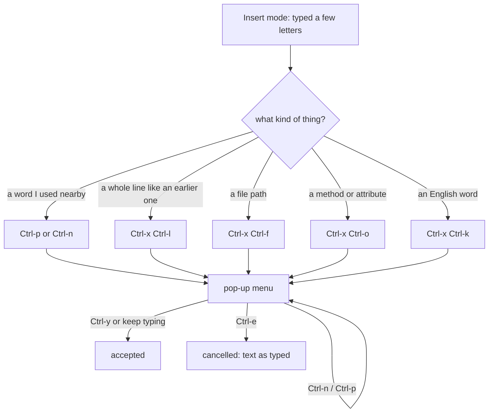

# Auto-completion and spell checking

> **Before this lesson:** you should be at ease in [Insert mode](#/lesson/vim/vim-insert-mode), because everything about completion happens while you are typing. The second half uses [motions](#/lesson/vim/vim-motions) and mentions the tags index from [the previous lesson](#/lesson/vim/vim-ctags-quickfix-grep).

## In plain words

**Auto-completion** is the editor finishing a word for you. You type the first few letters, press a key, and it offers the rest. A phone keyboard does the same when it suggests words above the keys.

A phone guesses from a large dictionary of the language. Vim's built-in completion works differently and, for writing code, better: its first source of suggestions is **the text you already have open**. Think of filling in a long form by hand where the same reference number is needed in ten boxes. You do not look it up ten times; you copy it from a box you already filled in. Code is like that form. The names you need, `customer_invoice_total`, `handle_connection_error`, have nearly always been typed before, somewhere in the files in front of you.

**Spell checking** is the editor marking words it does not find in a dictionary, as a word processor does with a red wavy line, and offering corrections.

Why they matter at work:

- Completion saves typing, but its real value is **accuracy**. A long name that was completed cannot contain a typing slip, and a misspelt variable name is one of the most common small bugs there is.
- Much of what developers write is not code: commit messages, comments, documentation, messages to colleagues. Spelling mistakes in those are read by other people. A spell checker that works in the same editor, with the same keys, removes an avoidable source of embarrassment.

`<C-n>` means: hold Ctrl and press `n`. All completion keys are typed **in Insert mode**, in the middle of typing. In the tables `‸` marks the insertion point, the place where the next typed character will appear.

## Keyword completion: `<C-n>` and `<C-p>`

A **keyword** here means a word made of letters, digits and underscores, the kind of word a variable name is.

| Key (in Insert mode) | Meaning |
|---|---|
| `<C-n>` | complete the word before the cursor; look for candidates **forward** (think *next*) |
| `<C-p>` | the same, looking **backward** first (think *previous*) |

Start with the simplest case. The buffer contains:

```text
retry_interval = 30
retry_limit = 5
wait(re‸
```

You have typed `re` and press `<C-n>`. Vim collects every keyword that starts with `re` and shows them in a small list under the cursor, called the **pop-up menu**:

```text
wait(retry_interval‸
     retry_interval
     retry_limit
```

The first candidate has been filled in. Pressing `<C-n>` again moves to the next candidate and replaces the text with it; `<C-p>` moves the other way. Carrying on typing accepts whatever is currently filled in.

Which of the two keys to press first is a small optimisation: the word you want is usually one you used a moment ago, a few lines **above**, so `<C-p>` tends to offer it first.

### Working the pop-up menu

| Key | Effect |
|---|---|
| `<C-n>` / `<C-p>` | move to the next / previous candidate **and put it into the text** |
| `<Down>` / `<Up>` (arrow keys) | move the highlight **without** changing the text |
| `<C-y>` | accept the highlighted candidate (*yes*) |
| `<C-e>` | close the menu and go back to what you had typed (*exit*) |
| any letter | accept the current text and keep typing |
| `<C-h>` or Backspace | delete one character and widen the list again |
| `<C-l>` | add one more character from the current candidate |

A technique for long lists: press `<C-n>` and then `<C-p>` straight away. The menu stays open but your text is back to the letters you typed, and from that state **each further letter you type narrows the list as you go**. With `re` typed and forty candidates, typing `t`, `r`, `y`, `_`, `l` shrinks the list until `retry_limit` is the only one left; `<C-y>` accepts it.

If you prefer the menu always to behave that way, this setting does it:

```vim
set completeopt=menuone,noselect
```

`menuone` shows the menu even when there is a single candidate; `noselect` means nothing is filled in until you choose.

### Where the candidates come from

Plain `<C-n>` / `<C-p>` look in several places. The list is held in the `complete` setting, whose default covers:

| Source | Meaning |
|---|---|
| the current buffer | the file you are typing in |
| buffers in other windows | files visible in other splits |
| other loaded buffers | every file you have open, visible or not |
| the tags file | every name in the project's index, if you built one with ctags |
| included files | files that the current file pulls in with statements such as `#include` |

This has a practical consequence: **to make a file's names available for completion, open the file.** If you are about to write code that uses a module, opening that module in a split is a quick way to load its vocabulary.

The mechanism is easy to model. The function below gathers the keywords of a buffer and returns the candidates for a prefix in the order `<C-p>` would offer them: nearest above the cursor first.

```python-run
import re

buffer_text = """\
retry_interval = 30
retry_limit = 5
result = fetch(retry_limit)
report(result)
re
"""

def candidates(lines, row, prefix):
    """Keywords starting with `prefix`, nearest above the cursor row first, each listed once."""
    seen, out = set(), []
    order = list(range(row - 1, -1, -1)) + list(range(len(lines) - 1, row, -1))   # upward, then wrap
    for r in order:
        for word in reversed(re.findall(r"\w+", lines[r])):                        # right to left
            if word.startswith(prefix) and word != prefix and word not in seen:
                seen.add(word)
                out.append(word)
    return out

lines = buffer_text.splitlines()
print("typed 're' on the last line, Ctrl-P offers:", candidates(lines, 4, "re"))
print("typed 'retry_l':                          ", candidates(lines, 4, "retry_l"))
```

The first line of output starts with `result` and `report`, the words closest above the cursor, and only then the earlier ones. The second shows how a longer prefix narrows the list to one.

## The completion family: `<C-x>` and a second key

Besides the general keys there is a set of specialised ones. Each starts with `<C-x>`, which tells Vim "a completion command follows", and then a second key that chooses the kind.

| Keys | Completes | Typical use |
|---|---|---|
| `<C-x><C-n>` | keywords from the **current buffer only** | a faster, narrower `<C-n>` |
| `<C-x><C-l>` | **whole lines** | repeating a line that is almost the same as an earlier one |
| `<C-x><C-f>` | **file names** | typing a path in a script or configuration file |
| `<C-x><C-]>` | names from the **tags** file | any name defined in the project |
| `<C-x><C-k>` | words from a **dictionary** | ordinary English words |
| `<C-x><C-o>` | **omni-completion**: suggestions that understand the language | methods of an object, attributes of a tag |
| `<C-x>s` | **spelling** suggestions for the word before the cursor | fixing a typo without leaving Insert mode |
| `<C-x><C-v>` | Vim commands | writing Vim configuration |

Once a menu is open, the same keys as before (`<C-n>`, `<C-p>`, `<C-y>`, `<C-e>`) operate it.



### Whole lines

Code is full of lines that differ from an earlier line in one word.

| Text so far | Keys | Result |
|---|---|---|
| `self.assert_valid(order.total)`<br>`self.ass‸` | `<C-x><C-l>` | `self.assert_valid(order.total)`<br>`self.assert_valid(order.total)‸` |

Then change the part that differs. Line completion matches on the start of the line, ignoring indentation.

### Sequences of words

After accepting a completed word, pressing the same completion keys again offers **the word that followed it** in the place it was copied from. Repeating this copies a run of words.

Suppose the buffer contains the phrase `the retry limit was exceeded` and on a new line you type `the r`:

| Keys | Text |
|---|---|
| `<C-x><C-p>` | `the retry` |
| `<C-x><C-p>` | `the retry limit` |
| `<C-x><C-p>` | `the retry limit was` |

The same works with `<C-x><C-l>` for consecutive lines: accept one line, press `<C-x><C-l>` again, and the line that came after it in the original place is offered.

### File names

| Text so far | Keys | Result |
|---|---|---|
| `config = load("conf‸` | `<C-x><C-f>` | a menu of files and directories whose names start with `conf` |
| `source ~/.co‸` | `<C-x><C-f>` | completes inside your home directory |

Paths are completed relative to Vim's **working directory** (the directory shown by `:pwd`), not relative to the file you are editing. If the path you are typing is relative to the file, either type it in full or change directory temporarily with `:cd %:h` and return with `:cd -`.

### Dictionary words

`<C-x><C-k>` completes ordinary words from a word list. The quickest way to give it one is to switch on spell checking (next part of this lesson), because Vim then uses the spelling dictionary. With `:set spell` on, typing `accom` and pressing `<C-x><C-k>` offers `accommodate`, `accompany`, `accomplish` and so on: useful for words you can never remember how to spell.

### Omni-completion

Everything so far treats text as words. **Omni-completion**, `<C-x><C-o>`, asks a helper that understands the language. After typing `text.` in a Python file it can offer the methods of a string; inside an HTML tag it offers valid attribute names; in a style sheet, property names.

It needs file-type support switched on (`filetype plugin on` in your configuration) and it is only as good as the helper for that language. In current setups the helper is usually a **language server**, a separate program that analyses your project and answers questions such as "what can follow this dot?". The *everyday engineering* module introduces language servers; when one is attached, `<C-x><C-o>` (or an automatic pop-up provided by a plugin) shows its answers.

## Spell checking

### Switching it on

| Command | Effect |
|---|---|
| `:set spell` | switch spell checking on for the current window |
| `:set nospell` | switch it off |
| `:set spelllang=en_gb` | choose the language and region (`en_us`, `en_gb`, `de`, `fr`, …) |
| `:setlocal spell spelllang=en_gb` | both at once, for this buffer only |

Words that are not in the dictionary are highlighted. Vim distinguishes a few cases by colour: words it does not know, words that should start with a capital letter, rare words, and words that are correct in another region (for example `color` when the language is British English).

In source code Vim checks only comments and text inside quotation marks, where the file type's syntax rules mark them, so variable names are not flagged.

### Moving between mistakes and fixing them

All of these are Normal-mode commands.

| Keys | Effect |
|---|---|
| `]s` | jump to the next misspelt word |
| `[s` | jump to the previous one |
| `z=` | show a numbered list of suggested corrections for the word under the cursor |
| `1z=` | take the first suggestion without showing the list |
| `zg` | mark the word as **good**: add it to your personal word list |
| `zw` | mark the word as **wrong**: flag it from now on |
| `zug` / `zuw` | undo a `zg` / `zw` |

A session on a short paragraph:

| Before | Keys | After |
|---|---|---|
| `[T]he servr restarts automaticaly after a failure.` | `]s` | cursor on `[s]ervr` |
| | `1z=` | `The [s]erver restarts automaticaly after a failure.` |
| | `]s` | cursor on `[a]utomaticaly` |
| | `z=` | a numbered list appears; type the number next to `automatically` and press Enter |
| | | `The server restarts [a]utomatically after a failure.` |

`1z=` is a gamble that the best guess is right. It usually is for simple slips; glance at the result, and press `u` if it chose badly.

### Your own words

Technical writing is full of words no dictionary knows: product names, abbreviations, the names of your team's services. `zg` on such a word adds it to your **spell file**, a personal list that Vim consults alongside the dictionary. The file lives in your Vim configuration directory and can be kept under version control and shared between machines.

You can keep more than one list, for example a general one and a project-specific one, by giving the `spellfile` setting two file names separated by a comma; `1zg` then adds to the first and `2zg` to the second.

### Fixing a typo without leaving Insert mode

You notice a slip a few words back while still typing. Two routes:

| Route | Keys | Notes |
|---|---|---|
| leave, fix, resume | `<Esc>[s1z=A` | escape, jump back to the misspelt word, take the first suggestion, and continue appending at the end of the line |
| stay in Insert mode | `<C-x>s` | Vim looks backward for the nearest misspelt word and shows suggestions in the completion menu; choose with `<C-n>` and accept by typing on |

The second is the completion machinery from the first half of this lesson put to a new use.

Suggestion lists come from measuring how different two words are. A rough imitation in Python, using the standard library's "close match" helper:

```python-run
import difflib

dictionary = ["server", "serve", "sever", "servant", "service", "automatic", "automatically",
              "failure", "restart", "restarts", "accommodate", "separate", "receive"]

def suggest(word, limit=4):
    """Words from the dictionary that are close to `word`, best first."""
    return difflib.get_close_matches(word, dictionary, n=limit, cutoff=0.6)

for typo in ["servr", "automaticaly", "seperate", "recieve", "kubectl"]:
    print(f"{typo:14} -> {suggest(typo)}")
```

Each typo gets a short list with the intended word at or near the front. The last one, a tool name, gets nothing: no dictionary word is close to it. That is the situation `zg` is for.

## Why it works

Completion and spelling look like add-ons, yet both lean on parts of Vim covered in earlier lessons.

- **Completion reads from buffers.** The buffer list is the editor's memory of your project, and completion treats that memory as a dictionary. Tags, which the previous lesson built for navigation, become a second source for free.
- **Completion stays inside one insert.** Accepting a candidate is part of the same Insert-mode session, so the whole thing is still a single change: one `u` removes it and `.` can repeat it.
- **Spelling commands are motions and changes.** `]s` and `[s` are motions like any other and can follow an operator. `1z=` is a change, so after correcting one occurrence of a mistake you can find the next with `]s` and judge it on its own, or repeat the fix elsewhere.

> [!TIP]
> Build two reflexes: `<C-p>` after typing the first two or three letters of any name longer than six characters, and `]s` then `1z=` as a last pass over every commit message and comment block. Both work in a bare Vim on any machine.

> [!TIP]
> This site's code editor has a Vim mode (⚙ settings menu) that covers Normal-mode editing well, but Vim's completion family and spell checker are features of real Vim. Practise this lesson in Vim or Neovim on your own machine: open two or three source files and use `<C-p>` for every long name for a day.

> [!INTERVIEW]
> In a shared-screen coding exercise, completing long identifiers instead of retyping them prevents the classic "undefined name" error that costs two minutes to spot under pressure. Say what you are doing if asked: completion from open buffers needs no project setup, which is why it still matters when no language server is running, for instance in a scratch file or on a remote machine.

## Pitfalls

- **`<C-n>` offers nothing useful in a new, empty file.** Its sources are your open buffers; open related files first.
- **Pressing `<C-n>` when you meant to move the cursor.** In Insert mode it completes; it does not go down a line.
- **`<C-p>` with a huge number of open buffers can pause.** Limit the sources (`:set complete-=i` removes included files, the slowest) or use `<C-x><C-n>` for the current buffer only.
- **File-name completion uses the working directory.** Paths relative to the current file will not be found unless you change directory.
- **The terminal may swallow `<C-s>` or `<C-q>`**, and web browsers reserve `<C-n>`, `<C-p>` and `<C-w>` for their own use. In a browser-based editor, some of these keys never reach the editor.
- **Spell checking marks code-like words in prose files.** In a Markdown document, names such as `kubectl` or `argparse` are flagged; add the real ones with `zg` and ignore the rest.
- **`zg` on a misspelt word** teaches Vim the mistake. Undo it with `zug`.
- **The dictionary for a language may be missing.** Vim offers to download it the first time you set a `spelllang` it does not have; on a machine without internet access you must copy the files yourself.
- **Case matters for completion** unless `ignorecase` is on; add `infercase` so that a completion adapts to the capitalisation you started typing.

## Cheat sheet

| Task | Keys |
|---|---|
| Complete a word (backward / forward search) | `<C-p>` / `<C-n>` |
| Next / previous candidate | `<C-n>` / `<C-p>` |
| Accept / cancel | `<C-y>` / `<C-e>` |
| Narrow the list as you type | `<C-n><C-p>` then type |
| Complete a whole line | `<C-x><C-l>` |
| Complete a file name | `<C-x><C-f>` |
| Complete from tags | `<C-x><C-]>` |
| Complete from the dictionary | `<C-x><C-k>` |
| Language-aware completion | `<C-x><C-o>` |
| Continue with the following word | repeat `<C-x><C-p>` |
| Spell checking on / off | `:set spell` / `:set nospell` |
| Choose language | `:set spelllang=en_gb` |
| Next / previous misspelling | `]s` / `[s` |
| Suggestions / take the first | `z=` / `1z=` |
| Add word to personal list | `zg` |
| Mark word as wrong | `zw` |
| Spelling suggestions while typing | `<C-x>s` |

## Summary

- `<C-n>` and `<C-p>` complete the word being typed from keywords in your open buffers, tags and included files; a pop-up menu shows the candidates.
- `<C-y>` accepts, `<C-e>` cancels, and `<C-n><C-p>` turns the menu into a live filter.
- The `<C-x>` family completes specific things: whole lines, file names, tags, dictionary words, and language-aware suggestions through omni-completion.
- Repeating a completion continues with the next word or line from the place the first came from.
- `:set spell` highlights unknown words; `]s` and `[s` move between them; `z=` suggests corrections and `1z=` takes the first.
- `zg` adds a word to your personal list, and `<C-x>s` corrects spelling from Insert mode.

## Glossary

| Term | Meaning |
|---|---|
| auto-completion | the editor finishing a partly typed word from a list of candidates |
| keyword | a word made of letters, digits and underscores |
| candidate | one of the possible completions on offer |
| pop-up menu | the small list of candidates shown under the cursor |
| insertion point | the place in Insert mode where the next typed character will go |
| buffer | Vim's in-memory copy of a file |
| tags file | the index of definitions built by ctags |
| omni-completion | completion supplied by a helper that understands the programming language |
| language server | a separate program that analyses code and answers the editor's questions about it |
| working directory | the directory relative to which Vim resolves file names; shown by `:pwd` |
| spell file | your personal list of words that Vim should accept (or reject) |
| `spelllang` | the setting that selects the spelling language and region |

## Check yourself

```quiz
[
  {"q": "In Insert mode you have typed 'conn' and a nearby line above contains 'connection_pool'. Which key most directly offers it?",
   "options": ["<C-p>", "<C-y>", "<C-e>", "<C-o>"],
   "answer": 0,
   "explain": "Ctrl-P starts keyword completion looking backward first, so words used recently above the cursor are offered first. Ctrl-Y and Ctrl-E accept and cancel an open menu."},
  {"q": "The completion menu is open and the wrong candidate is filled in. Which key closes the menu and restores exactly what you had typed?",
   "options": ["<C-y>", "<C-e>", "<Esc>", "<C-n>"],
   "answer": 1,
   "explain": "Ctrl-E exits completion and returns to the originally typed text. Ctrl-Y would accept the candidate, and Escape leaves Insert mode with the candidate still in place."},
  {"q": "You want to repeat an earlier line that begins with 'logger.info(' almost exactly. After typing 'logger.i', which keys complete the whole line?",
   "options": ["<C-x><C-f>", "<C-x><C-l>", "<C-x><C-k>", "<C-n><C-p>"],
   "answer": 1,
   "explain": "Ctrl-X Ctrl-L is line completion. Ctrl-X Ctrl-F completes file names and Ctrl-X Ctrl-K dictionary words."},
  {"q": "Why might <C-n> offer no candidates for a name that definitely exists in your project?",
   "options": ["Completion only works for English words", "The file containing the name is not open in a buffer and there is no tags file", "The name is too long", "Completion is disabled in Insert mode"],
   "answer": 1,
   "explain": "Keyword completion draws on loaded buffers, the tags file and included files. A name in a file that has not been opened, with no index, is unknown to it."},
  {"q": "Which command switches spell checking on with British English as the language?",
   "options": [":set spell spelllang=en_gb", ":spell en_gb", ":set dictionary=en_gb", ":language en_gb"],
   "answer": 0,
   "explain": "spell switches checking on and spelllang selects the language and region."},
  {"q": "The cursor is somewhere before the misspelt word 'recieve'. Which Normal-mode keystrokes jump to it and replace it with the top suggestion?",
   "options": ["]s1z=", "[s1z=", "]szg", "z=]s"],
   "answer": 0,
   "explain": "]s jumps forward to the next misspelt word and 1z= accepts the first suggestion. [s would search backward, and zg would add the misspelling to the word list."},
  {"q": "Your team's service is called 'Quillon' and spell checking keeps flagging it. What is the right fix?",
   "options": ["Turn spell checking off", "Press zg with the cursor on the word", "Press zw with the cursor on the word", "Press 1z= each time"],
   "answer": 1,
   "explain": "zg adds the word to your personal spell file so that it is accepted from then on. zw does the opposite."},
  {"q": "While in Insert mode, which keys offer spelling corrections for the nearest misspelt word before the cursor?",
   "options": ["<C-x>s", "<C-x><C-o>", "<C-r>s", "<C-o>s"],
   "answer": 0,
   "explain": "Ctrl-X followed by s is spelling completion: the suggestions appear in the ordinary completion menu."}
]
```

> **Source:** Neil, Practical Vim 2e, tips 112–123 (ch. 19 "Dial X for Autocompletion" and ch. 20 "Find and Fix Typos with Vim's Spell Checker"). Examples and wording are original.
