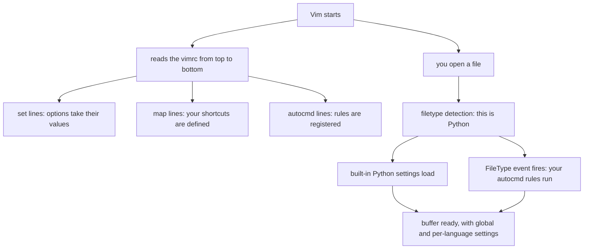

# A sensible vimrc, explained line by line, and a map of plugins

> **Before this lesson:** it helps to have met [Ex commands](#/lesson/vim/vim-command-line), [buffers](#/lesson/vim/vim-buffers), [windows](#/lesson/vim/vim-windows-tabs) and [search](#/lesson/vim/vim-patterns-search), because the settings below adjust those features. You do not need to have configured an editor before.

## In plain words

Out of the box, Vim behaves much as it did decades ago: no line numbers, searches that are fussy about capital letters, a Backspace key that refuses to delete in some situations. None of that is how people use it today. The behaviour is controlled by several hundred **settings** (Vim calls them *options*), and you record your choices in a plain text file that Vim reads every time it starts. That file is called the **vimrc**.

An everyday comparison: the driver's seat of a shared car. Every time you get in you would have to move the seat, tilt the mirrors and tune the radio. A car with memory buttons does it for you when you sit down. The vimrc is that memory button. It contains exactly the commands you would otherwise type by hand after starting Vim, one per line.

A **plugin** is an add-on: a bundle of files, written by someone else, that gives Vim a feature it does not have, such as a file finder or integration with the Git version-control system. Think of apps on a phone. The phone works without them, and it is easy to install so many that it becomes slow and confusing.

Why it matters at work: you will spend thousands of hours in your editor. A small configuration that you understand line by line is worth far more than a huge one copied from the internet, because when something behaves oddly you know where to look. And on servers and colleagues' machines there is no configuration at all, so it also pays to know which behaviour is built in and which is yours.

This lesson builds a configuration of about forty lines and explains every one, then gives a map of the plugin landscape so that you can choose add-ons deliberately.

## Where the file lives and how to try things

| Program | File |
|---|---|
| Vim on Linux and macOS | `~/.vimrc`, or `~/.vim/vimrc` (the `~` means your home directory) |
| Vim on Windows | `_vimrc` in your home folder, or `vimfiles\vimrc` |
| Neovim | `~/.config/nvim/init.vim`, or `init.lua` if you write the configuration in the Lua language (on Windows, under `AppData\Local\nvim`) |

**Neovim** is a modern offshoot of Vim. It reads the same kind of settings, and nearly every line below works in both.

Inside Vim, the variable `$MYVIMRC` holds the path of the file in use, so:

| Command | Effect |
|---|---|
| `:edit $MYVIMRC` | open your configuration |
| `:source $MYVIMRC` | read it again, applying your edits without restarting |
| `:set number?` | ask the current value of a setting (the question mark means "show, do not change") |
| `:verbose set number?` | also say **which file** last changed it |
| `:help 'number'` | read the documentation for a setting (the name goes in single quotes) |

The safest way to work: type a setting on the command line first, for example `:set relativenumber`, see whether you like it, and copy it into the file only then. Lines in the vimrc are the same commands **without the leading colon**. A double quote `"` starts a comment: Vim ignores the rest of that line.

### How settings are written

There are three kinds of setting, and the `:set` command treats each a little differently.

| Kind | Switch on / set | Switch off / other forms |
|---|---|---|
| on-or-off | `set hidden` | `set nohidden`; `set hidden!` flips it |
| a number | `set shiftwidth=4` | |
| text or a list | `set wildmode=longest:full,full` | `set path+=src/**` adds an item to a list; `-=` removes one |

Several settings can share a line: `set number relativenumber`.

This small model reads `set` lines the way Vim does, which makes the three forms concrete:

```python-run
def apply(config_text):
    """Interpret simple `set` lines. Returns a dict of option values."""
    opts = {}
    for raw in config_text.splitlines():
        line = raw.split('"')[0].strip()            # a double quote starts a comment
        if not line.startswith("set "):
            continue
        for item in line[4:].split():
            if "+=" in item:                         # add to a comma-separated list
                name, value = item.split("+=", 1)
                opts[name] = ",".join(filter(None, [opts.get(name, ""), value]))
            elif "=" in item:                        # number or text
                name, value = item.split("=", 1)
                opts[name] = int(value) if value.isdigit() else value
            elif item.startswith("no"):              # on-or-off, switched off
                opts[item[2:]] = False
            else:                                    # on-or-off, switched on
                opts[item] = True
    return opts

vimrc = '''
set number relativenumber     " line numbers
set shiftwidth=4 expandtab
set nohlsearch
set path+=src/**
set path+=tests/**
'''
for name, value in apply(vimrc).items():
    print(f"{name:15} = {value!r}")
```

The output shows two settings switched on from one line, a number, one switched off by its `no` prefix, and a list that grew by two items.

## The configuration, section by section

Here is the whole file. Read it once, then follow the explanations.

```vim
" ---------- 1. foundations ----------
set nocompatible
filetype plugin indent on
syntax on
set encoding=utf-8

" ---------- 2. files and buffers ----------
set hidden
set autoread
set undofile
set undodir=~/.vim/undo//

" ---------- 3. what you see ----------
set number relativenumber
set scrolloff=5
set laststatus=2
set showcmd
set wildmenu
set wildmode=longest:full,full
set splitbelow splitright

" ---------- 4. typing and indentation ----------
set backspace=indent,eol,start
set autoindent
set expandtab
set shiftwidth=4
set softtabstop=4

" ---------- 5. searching ----------
set incsearch hlsearch
set ignorecase smartcase

" ---------- 6. responsiveness ----------
set ttimeout ttimeoutlen=50
set mouse=a

" ---------- 7. key mappings ----------
let mapleader = " "
nnoremap <leader>w :update<CR>
nnoremap <silent> <leader>h :nohlsearch<CR>
nnoremap <C-h> <C-w>h
nnoremap <C-j> <C-w>j
nnoremap <C-k> <C-w>k
nnoremap <C-l> <C-w>l
cnoremap <expr> %% getcmdtype() == ':' ? expand('%:h') . '/' : '%%'

" ---------- 8. per-language settings ----------
augroup my_filetypes
  autocmd!
  autocmd FileType yaml,json,html,css setlocal shiftwidth=2 softtabstop=2
  autocmd FileType make setlocal noexpandtab
  autocmd FileType markdown,gitcommit setlocal spell
augroup END

" ---------- 9. bundled extras ----------
packadd! matchit
```

### 1. Foundations

| Line | What it does | Why you want it |
|---|---|---|
| `set nocompatible` | stops Vim imitating the original `vi` editor from 1976 | unlocks nearly every feature in this track. (Vim already does this when it finds a vimrc; the line makes the intent explicit. Neovim ignores it.) |
| `filetype plugin indent on` | detects each file's type from its name and contents, then loads that language's helper settings and indentation rules | Python files get Python indentation, Makefiles get real tabs, `gf` learns about imports |
| `syntax on` | colours the text according to the language | easier to read; also lets spell checking tell comments from code |
| `set encoding=utf-8` | uses UTF-8, the standard way of storing text in every alphabet, inside Vim | accented letters, non-Latin scripts and symbols display correctly |

### 2. Files and buffers

| Line | What it does | Why you want it |
|---|---|---|
| `set hidden` | lets you switch away from a buffer (Vim's in-memory copy of a file) that has unsaved changes | without it Vim refuses with an error each time; see the buffers lesson |
| `set autoread` | reloads a file that changed on disk, provided you have no unsaved edits to it | keeps up with files rewritten by a code formatter or a version-control operation |
| `set undofile` | saves each file's undo history to disk | you can undo changes made **yesterday**, after closing and reopening the file |
| `set undodir=~/.vim/undo//` | keeps those history files in one directory | otherwise they would be scattered next to your files. Create the directory once with `mkdir -p ~/.vim/undo`. The two slashes make Vim use the full path in the file name, avoiding clashes between files with the same name |

### 3. What you see

| Line | What it does | Why you want it |
|---|---|---|
| `set number relativenumber` | shows the real line number on the cursor's line and, on every other line, its **distance** from the cursor | the distance is the count for `j`, `k` and operators: the line marked 7 is `7j` away, and `d7j` deletes down to it |
| `set scrolloff=5` | keeps at least five lines visible above and below the cursor | you always see context when you search or scroll |
| `set laststatus=2` | always shows the status line (file name, position) | by default it appears only with several windows |
| `set showcmd` | shows partly typed commands in the corner | after pressing `d` or `2` you can see that Vim is waiting for more |
| `set wildmenu` | shows the candidates in a menu when you press Tab on the command line | you can see what you are completing |
| `set wildmode=longest:full,full` | first Tab completes as far as the candidates agree and opens the menu; further Tabs cycle | the behaviour most people expect from a shell |
| `set splitbelow splitright` | new split windows open below and to the right | by default they open above and to the left, which most people find backward |

### 4. Typing and indentation

| Line | What it does | Why you want it |
|---|---|---|
| `set backspace=indent,eol,start` | lets Backspace delete indentation, line breaks, and text that was there before you started inserting | without it Backspace stops dead in each of those cases |
| `set autoindent` | a new line starts with the same indentation as the one above | essential for code |
| `set expandtab` | pressing Tab inserts spaces | spaces look the same in every program; most style guides ask for them |
| `set shiftwidth=4` | one level of indentation is four columns | used by `>>`, `<<`, `=` and automatic indenting |
| `set softtabstop=4` | Tab and Backspace move four columns at a time while inserting | makes the spaces feel like tab stops |

There is a fourth related setting, `tabstop`, which says how wide a real tab character **looks**. Leave it at its default of 8 unless a project's style demands otherwise; changing how tabs look hides the difference between tabs and spaces.

### 5. Searching

| Line | What it does | Why you want it |
|---|---|---|
| `set incsearch` | shows the first match while you are still typing the pattern | you can stop typing as soon as you see the right place |
| `set hlsearch` | highlights every match of the last search | you see what a pattern covers before substituting |
| `set ignorecase smartcase` | searches ignore capitals, unless your pattern contains one | type lower case to find everything, type a capital to be exact |

### 6. Responsiveness

| Line | What it does | Why you want it |
|---|---|---|
| `set ttimeout ttimeoutlen=50` | waits only 50 thousandths of a second to decide whether Escape was the start of a special key | removes the noticeable pause after pressing Escape in a terminal |
| `set mouse=a` | enables the mouse in all modes | scrolling, clicking to place the cursor and dragging window borders work; nobody is obliged to use them |

### 7. Key mappings

A **mapping** makes one key sequence stand for another. The command's name says where it applies:

| Command | Applies in |
|---|---|
| `nnoremap` | Normal mode |
| `inoremap` | Insert mode |
| `vnoremap` (or `xnoremap`) | Visual mode |
| `cnoremap` | Command-line mode |

The `nore` in the middle means *non-recursive*: the right-hand side is taken with its built-in meaning even if you later remap those keys. Always use the `nore` forms; the plain `map` family causes confusing chains.

| Line | What it does |
|---|---|
| `let mapleader = " "` | defines the **leader key** as the space bar. The leader is a prefix reserved for your own shortcuts, so that they cannot collide with built-in commands. Wherever a mapping says `<leader>`, press Space |
| `nnoremap <leader>w :update<CR>` | Space then `w` saves the file if it has changed. `<CR>` is the Enter key, typed for you |
| `nnoremap <silent> <leader>h :nohlsearch<CR>` | Space then `h` clears search highlighting. `<silent>` stops the command being echoed at the bottom |
| `nnoremap <C-h> <C-w>h` and the three after it | Ctrl with `h`, `j`, `k` or `l` moves to the window on that side, saving the `<C-w>` prefix |
| `cnoremap <expr> %% …` | on the command line, typing `%%` inserts the directory of the current file (from the opening-files lesson). `<expr>` means the right-hand side is a small calculation: if the command line is a `:` command, produce the directory, otherwise produce two percent signs |

### 8. Per-language settings

An **autocommand** tells Vim: "when this event happens, run this command". The event used here is `FileType`, which fires when Vim has worked out what kind of file a buffer holds.

| Line | What it does |
|---|---|
| `augroup my_filetypes` … `augroup END` | gives the following autocommands a group name |
| `autocmd!` | deletes the group's previous contents. Without this line, every `:source $MYVIMRC` would add duplicate copies and each event would run the commands twice, three times, and so on |
| `autocmd FileType yaml,json,html,css setlocal shiftwidth=2 softtabstop=2` | two-space indentation in those file types. `setlocal` changes the setting for that buffer only |
| `autocmd FileType make setlocal noexpandtab` | Makefiles require real tab characters, so spaces-for-tabs is switched off there |
| `autocmd FileType markdown,gitcommit setlocal spell` | spell checking for prose and commit messages |

As a configuration grows, the tidier home for such settings is one small file per language, for example `~/.vim/after/ftplugin/python.vim`, containing `setlocal` lines. Vim loads it automatically for Python buffers.

### 9. Bundled extras

`packadd! matchit` loads a plugin that ships with Vim but is not switched on by default. It teaches the `%` key to jump between matching words such as `if` and `end`, and between opening and closing HTML tags, as well as brackets. (Neovim loads it without being asked.)



## What was left out on purpose

- **Remapping core keys.** Changing what `j`, `w` or `;` do makes every Vim you meet elsewhere feel broken. Add shortcuts behind the leader key instead.
- **A long list of settings you have not tried.** Each line should be there because you noticed a need.
- **`set clipboard=unnamedplus`.** It makes every yank and delete go to the system clipboard. Some people love it; others find it overwrites what they copied elsewhere. Try it for a week before deciding (see the registers lesson).
- **`set autochdir`.** Changing directory on every file switch breaks project-wide searches and many plugins.

## Plugins: a map of the territory

### How plugins are installed

Vim 8 and Neovim have built-in support for **packages**. Any directory placed under `~/.vim/pack/{any-name}/start/` (for Neovim, `~/.local/share/nvim/site/pack/{any-name}/start/`) is loaded at start-up. Installing a plugin by hand is therefore one `git clone` of its repository into that directory, and removing it is deleting the directory.

A **plugin manager** automates downloading and updating from a list in your configuration. Well-known ones are *vim-plug* (works in Vim and Neovim) and *lazy.nvim* (Neovim only). With vim-plug the list looks like this:

```vim
call plug#begin()
Plug 'tpope/vim-surround'
Plug 'tpope/vim-commentary'
Plug 'junegunn/fzf.vim'
call plug#end()
```

and `:PlugInstall` fetches everything named.

### Categories worth knowing

| Need | What such a plugin adds | Well-known examples |
|---|---|---|
| more operators and text objects | new verbs and nouns in the grammar: change the surrounding quotes, comment out a paragraph | *surround*, *commentary* (built into Neovim as `gc`), *targets.vim* |
| repeat support | makes `.` work for commands defined by plugins | *repeat* |
| paired shortcuts | `[b` / `]b`, `[q` / `]q` and many more for stepping through lists | *unimpaired* |
| finding files and text | type a few letters of a name and pick from a filtered list (a "fuzzy finder") | *fzf.vim*, *Telescope* (Neovim) |
| version control | Git status, staging, blame and diffs inside the editor | *fugitive*, *gitsigns* (Neovim) |
| file browsing | a nicer directory listing or a tree | *vinegar* (improves the built-in explorer), *nvim-tree*, *oil.nvim* |
| code intelligence | go to definition, rename, error markers through a language server | built into Neovim; *vim-lsp* or *coc.nvim* for Vim |
| checking and formatting | run linters and formatters as you type or save | *ALE*, *conform.nvim* |
| completion menus | automatic pop-ups combining several sources | *nvim-cmp*, *blink.cmp* |
| syntax understanding | highlighting and text objects based on a real parse of the code | *nvim-treesitter* |
| appearance | colour schemes and status lines | *gruvbox*, *catppuccin*, *lualine* |

The first three rows are the ones most in the spirit of this track: they extend the operator-plus-motion grammar instead of adding menus. `cs"'` (change surrounding double quotes to single), `ds(` (delete surrounding parentheses) and `gcap` (comment a paragraph) feel like commands Vim should have had all along.

### A way of deciding

1. Use plain Vim until something specific irritates you more than once.
2. Check whether a built-in feature already solves it (`:help` is thorough; this track covered many candidates).
3. If not, add **one** plugin for that need and learn it properly.
4. Every few months, remove anything you no longer use.

Pre-assembled configurations ("distributions") such as LazyVim and AstroNvim give an editor with dozens of plugins already set up. They are a fine way to see what is possible, and a poor way to learn what any single part does. If you start from one, still read its files.

## Why this approach works

The vimrc is not a special language. Every line is an Ex command of the kind you have been typing after a colon since the command-line lesson: `set`, `nnoremap`, `autocmd`. Understanding the file is therefore the same skill as using the editor, and anything in it can be tried interactively before it is written down.

Keeping the file small has a practical pay-off on the day you log in to a server where none of it exists: the distance between "my Vim" and "stock Vim" is forty lines, most of them cosmetic, and your hands still know every command.

> [!TIP]
> Keep your configuration in a version-controlled repository (people call theirs "dotfiles"). Setting up a new machine becomes cloning one repository, and you gain a history of what you changed and why.

> [!TIP]
> When a setting does not seem to apply, `:verbose set {name}?` names the file and line that last touched it. It is nearly always a file-type plugin or another plugin overriding your choice.

> [!INTERVIEW]
> "Walk me through your editor setup" is a common warm-up question. The answer that lands well is short and reasoned: a few settings and why each is there, three or four plugins and the problem each solved, and the fact that you can work in an unconfigured Vim over SSH when necessary. A list of forty plugin names lands badly.

## Pitfalls

- **Copying a large vimrc from someone else.** You inherit mappings that override built-in keys and cannot tell which lines cause which behaviour.
- **Forgetting `autocmd!` inside the group.** Autocommands pile up each time the file is sourced.
- **Using `map` instead of `nnoremap`.** Recursive mappings interact in surprising ways, and `map` also applies in Visual and Operator-pending modes.
- **A comment after a mapping.** In `nnoremap <leader>w :update<CR> " save`, the quote and everything after it become part of the mapping. Put comments on their own line.
- **Setting `tabstop=4` together with `noexpandtab` in a shared project.** Files then look aligned for you and ragged for everyone else.
- **`set mouse=a` and copying text from the terminal.** With the mouse captured by Vim, the terminal's own selection may need Shift held down.
- **Expecting Vim settings in Lua syntax, or the reverse.** Neovim accepts both `init.vim` and `init.lua`, but not mixed in one file without the bridging commands (`vim.cmd` in Lua, `lua` in Vim script).
- **Plugins that remap common keys.** Read a plugin's default mappings before installing; `:verbose nmap {keys}` shows who defined a mapping.

## Cheat sheet

| Task | Command |
|---|---|
| Open your configuration | `:edit $MYVIMRC` |
| Apply it again | `:source $MYVIMRC` |
| Show a setting's value | `:set name?` |
| Show who set it | `:verbose set name?` |
| Read about a setting | `:help 'name'` |
| Switch an on-or-off setting | `:set name` / `:set noname` / `:set name!` |
| Reset a setting to its default | `:set name&` |
| Set for this buffer only | `:setlocal name=value` |
| Define a Normal-mode shortcut | `nnoremap <leader>x :command<CR>` |
| See a mapping and where it came from | `:verbose nmap <leader>x` |
| Run something for a file type | `autocmd FileType python setlocal …` inside an `augroup` |
| Load a bundled plugin | `packadd! matchit` |
| List loaded scripts | `:scriptnames` |
| Start without any configuration | `vim -u NONE` (useful for testing whether a problem is yours) |

## Summary

- The vimrc is a text file of Ex commands that Vim runs at start-up; lines are the commands you would type after a colon.
- `:set` handles three kinds of option: on-or-off, numbers, and text or lists.
- A sound starting configuration covers foundations, buffers, display, indentation, search, responsiveness, a few leader-key mappings and per-language rules, in about forty lines you can explain.
- Mappings should use the non-recursive forms and live behind a leader key; autocommands belong in a group that clears itself.
- Plugins are optional add-ons installed as packages or through a manager. Add them one at a time for a need you have felt, favouring those that extend Vim's own grammar.
- A small, understood configuration keeps you effective on machines that have none.

## Glossary

| Term | Meaning |
|---|---|
| vimrc | the file of settings and commands that Vim reads at start-up |
| option (setting) | a named value that controls one aspect of Vim's behaviour |
| Neovim | a modern offshoot of Vim that shares its editing model and most settings |
| mapping | a rule that makes one key sequence stand for another |
| non-recursive mapping | a mapping whose right-hand side keeps its built-in meaning (`nnoremap`, `inoremap`, …) |
| leader key | a prefix key reserved for your own shortcuts |
| autocommand | a rule that runs a command when an event such as "file type detected" occurs |
| augroup | a named group of autocommands, which can be cleared and redefined together |
| file type | the kind of content Vim believes a buffer holds, such as `python` or `markdown` |
| plugin | an add-on that gives Vim extra features |
| package | Vim's built-in way of loading plugins from a `pack` directory |
| plugin manager | a plugin that downloads and updates other plugins from a list |
| UTF-8 | the standard encoding that can represent the characters of every writing system |
| dotfiles | a person's collection of configuration files, usually kept under version control |

## Check yourself

```quiz
[
  {"q": "You add a line to your vimrc and want it to take effect without restarting Vim. Which command?",
   "options": [":edit $MYVIMRC", ":source $MYVIMRC", ":set all", ":reload"],
   "answer": 1,
   "explain": ":source reads a file and runs each line as a command. :edit only opens it for editing."},
  {"q": "With 'set number relativenumber', the line you want to delete down to shows 6 in the margin. Which keystrokes delete from the current line through that line?",
   "options": ["6dd", "d6j", "d6G", "6x"],
   "answer": 1,
   "explain": "The margin shows the distance in lines, which is exactly the count for j. d6j deletes the current line and the six below it. 6dd would delete only six lines in total, stopping one short."},
  {"q": "What does 'set ignorecase smartcase' do to the search /config ?",
   "options": ["Finds only 'config'", "Finds config, Config and CONFIG", "Finds only capitalised forms", "Disables searching"],
   "answer": 1,
   "explain": "With no capital letter in the pattern the search ignores case. A pattern containing a capital, such as /Config, would be matched exactly."},
  {"q": "Why should mappings be written with nnoremap instead of nmap?",
   "options": ["nnoremap is faster to type", "nnoremap uses the built-in meaning of the keys on its right-hand side, so other mappings cannot change what it does", "nmap does not work in Normal mode", "nnoremap applies in every mode"],
   "answer": 1,
   "explain": "The non-recursive form does not re-interpret its right-hand side through other mappings, which avoids chains and loops."},
  {"q": "The vimrc contains: let mapleader = \" \" and nnoremap <leader>w :update<CR>. What do you press to save?",
   "options": ["Backslash then w", "Space then w", "Ctrl-w", "Colon then w"],
   "answer": 1,
   "explain": "The leader key was set to the space bar, so <leader>w means Space followed by w. (Typing :w and Enter still works as well.)"},
  {"q": "What is the purpose of the autocmd! line at the start of an augroup?",
   "options": ["It runs all autocommands immediately", "It removes the group's existing autocommands so that re-reading the vimrc does not create duplicates", "It disables autocommands permanently", "It marks the group as high priority"],
   "answer": 1,
   "explain": "Each time the file is sourced the autocmd lines would be added again. Clearing the group first keeps exactly one copy."},
  {"q": "Which line gives two-space indentation in YAML files only?",
   "options": ["set shiftwidth=2", "autocmd FileType yaml setlocal shiftwidth=2 softtabstop=2", "set filetype=yaml shiftwidth=2", "nnoremap yaml :set shiftwidth=2<CR>"],
   "answer": 1,
   "explain": "The FileType event fires for YAML buffers and setlocal confines the change to that buffer. A plain set would change every file."},
  {"q": "A setting you put in your vimrc is not in effect in one particular file. Which command tells you what overrode it?",
   "options": [":set name?", ":verbose set name?", ":help 'name'", ":scriptnames"],
   "answer": 1,
   "explain": "With :verbose, Vim reports the file and line where the option was last set, usually a file-type plugin or another plugin."}
]
```

> **Source:** Neil, Practical Vim 2e, appendix 1 ("Customize Vim to Suit Your Preferences") and ch. 21 ("Now What?"); plugin and Neovim material is supplementary. Examples and wording are original.
