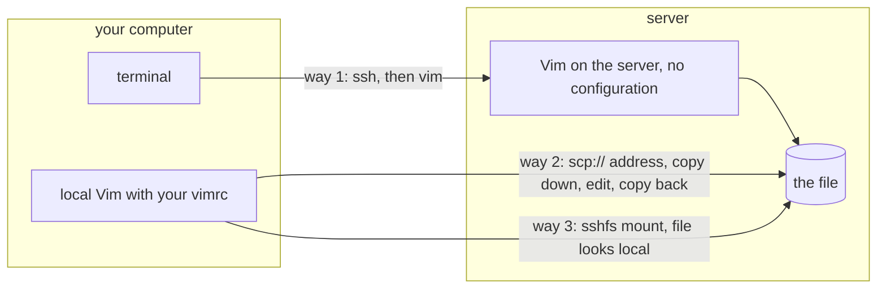
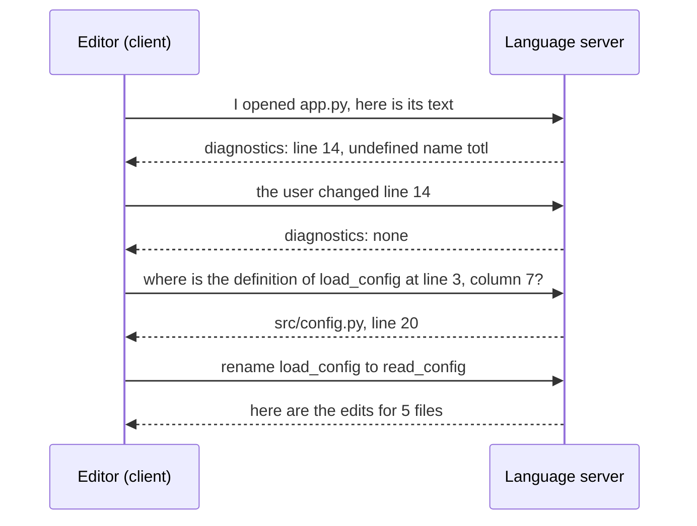

# Vim on the job: remote machines, comparing files, Git, and language servers

> **Before this lesson:** you should be able to [open and save files](#/lesson/vim/vim-open-save), work with [split windows](#/lesson/vim/vim-windows-tabs) and understand what [the vimrc](#/lesson/vim/vim-vimrc-plugins) is. Terms from system administration and version control are explained as they come up.

## In plain words

The earlier lessons taught the editor. This one shows four places where knowing it pays off in day-to-day engineering work.

1. **Editing on another computer.** Much software runs on machines you never sit in front of: servers in a data centre or in the cloud. You connect to them over the network and get a text-only screen. It is like talking to someone through an intercom: voice only, no video. Graphical editors do not work through an intercom. Vim does, and some version of it is installed on practically every such machine.
2. **Comparing two versions of a file.** Like the "spot the difference" puzzles in a newspaper, except the editor circles the differences for you and lets you copy a piece from one picture to the other.
3. **Working with Git.** Git is the tool nearly every team uses to record the history of its code. Git frequently needs you to edit some text (a description of your change, a list of steps) and opens an editor for it, by default often Vim.
4. **Code intelligence.** A **language server** is a helper program that understands a programming language and can tell the editor where something is defined, what is wrong with a line, or how to rename something safely. Think of a specialist interpreter sitting beside you who knows the language thoroughly; the editor asks the questions and shows you the answers.

Why it matters for a job: these are precisely the situations where a new engineer gets stuck in front of other people. A server editor that will not quit, a merge conflict, a commit message screen that seems frozen. Being calm in all of them is a visible sign of competence.

`<CR>` is the Enter key. `<C-w>` means hold Ctrl and press `w`.

## Part 1: editing on a remote machine

**SSH** (Secure Shell) is the standard program for logging in to another computer over the network. Typing `ssh deploy@web01` in a terminal connects you to the machine `web01` as the user `deploy`; from then on, what you type runs **there**.

There are three ways to edit a file that lives on a remote machine.

### Way 1: log in and run Vim there

```text
ssh deploy@web01
vim /etc/nginx/nginx.conf
```

This always works and needs nothing installed on your side. The editor is running on the server, so:

- **Your configuration is not there.** No vimrc, no plugins, no custom shortcuts. This is the reason this track has taught built-in commands throughout.
- **The program may be a cut-down build.** On minimal systems the command `vi` starts a small version of Vim with some features removed (often no syntax colouring and, depending on the build, limited undo). Try `vim` first; if only `vi` exists, the core commands still work.
- **A few settings can be typed by hand** to make an unconfigured session comfortable:

| Type | Gives you |
|---|---|
| `:set nocompatible` | modern behaviour, if the system started Vim in old-`vi` mode |
| `:syntax on` | colours |
| `:set number` | line numbers |
| `:set hlsearch incsearch` | visible search |
| `:set backspace=indent,eol,start` | a Backspace key that behaves normally |

#### The survival kit

If you remember nothing else on a remote machine, remember this table.

| Situation | Keys |
|---|---|
| Stuck, unsure what mode you are in | `<Esc>` twice |
| Save | `:w<CR>` |
| Save and quit | `:wq<CR>` |
| Quit **without** saving | `:q!<CR>` |
| Undo the last change | `u` |
| Find text | `/text<CR>`, then `n` for the next |
| Go to line 120 (from an error message) | `120G` or `:120<CR>` |
| "File is read-only" when saving | `:w !sudo tee % > /dev/null`, or quit and reopen with `sudoedit` |

#### Connections that drop: swap files

While you edit, Vim regularly writes your unsaved work to a hidden **swap file** next to the original (for `nginx.conf` it is named `.nginx.conf.swp`). If the network connection breaks, the editor on the server is killed but the swap file survives. The next time you open the file, Vim tells you so and offers choices:

| Choice | Meaning |
|---|---|
| `(R)ecover` | rebuild your unsaved work from the swap file |
| `(O)pen Read-Only` | look without changing anything |
| `(E)dit anyway` | ignore the swap file and edit the saved version |
| `(D)elete it` | throw the swap file away |
| `(Q)uit` / `(A)bort` | do nothing |

After recovering, check the text, save it, and delete the swap file so that the question is not asked again. The same message appears when **another person** (or another terminal of yours) has the file open at that moment; in that case choose read-only or quit, to avoid two people overwriting each other.

#### Sessions that survive: tmux

A **terminal multiplexer** is a program that keeps your terminal session alive on the server after you disconnect. The common one is `tmux`.

| Command | Effect |
|---|---|
| `tmux new -s work` | start a session named `work` |
| `Ctrl-b` then `d` | detach: leave it running and return to the plain shell |
| `tmux attach -t work` | come back to it later, even from another computer |

Run Vim inside tmux and a dropped connection costs you nothing: reconnect, attach, and the editor is exactly as you left it.

### Way 2: edit the remote file with your local Vim

Vim can fetch a file over SSH, let you edit a local copy with all your own settings, and send it back when you save.

```text
vim scp://deploy@web01//etc/nginx/nginx.conf
```

| Part | Meaning |
|---|---|
| `scp://` | use the secure-copy method that comes with SSH |
| `deploy@web01` | user and machine |
| `//etc/nginx/nginx.conf` | **two** slashes: a path starting from the top of the file system. With **one** slash the path would be relative to the user's home directory |

The same address works from inside Vim: `:edit scp://deploy@web01//etc/hosts`. Each `:write` uploads the file. This is pleasant for a handful of files; it is not suited to browsing a whole project.

### Way 3: let another tool bridge the gap

| Tool | Idea |
|---|---|
| `sshfs` | makes a remote directory appear as an ordinary local folder, so any local program can open the files |
| editor remote extensions (for example VS Code's *Remote - SSH*) | run a helper on the server and show its files in your local editor; your Vim key bindings in that editor keep working |



## Part 2: comparing files with vimdiff

A **diff** is a description of the differences between two texts: which lines were added, removed or changed. Vim can show two (or more) files side by side with the differences coloured and the identical stretches folded away.

### Starting

| Command | Effect |
|---|---|
| `vimdiff old.conf new.conf` (from the shell) | open both files side by side in diff mode; `vim -d old.conf new.conf` is the same |
| `:diffsplit other.conf` | from inside Vim: compare the current file with another, one above the other |
| `:vertical diffsplit other.conf` | the same, side by side |
| `:windo diffthis` | turn the windows you already have open into a comparison |
| `:diffoff!` | leave diff mode in all windows |

What you see: lines present on one side only, lines that differ (with the changed part of the line marked more strongly), and long identical regions collapsed into a single "folded" line that you can open with `zo` and close with `zc`. The two windows scroll together.

### Moving and copying between the two sides

| Keys | Meaning |
|---|---|
| `]c` | jump to the next difference (think *change*) |
| `[c` | jump to the previous difference |
| `do` | **diff obtain**: replace this difference with the text from the other window |
| `dp` | **diff put**: push this difference into the other window |
| `:diffupdate` | recalculate the highlighting after manual edits |
| `<C-w>w` | switch to the other window |

A small worked example. Two versions of a settings file:

| Left window: `old.conf` | Right window: `new.conf` |
|---|---|
| `port = 8080` | `port = 8080` |
| `workers = 2` | `workers = 8` |
| `debug = true` | `debug = true` |
| | `timeout = 30` |

| Step | Cursor in | Keys | Result |
|---|---|---|---|
| 1 | left window, top | `]c` | cursor on `workers = 2`, the first difference |
| 2 | left | `do` | the left file now says `workers = 8`; this difference disappears |
| 3 | left | `]c` | cursor at the place where the right side has an extra line |
| 4 | left | `do` | the left file gains `timeout = 30`; the files are now identical |
| alternative to 2 | left | `dp` | the **right** file would get `workers = 2` instead |

`do` and `dp` are the only two commands to learn: "bring it here" and "send it there".

What a diff computes can be shown in a few lines of Python using the standard `difflib` module:

```python-run
import difflib

old = ["port = 8080", "workers = 2", "debug = true"]
new = ["port = 8080", "workers = 8", "debug = true", "timeout = 30"]

for line in difflib.unified_diff(old, new, fromfile="old.conf", tofile="new.conf", lineterm=""):
    print(line)
```

Reading the output: lines starting with `-` exist only in the old version, lines starting with `+` only in the new, and lines starting with a space are the same in both and are shown for context. The line beginning `@@` says which line numbers the block covers. This "unified" format is what Git prints, so learning to read it here pays off there.

## Part 3: Vim and Git

**Git** records snapshots of a project, called **commits**, each with a message describing the change. Several Git operations open a text editor.

### Telling Git which editor to use

```text
git config --global core.editor vim
```

(Use `nvim` for Neovim.) Without this, Git uses whatever the environment variable `EDITOR` names, and on many systems that is already `vi` or `vim`. This is why people who have never chosen Vim find themselves inside it.

### Writing a commit message

Running `git commit` opens a temporary file. Lines beginning with `#` are notes from Git and will be thrown away.

| You want to | Keys |
|---|---|
| write the message | `i`, type a short summary line, an empty line, then details; `<Esc>` |
| accept and make the commit | `:wq<CR>` |
| cancel the commit | `:cq<CR>` |

`:cq` quits and reports a failure to the program that started Vim, so Git abandons the commit. (Quitting with an empty message also cancels.) Vim recognises the file as a commit message and helps: the first line is highlighted differently once it grows too long, and with `:set spell` your spelling is checked.

### Rewriting history: the rebase list

`git rebase -i` ("interactive rebase") shows your recent commits as a list of lines, each starting with a command word:

```text
pick 3f2a1c9 Add retry setting
pick 8d07be4 Fix typo in retry setting
pick c41d9aa Document retry setting
```

You edit the list and save; Git then replays the commits as instructed. It is a text-editing task, and a good showcase for Normal-mode commands:

| Goal | Keys | Why they work |
|---|---|---|
| fold the second commit into the first | on line 2: `cwfixup<Esc>` | `cw` changes the first word, `pick`, to `fixup` |
| do the same to the next line | `j0.` | the dot command repeats the change |
| move a commit one line down | `ddp` | cut the line, put it below |
| drop a commit | `dd` | deleting the line removes that commit from the result |
| abandon the whole operation | `:cq<CR>` | Git sees the failure and leaves everything untouched |

### Reading Git's output in Vim

| Command | Effect |
|---|---|
| `git diff` piped into `vim -` (in the shell: the `git diff` command, a vertical bar, then `vim -`) | the single dash makes Vim read from the pipe, giving you a coloured, searchable view of the changes |
| `:!git status` | run a Git command without leaving Vim |
| `:read !git log -1` | insert the output of a command below the cursor |
| `:!git blame %` | show who last changed each line of the current file (`%` is the file name) |
| `git difftool --tool=vimdiff` | open each changed file as a side-by-side comparison of before and after |

### Merge conflicts

When two people change the same lines, Git cannot combine the changes and writes both versions into the file, between markers:

```text
<<<<<<< HEAD
workers = 4
=======
workers = 8
>>>>>>> feature/tuning
```

The part above the `=======` line is your side; the part below is the incoming side. Resolving a conflict means editing the file until it contains what the result should be, with all three marker lines removed, then saving and telling Git the file is settled (`git add`).

| Step | Keys | Purpose |
|---|---|---|
| 1 | `/<<<<<<<<CR>` | jump to the next conflict (then `n` for the one after) |
| 2 | decide what the lines should be | |
| 3 | `dd` on the lines and markers you are discarding | |
| 4 | `:wq<CR>`, then `git add` the file in the shell | |

For larger conflicts `git mergetool --tool=vimdiff` opens a prepared layout with several windows: your version (LOCAL), the other side's version (REMOTE), their common ancestor (BASE), and at the bottom the file being produced (MERGED). With the cursor on a conflict in the bottom window, `:diffget LOCAL` or `:diffget REMOTE` pulls in the chosen side.

For people who use Git from inside the editor all day, the *fugitive* plugin provides commands such as `:Git` (an interactive status screen), `:Git blame` and `:Gdiffsplit`.

## Part 4: Neovim and language servers

### Neovim in one paragraph

**Neovim** began in 2014 as a reorganisation of Vim's source code and has grown into a separately developed editor. Everything in this track, modes, operators, motions, text objects, registers, macros, Ex commands, works the same in both. Neovim's own additions include configuration in the Lua programming language (`init.lua`), a built-in terminal window, more modern defaults (several settings from the previous lesson are already on), syntax analysis through a library called tree-sitter, and a built-in client for language servers. Vim, for its part, has continued to gain features, including its own newer scripting language. Either is a sound choice; skills transfer completely.

### What a language server is

Editors used to need a separate plugin for every language to offer "go to definition" or error highlighting, and each editor needed its own. The **Language Server Protocol**, abbreviated **LSP**, replaced that with one agreed set of messages. A *protocol* is a fixed format for a conversation between two programs.

- The **language server** is a program that deeply understands one language: `pyright` for Python, `gopls` for Go, `rust-analyzer` for Rust, `clangd` for C and C++, `typescript-language-server` for TypeScript and JavaScript.
- The **client** is the editor. It tells the server what you have open and what you typed, and asks questions.

Because the conversation is standardised, one server works with every editor that speaks LSP, and one editor works with every server.



The messages themselves are small pieces of structured text in a format called JSON. This sketch builds the "where is this defined?" question the way an editor would:

```python-run
import json

request = {
    "jsonrpc": "2.0",                      # the message format version
    "id": 42,                              # so the answer can be matched to the question
    "method": "textDocument/definition",   # which question is being asked
    "params": {
        "textDocument": {"uri": "file:///home/you/proj/app.py"},
        "position": {"line": 2, "character": 6},   # counted from 0: third line, seventh column
    },
}
print(json.dumps(request, indent=2))

reply = {"jsonrpc": "2.0", "id": 42,
         "result": {"uri": "file:///home/you/proj/src/config.py",
                    "range": {"start": {"line": 19, "character": 4}, "end": {"line": 19, "character": 15}}}}
target = reply["result"]
print("jump to", target["uri"].split("/proj/")[1], "line", target["range"]["start"]["line"] + 1)
```

The first output is the question: a method name and a position in a file. The second line shows the editor turning the answer into a jump. Every LSP feature is a variation on this exchange.

### What you get

| Feature | What it does | Typical keys in a current Neovim (they vary by version and configuration) |
|---|---|---|
| diagnostics | errors and warnings shown beside the code as you type | `]d` / `[d` to step through them |
| go to definition | jump to where a name is defined, knowing the language's rules | `<C-]>`, then `<C-t>` to return |
| hover | show the documentation and type of the thing under the cursor | `K` |
| find references | list every use of a name (into the quickfix list) | `grr` |
| rename | change a name everywhere it refers to the same thing | `grn` |
| code action | apply a suggested fix, such as adding a missing import | `gra` |
| completion | suggestions that fit the context | `<C-x><C-o>`, or an automatic menu |
| formatting | re-lay-out the file in the standard style | a command or an on-save hook |

Compared with the tools from the Tools module: ctags answers "where is a thing *named* this?", the language server answers "where is *this* thing?". Text search finds every occurrence of some letters; "find references" finds every use of one particular variable and ignores other variables that happen to share its name.

Setting it up has two halves: install the server program for your language, and tell the editor to start it for the right file types. Neovim has the client built in (recent versions need only a few lines of configuration per server); for Vim, plugins such as *vim-lsp* or *coc.nvim* provide the client. Exact steps change from release to release, so follow the current documentation of your editor.

## Why this hangs together

All four parts apply ideas from earlier lessons to a new setting.

- On a server you have Vim's built-in commands and nothing else, which is the vocabulary this track taught.
- Diff mode is two ordinary windows with a shared view; `do` and `dp` are changes like any other, and `]c` is a motion.
- Git's editing tasks are small text files; the rebase list in particular rewards `cw`, `.`, `dd` and `p`.
- A language server feeds the mechanisms you already use: definitions arrive as jumps (so `<C-t>` and `<C-o>` return), references arrive as a quickfix list (so `:cnext` and `:cfdo` apply), completions arrive in the Insert-mode menu.

> [!TIP]
> Practise the survival kit where nothing is at stake: start `vim -u NONE` on your own machine, which runs Vim with no configuration at all, and edit a scratch file for ten minutes. That is what a server will feel like.

> [!TIP]
> The commands in this lesson belong to a real terminal. For the editing side, this site's code editor has a Vim mode (⚙ settings menu): paste the three-line rebase list from Part 3 into an editor pane and practise `cwfixup<Esc>`, `j0.` and `ddp` on it.

> [!INTERVIEW]
> Operations-flavoured interviews like to ask: "You are logged in to a production machine and need to change one line of a configuration file. Walk me through it." A complete answer mentions making a backup copy first, opening the file (with `sudoedit` if it needs administrator rights), searching for the setting, changing it, saving, validating the configuration with the service's own check command before restarting, and knowing how to back out. Saying how to quit without saving, `:q!`, is part of the answer.

## Pitfalls

- **Not knowing which machine you are on.** With several terminals open it is easy to edit the production file thinking it is the test one. Check the prompt before saving.
- **Ignoring the swap-file message.** Pressing a key at random can throw away recoverable work or start a second edit of a file someone else has open. Read the choices.
- **One slash or two in an `scp://` address.** One is relative to the home directory, two is from the top of the file system.
- **`do` and `dp` the wrong way round.** `do` changes the window you are in; `dp` changes the other one. `u` undoes `do`; for `dp`, switch windows first and then undo.
- **Leaving conflict markers in a file.** The program will not run with `<<<<<<<` lines in it. Search for them before saving.
- **`:q!` during a commit or rebase** does not always cancel: if the file already contains a valid message or list, Git proceeds. `:cq` cancels reliably.
- **Expecting the language server on a server.** Code intelligence is a local comfort. Remote machines usually have neither the server programs nor your configuration.
- **A language server that seems silent** is usually not installed, not started for that file type, or unable to find the project's root directory. `:checkhealth` in Neovim and the server's log are the places to look.

## Cheat sheet

| Task | Command or keys |
|---|---|
| Log in to a machine | `ssh user@host` |
| Keep a session alive | `tmux new -s name`, `Ctrl-b d`, `tmux attach -t name` |
| Edit a remote file locally | `vim scp://user@host//absolute/path` |
| Run Vim with no configuration | `vim -u NONE` |
| Recover after a crash | reopen the file and choose `(R)ecover`, or `vim -r file` |
| Compare two files | `vimdiff a b` |
| Compare with another file from inside Vim | `:vertical diffsplit other` |
| Next / previous difference | `]c` / `[c` |
| Take the other side's text / give mine | `do` / `dp` |
| Leave diff mode | `:diffoff!` |
| Make Vim Git's editor | `git config --global core.editor vim` |
| Finish / cancel a commit or rebase | `:wq` / `:cq` |
| View a diff in Vim | pipe `git diff` into `vim -` |
| Find the next conflict | `/<<<<<<<` |
| Resolve conflicts in a prepared layout | `git mergetool --tool=vimdiff` |
| Hover documentation (language server) | `K` |
| Next diagnostic | `]d` |

## Summary

- Over SSH you can run the server's own Vim (always available, unconfigured), edit through an `scp://` address with your local Vim, or mount the remote files.
- Swap files protect unsaved work when a connection drops; tmux keeps the whole session alive.
- `vimdiff` shows files side by side; `]c` and `[c` move between differences, `do` and `dp` copy a difference in or out.
- Git opens an editor for commit messages and rebase lists: `:wq` accepts, `:cq` cancels, and ordinary editing commands do the work. Conflicts are marked with `<<<<<<<`, `=======` and `>>>>>>>` and are resolved by editing.
- Neovim is a separately developed editor with the same editing model as Vim.
- A language server is a per-language helper that speaks a standard protocol (LSP) with the editor and provides diagnostics, definitions, references, rename and completion, delivered through jumps, the quickfix list and the completion menu.

## Glossary

| Term | Meaning |
|---|---|
| SSH (Secure Shell) | the standard program and protocol for logging in to another computer over a network |
| server | a computer, usually without a screen of its own, that runs software for others to use |
| terminal | a window that shows text and accepts typed commands |
| swap file | Vim's hidden backup of unsaved work, used for recovery after a crash |
| terminal multiplexer | a program such as tmux that keeps terminal sessions running after you disconnect |
| `scp://` address | a way to name a file on another machine so that Vim fetches and stores it over SSH |
| diff | a description of the differences between two texts |
| diff mode | Vim's side-by-side display of differences between windows |
| Git | the widely used version-control system |
| commit | one recorded snapshot of a project, with a message |
| rebase | a Git operation that replays commits, optionally reordered or combined |
| merge conflict | a place where two sets of changes touch the same lines and Git cannot combine them |
| Neovim | a modern editor that grew out of Vim and keeps its editing model |
| protocol | an agreed format for communication between programs |
| LSP (Language Server Protocol) | the standard conversation between editors and language servers |
| language server | a program that analyses code in one language and answers an editor's questions |
| diagnostic | an error or warning reported about a place in the code |
| JSON | a simple text format for structured data, used by LSP messages |

## Check yourself

```quiz
[
  {"q": "You are in Vim on a server, have made changes you do not want to keep, and need to get out. What do you type?",
   "options": [":wq<CR>", ":q!<CR>", "<C-c>", ":x<CR>"],
   "answer": 1,
   "explain": ":q! quits and discards unsaved changes. :wq and :x would save them, and Ctrl-C does not exit Vim."},
  {"q": "Which address opens the file /etc/hosts on the machine db01, as user ops, in your local Vim?",
   "options": ["vim ssh://ops@db01/etc/hosts", "vim scp://ops@db01//etc/hosts", "vim ops@db01:/etc/hosts", "vim scp://ops@db01/etc/hosts"],
   "answer": 1,
   "explain": "The scp:// form with two slashes after the host gives a path from the top of the file system. With one slash the path would be taken relative to the user's home directory."},
  {"q": "Your SSH connection dropped while editing. On reopening the file Vim reports that a swap file exists. Which choice gets your unsaved work back?",
   "options": ["(D)elete it", "(E)dit anyway", "(R)ecover", "(Q)uit"],
   "answer": 2,
   "explain": "Recover rebuilds the buffer from the swap file. Edit anyway would open the last saved version and ignore the unsaved work."},
  {"q": "In vimdiff the cursor is on a difference in the left window. Which keys replace the left window's text with the right window's version?",
   "options": ["dp", "do", "]c", "dd"],
   "answer": 1,
   "explain": "do means diff obtain: bring the other window's text here. dp would push this window's text into the other one."},
  {"q": "Which keys jump to the next difference in diff mode?",
   "options": ["]c", "]s", "]d", "n"],
   "answer": 0,
   "explain": "]c moves to the next change. ]s is the next misspelt word and ]d the next diagnostic."},
  {"q": "Git has opened Vim for a commit message and you decide not to commit after all. Which command cancels reliably?",
   "options": [":wq", ":cq", ":w", "ZZ"],
   "answer": 1,
   "explain": ":cq exits with an error status, which tells Git to abandon the operation. :wq and ZZ would save the message and complete the commit."},
  {"q": "A rebase list has three lines starting with 'pick'. The cursor is on the first character of the second line. Which keystrokes change the second AND third lines to start with 'fixup'?",
   "options": ["cwfixup<Esc>j0.", "ddp", "rfj.", "ifixup<Esc>j."],
   "answer": 0,
   "explain": "cw replaces the word pick with fixup; j0 moves to the start of the next line and dot repeats the change. The i version would insert in front of pick without removing it."},
  {"q": "What is the main advantage of a language server's 'find references' over a plain text search for the same name?",
   "options": ["It is always faster", "It understands the language, so it finds uses of that particular symbol and not unrelated things with the same spelling", "It works without any installation", "It also searches comments"],
   "answer": 1,
   "explain": "A text search matches letters. A language server resolves which definition each use refers to, so two different variables with the same name are not confused."}
]
```

> **Source:** supplementary material beyond the book. Remote editing through netrw is touched on in Neil, Practical Vim 2e, tip 44, and saving as the super user in tip 46; the rest draws on the Vim and Neovim documentation (`:help diff`, `:help netrw`, `:help recovery`, `:help lsp`) and the Git manual. Examples and wording are original.
