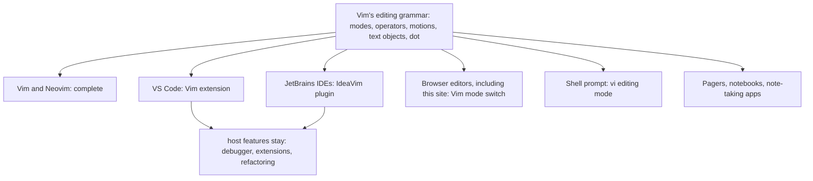

# Vim keys everywhere: VS Code, JetBrains IDEs, this site and the shell

> **Before this lesson:** you should know the core of the track: [the dot command](#/lesson/vim/vim-dot-command), [operators and motions](#/lesson/vim/vim-normal-grammar), [text objects](#/lesson/vim/vim-text-objects) and [registers](#/lesson/vim/vim-registers). This lesson is about using that knowledge in programs other than Vim itself.

## In plain words

"Vim" is two things that are easy to confuse. One is a program you can start in a terminal. The other is a **way of editing**: modes, operators, motions, text objects, the dot command. The second can exist without the first. Many other programs offer a **Vim mode** (also called *Vim key bindings* or *Vim emulation*): they keep their own menus and features, but the keyboard behaves as it does in Vim.

Think of touch typing. You learn where the letters are once, and the skill works on a laptop, a desktop keyboard and a library computer, even though the machines differ. Or think of driving: the pedals and the steering wheel are in the same places in every car, so you can drive a rental car you have never seen. The dashboard is different; the core controls are not.

Why it matters at work: teams standardise on tools. You may be given VS Code, a JetBrains IDE (an *IDE*, integrated development environment, is an editor bundled with tools for running, testing and debugging code), a notebook in a browser, or a bare terminal on a server. If your editing skill lives in your hands as Vim's grammar, you take it with you into all of them and pay the learning cost only once.

This lesson shows how to switch Vim keys on in the common places, what carries over and what does not, and how to practise on this site.

## What carries over, and what does not

A Vim mode re-implements Vim's behaviour inside another program. No re-implementation is complete, but the commonly used core is covered well almost everywhere.

| Reliably present in Vim modes | Often partial | Usually missing or different |
|---|---|---|
| Normal, Insert and Visual modes | Ex commands beyond `:w`, `:q`, `:s` | your vimrc and Vim plugins |
| operators: `d` `c` `y` `>` `<` `gU` `gu` | `:g`, `:normal`, ranges with patterns | Vim script and autocommands |
| motions: `w` `b` `e` `f` `t` `;` `0` `$` `gg` `G` `%` | macros that cross files | the quickfix list (the host program has its own "problems" panel) |
| text objects: `iw` `i"` `i(` `ip` `it` | marks and the jump list (often mapped to the host's own history) | buffers, the argument list, tab pages (the host manages files its own way) |
| the dot command and counts | registers beyond the basics | Vim's pattern dialect (`\v` and friends): the host's regex flavour is used instead |
| `/` search, `n`, `N`, `*` | Visual-block mode | chords the host or the browser has reserved, such as `<C-w>` |
| `u` and `<C-r>` (undo and redo) | `<C-a>` / `<C-x>` on numbers | |
| named registers and simple macros (`qa`, `@a`) | | |

The left column is the operator-plus-motion grammar, and that is where nearly all of the benefit lies. The right column is mostly *file management and automation*, which the host program handles through its own commands.



## VS Code

Visual Studio Code is a widely used free editor. Vim keys come from an **extension**, which is VS Code's word for an add-on.

### Two choices

| Extension | How it works | Good for |
|---|---|---|
| **Vim** (often called VSCodeVim) | re-implements Vim behaviour inside VS Code | most people: nothing else to install |
| **VSCode Neovim** | runs a real Neovim in the background and lets it drive the editing | people who already have a Neovim configuration and want exact behaviour |

To install: open the Extensions view (the icon of four squares in the side bar, or `Ctrl+Shift+X`), search for `Vim`, and choose Install. From then on files open in Normal mode and the status bar at the bottom shows the current mode.

### Settings worth making

VS Code stores preferences in a file called `settings.json` (open it with the command "Preferences: Open User Settings (JSON)" from the command palette, `Ctrl+Shift+P`). **JSON** is a plain-text format of names and values. A sensible start:

```json
{
  "vim.leader": "<space>",
  "vim.hlsearch": true,
  "vim.incsearch": true,
  "vim.useSystemClipboard": false,
  "vim.handleKeys": {
    "<C-f>": false,
    "<C-b>": false
  },
  "vim.normalModeKeyBindingsNonRecursive": [
    { "before": ["<leader>", "w"], "commands": [":w"] },
    { "before": ["<leader>", "h"], "commands": [":nohl"] },
    { "before": ["<leader>", "r"], "commands": ["editor.action.rename"] }
  ]
}
```

| Line | What it does |
|---|---|
| `"vim.leader": "<space>"` | makes the space bar the leader key, the prefix for your own shortcuts |
| `"vim.hlsearch"` and `"vim.incsearch"` | highlight search matches and show them while typing, as in the vimrc lesson |
| `"vim.useSystemClipboard": false` | keeps Vim's registers separate from the system clipboard; set it to `true` if you want plain `y` and `p` to use the clipboard |
| `"vim.handleKeys"` | hands certain chords back to VS Code. Here Ctrl-F and Ctrl-B keep their VS Code meanings (find, and toggle the side bar) instead of Vim's page scrolling |
| `"vim.normalModeKeyBindingsNonRecursive"` | defines shortcuts. Each entry has `before` (the keys you press) and either `after` (Vim keys to run) or `commands` (Ex commands or VS Code commands) |

The last entry shows the real attraction: a Vim-style shortcut that triggers a **VS Code** feature, here the language-aware rename.

### Useful built-in bridges

| Keys | Effect in VS Code with the Vim extension |
|---|---|
| `gd` | go to definition (VS Code's, so it understands the language) |
| `gh` | show the hover information for the thing under the cursor |
| `<C-o>` / `<C-i>` | VS Code's own back and forward navigation |
| `gt` / `gT` | next / previous editor tab |
| `:vsplit`, `<C-w>h`, `<C-w>l` | split the editor and move between the halves |
| `gcc`, `gc` + motion | comment lines (an emulated plugin, on by default) |
| `ys`, `cs`, `ds` + target | add, change or delete surrounding quotes or brackets (emulated, on by default) |

One practical note for macOS: holding a key such as `j` may pop up an accent chooser instead of repeating. The extension's documentation gives a one-line terminal command that switches key repeat on for VS Code.

## JetBrains IDEs

IntelliJ IDEA, PyCharm, WebStorm, GoLand and their siblings share one Vim add-on, **IdeaVim**, maintained by JetBrains.

To install: open Settings, choose Plugins, search the Marketplace for `IdeaVim`, install and restart. A small icon in the status bar switches it on and off.

### The `.ideavimrc` file

IdeaVim reads a configuration file named `.ideavimrc` in your home directory. Its syntax is a subset of the vimrc, so lines from the earlier lesson can be copied in.

```vim
" ~/.ideavimrc
let mapleader = " "
set number relativenumber
set incsearch hlsearch ignorecase smartcase
set scrolloff=5

" emulated plugins that ship with IdeaVim
set surround
set commentary
set highlightedyank

" IdeaVim-specific
set ideajoin

" shortcuts that call IDE features
nnoremap <leader>r :action RenameElement<CR>
nnoremap <leader>f :action GotoFile<CR>
nnoremap <leader>t :action GotoTest<CR>
nnoremap gr :action FindUsages<CR>
```

| Line or group | What it does |
|---|---|
| the first four `set` lines | the same settings as in a vimrc |
| `set surround`, `set commentary` | switch on IdeaVim's built-in imitations of two popular Vim plugins: `cs"'` to change surrounding quotes, `gcc` to comment a line |
| `set highlightedyank` | briefly flashes the text you yank, a useful confirmation while learning |
| `set ideajoin` | makes `J` use the IDE's language-aware line joining |
| `:action {Name}` | runs an IDE command by its internal name. `RenameElement` is the IDE's safe rename; `GotoFile` its fuzzy file finder; `FindUsages` lists references |

The command `:actionlist` prints every action name, and `:actionlist rename` filters the list. Mapping IDE actions to leader-key shortcuts is what makes the combination comfortable: Vim's grammar for text, the IDE's knowledge of the code for everything else.

### Keys both sides want

Some chords have a meaning in the IDE **and** in Vim (Ctrl-V, Ctrl-W, Ctrl-R and others). In Settings, under Editor and then Vim, IdeaVim lists each such chord and lets you choose who handles it: the IDE, Vim, or a different choice per mode. Spend two minutes there on the first day.

## This site's editor

Every code editor on this site, in runnable lesson blocks and on problem pages, has a Vim mode.

**To switch it on:** open the **⚙ settings menu** and turn on **Vim mode**. The setting is remembered. Turn it off the same way.

Once it is on, the editor starts in Normal mode. Press `i` to type, and `<Esc>` to return.

### What works well here

| Area | Examples to try |
|---|---|
| modes | `i`, `a`, `o`, `<Esc>`, `v`, `V` |
| operators with motions and text objects | `dw`, `ciw`, `ci"`, `di(`, `yap`, `>ip`, `gUiw` |
| the dot command and counts | `A;<Esc>` then `j.`; `3dd` |
| character and pattern search | `f,`, `;`, `/name`, `n`, `*` |
| registers and put | `yy`, `p`, `"ayiw`, `"ap` |
| macros | `qa` … `q`, `@a`, `@@` |
| undo and redo | `u`, `<C-r>` |
| substitution | `:s/old/new/g`, `:%s/old/new/g` |

### What to expect differently

- **The browser owns some chords.** `<C-w>` closes the browser tab, `<C-n>` opens a new window and `<C-t>` a new tab, before the page ever sees them. Avoid those here; use Backspace in Insert mode, and remember that this is a limitation of browsers, not of Vim.
- **Patterns use the browser's regex flavour** (JavaScript's), which is close to Vim's "very magic" style: `+`, `?`, `|` and parentheses work without backslashes. Vim-specific items such as `\v`, `\<`, `\zs` do not apply.
- **There is one buffer per editor pane.** Commands about files, windows and tabs (`:e`, `:bnext`, `<C-w>s`) have nothing to act on.
- **Running the code** is done with the page's Run button, not from the editor's command line.

### A practice routine for any problem page

1. Switch Vim mode on.
2. Solve the problem. Whenever you catch yourself pressing an arrow key or reaching for the mouse, stop and ask which motion or text object names the place you were heading for.
3. When you rename something, use `*`, then `cgn`, the new name, `<Esc>`, and `.` for the other occurrences.
4. When you change an argument or a string, use `ci(` or `ci"`.
5. Before submitting, tidy indentation with `>ip`, `<ip` or `=ip`.

The problems attached to this track are also about Vim itself: you write small Python functions that predict what a Vim command does. Solving them *in* Vim mode trains both sides at once.

> [!TIP]
> The first week with Vim mode on will feel slower. That is expected: you are replacing habits. Keep it on for every problem you solve on this site for two weeks before judging it.

## The shell prompt

The **shell** is the program that reads the commands you type in a terminal; `bash` and `zsh` are the common ones. Its input line has an editing mode of its own, and one of the choices is Vim-like.

| Shell | To switch on vi editing mode | To make it permanent |
|---|---|---|
| bash | `set -o vi` | add that line to `~/.bashrc` |
| zsh | `bindkey -v` | add that line to `~/.zshrc` |
| any program using the *readline* library (bash, the Python prompt, database consoles) | | put `set editing-mode vi` in `~/.inputrc` |

In this mode the prompt starts in Insert mode. Press `<Esc>` and the line you typed behaves like a one-line Vim buffer.

| After `<Esc>` at the prompt | Effect |
|---|---|
| `0`, `$`, `w`, `b`, `f/` | move along the command |
| `cw`, `dw`, `D`, `ci"` (in recent versions), `r`, `x` | edit it |
| `k` / `j` | previous / next command in the history |
| `/text<CR>` | search the history for a command containing `text` |
| `v` | open the current command in your full editor; saving and quitting runs it |

Example: you typed a long command with a wrong file name in the middle.

| Line | Keys | Result |
|---|---|---|
| `cp reports/2025/summary.txt backup/` (cursor at the end) | `<Esc>` | Normal mode |
| | `F5` | cursor back on the `5` of `2025` |
| | `r6` | `cp reports/2026/summary.txt backup/` |
| | `<CR>` | run it |

Even without vi mode there is a related convenience: in bash, `Ctrl-x Ctrl-e` opens the current command line in the program named by the `EDITOR` environment variable. Setting `export EDITOR=vim` in your shell start-up file makes that, and many other tools, use Vim.

## Other places you will meet the same keys

| Program | What works |
|---|---|
| `less` (the pager that shows long output) and `man` (manual pages) | `j` `k` to scroll, `/text` to search, `n` `N`, `g` and `G` for top and bottom, `q` to quit |
| Git's log and diff views | the same, because they are shown through `less` |
| tmux copy mode | with `setw -g mode-keys vi`: `v` to select, `y` to copy, `/` to search |
| Jupyter notebooks | `j` and `k` move between cells out of the box; an extension adds full Vim editing inside cells |
| browser extensions such as Vimium | `j` `k` to scroll pages, `f` to follow links by typing letters |
| note-taking and writing tools (Obsidian, Overleaf and others) | a "Vim key bindings" switch in the settings |
| online coding platforms | many have a key-binding choice in the editor settings, as this site does |

The shared ancestry explains it: these tools copied conventions from `vi` because their first users already knew them.

## A tiny model: the portable core

To make "what carries over" concrete, here is a rough feature list per environment and the part that is common to all of them. The exact contents are approximate and change between versions; the point is the shape of the result.

```python-run
core = {"modes", "operators", "motions", "text objects", "dot command", "counts", "search", "undo"}

environments = {
    "Vim / Neovim":   core | {"registers", "macros", "ex commands", "buffers", "quickfix", "vimrc", "plugins"},
    "VS Code + Vim":  core | {"registers", "macros", "basic ex commands", "surround", "host actions"},
    "IdeaVim":        core | {"registers", "macros", "basic ex commands", "surround", "host actions", "ideavimrc"},
    "this site":      core | {"registers", "macros", "basic ex commands"},
    "shell vi mode":  {"modes", "operators", "motions", "counts", "search", "undo", "dot command"},
}

shared = set.intersection(*environments.values())
print("available everywhere:", sorted(shared))
for name, features in environments.items():
    print(f"{name:15} adds: {sorted(features - shared)}")
```

The first line of output is the list to invest in: it is small, and it is exactly the grammar taught in the first modules of this track. Everything else is a local extra.

## Why it works

The reason Vim's editing model can be transplanted is that it is a **language with a small, regular grammar**: a handful of verbs, a few dozen nouns, and the rule that any verb takes any noun. A grammar is far easier to re-implement faithfully than a pile of unrelated shortcuts, and once it is implemented, everything you know works at once.

For you this suggests where to put effort. Hours spent on operators, motions, text objects and the dot command are repaid in every tool. Hours spent on one program's file tree, plugin manager or settings screen are repaid only there. Learn the grammar deeply and the local extras lightly.

> [!INTERVIEW]
> Interviewers who see you use Vim keys in an IDE sometimes ask why. A grounded answer: the editing commands are composable and repeatable, they work the same in the terminal, the IDE and the browser, and the IDE still supplies what it is best at, the debugger, refactoring and code navigation. That shows you choose tools for reasons and are not attached to one program. If an interview platform has no Vim mode, say so and carry on in its default mode without fuss; adaptability counts for more than preference.

## Pitfalls

- **Assuming everything is there.** An emulation covers the common commands. When a less common one does nothing, check the extension's documentation instead of assuming you mistyped.
- **Fighting the host program.** Use the IDE's rename, its file finder and its debugger. Map them to leader-key shortcuts; do not try to rebuild them with Vim commands.
- **Clipboard confusion.** Each tool has its own setting for whether `y` and `p` use the system clipboard. Decide once per tool; `"+y` and `"+p` work explicitly where registers are supported.
- **Chord conflicts.** Ctrl-combinations are the usual trouble spot. Both the VS Code extension (`vim.handleKeys`) and IdeaVim (its settings page) let you choose who gets each one.
- **Browser-reserved keys.** In any web-based editor, `<C-w>` will close the tab. Train yourself to use Backspace or `<Esc>db` there.
- **Escape in web pages and dialogs.** Some pages use Escape to close a pop-up or leave the editor. If that happens, `<C-[>` usually works as an alternative.
- **Shared machines and pair programming.** Vim mode surprises a colleague who takes the keyboard. Know where the on/off switch is (in VS Code and IdeaVim it is one click in the status bar).
- **Shell vi mode hides the mode.** By default the prompt does not show whether you are in Insert or Normal mode; both bash and zsh can be configured to display it.

## Cheat sheet

| Where | How to get Vim keys |
|---|---|
| VS Code | install the **Vim** extension; configure in `settings.json` with `vim.*` entries |
| JetBrains IDEs | install the **IdeaVim** plugin; configure in `~/.ideavimrc` |
| This site | **⚙ settings menu**, then **Vim mode** |
| bash | `set -o vi` |
| zsh | `bindkey -v` |
| readline programs | `set editing-mode vi` in `~/.inputrc` |
| tmux copy mode | `setw -g mode-keys vi` |
| Default editor for other tools | `export EDITOR=vim` |

| In an IDE, map a leader key to | VS Code command | IdeaVim action |
|---|---|---|
| rename symbol | `editor.action.rename` | `RenameElement` |
| find file by name | `workbench.action.quickOpen` | `GotoFile` |
| find references | `editor.action.goToReferences` | `FindUsages` |
| format document | `editor.action.formatDocument` | `ReformatCode` |

## Summary

- Vim is both a program and an editing language; the language is available in many other programs as a Vim mode.
- Modes, operators, motions, text objects, counts, search and the dot command carry over nearly everywhere. File management, plugins and advanced Ex commands mostly do not; use the host program's own features for those.
- In VS Code, install the Vim extension and configure it in `settings.json`; in JetBrains IDEs, install IdeaVim and use `~/.ideavimrc`. In both, map leader-key shortcuts to the host's commands.
- On this site, turn on Vim mode in the ⚙ settings menu and use it for every problem; avoid the chords the browser reserves.
- The shell prompt, pagers and many other tools understand the same keys.
- Invest in the grammar: it is the part that pays off in every tool.

## Glossary

| Term | Meaning |
|---|---|
| Vim mode (Vim emulation, Vim key bindings) | an option that makes another program's editor respond to Vim's keys |
| host program | the program that the Vim mode runs inside, such as an IDE |
| IDE | integrated development environment: an editor combined with tools to run, test and debug code |
| extension (plugin) | an add-on that gives a program extra features |
| VS Code | Visual Studio Code, a widely used free code editor |
| `settings.json` | VS Code's preferences file |
| JSON | a plain-text format of names and values |
| JetBrains | the company behind IntelliJ IDEA, PyCharm and related IDEs |
| IdeaVim | the Vim emulation plugin for JetBrains IDEs |
| `.ideavimrc` | IdeaVim's configuration file, written like a vimrc |
| action | in JetBrains IDEs, a named command that can be bound to keys |
| leader key | a prefix key reserved for your own shortcuts |
| shell | the program that reads commands in a terminal, such as bash or zsh |
| readline | a library many command-line programs use for their input line |
| pager | a program such as `less` that shows long text one screen at a time |
| chord | a key pressed together with a modifier such as Ctrl |

## Check yourself

```quiz
[
  {"q": "Which parts of Vim are most reliably available in Vim modes of other programs?",
   "options": ["The vimrc and Vim plugins", "Operators, motions, text objects and the dot command", "The quickfix list and the argument list", "Vim script and autocommands"],
   "answer": 1,
   "explain": "Emulations concentrate on the editing grammar. Configuration files, plugins and list-based features belong to the Vim program itself, and the host program has its own equivalents."},
  {"q": "How do you switch on Vim mode in this site's code editor?",
   "options": ["Type :set vim", "Open the ⚙ settings menu and turn on Vim mode", "Install a browser extension", "Press Escape three times"],
   "answer": 1,
   "explain": "The editor's Vim mode is a switch in the settings menu marked with a gear icon, and the choice is remembered."},
  {"q": "In this site's editor with Vim mode on, the cursor is inside the parentheses of  print(old_value)  . Which keystrokes replace the argument with total?",
   "options": ["ci(total<Esc>", "di(total", "cwtotal", "ya(total<Esc>"],
   "answer": 0,
   "explain": "ci( changes everything inside the parentheses from any position within them, and Esc returns to Normal mode. di( would delete and then run t, o, t, a, l as Normal-mode commands."},
  {"q": "Why should you avoid <C-w> in a browser-based editor?",
   "options": ["It is not a Vim command", "The browser acts on it first and closes the tab", "It saves the page", "It switches Vim mode off"],
   "answer": 1,
   "explain": "Browsers reserve some chords and handle them before the page sees them. Ctrl-W closes the current tab."},
  {"q": "In VS Code's settings.json, what does an entry in vim.normalModeKeyBindingsNonRecursive with \"commands\": [\"editor.action.rename\"] achieve?",
   "options": ["It disables renaming", "It binds a Normal-mode key sequence to VS Code's own rename feature", "It installs a rename plugin", "It renames the settings file"],
   "answer": 1,
   "explain": "The commands list can hold VS Code command names, so a Vim-style shortcut can trigger a language-aware feature of the host editor."},
  {"q": "Where does IdeaVim read its configuration from?",
   "options": ["~/.vimrc", "~/.ideavimrc", "settings.json", "~/.inputrc"],
   "answer": 1,
   "explain": "IdeaVim uses a file named .ideavimrc in the home directory, with vimrc-like syntax. settings.json belongs to VS Code and .inputrc to readline."},
  {"q": "At a bash prompt in vi editing mode you typed  mkdir projetcs/demo  and the cursor is at the end of the line. Which keys correct the directory name to projects and run the command?",
   "options": ["<Esc>Ftxp<CR>", "<Esc>ftxp<CR>", "<C-w>projects<CR>", ":s/tc/ct/<CR>"],
   "answer": 0,
   "explain": "Esc enters Normal mode on the command line. Ft moves left onto the only t, x cuts it (the cursor is then on c) and p puts it back after the c, giving projects. Enter runs the line. The f form searches to the right and finds nothing; Ctrl-W would delete the whole path including /demo; the shell prompt has no :s command."},
  {"q": "What is the sensible way to use an IDE's refactoring tools when you have Vim mode on?",
   "options": ["Avoid them and use :s instead", "Map leader-key shortcuts to the IDE's actions and use them alongside Vim's editing commands", "Turn Vim mode off whenever you refactor", "Rewrite them as macros"],
   "answer": 1,
   "explain": "The host program understands the code; Vim's grammar is for editing text. Binding IDE actions to Vim-style shortcuts gives you both."}
]
```

> **Source:** supplementary material beyond the book, based on the documentation of the VS Code Vim extension, IdeaVim, bash and zsh. The idea that the editing grammar is the portable part follows Neil, Practical Vim 2e, ch. 1–2. Examples and wording are original.
