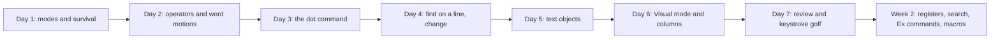

# A 14-day practice plan, week 1: the core grammar

> **Before this lesson:** no earlier lesson is strictly required, because each day below says which lesson to read first and links to it. If you have already worked through the track, treat this as the gym programme that turns knowledge into habit.

## In plain words

Reading about Vim does not make you able to use it, in the same way that reading about swimming does not keep you afloat. Vim is a **motor skill**: the commands have to move from "I know there is a key for that" to "my fingers did it before I finished the thought". The only route is repetition, in small doses, on purpose.

Think of learning a musical instrument. Nobody starts with a whole piece at full speed. You practise one short passage slowly until it is right, then the next, then join them. A good practice session is short, focused on one thing, and repeated the next day.

This plan gives you fourteen such sessions of roughly twenty minutes each. Every day has:

- **one idea**, with a link to the lesson that explains it;
- a **drill**: a few lines of text to paste into an editor, the exact keys to press, and the result you should get;
- a **check** you can do without anyone's help.

Why it matters for a job: after these two weeks, editing stops costing attention. In a pairing session, a live interview or an incident at 3 a.m., your mind stays on the problem instead of on the keyboard.

### Where to practise

Use **this site's code editor**. Open any runnable code block or problem page, open the **⚙ settings menu** and switch on **Vim mode**. Select everything in the editor pane, delete it, and paste the drill text. A real Vim or Neovim on your own machine is equally good, and from day 10 onward the drills that use patterns and Ex commands are meant for it.

### How to read the drills

- `[x]` marks the character the cursor is on. In Vim's Normal mode the cursor always sits on a character.
- `<Esc>` is the Escape key, `<CR>` is the Enter key, `<C-v>` means hold Ctrl and press `v`, and `␣` stands for one press of the space bar where a space would otherwise be invisible.
- "Before", "Keys" and "After" are what the text looks like, exactly what to type, and what the text should look like afterwards.

### Rules for the fortnight

1. **Type every drill three times.** First slowly while reading the explanation, then from memory, then once more the next day as a warm-up.
2. **If the result differs, press `u`** (undo) until the text is back to the start, and try again. A mismatch is information, not failure.
3. **No arrow keys and no mouse** inside the editor pane during practice.
4. **Stop after twenty minutes.** Short daily sessions beat one long one.



## Day 1: modes and survival

**Read first:** the opening of [the dot command lesson](#/lesson/vim/vim-dot-command) and [Insert mode](#/lesson/vim/vim-insert-mode).

**The idea.** Vim has **modes**: states in which the same keys mean different things. In **Normal mode** keys are commands (move, delete, copy). In **Insert mode** keys type text. You begin in Normal mode. `i` switches to Insert mode; `<Esc>` switches back. When in doubt, press `<Esc>`: it is always safe.

| Key | Meaning |
|---|---|
| `i` / `a` | start typing before / after the cursor character |
| `<Esc>` | back to Normal mode |
| `h` `j` `k` `l` | left, down, up, right |
| `0` / `$` | start / end of the line |
| `x` | delete the character under the cursor |
| `u` / `<C-r>` | undo / redo |
| `f{char}` | jump forward to the next `{char}` on the line |

**Drill text:**

```text
The quick brwn fox
jumps ovr the lazy dog
```

| # | Before | Keys | After | What each key did |
|---|---|---|---|---|
| 1 | `[T]he quick brwn fox` | `fw` | `The quick br[w]n fox` | `f` then `w`: jump to the next `w` |
| 2 | | `io<Esc>` | `The quick br[o]wn fox` | `i` inserts before the cursor; `o` is typed; `<Esc>` returns |
| 3 | | `j0` | `[j]umps ovr the lazy dog` | `j` down a line, `0` to its first column |
| 4 | | `fv` | `jumps o[v]r the lazy dog` | jump to the `v` |
| 5 | | `ae<Esc>` | `jumps ov[e]r the lazy dog` | `a` appends after the cursor |
| 6 | | `uu` | both fixes undone, one per `u` | each insert was one undo step |
| 7 | | `<C-r><C-r>` | both fixes back | redo |

**Check:** without looking, can you say which mode you are in after each of these: `i`, `<Esc>`, `a`, `<Esc><Esc>`? (Insert, Normal, Insert, Normal.)

## Day 2: operators and word motions

**Read first:** [Normal mode grammar](#/lesson/vim/vim-normal-grammar) and the word section of [motions](#/lesson/vim/vim-motions).

**The idea.** An **operator** is a command that does something to text: `d` deletes, `c` changes (deletes and lets you type a replacement), `y` copies, `gu` makes lower case. A **motion** is a command that moves the cursor: `w` to the next word, `b` back a word, `e` to the end of a word. Type an operator and then a motion, and the operator acts on the text the motion would have crossed. A number in front repeats a motion.

**Drill text** (one line):

```text
delete this extra extra word and CHANGE this one
```

| # | Before | Keys | After | Why |
|---|---|---|---|---|
| 1 | `[d]elete this extra extra word and CHANGE this one` | `3w` | `delete this extra [e]xtra word and CHANGE this one` | three words forward |
| 2 | | `dw` | `delete this extra [w]ord and CHANGE this one` | delete to the start of the next word |
| 3 | | `2w` | `delete this extra word and [C]HANGE this one` | two words forward |
| 4 | | `guw` | `delete this extra word and [c]hange this one` | lower-case to the start of the next word |
| 5 | | `$b` | `… and change this [o]ne` | end of line, then back to the start of that word |
| 6 | | `cwline<Esc>` | `… and change this lin[e]` | change the word, type `line`, leave Insert mode |

**Variations to try:** `de` instead of `dw` in step 2 and notice the space that is left behind; `d2w` to remove two words at once; `yw` followed by `P` to copy a word and put it before the cursor.

**Check:** predict before pressing: on `one two three` with the cursor on `one`, what does `dw` leave? What does `cw` followed by typing `1` and `<Esc>` leave? (`two three`; `1 two three`. `cw` keeps the space, `dw` takes it.)

## Day 3: the dot command

**Read first:** [the dot command](#/lesson/vim/vim-dot-command).

**The idea.** The `.` key repeats your last change. A **change** is one Normal-mode editing command, or everything you did between entering Insert mode and pressing `<Esc>`. Three keys that start an insert *and position the cursor for you* make excellent repeatable changes:

| Key | Starts typing |
|---|---|
| `A` | at the end of the line |
| `I` | at the first non-blank character of the line |
| `o` | on a new line below |

**Drill text:**

```text
alpha
beta
gamma
```

| # | Before | Keys | After |
|---|---|---|---|
| 1 | `[a]lpha` / `beta` / `gamma` | `A",<Esc>` | `alpha"[,]` / `beta` / `gamma` |
| 2 | | `j.` | `alpha",` / `beta"[,]` / `gamma` |
| 3 | | `j.` | `alpha",` / `beta",` / `gamma"[,]` |
| 4 | | `gg` | cursor on the first line |
| 5 | | `I"<Esc>` | `["]alpha",` / `beta",` / `gamma",` |
| 6 | | `j.j.` | `"alpha",` / `"beta",` / `"gamma",` |
| 7 | | `gg>>` | first line indented one step |
| 8 | | `j.j.` | all three lines indented |

Count the keys: after the first line, each further line cost two, `j` to move and `.` to act. That rhythm, one key to move and one to act, is the single most useful habit in Vim.

**Check:** with the cursor on the first of five lines, how many key presses add a semicolon to the end of all five? (`A;<Esc>` is three, then `j.` four times is eight: eleven in total.)

## Day 4: find on the line, and change up to it

**Read first:** the character-search section of [motions](#/lesson/vim/vim-motions).

**The idea.** Four motions search within the current line: `f{char}` moves **onto** the next occurrence of a character, `t{char}` moves **up to** it (stops one short). `;` repeats the search and `,` repeats it backwards. After an operator, `t` is the natural partner: `dt,` deletes up to the comma and keeps the comma; `ct)` changes everything up to the closing parenthesis.

**Drill text** (one line; paste a fresh copy before drills B and C):

```text
connect(host, port, timeout, retries)
```

**A. Moving**

| # | Before | Keys | After |
|---|---|---|---|
| 1 | `[c]onnect(host, port, timeout, retries)` | `f,` | `connect(host[,] port, timeout, retries)` |
| 2 | | `;` | `connect(host, port[,] timeout, retries)` |
| 3 | | `;` | `connect(host, port, timeout[,] retries)` |
| 4 | | `,` | back to the comma after `port` |

**B. Deleting the first argument** (fresh copy)

| # | Before | Keys | After |
|---|---|---|---|
| 1 | `[c]onnect(host, port, timeout, retries)` | `f(l` | `connect([h]ost, port, timeout, retries)` |
| 2 | | `df,` | `connect([ ]port, timeout, retries)` |
| 3 | | `x` | `connect([p]ort, timeout, retries)` |

**C. Replacing all the arguments** (fresh copy)

| # | Before | Keys | After |
|---|---|---|---|
| 1 | `[c]onnect(host, port, timeout, retries)` | `f(l` | `connect([h]ost, port, timeout, retries)` |
| 2 | | `ct)cfg<Esc>` | `connect(cf[g])` |

**Variation:** in drill B replace `df,` by `dt,` and see that the comma survives.

**Check:** on `a = b + c * d` with the cursor on `a`, which keys delete from the cursor up to but not including the `*`? (`dt*`.)

## Day 5: text objects

**Read first:** [text objects](#/lesson/vim/vim-text-objects).

**The idea.** A **text object** names a whole structure, a word, a quoted string, a pair of brackets, a paragraph, and works from anywhere inside it. It is two keys after an operator: `i` (*inner*, the contents) or `a` (*around*, the contents and the delimiters or the neighbouring space), then a letter or symbol for the kind.

| Object | Selects |
|---|---|
| `iw` / `aw` | the word / the word and a neighbouring space |
| `i"` / `a"` | inside the quotes / the quotes too |
| `i(` / `a(` | inside the parentheses / the parentheses too |
| `ip` / `ap` | the paragraph / the paragraph and the blank line after it |

**Drill text A** (one line):

```text
result = transform(data["items"], mode="fast")
```

| # | Before | Keys | After | Note |
|---|---|---|---|---|
| 1 | cursor at the start of the line | `fi` | cursor on the `i` of `items` | the first `i` on the line is in `items` |
| 2 | | `ci"rows<Esc>` | `result = transform(data["row[s]"], mode="fast")` | change inside the quotes |
| 3 | | `$F"` | cursor on the last quote of the line | `$` to the end, `F"` backward onto a quote |
| 4 | | `ci"slow<Esc>` | `… mode="slo[w]")` | the cursor may be on a quote |
| 5 | | `0f(` | cursor on the opening parenthesis | |
| 6 | | `ci(payload<Esc>` | `result = transform(payloa[d])` | on a bracket counts as inside it |

**Drill text B** (one line):

```text
this sentence has has a repeated word
```

| # | Before | Keys | After |
|---|---|---|---|
| 1 | `[t]his sentence has has a repeated word` | `3w` | cursor on the second `has` |
| 2 | | `daw` | `this sentence has [a] repeated word` |

`daw` removed the word together with one space, so the spacing is still right.

**Check:** which three keys empty a pair of square brackets from any position inside them? (`di[`.) Which keys copy the paragraph you are in? (`yap`.)

## Day 6: Visual mode and columns

**Read first:** [Visual mode](#/lesson/vim/vim-visual-mode).

**The idea.** In **Visual mode** you select text first and act on it second. `v` selects characters, `V` whole lines, and `<C-v>` a **block**: a rectangle of columns across several lines. In block mode, `I` types at the left edge and `A` at the right edge of every line of the rectangle; the text appears on the other lines when you press `<Esc>`. `$` stretches the block to the end of each line, however long.

**Drill text:**

```text
name = "ada"
role = "admin"
team = "core"
```

| # | Before | Keys | After |
|---|---|---|---|
| 1 | cursor on the first character of line 1 | `<C-v>jj` | a one-column block down three lines |
| 2 | | `I-␣<Esc>` | `- name = "ada"` / `- role = "admin"` / `- team = "core"` |
| 3 | cursor back on line 1 | `<C-v>jj$` | block covering all three lines to their ends |
| 4 | | `A,<Esc>` | `- name = "ada",` / `- role = "admin",` / `- team = "core",` |
| 5 | | `Vjj>` | all three lines indented one step |
| 6 | | `.` | indented once more (the dot command repeats a line-wise selection on the same number of lines) |
| 7 | | `gv<` | `gv` reselects the last selection; `<` moves it one step back |

**A habit to form now:** when the region can be named with a motion or text object, skip Visual mode. `gUiw` (upper-case the word) is better than `viwU` because the dot command can repeat it correctly on a word of a different length.

**Check:** which key sequence puts `//␣` in front of five consecutive lines starting at the cursor line? (`<C-v>4jI//␣<Esc>`.)

## Day 7: review and keystroke golf

**The idea.** Today nothing is new. You combine the week's commands and count your keys, a game known as *Vim golf*: as in golf, the lowest score wins. Counting is not about typing fast. It forces you to look for the command that *names* what you want instead of walking there one character at a time.

For each challenge: paste the "Before" text, put the cursor where stated, and try to reach "After". Write down your keys, count them (special keys such as `<Esc>` count as one), and only then compare with the reference solution.

| # | Before (cursor position) | After | Reference keys | Count |
|---|---|---|---|---|
| A | `timeout=30;retries=5;verbose=true` (start of line) | `timeout=30, retries=5, verbose=true` | `f;s,␣<Esc>;.` | 8 |
| B | two lines, `second` above `first` (cursor on `second`) | `first` above `second` | `ddp` | 3 |
| C | `print "hello"` (start of line) | `print("hello")` | `f␣r(A)<Esc>` | 7 |
| D | `max_retries = 3` (anywhere on the name) | `MAX_RETRIES = 3` | `gUiw` | 4 |
| E | `log(level, message, *args)` (anywhere between the parentheses) | `log()` | `di(` | 3 |

Notes on the reference solutions:

- **A** uses `s`, which replaces one character and stays in Insert mode, so the change "replace this character by a comma and a space" is one unit. `;` repeats the `f;` search and `.` repeats the change.
- **C** turns the space into the opening parenthesis with `r(` (replace one character) and appends the closing one with `A`.
- There is often more than one good answer. A different solution with the same or a lower count is a success.

The counter below gives a rough score for a keystroke string so that you can check yours. It treats `<Esc>`, `<CR>` and Ctrl-chords written as `<C-x>` as one key each. (One of this module's practice problems asks you to write a stricter version.)

```python-run
import re

def rough_score(keys):
    """Count key presses: <Esc>, <CR>, <C-x> are one key; every other character is one key."""
    return len(re.findall(r"<(?:Esc|CR|C-.)>|.", keys))

attempts = {
    "A, reference":      "f;s, <Esc>;.",
    "A, with :s":        ":s/;/, /g<CR>",
    "C, reference":      "f r(A)<Esc>",
    "C, the long way":   "wi(<Esc>hxA)<Esc>",
    "D, reference":      "gUiw",
    "D, in Visual mode": "viwU",
}
for name, keys in attempts.items():
    print(f"{name:20} {keys:22} {rough_score(keys)} keys")
```

Reading the output: for challenge A the dot-formula answer beats the substitute command by two keys, because there are only two semicolons. With twenty semicolons the substitute command, whose cost does not grow, would win easily. For D the two answers tie on count, and the operator form is still the better habit, for the reason given on day 6.

**Self-assessment for week 1.** Without notes, you should be able to:

| Skill | Yes / not yet |
|---|---|
| say which mode you are in and get back to Normal mode | |
| delete, change and copy a word, a line and "up to a character" | |
| repeat a change on following lines with `j.` | |
| reach any punctuation mark on a line with `f` and `;` | |
| change the inside of quotes and brackets with `ci"` and `ci(` | |
| prefix and suffix several lines with a block insert | |

For every "not yet", repeat that day's drill tomorrow before starting week 2.

## Why the plan is built this way

The order follows Vim's grammar from the inside out. Days 1 and 2 give you the two word classes of the language: operators (verbs) and motions (nouns). Day 3 adds repetition, which is what makes short commands worth more than they look. Days 4 and 5 add more precise nouns: character searches and text objects. Day 6 shows the alternative word order, noun first, and where it fits. Day 7 mixes everything so that choosing a command becomes a decision you make without thinking.

Each drill is small on purpose. Motor learning works on short sequences repeated with full attention; a twenty-key drill done three times teaches more than a two-hundred-key exercise done once.

> [!TIP]
> Keep a scrap of paper beside the keyboard for one week and make a mark every time you catch yourself pressing an arrow key or holding `j`. Do not try to fix it in the moment. At the end of the day, look at the marks and ask which motion would have named the place you were going.

> [!TIP]
> The problems attached to this track make excellent homework for the same days: `vim-word-forward` and `vim-word-motions` after day 2, `vim-find-char` after day 4, the `vim-text-object-…` problems after day 5, `vim-visual-block-insert` after day 6 and `vim-golf-score` after day 7. Solve them with Vim mode switched on.

> [!INTERVIEW]
> Interviewers do not ask you to recite Vim commands. What they notice is whether editing interrupts your thinking. The week-1 skills, moving by word and by character search, changing inside brackets and quotes, repeating a change, are exactly the ones used when fixing code live in front of someone.

## Pitfalls

- **Practising only when you "have time".** Tie the session to something you already do every day, such as the first coffee.
- **Speed before accuracy.** Fast wrong repetitions train the wrong movement. Go slowly enough to get it right every time; speed follows.
- **Skipping the prediction.** Say what you expect before you press the keys. Most of the learning is in the gap between the prediction and the result.
- **Learning by copying keys without the words.** Read `ct)` as "change till the parenthesis". The words are what let you build commands you were never shown.
- **Giving up in the first three days.** Productivity dips before it rises. If you have real work to finish, switch Vim mode off for that task and on again for practice.
- **Browser shortcuts.** In this site's editor, do not press Ctrl-W (the browser closes the tab). Use Backspace in Insert mode.
- **Leaving Caps Lock on.** In Normal mode capital letters are different commands; a locked Caps Lock makes Vim appear to go mad. If `j` suddenly joins lines, check it.

## Cheat sheet: week 1

| Day | Keys to own |
|---|---|
| 1 | `i` `a` `<Esc>` `h` `j` `k` `l` `0` `$` `x` `u` `<C-r>` |
| 2 | `d` `c` `y` `gu` `gU` with `w` `b` `e`; counts such as `3w`, `d2w` |
| 3 | `.` with `A` `I` `o` `>>`; the rhythm `j.` |
| 4 | `f` `t` `F` `T` `;` `,`; `dt,` `df,` `ct)` |
| 5 | `iw` `aw` `i"` `a"` `i(` `a(` `ip` `ap` after `d` `c` `y` |
| 6 | `v` `V` `<C-v>`; block `I`, `A`, `$A`; `gv`; `>` `<` |
| 7 | all of the above, with a key count |

## Summary

- Skill with Vim comes from short, daily, deliberate practice, not from reading.
- Week 1 covers the core grammar: modes, operators with motions, the dot command, character searches, text objects and Visual mode.
- Every drill gives the text, the keys and the expected result so that you can check yourself; when a result differs, undo and try again.
- Count keys now and then: it steers you toward commands that name their target.
- Use this site's editor with Vim mode on, and the track's practice problems, as your training ground.
- Finish the self-assessment honestly before moving on to week 2.

## Glossary

| Term | Meaning |
|---|---|
| mode | a state of the editor in which keys have a particular meaning |
| Normal mode | the mode in which keys are commands; Vim's resting state |
| Insert mode | the mode in which keys type text |
| Visual mode | the mode in which you select text before acting on it |
| operator | a command that acts on text, such as `d` (delete) or `c` (change) |
| motion | a command that moves the cursor, such as `w` or `f,` |
| text object | a name for a whole structure, such as `iw` (inner word) or `i(` (inside parentheses) |
| count | a number typed before a command to repeat or extend it |
| change | one editing action that the dot command can repeat and `u` can undo |
| dot command | the `.` key, which repeats the last change |
| block (Visual-block) | a rectangular selection of columns across lines, started with `<C-v>` |
| drill | a short exercise repeated until it becomes automatic |
| Vim golf | the game of making an edit in as few key presses as possible |

## Check yourself

```quiz
[
  {"q": "Line: 'copy the the file' with the cursor on the first character. Which keystrokes produce 'copy the file'?",
   "options": ["2wdaw", "2wdiw", "wde", "3wdaw"],
   "answer": 0,
   "explain": "2w moves to the second 'the'; daw deletes that word together with one neighbouring space. diw and wde would each leave two spaces side by side, and 3w lands on 'file'."},
  {"q": "Three lines need the word 'const ' in front. The cursor is on the first. Which keys do it in the fewest presses?",
   "options": ["Iconst <Esc>j.j.", "iconst <Esc>j.j.", "0iconst <Esc>j0.j0.", "Aconst <Esc>j.j."],
   "answer": 0,
   "explain": "I inserts at the first non-blank character and carries that positioning inside the change, so j. is enough on the other lines. The i versions depend on where the cursor happens to be, and A would append at the end."},
  {"q": "Line: 'send(to, subject, body)' with the cursor on s. Which keystrokes produce 'send(msg)'?",
   "options": ["f(lct)msg<Esc>", "f(ct)msg<Esc>", "f(ldt)msg", "ci)msg<Esc>"],
   "answer": 0,
   "explain": "f( moves onto the parenthesis, l steps inside, and ct) changes up to the closing parenthesis. Without the l the opening parenthesis would be replaced too; dt) followed by msg would run m, s, g as commands; ci) from outside the parentheses does not work in real Vim."},
  {"q": "Line: 'colour = \"dark blue\"' with the cursor anywhere inside the quotes. Which keys change the text to 'colour = \"red\"'?",
   "options": ["ci\"red<Esc>", "ca\"red<Esc>", "cwred<Esc>", "di\"red"],
   "answer": 0,
   "explain": "i\" is the inside of the quoted string, so the quotes stay. ca\" would remove the quotes, cw would change only part of one word, and after di\" the letters r, e, d would be Normal-mode commands."},
  {"q": "Which keys append a comma to the end of four consecutive lines of different lengths, starting on the first?",
   "options": ["<C-v>3jA,<Esc>", "<C-v>3j$A,<Esc>", "V3jA,<Esc>", "v3j$a,<Esc>"],
   "answer": 1,
   "explain": "The \\$ makes the block follow each line's own end, so A appends there. Without \\$ the comma goes at a fixed column."},
  {"q": "On the line 'a.b.c.d' with the cursor on a, what does f.;; do?",
   "options": ["Moves to the first dot", "Moves to the second dot", "Moves to the third dot", "Deletes three dots"],
   "answer": 2,
   "explain": "f. jumps to the first dot and each ; repeats the search, so two repeats reach the third dot."},
  {"q": "Why does the plan ask you to predict the result before pressing the keys?",
   "options": ["To slow you down", "Because the difference between what you expected and what happened is where the learning occurs", "Because Vim needs time to respond", "To save undo steps"],
   "answer": 1,
   "explain": "Prediction turns each drill into a test of your mental model; a surprise shows exactly which rule you have not absorbed yet."},
  {"q": "In keystroke golf, which solution for upper-casing the word under the cursor is the better habit, and why?",
   "options": ["viwU, because it is shorter", "gUiw, because the dot command can repeat it correctly on a word of any length", "They are identical in every respect", "~, because it is one key"],
   "answer": 1,
   "explain": "Both are four keys. The operator form stores 'upper-case inner word', which adapts to the next word; the Visual form stores only the size of the original selection."}
]
```

> **Source:** practice material written for this guide. The skills drilled follow Neil, Practical Vim 2e, tips 1–26 (ch. 1–4) and 47–53 (ch. 8), and the book's advice in ch. 21 to keep practising. Drill texts and wording are original.
