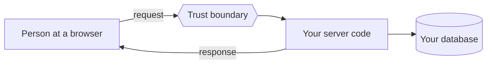
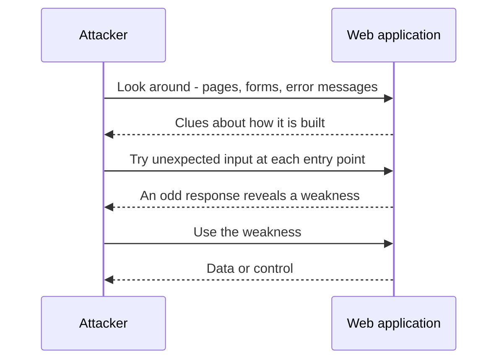

# The security mindset and a short history

> **Before this lesson:** nothing is required. If you have used a website and written a few lines of Python, you have enough. This is the first lesson of the track.

## In plain words

Building software is like building a house. Most of the time you think about the people who will live in it: where the kitchen goes, how the light falls, whether the stairs are comfortable. Security asks a different question about the same house: *what would somebody do who wants to get in without being invited?* They will not use the front door politely. They will try the window you forgot to latch, the spare key under the flowerpot, the builder's entrance that was never bricked up.

**Web application security** is the craft of answering that question for websites and the programs behind them. A *web application* is any program you use through a browser or a phone app that talks to a computer somewhere else — a shop, a bank, a chat tool. The people who misuse such programs are called **attackers**. Your job as a developer is not to become one; it is to build things that keep working, and keep their users' information safe, even while somebody is actively trying to break them.

Why does this matter for a job? Because every company that puts software on the internet is attacked — not occasionally, but constantly and automatically. An engineer who can spot the unlatched window during design or code review saves their employer from the kind of incident that reaches the newspapers. Interviewers know this, which is why security questions appear in interviews for ordinary software roles, not only for specialist ones.

This lesson gives you the vocabulary and the way of thinking the rest of the track relies on. There is very little code in it; the code starts in the next lesson.

## Three words you must not mix up

Newcomers often use *threat*, *vulnerability* and *risk* as if they meant the same thing. They do not, and the difference is the foundation of everything else.

- An **asset** is something worth protecting: customers' passwords, money in an account, the ability of the site to stay online, the company's reputation.
- A **threat** is something bad that *could* happen to an asset, together with whoever or whatever might cause it. "A stranger reads other customers' orders" is a threat.
- A **vulnerability** is a weakness that makes a threat possible. "The orders page shows any order whose number is typed into the address bar, without checking who is asking" is a vulnerability.
- An **exploit** is the concrete act (or tool) that uses a vulnerability. Typing someone else's order number is the exploit.
- **Risk** is how much you should worry: roughly *how likely is it* multiplied by *how bad would it be*.

Back to the house. The jewellery is the asset. Burglary is the threat. The unlatched window is the vulnerability. Climbing through it is the exploit. The risk depends on the neighbourhood and on what the jewellery is worth.

A control (also called a **mitigation** or **defence**) is anything that lowers risk: a lock, an alarm, moving the jewellery to a bank. Notice that the three examples work in different ways. The lock *prevents*, the alarm *detects*, and the bank *reduces the impact* of a break-in. Good security uses all three kinds.

## What "secure" means: the CIA triad

"Is it secure?" is too vague to answer. Security people split the question into three properties, remembered by the initials **CIA** (nothing to do with the intelligence agency):

| Property | Plain meaning | Example failure |
|---|---|---|
| **Confidentiality** | Only the right people can read it | A stranger downloads the customer list |
| **Integrity** | Only the right people can change it, and changes are detectable | Someone alters the price of an item to zero |
| **Availability** | It works when the right people need it | The site is flooded with requests and goes offline |

Two more ideas complete the picture. **Authentication** means proving *who* someone is (logging in). **Authorisation** means deciding *what* that person is allowed to do. A hotel checks your passport at the desk (authentication) and then gives you a card that opens room 412 but not room 413 (authorisation). Many of the worst real-world bugs are authorisation bugs: the application knows perfectly well who you are and still lets you into the wrong room.

## The core habit: ask "who controls this value?"

Here is the single most useful habit in the whole field. Whenever a piece of data enters your program, ask: **who chose this value?**

If the answer is "my own code" or "my own database, and only my code writes to it", the value is *trusted*. If the answer is "the person using the website", "another company's server", or "I am not sure", the value is **untrusted input**. Untrusted does not mean malicious. It means *you cannot assume it is friendly*, so you must check it before relying on it.

The imaginary line that untrusted data crosses on its way into your system is called a **trust boundary**. The most important trust boundary on the web runs between the browser and the server.



Everything to the left of the boundary is under the visitor's control. This surprises beginners, because the web page *looks* like part of your application. It is not. The page is a set of instructions you sent to a stranger's computer, and the stranger is free to ignore them. A price shown in a form, a hidden field, a disabled button, a check written in JavaScript — all of these run on a machine you do not control and can be changed before the request is sent.

Let us make that concrete with the smallest possible example. A shop's checkout form sends the item and its price to the server. The first function below trusts the price that arrives. The second looks the price up itself.

```python-run
# A tiny "server". PRICES is our own data: we wrote it, so we trust it.
PRICES = {"mug": 12, "poster": 8}

def checkout_trusting(form):
    # form is whatever the browser sent. The visitor controls every field.
    return form["quantity"] * form["price"]

def checkout_checked(form):
    item = form["item"]
    quantity = form["quantity"]
    if item not in PRICES:                 # unknown item: refuse
        raise ValueError("no such item")
    if not isinstance(quantity, int) or not 1 <= quantity <= 20:
        raise ValueError("bad quantity")   # negative or absurd amounts: refuse
    return quantity * PRICES[item]         # the price comes from OUR table

honest = {"item": "mug", "quantity": 2, "price": 12}
edited = {"item": "mug", "quantity": 2, "price": 0}     # the visitor changed one number

print("trusting, honest form:", checkout_trusting(honest))
print("trusting, edited form:", checkout_trusting(edited))
print("checked,  edited form:", checkout_checked(edited))
```

Line by line: `PRICES` is a dictionary, a lookup table from names to numbers. `checkout_trusting` multiplies two numbers that both came from the visitor, so the visitor decides the total — the edited form pays `0`. `checkout_checked` reads only the *item name* and *quantity* from the form, checks that both are sensible, and takes the price from its own table. The edited price is never looked at, so the answer is `24` again.

Nothing about the first function looks wrong when you test it as a normal customer. That is the nature of security bugs: **they are invisible to people who use the software as intended.** You find them only by deliberately asking what happens when a value is not what you expected.

> [!TIP]
> When reading any code, underline every value that comes from outside (request parameters, headers, cookies, uploaded files, responses from other services). Follow each one until it is either checked or used. A value that is *used before it is checked* is where the bug will be.

## Six principles you will meet in every lesson

These are not rules to memorise for their own sake. Each one is a pattern that, once you see it, explains dozens of specific defences.

**1. Never trust the client.** Checks in the browser are a convenience for honest users. Every check that matters must be repeated on the server.

**2. Least privilege.** Give each person and each program only the permissions needed for its task — no more. If the part of your application that shows product pages can only *read* the products table, a bug in it cannot delete customers. The word *privilege* here means "permission to do something".

**3. Defence in depth.** Assume any single protection will fail one day and put another behind it. A castle has a moat *and* a wall *and* a keep. On the web that might be: validate the input, *and* use a safe database call, *and* give the database account limited rights, *and* watch the logs.

**4. Deny by default.** Start from "nobody may do anything" and add permissions deliberately. The opposite approach — allow everything, then block the bad cases you can think of — fails because you cannot think of them all. A list of permitted things is an **allow-list**; a list of forbidden things is a **block-list** (older texts say whitelist and blacklist). Prefer allow-lists.

**5. Fail securely.** When something goes wrong — the database is unreachable, the input cannot be parsed — the result should be "access refused", never "access granted because the check crashed".

**6. Keep it simple and visible.** Complicated security code hides mistakes. A system should stay safe even if its design is public; secrecy of *keys* is fine, secrecy of *how it works* is a weak plan (this is sometimes called avoiding "security through obscurity").

> [!WARNING]
> "We're too small to be a target" is a comforting mistake. Most attacks are not aimed at anyone: programs scan the whole internet looking for a known weakness and attack whatever answers. Being unknown does not hide you from a scanner.

## A short history, and what each episode teaches

You do not need dates for an interview. You need the lessons, because each one is still true.

**Before computers: breaking codes.** In the 1930s and 1940s armies protected radio messages with cipher machines; the best known is the German *Enigma*, a typewriter-like device that scrambled each letter through rotating wheels. Polish and later British mathematicians found that operators' habits — repeated phrases, predictable message openings — let them narrow the possibilities enough for an electromechanical machine to try the remainder. *Lesson: systems are usually defeated through the way people use them, not through the mathematics.*

**The telephone network: mixing instructions with content.** Mid-century long-distance telephone exchanges controlled calls by sending tones down the same wire that carried the callers' voices. Hobbyists, later called *phreakers*, discovered that playing the right tone into the mouthpiece — famously one at 2600 hertz — made the exchange obey them, giving free calls. The telephone companies eventually moved control signals to a separate channel. *Lesson: when commands and data travel together, whoever supplies the data can supply commands.* You will meet exactly this idea again as **injection**, the cause of SQL injection and cross-site scripting.

**Early networked computers.** In 1988 a graduate student released a self-copying program, now known as the Morris worm, that spread across a large share of the young internet by abusing a few known weaknesses and guessing weak passwords; it was meant as an experiment and still knocked thousands of machines offline. *Lesson: connected systems fail together, and weak passwords were already the easy way in.*

**The web becomes interactive.** The first websites were documents. Around the turn of the millennium they became applications: pages built on the fly from databases, with logins and shopping baskets, and browsers that ran small programs written in JavaScript. Each new capability opened a new category of mistake. Pages that pasted visitors' text into HTML allowed strangers' scripts to run in other people's browsers. In 2005 a self-spreading script on a popular social network added over a million "friends" to its author's profile within a day — harmless in intent, but a vivid demonstration. *Lesson: features arrive before the understanding of how they can be abused.*

**The modern era.** Today's applications are assembled from thousands of open-source packages, run on rented cloud computers, and expose programming interfaces to phones and partner companies. Attackers have professionalised: stolen password lists are traded, attacks are automated, and criminals encrypt organisations' data for ransom. Two patterns stand out. First, **supply-chain** problems — in late 2021 a flaw in a widely used Java logging library (nicknamed *Log4Shell*) left enormous numbers of unrelated products exposed at once, because they all contained the same component. Second, plain **misconfiguration** — storage left open to the public, default passwords never changed. *Lesson: you are responsible for code you did not write and settings you did not think about.*

The thread running through all of it: defenders must close every gap, while an attacker needs only one. That imbalance is why the principles above emphasise layers and defaults rather than heroics.

## The map: the OWASP Top 10

**OWASP** — the Open Worldwide Application Security Project — is a non-profit community that publishes free security guidance. Its best-known document is the **OWASP Top 10**, a ranked list of the most significant categories of web application risk, revised every few years from real-world data. Interviewers expect you to recognise the names. The 2021 edition lists:

| # | Category | In one sentence | Where in this track |
|---|---|---|---|
| A01 | Broken Access Control | Users can act outside their intended permissions | Access control module |
| A02 | Cryptographic Failures | Sensitive data is exposed through weak or missing cryptography | Passwords, sessions, JWT |
| A03 | Injection | Untrusted data is interpreted as code or commands | XSS, SQL, command injection |
| A04 | Insecure Design | The flaw is in the plan, not the typing | Threat modelling, business logic |
| A05 | Security Misconfiguration | Unsafe defaults and settings | Headers, misconfiguration |
| A06 | Vulnerable and Outdated Components | Known-bad libraries | Supply chain |
| A07 | Identification and Authentication Failures | Login can be bypassed or guessed | Authentication, sessions |
| A08 | Software and Data Integrity Failures | Code or data is trusted without verification | Deserialisation, supply chain |
| A09 | Security Logging and Monitoring Failures | Attacks go unnoticed | Logging lesson |
| A10 | Server-Side Request Forgery | The server is tricked into making requests | SSRF lesson |

A newer edition published in 2025 reshuffles the list — supply-chain failures move up and become their own category, and a category about mishandling errors and exceptional conditions appears — but the underlying weaknesses are the same ones. Always check the OWASP site for the current list before an interview; the *categories* change slowly, the *ranking* changes with each edition.

> [!INTERVIEW]
> A common opener is "What is the OWASP Top 10 and can you name a few entries?" A strong answer names three or four categories, gives a one-line example of each, and adds that the list is an awareness document — a starting point for conversation, not a complete checklist or a standard to "comply" with.

## How defenders and attackers work

It helps to know the shape of an attack, because each stage is an opportunity to stop it.



The first stage is called **reconnaissance** (often shortened to *recon*): learning what exists. The second is discovery of a weakness. The third is exploitation. Defenders respond at each step: reveal less in the first, validate and encode in the second, limit what any one weakness can reach in the third, and keep records so that the whole sequence is noticed.

On the defending side the work is spread across the life of a project:

1. **Design** — decide what needs protecting and how (threat modelling).
2. **Build** — use safe patterns and libraries by default.
3. **Review** — have someone else read the code looking for the mistakes in this track.
4. **Test** — automated scanners and deliberate misuse tests.
5. **Operate** — patch dependencies, watch logs, respond when something is reported.

The earlier a problem is caught, the cheaper it is. A design flaw noticed on a whiteboard costs a conversation; the same flaw found after a breach costs customers.

## Ethics and the law

Understanding how attacks work is necessary for defence, and it comes with a boundary: **only ever test systems you own or have explicit written permission to test.** In most countries, accessing someone else's system without permission is a crime even if you change nothing and mean well. Everything in this track is aimed at reading, reviewing and fixing code. The examples use a made-up shop application, and the runnable demonstrations show defences. If you find a weakness in a real product by accident, the professional response is to report it privately to the organisation — a process called *responsible disclosure*, covered near the end of the track.

## Pitfalls for newcomers

- **Thinking security is a feature added at the end.** It is a property of the whole design, like the strength of a bridge.
- **Relying on one strong wall.** A firewall, an encrypted connection or a login page each stop one kind of problem. None of them stops a logged-in user from asking for another user's data.
- **Confusing encryption with security.** The padlock in the browser means nobody *between* you and the site can read the traffic. It says nothing about whether the site itself handles your data correctly.
- **Block-list thinking.** "We strip out the word `script`" invites an endless contest you will lose. Define what is allowed instead.
- **Treating users as the enemy.** Most are honest. Design so that the honest path is easy and the dishonest path is closed, rather than making everyone suffer.
- **Assuming frameworks make you safe automatically.** They give excellent defaults; the vulnerabilities live in the places where a developer switched the default off.

## Summary

- Security is about what happens when someone uses your software in ways you did not intend.
- Assets are protected from threats; vulnerabilities make threats possible; risk combines likelihood and impact.
- Confidentiality, integrity and availability describe what "secure" means; authentication and authorisation describe who may do what.
- The key question for every value is *who controls it?* Data crossing the trust boundary from the browser is untrusted until checked on the server.
- Six recurring principles: never trust the client, least privilege, defence in depth, deny by default, fail securely, keep it simple.
- History repeats: mixing commands with data, human shortcuts, shared components and unsafe defaults are behind most incidents.
- The OWASP Top 10 is the common map of risk categories.

## Glossary

- **Asset** — anything of value that needs protection.
- **Threat** — a potential harmful event and its source.
- **Vulnerability** — a weakness that lets a threat happen.
- **Exploit** — the action or tool that takes advantage of a vulnerability.
- **Risk** — likelihood of harm combined with its impact.
- **Control / mitigation** — a measure that reduces risk.
- **CIA triad** — confidentiality, integrity, availability.
- **Authentication** — verifying identity. **Authorisation** — deciding permissions.
- **Untrusted input** — data whose value is chosen by someone outside your control.
- **Trust boundary** — the line where untrusted data enters a trusted part of the system.
- **Allow-list / block-list** — a list of what is permitted / what is forbidden.
- **Least privilege** — granting only the permissions a task needs.
- **Defence in depth** — several independent layers of protection.
- **Reconnaissance** — gathering information about a target before acting.
- **OWASP** — community project publishing free application-security guidance.

```quiz
[
  {"q": "A page shows any invoice whose number is typed into the address bar without checking who is logged in. In security vocabulary, this missing check is a…",
   "options": ["threat", "vulnerability", "risk", "asset"], "answer": 1,
   "explain": "A vulnerability is the weakness itself. The threat is a stranger reading invoices; the invoices are the asset; the risk is how likely and how damaging that would be."},
  {"q": "An attacker changes the delivery address on someone else's order. Which property of the CIA triad was violated?",
   "options": ["Confidentiality", "Integrity", "Availability", "None of them"], "answer": 1,
   "explain": "Integrity is about data being changed only by those permitted to change it. Nothing was necessarily read in secret (confidentiality) or taken offline (availability)."},
  {"q": "A form uses JavaScript to stop users entering a quantity above 10. Why is that not a security control?",
   "options": ["JavaScript is slow", "The check runs on the visitor's machine, so the visitor can skip it and send any request", "Browsers do not support number checks", "It is a security control"], "answer": 1,
   "explain": "Anything in the browser is on the far side of the trust boundary. It improves the experience for honest users; the server must repeat the check."},
  {"q": "Which statement best describes 'defence in depth'?",
   "options": ["Use the single strongest protection available", "Keep the design secret", "Layer several independent protections so that one failure is not fatal", "Block every input that looks suspicious"], "answer": 2,
   "explain": "Each layer is assumed to fail eventually; the next one limits the damage."},
  {"q": "What lesson from the telephone 'phreaking' era reappears as injection attacks on the web?",
   "options": ["Passwords should be long", "Commands and data sharing one channel lets the data supplier issue commands", "Networks should be encrypted", "Hardware is more secure than software"], "answer": 1,
   "explain": "Control tones travelled on the voice channel, so a caller could 'speak' commands. SQL injection and XSS are the same confusion between data and instructions."},
  {"q": "Your database is unreachable while checking whether a user may view a report. Following 'fail securely', the application should…",
   "options": ["show the report, since the check could not prove otherwise", "refuse and report an error", "retry forever", "log the user out of every device"], "answer": 1,
   "explain": "When a security decision cannot be made, the safe outcome is denial. Granting access on error turns every outage into a bypass."},
  {"q": "Which is an allow-list approach to accepting a 'sort' parameter?",
   "options": ["Reject it if it contains a semicolon", "Remove the word DROP from it", "Accept it only if it is one of: 'price', 'name', 'date'", "Accept anything under 50 characters"], "answer": 2,
   "explain": "An allow-list enumerates the permitted values. The other options try to guess what bad input looks like, which is never complete."},
  {"q": "Authentication and authorisation differ how?",
   "options": ["They are two names for login", "Authentication proves who you are; authorisation decides what you may do", "Authorisation happens first", "Authentication is for administrators only"], "answer": 1,
   "explain": "The hotel desk checks your identity (authentication); your key card opens only your room (authorisation)."}
]
```

> **Source:** Hoffman, *Web Application Security*, ch. 1 (history of software security) and ch. 17 (overview of securing modern web applications), retold in original wording. OWASP Top 10 — https://owasp.org/www-project-top-ten/ ; OWASP Developer Guide, security principles — https://owasp.org/www-project-developer-guide/ ; MDN, Security on the web — https://developer.mozilla.org/en-US/docs/Web/Security
