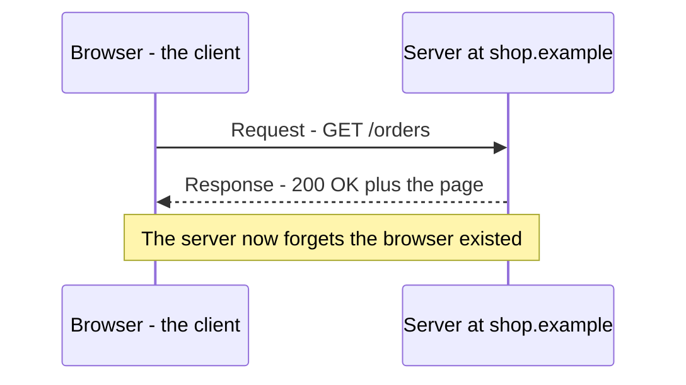
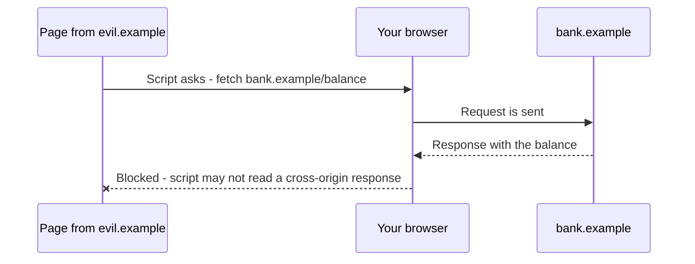

# HTTP, origins and the same-origin policy

> **Before this lesson:** read [The security mindset and a short history](#/lesson/web-security/security-mindset) for the words *trust boundary* and *untrusted input*. No networking knowledge is assumed.

## In plain words

When you open a website, your browser and a distant computer exchange short written messages. The browser writes "please give me the page called `/orders`", the other computer writes back "here it is". The set of rules for writing those messages is **HTTP**, the *Hypertext Transfer Protocol*. A *protocol* is an agreed format for a conversation, like the fixed phrases pilots and control towers use.

Now picture a large office building with many companies inside. Each company has its own locked office. Visitors may post a letter under any door, but they cannot walk into another company's office and read its files. Your browser is that building. Each website you have open is a tenant, and the rule that keeps tenants out of one another's offices is the **same-origin policy**. Without it, any page you visited could quietly read your email in another tab.

Almost every vulnerability later in this track is either a way of abusing the message format (HTTP) or a way of getting around that tenant rule. A developer who understands these two things can reason about attacks they have never seen before, which is exactly what interviewers probe for.

## Clients, servers and one round trip

A **client** is the program that asks; on the web it is usually a browser. A **server** is the program that answers. One question and its answer are called a **request** and a **response**.



The note at the bottom is important. HTTP is **stateless**: each request stands alone, and the server has no built-in memory that the next request comes from the same person. Remembering who you are is added on top with *cookies*, the subject of the next lesson.

## Anatomy of a URL

The address you type is a **URL** (Uniform Resource Locator). It has named parts, and security decisions depend on reading them correctly.

```
https://shop.example:443/orders/17?view=full#items
└─┬─┘   └────┬─────┘└┬┘└───┬────┘└───┬───┘└──┬─┘
scheme     host    port   path     query   fragment
```

- **Scheme** — which protocol to speak. `https` is HTTP sent through an encrypted tunnel; `http` is the same conversation in the clear.
- **Host** — the name of the server.
- **Port** — a number selecting one of many services on that server. If omitted, `https` uses 443 and `http` uses 80.
- **Path** — which resource is wanted.
- **Query** — extra named values after `?`, written `name=value` and joined with `&`.
- **Fragment** — the part after `#`. The browser keeps it to itself; it is never sent to the server.

Python's standard library can take a URL apart. Run this and compare the output with the diagram:

```python-run
from urllib.parse import urlsplit

parts = urlsplit("https://shop.example:443/orders/17?view=full#items")
print("scheme  :", parts.scheme)
print("host    :", parts.hostname)
print("port    :", parts.port)
print("path    :", parts.path)
print("query   :", parts.query)
print("fragment:", parts.fragment)
```

`urlsplit` returns an object whose attributes are the named pieces. Using a real parser like this — instead of searching the text for a dot or a slash — matters a great deal later, because attackers build addresses that *look* like one thing to a careless check and mean another to the browser.

## What a request looks like

HTTP messages are plain text. Here is a complete request for a made-up shop:

```http
POST /cart/items HTTP/1.1
Host: shop.example
Cookie: sid=8f3a...
Content-Type: application/json
Content-Length: 27

{"item": "mug", "qty": 2}
```

Reading it top to bottom:

1. The **request line**: a **method** (`POST`), a path, and the protocol version.
2. **Headers**: one `Name: value` pair per line, carrying information *about* the message. `Host` says which site is wanted, `Cookie` returns stored cookies, `Content-Type` says what format the body is in.
3. A blank line.
4. The **body**: the data being sent, here a small piece of **JSON** (JavaScript Object Notation — a text format for structured data using braces, quotes and colons).

The method states the intent. The ones you will meet most:

| Method | Meaning | Should it change anything on the server? |
|---|---|---|
| `GET` | Fetch something | No — it is called a *safe* method |
| `HEAD` | Like GET, headers only | No |
| `POST` | Submit data / perform an action | Yes |
| `PUT`, `PATCH` | Replace / partly update something | Yes |
| `DELETE` | Remove something | Yes |
| `OPTIONS` | Ask what is permitted | No |

> [!WARNING]
> "GET must not change anything" is not etiquette, it is a security rule. Browsers, link previewers and other websites trigger GET requests freely — an image tag is enough. If `GET /account/delete` really deletes the account, anyone who gets you to load a page containing that address has deleted your account. This is the seed of cross-site request forgery, covered in its own lesson.

Every part of a request — the path, the query, each header, the cookie, the body — is written by the client. All of it is untrusted input. Beginners readily distrust form fields and forget that headers such as `User-Agent`, `Referer` or `X-Forwarded-For` are every bit as easy to fake.

## What a response looks like

```http
HTTP/1.1 200 OK
Content-Type: text/html; charset=utf-8
Set-Cookie: sid=8f3a...; HttpOnly; Secure; SameSite=Lax
Cache-Control: no-store

<!doctype html><title>Your cart</title>...
```

The first line carries a **status code**, a three-digit summary of what happened:

| Range | Meaning | Examples |
|---|---|---|
| 2xx | Success | `200 OK`, `201 Created`, `204 No Content` |
| 3xx | Look elsewhere | `302 Found` (redirect), `304 Not Modified` |
| 4xx | The client's request was wrong | `400 Bad Request`, `401 Unauthorized`, `403 Forbidden`, `404 Not Found`, `429 Too Many Requests` |
| 5xx | The server failed | `500 Internal Server Error`, `503 Service Unavailable` |

Two of these are confused constantly. `401` means "I do not know who you are — log in". `403` means "I know who you are, and the answer is no". Remember the hotel from the previous lesson: 401 is the front desk asking for your passport; 403 is your key card refusing to open someone else's room.

Response headers are where a server gives the browser security instructions. `Set-Cookie` stores a cookie. `Content-Type` tells the browser how to interpret the body, and getting it wrong can turn harmless text into a running script. Later lessons add `Content-Security-Policy`, `Strict-Transport-Security` and others.

## HTTPS: the sealed envelope

Plain HTTP is a postcard: every network device between you and the server can read it and alter it. **HTTPS** puts the same conversation inside **TLS** (Transport Layer Security), which provides three things:

- **Encryption** — outsiders see scrambled bytes.
- **Integrity** — any tampering in transit is detected.
- **Server authentication** — a *certificate*, issued by an organisation browsers trust, proves you are talking to the real `shop.example` and not an impostor.

What HTTPS does **not** do is make the application correct. It protects the pipe, not what happens at either end. A site can be perfectly encrypted and still hand your data to the wrong user.

Here is a small vulnerable-versus-fixed comparison. The first configuration serves the login page over plain HTTP; the second redirects to HTTPS and tells browsers never to try HTTP again.

```python
# VULNERABLE: credentials cross the network readable by anyone on the path
@app.post("/login")                       # reachable at http://shop.example/login
def login(form: LoginForm):
    ...

# FIXED: refuse plain HTTP, and instruct the browser to remember that
@app.middleware("http")
async def https_only(request, call_next):
    if request.url.scheme != "https":
        return RedirectResponse(str(request.url.replace(scheme="https")), status_code=308)
    response = await call_next(request)
    response.headers["Strict-Transport-Security"] = "max-age=31536000; includeSubDomains"
    return response
```

The fixed version does two things. The `if` sends any plain-HTTP visitor to the same address with `https`. The added header, called **HSTS** (HTTP Strict Transport Security), tells the browser: "for the next year (`31536000` seconds), convert every request to this site to HTTPS yourself, before sending anything." That second step matters because the very first plain request can be intercepted; after one successful visit the browser stops making plain requests at all.

## Origins: who is a "different website"?

Now the tenant rule. Browsers group web content by **origin**, which is the combination of three URL parts:

> **origin = scheme + host + port**

Two URLs have the same origin only if all three match exactly. Path, query and fragment play no part.

| URL A | URL B | Same origin? | Why |
|---|---|---|---|
| `https://shop.example/cart` | `https://shop.example/admin` | Yes | Only the path differs |
| `https://shop.example` | `http://shop.example` | No | Scheme differs |
| `https://shop.example` | `https://api.shop.example` | No | Host differs |
| `https://shop.example` | `https://shop.example:8443` | No | Port differs |

The comparison is easy to express in code, and writing it once makes the definition stick:

```python-run
from urllib.parse import urlsplit

DEFAULT_PORTS = {"http": 80, "https": 443}

def origin(url):
    p = urlsplit(url)
    scheme = p.scheme.lower()
    host = (p.hostname or "").lower()          # host names are case-insensitive
    port = p.port or DEFAULT_PORTS.get(scheme)  # fill in the default when absent
    return (scheme, host, port)

def same_origin(a, b):
    return origin(a) == origin(b)

pairs = [
    ("https://shop.example/cart", "https://shop.example/admin"),
    ("https://shop.example", "http://shop.example"),
    ("https://shop.example", "https://api.shop.example"),
    ("https://shop.example", "https://shop.example:443"),
    ("https://shop.example", "https://SHOP.example:8443"),
]
for a, b in pairs:
    print(same_origin(a, b), "|", a, "vs", b)
```

`origin` returns a tuple — a fixed group of three values — and `same_origin` compares two tuples. The fourth pair prints `True` because 443 is the default for `https`, so writing it out changes nothing. The last prints `False` because of the port, even though the capital letters in the host are ignored.

You will also see the word **site**, which is looser: roughly the scheme plus the *registrable domain* (the part you buy, such as `shop.example`). `app.shop.example` and `api.shop.example` are different origins but the same site. The distinction returns when we discuss the `SameSite` cookie attribute.

## The same-origin policy

The **same-origin policy** (SOP) is a rule built into every browser:

> Script running in a page from one origin may not **read** data belonging to another origin.

Concretely, JavaScript on `https://evil.example` cannot read the content of a frame showing `https://bank.example`, cannot read that origin's cookies or stored data, and cannot read the *response* to a request it makes to that origin.

The subtle part — and the part interviewers test — is what the policy does **not** stop:

| A page on origin A may… | Allowed? |
|---|---|
| link to origin B | Yes |
| embed B's images, scripts, stylesheets, frames | Yes |
| **send** a form or request to B, cookies included | Yes (subject to cookie rules) |
| **read** B's response from script | **No**, unless B opts in |
| read B's cookies, storage or page content | **No** |

So the policy is a *read* barrier, not a *send* barrier. A hostile page cannot see your bank balance, but it can cause your browser to send a request to the bank. If the bank acts on that request because your cookie came along, damage is done without the attacker ever reading a byte. That gap is cross-site request forgery.



Here is how that looks from the hostile page's point of view:

```javascript
// Running on https://evil.example
const response = await fetch("https://bank.example/api/balance");
const data = await response.json();   // never reached: the browser refuses
// Console: "blocked by CORS policy: No 'Access-Control-Allow-Origin' header..."
```

`fetch` is the browser function for making a request from script. The request may travel, but the browser refuses to hand the answer to the script because the origins differ and the bank did not grant permission.

That permission mechanism is **CORS** — Cross-Origin Resource Sharing. A server can add response headers saying "origin X may read this". CORS therefore *loosens* the same-origin policy; it is never something you "turn on for security". A whole section of the headers lesson covers doing it without opening the door to everyone.

> [!INTERVIEW]
> "What does the same-origin policy protect, and what does it not protect?" Answer: it stops a page from *reading* another origin's responses, DOM and storage. It does not stop the page from *sending* requests to that origin, which is why CSRF defences exist, and it does not help at all if hostile script runs *inside* your own origin, which is why cross-site scripting is so serious — the script is then a legitimate tenant of your office.

## Why this explains the major attacks

With HTTP and the same-origin policy in hand, the big three browser attacks fall into place:

- **Cross-site scripting (XSS)**: the attacker gets their script to run *as* your origin. The policy offers no protection because, from the browser's view, the script belongs there.
- **Cross-site request forgery (CSRF)**: the attacker cannot read, but can make the victim's browser *send*.
- **Misconfigured CORS**: the server tells browsers that hostile origins may read after all.

## How to look for yourself

You learn HTTP fastest by watching it.

- **Browser developer tools.** Press F12, open the *Network* tab, reload a page and click any row. You will see the request line, every header, cookies and the response. Do this on your own application for every feature you build.
- **`curl -i https://example.com`** in a terminal prints the response headers and body with no browser involved. The `-i` flag means "include headers". Because curl is not a browser, it ignores the same-origin policy entirely — a reminder that the policy protects *users of browsers*, and that your server must never rely on it to keep out a determined client.
- **In code review**, find every handler registered for `GET` and check that it only reads. Find every place a URL is built or compared and check that a parser is used.

> [!TIP]
> A quick self-test for any endpoint: "If a stranger's web page made my logged-in browser send this exact request, would something bad happen?" If yes, that endpoint needs CSRF protection. "If a stranger sent this request with curl and no cookies, would it work?" If yes, it needs authentication.

## Pitfalls

- **Believing headers.** `Referer`, `Origin`, `User-Agent` and `X-Forwarded-For` are set by whoever sends the request. Browsers set some of them honestly; other clients need not.
- **Putting secrets in URLs.** Addresses are saved in browser history, server logs and analytics, and may be passed to other sites in the `Referer` header. Tokens belong in headers or bodies.
- **Assuming subdomains are the same origin.** They are not — but they *are* the same site, and they can set cookies for the parent domain, so a weak subdomain can still hurt its siblings.
- **Mixed content.** An HTTPS page that loads a script over HTTP has thrown its protection away; modern browsers block this.
- **Treating CORS errors as a bug to silence.** Replying `Access-Control-Allow-Origin: *` to make the red console message disappear removes a protection you wanted.
- **Thinking the fragment reaches the server.** It does not, which occasionally matters: client-side code that acts on the fragment is processing input the server never saw.

## Summary

- HTTP is a stateless exchange of text messages: a request (method, path, headers, body) and a response (status, headers, body).
- Everything in a request is controlled by the sender and is untrusted.
- Safe methods such as GET must not change state.
- HTTPS encrypts and authenticates the connection; HSTS makes browsers insist on it. Neither fixes application logic.
- An origin is scheme + host + port. The same-origin policy stops scripts from reading across origins but does not stop requests being sent.
- CORS is a controlled relaxation of that policy, granted by the server whose data is being read.

## Glossary

- **HTTP** — the request/response protocol of the web. **HTTPS** — HTTP inside an encrypted TLS connection.
- **Client / server** — the program that asks / the program that answers.
- **Request / response** — one question and its answer.
- **Method** — the verb of a request (GET, POST…). **Safe method** — one that must not change server state.
- **Header** — a `Name: value` line carrying information about a message.
- **Status code** — three-digit result of a request.
- **Stateless** — the server keeps no memory between requests by default.
- **URL** — web address made of scheme, host, port, path, query, fragment.
- **TLS** — the protocol that encrypts and authenticates connections. **Certificate** — proof of a server's identity.
- **HSTS** — header telling browsers to use HTTPS only for a site.
- **Origin** — scheme + host + port. **Site** — scheme + registrable domain.
- **Same-origin policy** — browser rule preventing cross-origin reads.
- **CORS** — headers by which a server permits specific cross-origin reads.
- **JSON** — a text format for structured data.

```quiz
[
  {"q": "Which pair of URLs shares the same origin?",
   "options": ["https://shop.example and http://shop.example", "https://shop.example/a and https://shop.example/b?x=1", "https://shop.example and https://www.shop.example", "https://shop.example and https://shop.example:8443"], "answer": 1,
   "explain": "Origin is scheme + host + port. Only the path and query differ in the second pair; the others change scheme, host or port."},
  {"q": "A page on evil.example contains a form that auto-submits to bank.example/transfer. What does the same-origin policy do?",
   "options": ["Blocks the request from being sent", "Lets the request go but stops evil.example's script reading the response", "Deletes the bank cookie", "Shows a warning to the user"], "answer": 1,
   "explain": "The policy restricts reading, not sending. That is why servers need CSRF defences for state-changing requests."},
  {"q": "What does a 403 status code tell the client?",
   "options": ["You must log in first", "The server crashed", "You are identified but not permitted to do this", "The page has moved"], "answer": 2,
   "explain": "401 is 'who are you?'; 403 is 'I know who you are and the answer is no'."},
  {"q": "Why must a GET handler never delete or modify data?",
   "options": ["GET requests cannot carry cookies", "GET is slower than POST", "Browsers and other sites trigger GET requests freely, for example through an image tag", "Servers ignore GET bodies"], "answer": 2,
   "explain": "Anything able to make a browser load a URL can trigger a GET. State changes belong behind methods that can be protected against forgery."},
  {"q": "A site uses HTTPS everywhere. Which problem does that solve?",
   "options": ["A logged-in user viewing another user's invoices", "Someone on the same Wi-Fi reading the traffic", "SQL injection in the search box", "Weak passwords"], "answer": 1,
   "explain": "TLS protects data in transit between browser and server. It does nothing about what the application does with requests once they arrive."},
  {"q": "Which request header can a server rely on as proof of where a request came from when the client is not a browser?",
   "options": ["Referer", "Origin", "X-Forwarded-For", "None of them"], "answer": 3,
   "explain": "All headers are written by the client. Browsers set some honestly, but scripts and tools such as curl can send any value."},
  {"q": "What is CORS?",
   "options": ["A firewall that blocks cross-site attacks", "A way for a server to let named origins read its responses, relaxing the same-origin policy", "A replacement for HTTPS", "A cookie attribute"], "answer": 1,
   "explain": "CORS grants permission; it removes a restriction. Configuring it too generously creates vulnerabilities."},
  {"q": "What does the Strict-Transport-Security header ask the browser to do?",
   "options": ["Encrypt cookies", "Always use HTTPS for this site for the stated period", "Block scripts from other origins", "Hide the URL"], "answer": 1,
   "explain": "HSTS makes the browser upgrade requests to HTTPS itself, closing the window in which a plain HTTP request could be intercepted."}
]
```

> **Source:** Hoffman, *Web Application Security*, ch. 3 (structure of a modern web application) and ch. 18 (transport security), in original wording. MDN: HTTP overview — https://developer.mozilla.org/en-US/docs/Web/HTTP/Overview ; Same-origin policy — https://developer.mozilla.org/en-US/docs/Web/Security/Same-origin_policy ; Strict-Transport-Security — https://developer.mozilla.org/en-US/docs/Web/HTTP/Headers/Strict-Transport-Security ; OWASP HTTP Strict Transport Security Cheat Sheet — https://cheatsheetseries.owasp.org/cheatsheets/HTTP_Strict_Transport_Security_Cheat_Sheet.html
