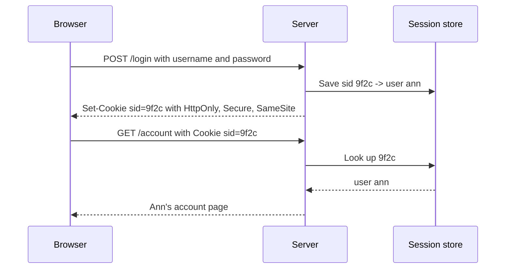

# Cookies and sessions

> **Before this lesson:** you should know what an HTTP request, a response, a header and an *origin* are — all explained in [HTTP, origins and the same-origin policy](#/lesson/web-security/http-same-origin).

## In plain words

Imagine a cloakroom at a theatre. You hand over your coat and receive a small numbered ticket. The ticket itself is worthless paper; its only power is that the attendant can match number 58 to your coat. Anyone holding ticket 58 gets the coat — the attendant does not remember your face.

A website has the same problem as that attendant. HTTP is *stateless*: the server forgets you between one request and the next. To stay logged in while you click around, the server hands your browser a ticket after you sign in, and the browser shows the ticket with every later request. The ticket is a **cookie**; the coat — everything the server remembers about your visit — is a **session**.

This matters enormously for security, because the consequence is the same as in the cloakroom: *whoever holds the ticket is you*. Passwords are checked once, at login. After that, the cookie is the only thing standing between a stranger and your account. Many attacks in this track are, at bottom, ways of stealing, guessing, planting or misusing that ticket.

## Step 1: a cookie is a named value the browser sends back

A **cookie** is a small piece of text with a name and a value. The server asks the browser to store one by putting a `Set-Cookie` header in a response:

```http
HTTP/1.1 200 OK
Set-Cookie: theme=dark
```

From then on, the browser adds a `Cookie` header to every request it makes to that site:

```http
GET /products HTTP/1.1
Host: shop.example
Cookie: theme=dark
```

That is the entire mechanism. Two things about it deserve attention straight away.

First, the browser attaches the cookie **automatically**. The page does not have to ask, and the user does not see it happen. This convenience is what makes logins work — and what makes cross-site request forgery possible.

Second, the cookie lives on the user's machine. The user can open the developer tools, read it, change it or delete it. **A cookie's value is untrusted input like any other part of a request.**

## Step 2: why you cannot store facts in a plain cookie

The simplest idea for remembering a login would be to store the user's name in a cookie. Here is that idea, and why it fails:

```python
# VULNERABLE: the server believes whatever the cookie says
@app.post("/login")
def login(form: LoginForm, response: Response):
    if check_password(form.username, form.password):
        response.set_cookie("user", form.username)     # e.g. user=ann
    return {"ok": True}

@app.get("/account")
def account(user: str = Cookie(None)):
    return load_account(user)                          # trusts the cookie value
```

`response.set_cookie("user", ...)` produces `Set-Cookie: user=ann`. Later, `Cookie(None)` reads the `user` cookie out of the request. The flaw: nothing stops a visitor from editing the cookie to `user=bob` in their own browser. The server then loads Bob's account. The same goes for cookies such as `role=admin` or `discount=50`.

There are two sound ways to fix this, and all real systems use one of them.

## Step 3: server-side sessions — store a random ticket number

Keep the facts on the server and give the browser only a meaningless, unguessable identifier.

```python
# FIXED: the cookie holds a random id; the facts stay on the server
import secrets

SESSIONS = {}      # session id -> data. In production this is a database or Redis.

@app.post("/login")
def login(form: LoginForm, response: Response):
    if not check_password(form.username, form.password):
        raise HTTPException(401)
    sid = secrets.token_urlsafe(32)                    # 32 random bytes, as text
    SESSIONS[sid] = {"user": form.username, "created": time.time()}
    response.set_cookie("sid", sid, httponly=True, secure=True, samesite="lax", path="/")
    return {"ok": True}

@app.get("/account")
def account(sid: str = Cookie(None)):
    session = SESSIONS.get(sid)                        # unknown id -> None
    if session is None:
        raise HTTPException(401)
    return load_account(session["user"])
```

Line by line:

- `secrets.token_urlsafe(32)` asks the operating system for 32 bytes of cryptographically strong randomness and encodes them as text. `secrets` is Python's module for security-sensitive random values. Do not use the `random` module here; its output can be predicted from earlier values.
- `SESSIONS[sid] = {...}` records, on the server, who this ticket belongs to.
- `set_cookie(..., httponly=True, secure=True, samesite="lax")` sends the ticket with three protective attributes explained below.
- In `account`, `SESSIONS.get(sid)` looks the ticket up. Editing the cookie now achieves nothing: a changed value matches no entry, and the chance of guessing another user's 32 random bytes is, for practical purposes, zero.

The value in the cookie is called a **session identifier** (session ID). It works exactly like the cloakroom number.



How unguessable must the identifier be? Run this to see what proper randomness looks like and how large the space of possibilities is:

```python-run
import secrets

for _ in range(3):
    print(secrets.token_urlsafe(32))

bits = 32 * 8
print("possible values: 2 **", bits)
print("that is a number with", len(str(2 ** bits)), "digits")
```

Each run prints three different 43-character strings. With 256 random bits there are more possible identifiers than atoms in the observable universe, so guessing is hopeless. OWASP's guidance asks for at least 64 bits of *entropy* (a measure of unpredictability); a generator such as `secrets` comfortably exceeds that. The identifiers that get guessed in practice are home-made ones: a counter, a timestamp, the user's ID run through a hash.

## Step 4: the other way — a signed value

Sometimes you want the cookie to carry data without a lookup. Then the server must be able to detect tampering. It does so by attaching a **signature**: a short code computed from the data and a **secret key** that only the server knows. The standard tool is **HMAC** (hash-based message authentication code). Change one character of the data and the code no longer matches; without the key, nobody can compute a matching code for new data.

```python-run
import hmac, hashlib

SECRET = b"server-side-key-kept-out-of-source-control"

def sign(value: str) -> str:
    mac = hmac.new(SECRET, value.encode(), hashlib.sha256).hexdigest()
    return value + "." + mac                     # data, a dot, then the signature

def verify(cookie: str):
    value, _, mac = cookie.rpartition(".")       # split at the LAST dot
    expected = hmac.new(SECRET, value.encode(), hashlib.sha256).hexdigest()
    if hmac.compare_digest(mac, expected):       # constant-time comparison
        return value
    return None                                  # tampered or malformed

cookie = sign("user=ann")
print("issued  :", cookie)
print("verify  :", verify(cookie))

forged = cookie.replace("user=ann", "user=bob")  # the visitor edits the data
print("forged  :", verify(forged))
```

What each part does: `hmac.new(key, message, hashlib.sha256)` computes the code using the SHA-256 hash function; `.hexdigest()` returns it as text. `sign` glues the data and code together. `verify` recomputes the code for the data it received and compares the two with `hmac.compare_digest`, which takes the same time whether the strings differ at the first character or the last (ordinary `==` stops early, which can leak information through timing). The forged cookie prints `None`: the visitor changed the data but could not produce the matching code.

Signed values are **tamper-evident, not secret**. Anyone can still *read* `user=ann`. Signing protects integrity; if the content must be hidden, it has to be encrypted as well, or — better — kept on the server.

JSON Web Tokens, covered in [JWT handling pitfalls](#/lesson/web-security/jwt), are a standardised form of this signed-value idea.

### Sessions or signed tokens?

| | Server-side session | Signed token in the cookie |
|---|---|---|
| Server stores | Session data | Nothing (only a key) |
| Log a user out immediately | Delete the entry | Hard — the token stays valid until it expires |
| Size of cookie | Small | Grows with the data |
| Works across many servers | Needs a shared store | Any server with the key can verify |
| Typical use | Classic web applications | APIs, single sign-on |

For an ordinary website, server-side sessions are the safer default, mostly because of the second row: when a session is stolen you want to be able to end it at once.

## Step 5: cookie attributes — the safety catches

After the `name=value` pair, `Set-Cookie` can carry attributes separated by semicolons. They are the main tools for protecting the ticket.

```http
Set-Cookie: sid=9f2c...; Path=/; Max-Age=3600; HttpOnly; Secure; SameSite=Lax
```

| Attribute | What it does | Which attack it blunts |
|---|---|---|
| `HttpOnly` | Hides the cookie from JavaScript (`document.cookie` cannot see it) | Theft of the session by injected script (XSS) |
| `Secure` | Sent only over HTTPS | Eavesdropping on plain HTTP |
| `SameSite=Strict` / `Lax` / `None` | Controls whether the cookie accompanies requests started by *other* sites | Cross-site request forgery |
| `Path=/` | Limits the cookie to URLs under that path | Minor scoping only — not a security boundary |
| `Domain=shop.example` | Widens the cookie to all subdomains | (Omit it: without `Domain` the cookie goes only to the exact host) |
| `Max-Age` / `Expires` | How long the browser keeps it | Limits the lifetime of a stolen cookie |

A few of these need a sentence more.

**`HttpOnly`** exists because of cross-site scripting. If hostile script runs in your page, the first thing it would like to do is read the session cookie and send it away. With `HttpOnly` the script cannot read it. The script can still *act* as the user while the page is open, so this limits damage; it does not cure XSS.

**`SameSite`** tells the browser what to do when a request to your site is started by a *different* site. `Strict` never sends the cookie on such requests. `Lax` — the default in current browsers when you say nothing — sends it only when the user navigates to your site at the top level with a safe method, such as clicking an ordinary link, and withholds it from cross-site form posts, images and background requests. `None` always sends it and is only accepted together with `Secure`.

**Cookie name prefixes** give extra guarantees enforced by the browser. A cookie whose name starts with `__Host-` is only accepted if it has `Secure`, has `Path=/`, and has **no** `Domain` attribute, which pins it to one exact host so that a sibling subdomain cannot overwrite it. `__Host-sid` is the strongest name you can give a session cookie.

> [!WARNING]
> Setting `Domain=shop.example` feels tidy and is usually a mistake. It makes the cookie visible to *every* subdomain — including that forgotten `blog.shop.example` running old software. A weakness there can now read or replace the main site's session cookie.

Here is a small checker that reads a `Set-Cookie` value and reports what is missing. It is the core of the practice problem attached to this module.

```python-run
def missing_protections(set_cookie: str):
    pieces = [p.strip() for p in set_cookie.split(";")]
    attributes = {p.split("=", 1)[0].lower() for p in pieces[1:] if p}   # names only, lower-cased
    wanted = ["httponly", "secure", "samesite"]
    return [name for name in wanted if name not in attributes]

print(missing_protections("sid=abc; Path=/"))
print(missing_protections("sid=abc; Path=/; HttpOnly; Secure; SameSite=Lax"))
print(missing_protections("theme=secure; HttpOnly"))    # a VALUE containing 'secure' proves nothing
```

The function splits the header at semicolons, skips the first piece (the cookie itself) and collects the attribute names in lower case because browsers ignore capitalisation there. The third line shows why parsing beats searching: the text contains the word "secure", but only as the cookie's value, and the checker correctly reports `secure` as missing.

## Where else can the browser keep things?

Besides cookies, script in a page can store data in **`localStorage`** and **`sessionStorage`** — small key-value stores belonging to the origin. The difference that matters for security:

| | Cookie with `HttpOnly` | `localStorage` |
|---|---|---|
| Readable by JavaScript | No | Yes, by any script running on the origin |
| Sent automatically with requests | Yes | No — code must attach it |
| Exposed to XSS theft | No | Yes |
| Exposed to CSRF | Yes (mitigate with `SameSite` and tokens) | No |

Neither is free of trade-offs. A token in `localStorage` is immune to request forgery but is handed to any injected script. An `HttpOnly` cookie is invisible to script but travels automatically. For session credentials the usual recommendation is the `HttpOnly`, `Secure`, `SameSite` cookie, combined with CSRF protection.

> [!INTERVIEW]
> "Where would you store an authentication token in a browser application?" Show you understand the trade-off rather than reciting a rule: `HttpOnly` cookie protects against script theft but needs CSRF defences; `localStorage` avoids CSRF but any XSS can read it. State a default (the cookie) and what you would add (SameSite, CSRF token, short lifetime).

## The life of a session

A session should not be immortal. Good practice, developed further in [Session management flaws and cookie attributes](#/lesson/web-security/session-management):

1. **Create a fresh identifier at login.** Never keep using one that existed before the user authenticated.
2. **Expire on inactivity** (an *idle timeout*) and after a maximum total age (an *absolute timeout*).
3. **Destroy on logout** — on the server, not only by clearing the cookie.
4. **Re-check on every request.** The lookup in `account` above is that check.

## Defence in depth for the session ticket

No single measure is sufficient, so they are stacked:

- **Unguessable identifier** from a cryptographic generator.
- **HTTPS everywhere** plus `Secure`, so the ticket never crosses the network in the clear.
- **`HttpOnly`** so injected script cannot copy it.
- **`SameSite`** so other sites cannot borrow it for forged requests.
- **Host-only scope** (no `Domain`; ideally the `__Host-` prefix).
- **Short lifetimes and server-side revocation** so a stolen ticket stops working soon.
- **Never in URLs or logs.** A session ID in a query string ends up in history, server logs and other sites' analytics.

## How to test it

- In the browser's developer tools, open *Application → Cookies* (Chrome, Edge) or *Storage → Cookies* (Firefox). For the session cookie confirm that the HttpOnly and Secure boxes are ticked and SameSite has a value.
- Type `document.cookie` in the console. The session cookie should **not** appear.
- Log in twice in separate private windows and compare identifiers: they must look unrelated.
- Note the cookie value, log out, then replay the old value with `curl -H "Cookie: sid=..."`. The server should answer `401`. If it serves the page, logout only cleared the browser's copy.
- Edit any cookie that appears to hold meaningful data (`role`, `user_id`, `cart_total`) and see whether the server believes it.
- In code review, search for `set_cookie` and check the three attributes at each call; search for `random.` near anything that looks like a token.

## Pitfalls

- **Meaningful data in an unsigned cookie.** If changing the cookie changes what you are allowed to do, it is a vulnerability.
- **Home-made identifiers** built from user IDs, timestamps or an unsalted hash.
- **`SameSite=None` to "fix" a login problem** without understanding that it restores cross-site sending.
- **Logout that only deletes the cookie** in the browser.
- **Long-lived "remember me" cookies** treated the same as fresh sessions; sensitive actions should ask for the password again.
- **Believing signing hides data.** It does not.
- **Trusting `Path`** to separate applications on one host; scripts under one path can reach the other.

## Summary

- HTTP forgets; cookies let the browser re-present a value on each request so the server can recognise the user.
- The browser sends cookies automatically and the user can edit them, so cookie values are untrusted.
- Keep facts on the server and give the browser a random session identifier, or sign the value with a server-held key so tampering is detected.
- `HttpOnly`, `Secure` and `SameSite` protect the cookie against script theft, eavesdropping and cross-site misuse; `__Host-` pins it to one host.
- Whoever holds the session identifier is the user, so it must be unpredictable, short-lived, revocable and never placed in a URL.

## Glossary

- **Cookie** — a named value stored by the browser and returned to the site that set it.
- **Session** — the server's record of one user's logged-in visit.
- **Session identifier (session ID)** — the random value in the cookie that points to the session.
- **Entropy** — a measure of how unpredictable a value is, in bits.
- **Signature / HMAC** — a code computed from data and a secret key, used to detect tampering.
- **Secret key** — a value known only to the server, used for signing.
- **`HttpOnly`** — cookie attribute hiding it from JavaScript.
- **`Secure`** — cookie attribute restricting it to HTTPS.
- **`SameSite`** — cookie attribute limiting cross-site sending.
- **`__Host-` prefix** — cookie name prefix enforcing Secure, Path=/ and no Domain.
- **Idle / absolute timeout** — expiry after inactivity / after a fixed total age.
- **`localStorage`** — script-readable key-value storage belonging to an origin.

```quiz
[
  {"q": "After login, a site sets the cookie role=user. A visitor edits it to role=admin and gains admin pages. What was the design error?",
   "options": ["The cookie lacked Max-Age", "The server trusted a client-controlled value as a fact", "The cookie was too long", "HTTPS was not used"], "answer": 1,
   "explain": "Cookies live on the user's machine and can be edited. Facts must stay on the server, or be signed so that changes are detected."},
  {"q": "Which Python call is appropriate for generating a session identifier?",
   "options": ["random.randint(0, 10**9)", "str(time.time())", "secrets.token_urlsafe(32)", "hashlib.md5(username.encode()).hexdigest()"], "answer": 2,
   "explain": "The secrets module uses the operating system's cryptographic generator. The others are predictable or derived from guessable inputs."},
  {"q": "What does the HttpOnly attribute do?",
   "options": ["Sends the cookie only over HTTP, not HTTPS", "Prevents JavaScript from reading the cookie", "Stops the cookie being sent cross-site", "Encrypts the cookie"], "answer": 1,
   "explain": "HttpOnly removes the cookie from document.cookie, so injected script cannot copy it. The name is misleading: it has nothing to do with the HTTP scheme."},
  {"q": "A cookie value is signed with HMAC. Which statement is true?",
   "options": ["Nobody but the server can read the value", "Anyone can read the value, but changes are detected by the server", "The value can be changed if the attacker knows the algorithm", "The value expires automatically"], "answer": 1,
   "explain": "A signature protects integrity, not confidentiality. Forging a new signature requires the secret key, not merely knowledge of the algorithm."},
  {"q": "Why is setting Domain=shop.example on a session cookie risky?",
   "options": ["It disables HTTPS", "It makes the cookie available to every subdomain, including poorly maintained ones", "Browsers reject it", "It shortens the lifetime"], "answer": 1,
   "explain": "Without a Domain attribute the cookie is host-only. Widening it lets any subdomain receive, and potentially overwrite, the session cookie."},
  {"q": "A user logs out and the server responds by telling the browser to delete the cookie, but keeps the session entry. What is the consequence?",
   "options": ["None; the user is logged out", "Anyone who copied the old identifier can keep using the session", "The password is exposed", "The cookie becomes HttpOnly"], "answer": 1,
   "explain": "Logout must invalidate the session on the server. Clearing the browser's copy does nothing about copies held elsewhere."},
  {"q": "Compared with an HttpOnly cookie, a token kept in localStorage is…",
   "options": ["safe from XSS but exposed to CSRF", "exposed to XSS theft but not sent automatically, so not exposed to CSRF", "encrypted by the browser", "shared across all origins"], "answer": 1,
   "explain": "Any script on the origin can read localStorage. Because the browser does not attach it to requests by itself, cross-site forgery does not carry it."},
  {"q": "With SameSite=Lax, in which case does the browser send the cookie on a request that starts from another site?",
   "options": ["A hidden form POST", "An image tag", "The user clicking a normal link to your site", "A background fetch"], "answer": 2,
   "explain": "Lax allows top-level navigations with safe methods, so links still arrive logged in, while cross-site POSTs and sub-resource requests arrive without the cookie."}
]
```

> **Source:** Hoffman, *Web Application Security*, ch. 3 (authentication systems and client-side data stores), in original wording. MDN: Using HTTP cookies — https://developer.mozilla.org/en-US/docs/Web/HTTP/Cookies ; Set-Cookie — https://developer.mozilla.org/en-US/docs/Web/HTTP/Headers/Set-Cookie ; OWASP Session Management Cheat Sheet — https://cheatsheetseries.owasp.org/cheatsheets/Session_Management_Cheat_Sheet.html
