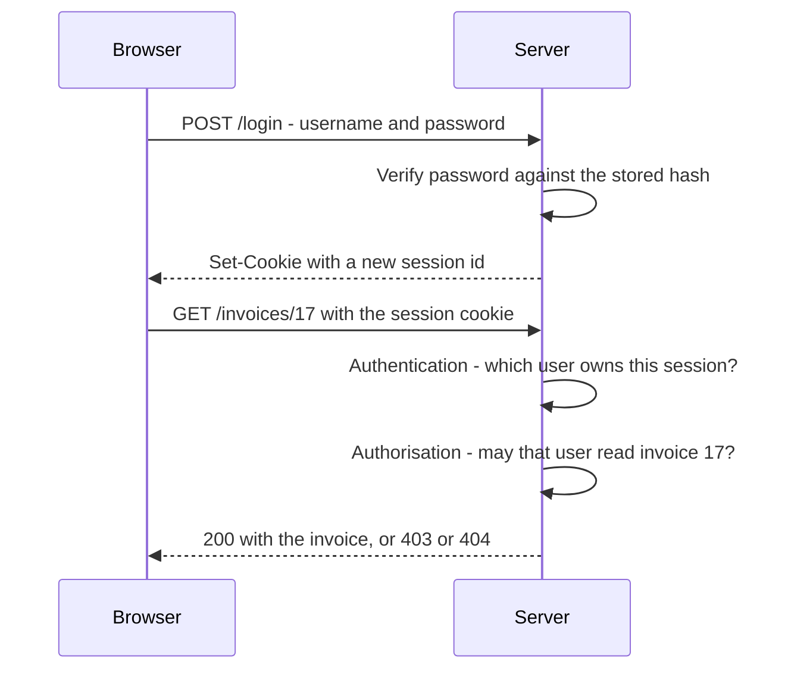
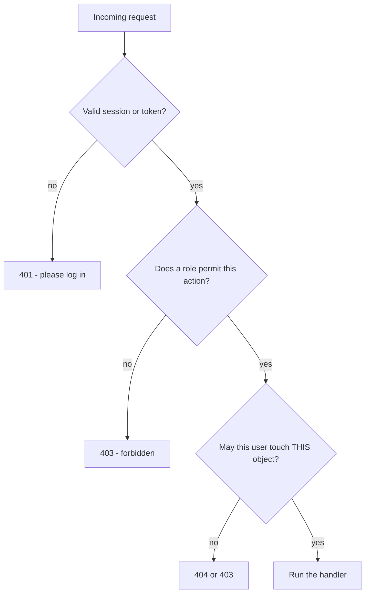

# Authentication and authorisation models

> **Before this lesson:** you should understand sessions and cookies from [Cookies and sessions](#/lesson/web-security/cookies-sessions), and the status codes 401 and 403 from [HTTP, origins and the same-origin policy](#/lesson/web-security/http-same-origin).

## In plain words

Think about boarding a flight. At the first desk an officer compares your face with your passport: *are you who you claim to be?* At the gate, a different question is asked: *does this boarding pass entitle you to this flight, in this seat?* A genuine passport does not get you onto any plane you like.

Websites ask the same two questions:

- **Authentication** (often shortened to *authn*) — proving identity. "This request comes from Ann."
- **Authorisation** (*authz*) — deciding permission. "Ann may read this invoice but may not refund it."

Keeping the two apart is one of the most valuable habits a developer can form. Applications are rarely broken because the login page accepts wrong passwords. They are broken, again and again, because a correctly logged-in user asks for something that belongs to someone else and nobody checks. *Broken Access Control* — the industry's name for failed authorisation — sits at the top of the OWASP Top 10 for exactly this reason. This lesson explains the models; later lessons cover the specific failures.

## Part 1: authentication

### Identification versus authentication

Typing a user name is **identification**: a *claim* ("I am Ann"). Supplying the password is **authentication**: *evidence* for the claim. A system that acts on the claim without the evidence — for example by reading a user ID from a request parameter — has skipped authentication entirely.

### The three kinds of evidence

Evidence of identity is traditionally sorted into three **factors**:

| Factor | Meaning | Examples | Typical weakness |
|---|---|---|---|
| Something you **know** | A secret in your head | Password, PIN | Guessed, reused, phished |
| Something you **have** | A physical or digital object | Phone app generating codes, hardware security key | Lost, stolen, cloned SIM |
| Something you **are** | A bodily characteristic | Fingerprint, face | Cannot be changed if copied |

**Multi-factor authentication** (MFA) requires evidence from at least two *different* categories. A password plus a code from an authenticator app is two factors. A password plus a "mother's maiden name" question is one factor twice, because both are things you know.

### How a login becomes many authenticated requests

Authentication happens once; every later request must still be linked to that moment. The previous lesson showed the standard pattern, repeated here as a sequence so that you can see where each responsibility sits:



Note the two separate boxes on the last request. Finding the user is authentication. The line after it is authorisation. It is very easy to write the first and forget the second.

### Common ways of carrying identity

| Scheme | How identity travels | Where you see it |
|---|---|---|
| **Session cookie** | Random ID in a cookie; server looks it up | Traditional websites |
| **Bearer token** | A token in the `Authorization: Bearer …` header | APIs, mobile apps |
| **API key** | A long secret string identifying an application, not a person | Server-to-server calls |
| **Basic authentication** | User name and password sent with every request, base64-encoded (which is *not* encryption) | Internal tools, legacy systems |
| **Federated login / single sign-on (SSO)** | Another trusted service vouches for the user ("Sign in with…") | Covered in [OAuth 2.0 and OpenID Connect](#/lesson/web-security/oauth-oidc) |

*Bearer* means "whoever bears (carries) this token is accepted" — the cloakroom ticket again. All of these therefore depend on HTTPS, and all of them must be treated as secrets.

## Part 2: authorisation

Once the server knows who is asking, it needs a rule for what they may do. Three questions frame every authorisation decision:

1. **Who** is asking? (the *subject*: a user or a program)
2. **What** do they want to do? (the *action*: read, update, delete, approve…)
3. **To which thing?** (the *resource* or *object*: invoice 17, user profile 204…)

Beginners usually remember the first two and forget the third. "Is this user allowed to read invoices?" is not the same question as "Is this user allowed to read *this* invoice?"

### Model 1: access control lists (ACL)

An **access control list** attaches to each resource a list of who may do what with it. A shared document is the familiar example: *Ann — owner; Bob — can edit; Carol — can view.*

ACLs are precise and easy to explain. They become hard to manage when there are millions of resources and you want to answer "what can Bob access?" across all of them.

### Model 2: role-based access control (RBAC)

In **role-based access control** permissions are attached to *roles* (job functions), and users are given roles.

```
viewer   → orders:read
support  → orders:read, orders:refund
admin    → everything
```

RBAC matches how organisations think ("she's in support") and is what most applications start with. Below is a minimal decision function. Read it before running it; the important line is the last one.

```python-run
ROLE_PERMISSIONS = {
    "viewer":  {"orders:read"},
    "support": {"orders:read", "orders:refund"},
    "admin":   {"orders:read", "orders:refund", "users:delete"},
}

def is_allowed(user_roles, permission):
    for role in user_roles:
        # .get(role, set()) returns an EMPTY set for a role we have never heard of
        if permission in ROLE_PERMISSIONS.get(role, set()):
            return True
    return False            # nothing matched: the default answer is "no"

print(is_allowed(["viewer"], "orders:read"))      # True
print(is_allowed(["viewer"], "orders:refund"))    # False
print(is_allowed(["support"], "orders:refund"))   # True
print(is_allowed(["intern"], "orders:read"))      # False - unknown role grants nothing
print(is_allowed([], "orders:read"))              # False - no roles, no access
```

`ROLE_PERMISSIONS` is a dictionary mapping each role to a *set* (an unordered collection of unique items) of permission strings. The loop returns `True` as soon as one of the user's roles contains the requested permission. If the loop ends without finding one, the function returns `False`. That final line is **deny by default**: an unknown role, an empty list or a misspelt permission all lead to refusal rather than to accidental access.

RBAC's limit is the third question. `orders:read` says a support agent may read orders — it does not say *whose*. On its own RBAC cannot express "customers may read only their own orders".

### Model 3: attribute-based access control (ABAC)

**Attribute-based access control** decides using properties (attributes) of the subject, the resource and the context: "allow if `user.department == document.department` and the time is within working hours". It is flexible enough to express ownership and tenancy rules, at the price of more complicated policies.

### Model 4: relationship-based access control (ReBAC)

**Relationship-based access control** decides from relationships stored as a graph: "Ann is a *member* of team X; team X is *owner* of folder Y; document Z is *in* folder Y — therefore Ann may edit Z." Large collaboration products work this way.

Real systems mix the models. A typical business application uses RBAC for coarse features and an ownership or tenancy rule (a small piece of ABAC) for individual records:

```python-run
def can_read_order(user, order):
    if user["tenant"] != order["tenant"]:       # different customer organisation: never
        return False
    if "support" in user["roles"]:              # coarse rule from the role
        return True
    return user["id"] == order["customer_id"]   # fine rule from ownership

ann  = {"id": 7, "tenant": "acme", "roles": ["customer"]}
sam  = {"id": 9, "tenant": "acme", "roles": ["support"]}
eve  = {"id": 3, "tenant": "globex", "roles": ["support"]}
order = {"id": 501, "tenant": "acme", "customer_id": 7}

for name, user in [("ann", ann), ("sam", sam), ("eve", eve)]:
    print(name, can_read_order(user, order))
```

Ann owns the order and may read it. Sam is support staff in the same organisation and may read it. Eve is support staff at a *different* customer organisation — a **tenant** — and is refused at the first line, before her role is even considered. In software that serves many organisations from one system (called *multi-tenant*), that tenant check must come first and must have no exceptions.

## Part 3: where the check goes

Knowing the models is not enough; most real bugs are about *placement*.

### Mistake: the check lives only in the user interface

```javascript
// VULNERABLE: the browser decides who sees the button; the server checks nothing
if (currentUser.role === "admin") {
  showButton("Delete user", () => fetch(`/api/users/${id}`, { method: "DELETE" }));
}
```

```python
# VULNERABLE server: any logged-in user who sends the request succeeds
@app.delete("/api/users/{user_id}")
def delete_user(user_id: int, user=Depends(current_user)):
    db.delete_user(user_id)
```

The JavaScript hides the button from ordinary users. Hiding is not protecting: the address `/api/users/42` still exists, and anyone can send a `DELETE` request to it with a tool or the browser console. The server function has a parameter `user=Depends(current_user)`, which in FastAPI means "run `current_user` first and pass in its result" — that performs *authentication*. Nothing in the body performs *authorisation*.

```python
# FIXED: the server makes the decision, for every request
def require(permission: str):
    def checker(user=Depends(current_user)):
        if not is_allowed(user.roles, permission):
            raise HTTPException(status_code=403)
        return user
    return checker

@app.delete("/api/users/{user_id}")
def delete_user(user_id: int, user=Depends(require("users:delete"))):
    db.delete_user(user_id)
```

`require("users:delete")` builds a small function that first authenticates (`current_user`), then asks the RBAC function, and raises `403` when the answer is no. Attaching it with `Depends` means the handler body cannot run for an unauthorised caller. Keeping the button hidden in the interface is still good manners — it is no longer the control.

### Mistake: checks scattered and occasionally forgotten

If every handler writes its own `if` statement, one will eventually be missed. Three structural habits reduce that risk:

1. **Centralise the decision** in one function or policy module, as with `require` above.
2. **Deny by default at the framework level.** Configure the application so that every route requires authentication unless explicitly marked public. Forgetting an annotation then produces a locked door, not an open one.
3. **Scope data access by the user.** Write queries as `WHERE id = ? AND owner_id = ?` so that even a missing check returns nothing.



Three gates, in order. The third gate is the one this track returns to in [Broken access control and IDOR](#/lesson/web-security/broken-access-control).

> [!TIP]
> When you design an endpoint, write its authorisation rule as one English sentence in the docstring before writing the code: "A customer may read an order if they placed it; support staff of the same tenant may read any order." If you cannot write the sentence, you are not ready to write the handler — and the reviewer now has something to check the code against.

> [!INTERVIEW]
> "What is the difference between authentication and authorisation?" is nearly guaranteed. Give the definitions, one analogy, the status codes (401 versus 403), and then add the insight that distinguishes a strong candidate: authorisation must be enforced on the server for every request and must consider the specific object, not only the user's role.

## Defence in depth

- **Strong authentication** — hashed passwords, MFA, rate limiting ([Authentication failures, password storage and MFA](#/lesson/web-security/authentication-passwords)).
- **Central, server-side authorisation** with deny-by-default routing.
- **Object-level checks and scoped queries** for every record access.
- **Least privilege for programs too**: the application's database account should not be able to drop tables; an internal service should hold only the permissions it uses.
- **Re-authentication for sensitive actions** — ask for the password again before changing the email address or payout details.
- **Audit logs** recording who did what to which object, so that misuse is noticed.

## How to test authorisation

Authorisation bugs are invisible in normal use, so they must be tested deliberately.

1. **Make a matrix.** List the roles down the side and every endpoint across the top; fill in *allow* or *deny*. That table is your specification.
2. **Automate it.** For each cell write a test that logs in as that role, calls the endpoint and asserts the status code. The *deny* cells are the valuable ones.
3. **Swap identities.** Log in as user A, copy a request that works, and replay it with user B's session. Anything B receives that belongs to A is a finding.
4. **Remove the credential.** Send the same request with no cookie or token at all; expect `401`.
5. **Check every method.** If `GET /orders/5` is protected, try `PUT`, `PATCH` and `DELETE` on the same path.

In code review, read each handler and ask aloud: *where is the line that says this user may do this to this object?* If you cannot point at it, it is not there.

## Pitfalls

- **Treating "logged in" as "allowed".** Authentication answers only the first of three questions.
- **Reading identity from the request.** `user_id` in a query string, a body field or a custom header is a claim, not evidence. Identity comes from the verified session or token.
- **Role checks by name scattered in code** (`if user.role == "admin"`) instead of permission checks through one function; adding a role later means hunting for every comparison.
- **Role explosion**: inventing `support-emea-readonly-weekends` when an attribute rule would do.
- **Forgetting non-interactive callers** — scheduled jobs, internal services and webhooks need identities and permissions too.
- **Leaking existence.** Replying `403` to "invoice 18" tells the caller that invoice 18 exists. Where that matters, answer `404`.
- **Stale permissions.** If roles are copied into a long-lived token, removing a role from a user has no effect until the token expires.

## Summary

- Authentication proves identity; authorisation decides what that identity may do. They are separate steps and separate bugs.
- Evidence of identity comes in three factors — know, have, are — and MFA combines different ones.
- Every authorisation decision involves a subject, an action and a specific resource.
- ACLs list permissions per resource; RBAC groups permissions into roles; ABAC decides from attributes; ReBAC from relationships. Real systems combine them.
- Enforce on the server, centrally, with deny by default, and include the object-level question.
- Test the *deny* cases explicitly, because nothing else will reveal them.

## Glossary

- **Authentication (authn)** — verifying who a caller is.
- **Authorisation (authz)** — deciding what a caller may do.
- **Identification** — claiming an identity, before any proof.
- **Factor** — a category of identity evidence: knowledge, possession, inherence.
- **MFA** — multi-factor authentication, requiring two or more different factors.
- **Bearer token** — a credential accepted from whoever presents it.
- **Subject / action / resource** — who is asking, what they want to do, and to what.
- **ACL** — access control list: per-resource list of permissions.
- **RBAC** — role-based access control. **ABAC** — attribute-based. **ReBAC** — relationship-based.
- **Tenant** — one customer organisation in a system shared by many.
- **Deny by default** — refuse unless a rule explicitly allows.
- **Object-level authorisation** — checking permission for the specific record requested.

```quiz
[
  {"q": "A user logs in with a password and then answers 'What was your first pet's name?'. How many authentication factors is that?",
   "options": ["Two", "One", "Three", "None"], "answer": 1,
   "explain": "Both are things the user knows. Multi-factor authentication needs different categories, such as a password and a code from a device."},
  {"q": "An endpoint returns 401. What should the client understand?",
   "options": ["The user is known but lacks permission", "The request is not authenticated", "The resource was deleted", "The server is overloaded"], "answer": 1,
   "explain": "401 means no valid identity was presented. 403 is the response for a known user without permission."},
  {"q": "An admin-only 'Delete' button is hidden by JavaScript for normal users, and the server endpoint only checks that the caller is logged in. What is wrong?",
   "options": ["Nothing; the button is hidden", "Authorisation is enforced only in the browser, so any logged-in user can call the endpoint directly", "The endpoint should use GET", "Admins should not have delete rights"], "answer": 1,
   "explain": "The interface is on the client's side of the trust boundary. The server must make the permission decision on every request."},
  {"q": "RBAC grants the role 'customer' the permission 'orders:read'. What does RBAC alone fail to express?",
   "options": ["That customers can read orders", "That a customer may read only their own orders", "That admins have more permissions", "That roles can be combined"], "answer": 1,
   "explain": "Roles describe kinds of action, not which specific records. Ownership needs an object-level rule in addition."},
  {"q": "In the function is_allowed, why is the final 'return False' important?",
   "options": ["It makes the function faster", "It implements deny by default when no rule matches", "Python requires it", "It logs the user out"], "answer": 1,
   "explain": "Unknown roles, empty role lists and misspelt permissions all fall through to refusal, so mistakes fail closed rather than open."},
  {"q": "In a multi-tenant application, which check should come first when a support agent requests a record?",
   "options": ["Whether the agent has the support role", "Whether the record belongs to the agent's tenant", "Whether the record is recent", "Whether the agent used MFA"], "answer": 1,
   "explain": "Tenant isolation must hold regardless of role; a powerful role in one organisation must grant nothing in another."},
  {"q": "A handler takes user_id from the query string and returns that user's settings. Why is this unsafe even behind a login?",
   "options": ["Query strings are slow", "The identity used is a client-supplied claim instead of the authenticated session", "Settings should be in a cookie", "Logins expire"], "answer": 1,
   "explain": "Anyone can change the parameter. The server must take the identity from the verified session and check access to the requested object."},
  {"q": "Which test is most likely to reveal a broken authorisation rule?",
   "options": ["Logging in with the correct password", "Loading the home page as an admin", "Replaying user A's request for A's invoice with user B's session", "Checking that HTTPS is enabled"], "answer": 2,
   "explain": "Authorisation bugs appear only when an identity asks for something it should not have. Swapping sessions tests exactly that."}
]
```

> **Source:** Hoffman, *Web Application Security*, ch. 3 (authentication and authorisation systems) and ch. 18 (secure application architecture), in original wording. OWASP Authorization Cheat Sheet — https://cheatsheetseries.owasp.org/cheatsheets/Authorization_Cheat_Sheet.html ; OWASP Authentication Cheat Sheet — https://cheatsheetseries.owasp.org/cheatsheets/Authentication_Cheat_Sheet.html ; OWASP Top 10 A01 Broken Access Control — https://owasp.org/Top10/A01_2021-Broken_Access_Control/
