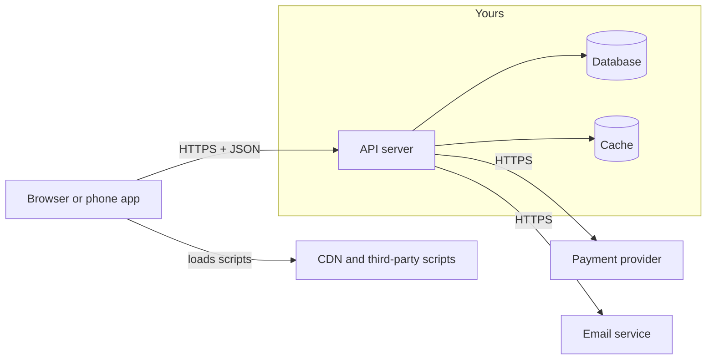

# APIs, dependencies and architecture review

> **Before this lesson:** you should be comfortable with HTTP methods and JSON from [HTTP, origins and the same-origin policy](#/lesson/web-security/http-same-origin) and with the three authorisation questions from [Authentication and authorisation models](#/lesson/web-security/authn-authz).

## In plain words

A restaurant has two faces. Customers see the dining room: menus, tables, a waiter. Behind a door is the kitchen, with its ovens, knives and storeroom. The waiter is the only link between the two. You tell the waiter what you want in an agreed form ("number 14, no onions"), and the waiter brings back a plate. You never walk into the kitchen yourself.

In a modern web application the web page or phone app is the dining room, and the server with its database is the kitchen. The waiter is the **API** — the *application programming interface*: a published list of requests the server will accept and the answers it will give. Every interesting thing the application can do goes through that list.

For security this has a blunt consequence. An attacker does not need your web page. They can talk to the waiter directly, order things that are not on the printed menu, and see how the kitchen reacts. So to protect an application you first need a clear picture of **what is in it**: which requests exist, what data flows where, and which parts were written by someone else. This lesson builds that picture. You cannot defend what you have not mapped.

## The shape of a modern application

Twenty years ago a typical site built complete pages on the server. Today most are split:



- The **front end** runs in the browser. Sites built this way are often called *single-page applications* (SPAs) because the browser loads one page and then fetches data as needed.
- The **back end** is the API server and its data stores.
- **Third parties** provide payments, email, analytics, and scripts delivered through a **CDN** (content delivery network — servers around the world that hand out static files quickly).

Every arrow in the diagram crosses a trust boundary and is a place where data must be checked. Every box you do not own is a dependency you are trusting.

## REST: the common style of API

Most web APIs follow a style called **REST** (Representational State Transfer). You do not need the theory, only the conventions:

- Things are **resources** with addresses: `/orders`, `/orders/17`, `/orders/17/items`.
- The HTTP **method** says what to do with the resource.
- Data travels as **JSON**.
- The **status code** reports the outcome.

| Request | Meaning |
|---|---|
| `GET /orders` | List orders |
| `GET /orders/17` | Read order 17 |
| `POST /orders` | Create an order |
| `PATCH /orders/17` | Change part of order 17 |
| `DELETE /orders/17` | Remove order 17 |

The regularity is pleasant for developers and equally pleasant for attackers: once someone has seen `GET /orders/17`, they will guess that `GET /orders/18`, `DELETE /orders/17` and `GET /users/1` exist. An API's **attack surface** — the total set of places where it accepts input — is the full table of resources × methods, not the handful your own front end happens to call.

## Three API mistakes, from simplest to subtlest

OWASP maintains a separate *API Security Top 10*. Three of its entries appear in almost every code base and are worth learning as patterns. We will take them one at a time with the same toy shop.

### 1. Returning too much

The simplest example first. An endpoint returns the user's profile by handing the database record straight to the JSON encoder:

```python
# VULNERABLE: whatever columns the table has are sent to the browser
@app.get("/api/me")
def me(user=Depends(current_user)):
    return db.get_user(user.id)       # includes password_hash, reset_token, is_admin...
```

The page only *displays* the name and email, so everything looks fine. But the full JSON is visible to anyone who opens the Network tab. This is **excessive data exposure**: relying on the front end to hide fields the API should never have sent.

```python
# FIXED: an explicit list of fields that may leave the server
class PublicUser(BaseModel):
    id: int
    name: str
    email: str

@app.get("/api/me", response_model=PublicUser)
def me(user=Depends(current_user)):
    return db.get_user(user.id)
```

`PublicUser` is a Pydantic model — a class that describes the exact shape of some data. `response_model=PublicUser` tells FastAPI to copy only those three fields into the response and drop everything else. This is an **allow-list for output**: a new column added to the table next year stays private unless someone deliberately adds it to the model.

The same idea in plain Python, so you can run it:

```python-run
PUBLIC_FIELDS = ("id", "name", "email")          # the allow-list

def to_public(record: dict) -> dict:
    # build a NEW dict containing only the permitted keys
    return {key: record[key] for key in PUBLIC_FIELDS if key in record}

row = {"id": 7, "name": "Ann", "email": "ann@shop.example",
       "password_hash": "pbkdf2_sha256$600000$...", "is_admin": False, "reset_token": "t-91f"}

print(to_public(row))
```

The expression in braces is a *dict comprehension*: it loops over the allowed names and copies each one that exists. `password_hash`, `is_admin` and `reset_token` are never mentioned, so they cannot leak.

### 2. Accepting too much (mass assignment)

Now the mirror image. An update endpoint copies every field from the request body onto the record:

```python
# VULNERABLE: the client chooses which columns to overwrite
@app.patch("/api/me")
def update_me(changes: dict, user=Depends(current_user)):
    db.update_user(user.id, **changes)     # {"name": "Ann"} ... or {"is_admin": true}
```

The form on the page sends `{"name": "Ann"}`. Nothing prevents a curious user from sending `{"is_admin": true}` or `{"credit_balance": 99999}` instead. This is **mass assignment**: binding request data to internal fields wholesale.

```python
# FIXED: only named fields are accepted, and unknown ones are an error
class ProfileUpdate(BaseModel):
    model_config = ConfigDict(extra="forbid")   # reject fields not listed below
    name: str | None = None
    email: EmailStr | None = None

@app.patch("/api/me")
def update_me(changes: ProfileUpdate, user=Depends(current_user)):
    db.update_user(user.id, **changes.model_dump(exclude_unset=True))
```

`extra="forbid"` makes any unexpected key a validation error (`422`). `model_dump(exclude_unset=True)` returns only the fields the client actually sent. Input and output now each have their own explicit allow-list — and they are *different* lists, which is the point.

### 3. Forgetting the third question

`GET /api/orders/17` checks that the caller is logged in and returns order 17 — whoever it belongs to. This is **broken object-level authorisation**, also known as IDOR (insecure direct object reference). It is the most common serious API flaw, and has a whole lesson: [Broken access control and IDOR](#/lesson/web-security/broken-access-control). For now, note the fix in one line: the query must include the owner, `WHERE id = ? AND customer_id = ?`.

> [!WARNING]
> "The front end never sends that field" and "the front end never shows that field" are not security properties. The API is the product; the front end is merely one of its clients.

## GraphQL: one endpoint, many questions

**GraphQL** is an alternative to REST in which the client sends a *query* describing exactly which fields it wants, usually to a single address such as `/graphql`:

```graphql
query {
  order(id: 17) {
    id
    total
    customer { name email }
  }
}
```

The server replies with JSON in the same shape. This flexibility is convenient, and it moves the security work rather than removing it:

- **Authorisation must be per field and per object.** Because clients compose their own queries, there is no single handler in which to put one check. Each *resolver* — the function that fetches one field — must enforce access, or `customer { email }` becomes reachable through some path nobody thought about.
- **Introspection.** GraphQL servers can describe their entire schema on request. That is helpful in development and, in production, hands an outsider the complete menu, including fields the front end never uses. Many teams disable it in production or restrict it to authenticated staff. Hiding the schema is not a substitute for authorisation; it only removes a convenience.
- **Expensive queries.** A client can nest relationships deeply — orders → customer → orders → customer… — and make the server do enormous work with one small request. Defences are limits on **depth**, on computed **cost**, on result sizes, and timeouts.
- **Batching.** Many operations can be packed into one HTTP request, which can slip past rate limits that count requests. Limit operations per request and count them individually.

A depth limiter is a pleasant small example. Here a query is represented as nested dictionaries, where each key is a field and each value is the set of sub-fields requested:

```python-run
def depth(selection: dict) -> int:
    if not selection:                 # a leaf field such as "id" has no children
        return 0
    return 1 + max(depth(child) for child in selection.values())

ok_query = {"order": {"id": {}, "total": {}, "customer": {"name": {}}}}
deep_query = {"order": {"customer": {"orders": {"customer": {"orders": {"customer": {"email": {}}}}}}}}

MAX_DEPTH = 4
for name, q in [("ok", ok_query), ("deep", deep_query)]:
    d = depth(q)
    print(name, "depth", d, "->", "accepted" if d <= MAX_DEPTH else "rejected")
```

`depth` is *recursive*: it calls itself on each child and adds one for the current level. The first query is three levels deep and is accepted; the second loops between `customer` and `orders` to reach seven levels and is rejected before any database work is done. Real GraphQL libraries provide this as a validation rule you switch on.

## Code you did not write: third-party dependencies

Open any project's dependency file — `requirements.txt` or `pyproject.toml` in Python, `package.json` in JavaScript — and you will find a dozen or two libraries. A **dependency** is someone else's code that yours needs in order to run. Those libraries have their own dependencies, called **transitive dependencies**, and the full tree commonly holds hundreds or thousands of packages.

All of that code runs with the same permissions as code you typed yourself. It can read your environment variables, open network connections and touch the database. Three consequences follow:

1. A **known vulnerability** in any package in the tree may be a vulnerability in your application.
2. A **malicious package** — a hijacked maintainer account, or a look-alike name such as `reqeusts` — runs inside your walls.
3. **Third-party scripts in the page** (analytics, chat widgets, advertising) run with your origin's full power in every visitor's browser.

The defences — lock files, automated scanning, pinning, integrity hashes — are the subject of [Vulnerable dependencies and the supply chain](#/lesson/web-security/dependencies-supply-chain). At the architecture stage the task is more basic: **know what you depend on**, and prefer fewer, well-maintained dependencies over many obscure ones.

> [!TIP]
> Before adding a package, spend two minutes on it: When was the last release? How many maintainers? How many dependencies does *it* pull in? Could twenty lines of your own code do the job? Each dependency is a long-term trust relationship, not a free download.

## Architecture review: reading a system for weak points

An **architecture review** looks at the design as a whole, before or alongside reading code. You are not hunting individual bugs yet; you are looking for *signs* of where bugs will cluster. It takes four steps.

**Step 1 — Draw it.** Boxes for components, arrows for data flows, a dashed line around what you control. The diagram near the top of this lesson is enough to start.

**Step 2 — List the entry points.** Every route, every method, every webhook (an HTTP call another company makes *to* you), file upload, message queue and admin tool. This is the attack surface.

**Step 3 — For each entry point, answer five questions.**

| Question | What a good answer looks like |
|---|---|
| Who may call it? | "Authenticated customers" — enforced by shared middleware |
| What input does it accept? | A schema with types, lengths and no unknown fields |
| What does it touch? | Named tables or services, with least privilege |
| What does it return? | A response model, not a raw record |
| What is logged? | Who did what to which object, without secrets |

**Step 4 — Look for the signals.**

| Signals of a healthy design | Warning signs |
|---|---|
| One shared mechanism for authentication and authorisation | Each endpoint doing its own checks, each slightly differently |
| Standard, well-known libraries for cryptography, sessions, sanitising | Home-made encryption, token formats or sanitisers |
| Validation and encoding done in one layer, the same way everywhere | Copy-pasted validation with small variations |
| Database access through parameterised queries or an ORM | SQL built by joining strings |
| Secrets loaded from the environment or a secrets manager | Keys in source files |
| Old and new parts following the same rules | A legacy area "nobody touches" that predates current practice |

The idea behind the table is consistency. Where a project solves a security problem once, centrally, a mistake is unlikely and easy to fix everywhere. Where every feature re-solves the same problem, some attempts will be wrong — and those are where you focus your code review. Home-made security mechanisms deserve particular suspicion: a team that wrote its own password-hashing or session scheme has probably repeated mistakes that the standard libraries fixed years ago.

> [!INTERVIEW]
> "How would you approach securing an application you have recently joined?" A good structure: (1) map it — components, data flows, entry points, dependencies; (2) identify the most valuable assets and the most exposed entry points; (3) check that authentication, authorisation, validation and logging are centralised; (4) prioritise the gaps by risk. Starting with a map shows you will not chase random bugs.

## Defence in depth for APIs

- **Authenticate every route by default**; mark public ones explicitly.
- **Authorise at the object and field level**, on the server.
- **Schemas for input** (types, ranges, lengths, no extra fields) **and for output** (response models).
- **Limits**: page sizes, request body size, query depth and cost, rate limits per user and per address.
- **Consistent errors** that do not reveal internals.
- **Inventory**: a generated list of all routes (for example from OpenAPI), reviewed when it changes, so that forgotten or "temporary" endpoints do not linger.
- **Dependency hygiene**: lock, scan, update.

## How to test it

- **Generate the route list** from the framework and compare it with what the front end uses. Routes nobody calls are prime suspects — old versions (`/api/v1/…`), debug helpers, internal tools.
- **Read raw responses** in the Network tab, not the rendered page, looking for fields that should not be there.
- **Send extra fields** in create and update requests (`"role"`, `"is_admin"`, `"price"`, `"owner_id"`) and see whether they stick.
- **Request huge things**: `?limit=1000000`, deeply nested GraphQL queries, large bodies. The answer should be a polite refusal.
- **Try other methods** on each path.
- **For GraphQL**, check whether introspection is available to anonymous callers in production and whether each resolver enforces access.

## Pitfalls

- **"Internal" APIs that are reachable from the internet.** If a browser can call it, so can anyone.
- **Old API versions left running** without the fixes applied to the new one.
- **Different rules on the mobile API** than on the web API for the same data.
- **Filtering in the client.** The server sends all records and the page shows "yours"; the rest are one click away in the developer tools.
- **Trusting webhooks** without verifying the sender's signature.
- **Assuming GraphQL is safer because there is only one URL.** One URL can expose the whole data model.
- **Adding dependencies casually**, then never updating them.

## Summary

- The API is the real application; the front end is one client among many possible ones.
- REST makes resources predictable, so every resource × method must be protected, not only those your pages use.
- Return only allow-listed fields; accept only allow-listed fields; check the specific object.
- GraphQL shifts authorisation into resolvers and adds risks from introspection, deep queries and batching.
- Dependencies run with your privileges; know what is in the tree.
- An architecture review maps components, flows and entry points, then looks for consistency: central mechanisms are a good sign, reinvention and inconsistency are where bugs hide.

## Glossary

- **API** — the set of requests a server accepts from programs.
- **REST** — a style of API built from resources, HTTP methods and JSON.
- **Resource** — a thing addressed by a URL, such as an order.
- **Single-page application (SPA)** — a front end that loads once and fetches data through an API.
- **CDN** — a network of servers distributing static files.
- **Attack surface** — all the points where a system accepts input.
- **Excessive data exposure** — returning more fields than the caller should see.
- **Mass assignment** — letting request data overwrite internal fields wholesale.
- **Response model / schema** — an explicit description of permitted fields and types.
- **GraphQL** — a query language in which clients choose the fields returned.
- **Resolver** — the function that fetches one GraphQL field.
- **Introspection** — a GraphQL server describing its own schema.
- **Dependency / transitive dependency** — a library you use / a library your library uses.
- **Webhook** — an HTTP request another service sends to your application.
- **Architecture review** — examining a system's design for structural weaknesses.

```quiz
[
  {"q": "An endpoint returns the full user record as JSON and the page displays only the name. Why is this a vulnerability?",
   "options": ["JSON is insecure", "The hidden fields are still delivered to the client and readable in the developer tools", "The page will render slowly", "It is not a vulnerability"], "answer": 1,
   "explain": "What the page shows is irrelevant; what the API sends is what an attacker receives. Use a response model that lists permitted fields."},
  {"q": "A profile update handler applies every key in the request body to the user record. A user sends {\"is_admin\": true}. What is this flaw called?",
   "options": ["Cross-site scripting", "Mass assignment", "SQL injection", "Clickjacking"], "answer": 1,
   "explain": "Mass assignment binds client input to internal fields without an allow-list. Accept only named fields and reject unknown ones."},
  {"q": "Why does a REST API's predictability matter for security?",
   "options": ["It makes HTTPS unnecessary", "Seeing one endpoint lets an attacker guess others, so all resource and method combinations must be protected", "It prevents injection", "It hides the database"], "answer": 1,
   "explain": "Conventions help attackers enumerate the surface. Protection cannot depend on an endpoint being unknown."},
  {"q": "In GraphQL, where must authorisation be enforced?",
   "options": ["Only at the /graphql URL", "In the front end's query builder", "In the resolvers, per object and field", "It is not needed because there is one endpoint"], "answer": 2,
   "explain": "Clients compose arbitrary queries, so a single check at the endpoint cannot know which data will be reached. Each resolver must enforce access."},
  {"q": "Which defence addresses a GraphQL query that nests relationships ten levels deep?",
   "options": ["HttpOnly cookies", "A query depth or cost limit", "A longer session timeout", "Disabling HTTPS"], "answer": 1,
   "explain": "Depth and cost limits reject queries that would make the server do disproportionate work."},
  {"q": "What is a transitive dependency?",
   "options": ["A library you install directly", "A library required by one of your libraries", "A deprecated library", "A library loaded from a CDN"], "answer": 1,
   "explain": "Most of a dependency tree consists of packages you never chose explicitly, and they run with the same privileges as your own code."},
  {"q": "During an architecture review you find that each endpoint implements its own, slightly different, permission check. What does this signal?",
   "options": ["A flexible design", "A higher chance that some checks are wrong or missing; review them closely", "That RBAC is in use", "Nothing"], "answer": 1,
   "explain": "Inconsistency means the problem was solved many times, and some solutions will be flawed. Centralised mechanisms are a sign of health."},
  {"q": "Which is the best first step when asked to assess an unfamiliar application's security?",
   "options": ["Run random payloads against the login form", "Map components, data flows, entry points and dependencies", "Rewrite the authentication system", "Enable every scanner at once and read nothing"], "answer": 1,
   "explain": "You cannot prioritise or defend what you have not mapped. The map tells you where the valuable assets and exposed entry points are."}
]
```

> **Source:** Hoffman, *Web Application Security*, ch. 3 (structure of a modern web application), ch. 5 (API analysis), ch. 6 (third-party dependencies) and ch. 7 (weak points in application architecture), in original wording. OWASP API Security Top 10 — https://owasp.org/API-Security/ ; OWASP GraphQL Cheat Sheet — https://cheatsheetseries.owasp.org/cheatsheets/GraphQL_Cheat_Sheet.html ; OWASP Mass Assignment Cheat Sheet — https://cheatsheetseries.owasp.org/cheatsheets/Mass_Assignment_Cheat_Sheet.html ; OWASP REST Security Cheat Sheet — https://cheatsheetseries.owasp.org/cheatsheets/REST_Security_Cheat_Sheet.html
