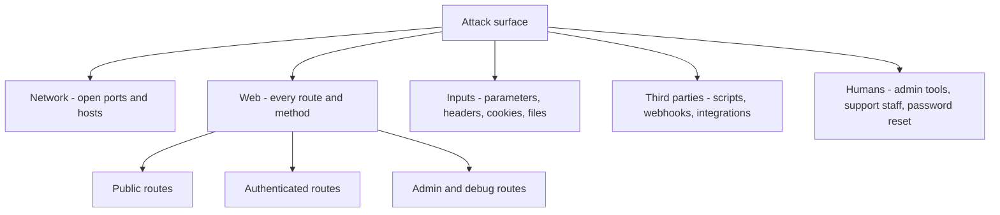

# The attacker's view: leaks and attack surface

> **Before this lesson:** you should know what an API, an entry point and a dependency are from [APIs, dependencies and architecture review](#/lesson/web-security/apis-architecture), and what status codes and headers are from [HTTP, origins and the same-origin policy](#/lesson/web-security/http-same-origin).

## In plain words

Before a burglar tries a door, they walk past the house a few times. Are there lights on a timer? Is there a sticker for an alarm company — and which one? Is a ladder lying in the garden? Is there a parcel on the step with the owner's name on it? None of this is breaking in. It is *looking*, from the public pavement, at what the house gives away about itself.

Applications give things away too. An error page that names the database. A response header announcing the exact server version. A comment left in the page: `<!-- TODO remove test login -->`. A forgotten `staging.shop.example` running last year's code. The activity of collecting such clues is called **reconnaissance** (recon), and the complete set of places where an application can be reached and fed input is its **attack surface**.

This lesson teaches you to walk past your own house. It is deliberately conceptual: the aim is not to investigate anybody else's system — doing that without permission is illegal — but to see what *yours* reveals, and to shrink it. In practice this is some of the cheapest security work there is: most of it is deleting things and turning options off.

## Why defenders should care about "only information"

A beginner's reaction is often: "So they know we use PostgreSQL. So what?" Three reasons it matters.

1. **It saves the attacker time.** Automated tools try thousands of techniques. Knowing the exact framework and version narrows the search to the handful that apply.
2. **It connects to public knowledge.** Vulnerabilities in popular software are published with identifiers. An exposed version number can be looked up in seconds.
3. **Small leaks combine.** A user name here, an internal host name there, a file path in a stack trace — individually harmless, together a map.

Hiding information is **not** a defence on its own. A system that is safe only while its details are unknown is not safe. But removing needless disclosure is a legitimate *layer*: it raises the cost of an attack and removes the easy first step.

## What applications leak, and how to stop it

We go from the most obvious leak to the subtlest.

### 1. Error messages

The simplest example. Something goes wrong and the framework's debugging page is shown to the visitor:

```text
sqlite3.OperationalError: no such column: emial
  File "/srv/shop/app/orders/repo.py", line 88, in find_orders
    cur.execute("SELECT * FROM orders WHERE emial = '" + email + "'")
```

One short error has revealed the database product, the directory layout, a table name, a column name and — worst — that the query is assembled by joining strings, which announces a likely SQL injection. A debugging page is a gift to developers and should exist only on developers' machines.

```python
# VULNERABLE: internal details travel to the client
@app.exception_handler(Exception)
async def on_error(request, exc):
    return JSONResponse({"error": str(exc), "trace": traceback.format_exc()}, status_code=500)
```

```python
# FIXED: details go to the log; the client gets a reference number
@app.exception_handler(Exception)
async def on_error(request, exc):
    incident = secrets.token_hex(8)
    logger.error("incident %s on %s", incident, request.url.path, exc_info=exc)
    return JSONResponse({"error": "Something went wrong.", "incident": incident}, status_code=500)
```

The fixed handler creates a short random **correlation identifier**, writes the full detail to the server's log under that identifier, and tells the visitor only that something failed, plus the identifier to quote to support. Developers lose nothing — the whole stack trace is in the log — and outsiders learn nothing.

Run a miniature of that pattern:

```python-run
import secrets, traceback

SERVER_LOG = []            # stands in for the real log file

def handle(action):
    try:
        return {"status": 200, "body": action()}
    except Exception:
        incident = secrets.token_hex(4)
        SERVER_LOG.append((incident, traceback.format_exc()))     # full detail, private
        return {"status": 500, "body": {"error": "Something went wrong.", "incident": incident}}

def broken():
    prices = {"mug": 12}
    return prices["poster"]          # KeyError: this item is not in the table

response = handle(broken)
print("what the client sees:", response)
print("what the log holds  :", SERVER_LOG[0][1].strip().splitlines()[-1])
```

`try` runs the action; if any exception is raised, the `except` block takes over. `traceback.format_exc()` returns the full error text as a string, which we append to the private list. The client's response contains no file names, no line numbers and no mention of a `KeyError`.

### 2. Response headers and default pages

Many servers and frameworks introduce themselves on every response:

```http
Server: nginx/1.18.0 (Ubuntu)
X-Powered-By: Express
```

Default "404 Not Found" pages, default favicons and "It works!" pages do the same — each product's is recognisable. Remove or genericise them: turn off version banners (`server_tokens off;` in nginx), disable `X-Powered-By`, and serve your own plain error pages. This is a five-minute configuration change.

### 3. What the front end carries

Everything shipped to the browser is public, however minified.

- **Comments** in HTML and JavaScript: notes to colleagues, old endpoints, occasionally credentials.
- **Source maps** — files ending `.map` that let browser tools show the original, readable source. Useful in development; in production they hand out your code with its comments.
- **The JavaScript bundle itself** lists every API route the application calls, including admin routes that the interface hides from ordinary users, and sometimes feature flags for unreleased features.
- **API keys** embedded in the code. Some keys are meant to be public; many are not.

The rule: assume a stranger will read every byte you send. Anything that must stay private stays on the server.

### 4. Forgotten doors

- **`robots.txt`** tells search engines which paths not to index. Listing `/admin-backup/` there hides it from search results and advertises it to everyone else. It is a politeness file, not access control.
- **Directory listing**: a web server set to show the contents of a folder when no index page exists.
- **Leftover files**: `.git` folders, `backup.zip`, `.env`, editor swap files, database dumps in the web root.
- **Debug and admin endpoints**: `/debug`, `/actuator`, interactive API documentation, health checks that print configuration.

### 5. More than one application per domain

Organisations run many systems under one domain name: `www`, `api`, `staging`, `old`, `jenkins`. The main site may be well defended while a subdomain created for a demo three years ago runs unpatched software and shares cookies with the parent domain.

Subdomains are harder to keep secret than people expect. Every publicly trusted HTTPS certificate is recorded in open **Certificate Transparency** logs, which anyone can search by domain. DNS records, search-engine caches and web archives preserve names long after you have stopped linking to them. The defensive conclusion: **keep an inventory, retire what you do not need, and protect non-production systems as if they were public — because they are.**

### 6. Leaks through behaviour: enumeration and timing

The subtlest leaks are not in any text. They are in *differences* between responses.

```python
# VULNERABLE: the reply tells the caller which half was wrong
@app.post("/login")
def login(form: LoginForm):
    user = db.find_user(form.email)
    if user is None:
        raise HTTPException(404, "No account with that email")
    if not verify_password(form.password, user.password_hash):
        raise HTTPException(401, "Wrong password")
    return start_session(user)
```

Two different messages let anyone test a list of email addresses and learn which belong to customers. This is **user enumeration**. With the list of real accounts, password guessing and phishing become far more efficient. The same leak commonly hides in registration ("email already in use") and password reset ("no such user").

```python
# FIXED: one answer for every kind of failure, and similar work each time
DUMMY_HASH = hash_password("placeholder-never-used")

@app.post("/login")
def login(form: LoginForm):
    user = db.find_user(form.email)
    stored = user.password_hash if user else DUMMY_HASH
    ok = verify_password(form.password, stored)        # always performs the slow hash
    if user is None or not ok:
        raise HTTPException(401, "Email or password is incorrect")
    return start_session(user)
```

Two changes. The message and status code are identical whichever part failed. And the password check runs even when the user does not exist, against a dummy hash, so that the response takes about as long in both cases. Otherwise the *time* would give the answer: a reply in 2 milliseconds means "no such user", one in 200 milliseconds means "user exists, password wrong". Information revealed through timing or other indirect behaviour is called a **side channel**.

```python-run
import hashlib, hmac

def slow_hash(password, salt):
    return hashlib.pbkdf2_hmac("sha256", password.encode(), salt, 50_000)

USERS = {"ann@shop.example": (b"salt-ann", slow_hash("correct horse", b"salt-ann"))}
DUMMY = (b"salt-none", slow_hash("placeholder", b"salt-none"))

def login(email, password):
    salt, stored = USERS.get(email, DUMMY)          # unknown user -> dummy record
    candidate = slow_hash(password, salt)           # same expensive work either way
    ok = hmac.compare_digest(candidate, stored) and email in USERS
    return "welcome" if ok else "Email or password is incorrect"

print(login("ann@shop.example", "correct horse"))
print(login("ann@shop.example", "wrong"))
print(login("nobody@shop.example", "wrong"))
```

`USERS.get(email, DUMMY)` returns the dummy record when the email is unknown, so the expensive hash is computed for every request. The second and third calls print exactly the same text, and take about the same time.

For registration and password reset, the equivalent fix is to always say the same thing — "If that address is registered, we have sent an email" — and deliver the real outcome by email.

> [!WARNING]
> Sequential identifiers leak too. If your order confirmation says "Order 10482" today and "Order 10530" tomorrow, a competitor knows you took 48 orders. More seriously, sequential IDs make it trivial to request every record in turn if an authorisation check is missing. Random identifiers (UUIDs) reduce guessing, but they are **not** an authorisation control — a leaked or shared ID still works.

### 7. Two quiet sources: DNS zone transfers and cached copies

Two more places leak names and content without anyone touching your application. Both are about *copies* of information that you may have forgotten exist.

#### DNS zone transfers

The **Domain Name System (DNS)** is the internet's phone book: it turns a name such as `shop.example` into the address of a server. The records for your domain, every name you have defined and where it points, are kept in a file-like collection called a **zone**, served by **name servers**. For reliability a domain normally has at least two name servers, a **primary** that holds the master copy and **secondary** servers that keep copies. So that the secondaries can stay up to date, DNS includes a request type that means "send me your entire zone". It is called a **zone transfer**, and its request type is **AXFR**.

That feature is correct and necessary, between your own servers. The mistake is **a name server that answers a zone-transfer request from anyone**. The reply is the whole list: `www`, `api`, `staging`, `vpn`, `jenkins`, `old-crm`, internal hostnames, mail servers, and the addresses behind them. It is the forgotten-doors inventory from section 5, handed over in one answer, including names that were never linked anywhere and would not appear in certificate logs.

An everyday comparison: the receptionist will gladly tell a visitor where the meeting room is, but the building directory with every tenant's office number is meant for the building's own staff. A misconfigured name server hands the full directory to any passer-by.

The defence is configuration, and it is quick:

1. **Restrict transfers to your own secondary servers.** Every name server product has an "allow transfer" setting; list the specific addresses of your secondaries (for BIND, the `allow-transfer` option) and nothing else. Check the default of your software and your hosting provider rather than assuming it.
2. **Authenticate the transfers.** Use TSIG (transaction signatures, a shared secret that signs the exchange) so that only a server holding the key is served, even if an address is spoofed.
3. **Keep internal names out of the public zone.** Use **split-horizon DNS**: the internal name servers answer with the internal names, the public ones publish only what outsiders need. Then even a leak shows little.
4. **Do not rely on obscurity.** Treat every name in a public zone as discoverable by other means as well; the control is that nothing sensitive is reachable, not that the name is unknown.
5. **Test your own domain.** From a machine you control, ask each of your name servers for a transfer of your own zone with a standard tool such as `dig`. The correct answer is a refusal. Add the check to your periodic attack-surface review. Only test domains and servers you are responsible for.

#### Search-engine caches and web archives

Search engines keep a stored copy of pages they have crawled, and public **web archives** (the Internet Archive's Wayback Machine is the best known) keep snapshots over many years. A page you removed last week may still exist in several of them. Some search engines have reduced or removed their visible "cached" links, but archives and other copies persist, and **scrapers and AI-training crawlers keep their own**.

Why this matters to a defender:

- A document that was public for an afternoon (a configuration file in the web root, an internal price list, an admin page with a key in its source) can be read later from a copy even after you delete the original.
- Old versions of your site show **old routes, old subdomains, old comments and old API keys**, which is exactly the forgotten-door inventory again.
- Advanced search operators let anyone query the engines for file types and path patterns on your domain, so exposed backups and listings are found at scale.

The defence has two halves, and the order matters:

1. **Prevent the exposure in the first place.** Nothing secret in the web root, in front-end code, or behind only an unlinked URL. If something sensitive was ever public, assume it was copied.
2. **Respond properly when it leaked.** *Rotate every secret that was exposed* (keys, tokens, passwords) because deleting the page does not un-leak them. Then remove the copies you can: ask search engines to remove the URL through their removal tools, and ask archives to exclude it through their takedown process. These requests take time and are not guaranteed.

Useful but limited controls: the `noindex` robots meta tag asks engines not to list a page, and `noarchive` asks them not to keep a cached copy, but both are requests to polite crawlers and only work if the page is crawlable when the tag is read. Authentication is the real control: a page behind a login cannot be crawled. For pages that should not be stored by shared caches and proxies, send `Cache-Control: no-store`.

> [!TIP]
> Treat "we deleted it" as the start of the response, not the end. The question to ask is "what could someone have learned from the copy, and what must change so that knowledge is useless?"

## Mapping your own attack surface

The **attack surface** is the sum of every point where someone outside can send input to, or obtain output from, your system. You reduce risk by making that sum smaller and by knowing exactly what is in it.



A practical inventory has four columns: the entry point, who may reach it, whether it changes anything, and what data it touches. Frameworks can list their own routes, so most of this can be generated and then reviewed. Here is the kind of review script a team might run on that list:

```python-run
ROUTES = [
    {"method": "GET",    "path": "/products",        "auth": False, "admin": False},
    {"method": "POST",   "path": "/login",           "auth": False, "admin": False},
    {"method": "POST",   "path": "/orders",          "auth": True,  "admin": False},
    {"method": "DELETE", "path": "/orders/{id}",     "auth": True,  "admin": False},
    {"method": "POST",   "path": "/internal/reindex", "auth": False, "admin": False},
    {"method": "GET",    "path": "/debug/config",    "auth": False, "admin": False},
    {"method": "DELETE", "path": "/admin/users/{id}", "auth": True,  "admin": True},
]
SAFE = {"GET", "HEAD", "OPTIONS"}
EXPECTED_PUBLIC_WRITES = {("POST", "/login")}

for r in ROUTES:
    notes = []
    if not r["auth"] and r["method"] not in SAFE and (r["method"], r["path"]) not in EXPECTED_PUBLIC_WRITES:
        notes.append("state-changing but unauthenticated")
    if any(word in r["path"] for word in ("debug", "internal", "test")) and not r["admin"]:
        notes.append("non-production style path exposed")
    if notes:
        print(r["method"], r["path"], "->", "; ".join(notes))
```

Each route is a dictionary. The loop applies two rules: a route that changes state without authentication is suspicious unless it is on a short list of expected exceptions, and a path containing words such as `debug` or `internal` should not be reachable by non-administrators. Two findings are printed. Notice how little cleverness is involved; the value comes from *having the list*.

Reduce the surface with one question for each row: **does this need to exist, and does it need to be reachable from here?** Delete unused features, endpoints and dependencies. Move administrative tools behind a private network or single sign-on. Close ports. Each removal is a category of bug that can no longer happen.

> [!TIP]
> Make the inventory part of the build. Export the route list (for example, the OpenAPI document) in continuous integration and fail the build, or require a reviewer's approval, when a new unauthenticated route appears. New attack surface then needs a conscious "yes".

> [!INTERVIEW]
> If asked "What is an attack surface and how do you reduce it?", define it (all points where untrusted input enters or data leaves), give categories (network, routes, inputs, third parties, people), and list reductions: remove unused functionality, require authentication by default, restrict admin and debug interfaces, minimise dependencies, and suppress needless information disclosure. Mention that reducing disclosure is a layer, not a substitute for fixing vulnerabilities.

## Defence in depth

1. **Say less**: generic errors, no version banners, no source maps or comments in production.
2. **Expose less**: delete unused endpoints, files and subdomains; no directory listings.
3. **Behave uniformly**: same response and similar timing for existing and non-existing accounts.
4. **Authenticate by default**, so a forgotten route is closed, not open.
5. **Rate-limit** so that enumeration is slow and visible (see [Denial of service and rate limiting](#/lesson/web-security/dos-rate-limiting)).
6. **Monitor**: bursts of 404s, logins against many accounts from one source, and requests for `/.git/` or `/.env` are early warnings.

## How to test your own application

Only ever against systems you own or are authorised to test.

- **Trigger errors on purpose** — a letter where a number is expected, malformed JSON, an unknown route — and read the full response. Any file path, query text, library name or version is a finding.
- **Read your response headers** with `curl -I https://your-site.example`.
- **Read your own bundle.** Search the shipped JavaScript for `TODO`, `password`, `secret`, `key`, `internal`, `staging`, and for API paths the interface does not expose to your role.
- **Request files that should not be there**: `/.git/config`, `/.env`, `/backup.zip`, `/robots.txt`.
- **Compare responses** for a real and an invented user on login, registration and password reset: status, body and approximate time.
- **List your certificates and DNS records** and check that every host is known, needed and patched.
- **In code review**, look for `debug=True`, exception text returned to clients, and messages that distinguish "not found" from "wrong password".

## Pitfalls

- **Debug mode in production.** One configuration flag undoes a great deal of care.
- **Believing obscurity is protection.** An unlinked admin page is found by guessing; a secret subdomain is in the certificate logs.
- **Fixing the message but not the status code or timing.** All three must match.
- **Over-correcting until users cannot get help.** A correlation identifier keeps errors supportable without revealing internals.
- **Staging environments with production data** and weaker protection.
- **Detailed errors in JSON APIs.** Teams tidy the HTML error page and forget that the API returns the raw exception text.
- **Treating recon as someone else's job.** The team that built the system can map it far faster than any outsider — do it first.

## Summary

- Attackers begin by observing; much of what they need is volunteered by error pages, headers, front-end code and forgotten hosts.
- Information disclosure rarely causes harm alone, but it makes every other attack faster and more precise.
- Return generic errors with a correlation ID; log the detail privately.
- Everything sent to the browser is public; `robots.txt` and unlinked URLs are not access control.
- Differences in message, status or timing reveal facts such as which accounts exist; respond uniformly.
- The attack surface is every reachable entry point. Inventory it, shrink it, authenticate by default and watch it.

## Glossary

- **Reconnaissance (recon)** — gathering information about a system before attempting anything.
- **Attack surface** — all points where a system accepts input or exposes output.
- **Information disclosure** — revealing technical or personal details unnecessarily.
- **Stack trace** — the list of function calls leading to an error, with files and line numbers.
- **Correlation identifier** — a random reference linking a user-visible error to a private log entry.
- **Banner** — a header or page in which software announces its name and version.
- **Source map** — a file mapping minified code back to the original source.
- **Directory listing** — a server showing a folder's contents.
- **Certificate Transparency** — public logs of issued HTTPS certificates.
- **User enumeration** — discovering which accounts exist from differing responses.
- **Side channel** — information leaked through behaviour such as timing instead of content.
- **Staging environment** — a copy of the application used for testing before release.
- **DNS (Domain Name System)** — the system that turns names into server addresses.
- **Zone / name server** — the set of DNS records for a domain / a server that answers questions about it.
- **Zone transfer (AXFR)** — a DNS request for a whole zone, meant for copying it to secondary servers.
- **TSIG** — a shared-secret signature that authenticates DNS exchanges such as zone transfers.
- **Split-horizon DNS** — answering with different records to internal and external askers.
- **Web archive** — a public service that stores dated snapshots of web pages.
- **`noindex` / `noarchive`** — requests asking search engines not to list or not to keep a copy of a page.

```quiz
[
  {"q": "Why is exposing an exact server version in a response header a problem even if that version has no known flaws today?",
   "options": ["It slows the response", "It lets attackers match your system to published vulnerabilities the moment one appears and narrows their search", "It breaks HTTPS", "It is not a problem"], "answer": 1,
   "explain": "Version disclosure reduces attacker effort and turns any future advisory into an immediate target list."},
  {"q": "What is the recommended way to handle an unexpected server error?",
   "options": ["Return the exception text so users can report it", "Return a generic message with a correlation ID and log full details on the server", "Return 200 with an empty body", "Redirect to the home page silently"], "answer": 1,
   "explain": "The client learns nothing about internals, while developers can find the full stack trace by the identifier."},
  {"q": "A login form answers 'No account with that email' or 'Wrong password'. What does this enable?",
   "options": ["SQL injection", "User enumeration", "Clickjacking", "Denial of service"], "answer": 1,
   "explain": "Different answers reveal which addresses are registered. Use one message and one status code for all failures."},
  {"q": "The login messages are made identical, but requests for unknown users return in 2 ms and for known users in 200 ms. What remains?",
   "options": ["Nothing; the fix is complete", "A timing side channel that still reveals which accounts exist", "A CSRF vulnerability", "An HTTPS downgrade"], "answer": 1,
   "explain": "Timing is information. Performing the same expensive verification for unknown users removes the difference."},
  {"q": "A team lists /admin-backup/ in robots.txt to keep it private. What is the effect?",
   "options": ["The path is protected from all visitors", "Search engines skip it, and anyone reading robots.txt learns that it exists", "The path is encrypted", "Browsers refuse to load it"], "answer": 1,
   "explain": "robots.txt is a public request to well-behaved crawlers. It provides no access control and advertises the path."},
  {"q": "Which statement about source maps in production is correct?",
   "options": ["They speed up the site", "They let anyone reconstruct readable original source, including comments", "They are required for HTTPS", "They hide API routes"], "answer": 1,
   "explain": "Source maps are a development aid. Publishing them gives away the unminified front-end code."},
  {"q": "What is the most reliable way to stop a forgotten endpoint from becoming a vulnerability?",
   "options": ["Give it a long, unusual path", "Require authentication by default and review the generated route inventory", "Leave it out of the documentation", "Use GraphQL"], "answer": 1,
   "explain": "Deny-by-default routing means an overlooked route is closed. An inventory makes new exposure visible."},
  {"q": "Replacing sequential order numbers with random UUIDs achieves what?",
   "options": ["It replaces the need for authorisation checks", "It makes identifiers harder to guess and hides volume, but authorisation is still required", "It encrypts the orders", "Nothing useful"], "answer": 1,
   "explain": "Unpredictable identifiers are a helpful layer. Anyone who obtains an identifier can still use it unless the server checks permission."},
  {"q": "What is the security problem with a name server that allows zone transfers to anyone?",
   "options": ["It slows down email", "It hands over the complete list of the domain's records, including unlinked and internal-looking hostnames", "It disables HTTPS", "It lets users change the records"], "answer": 1,
   "explain": "AXFR returns the whole zone. Restrict it to your own secondary servers and authenticate with TSIG."},
  {"q": "Which is the correct way to check your own domain for this weakness?",
   "options": ["Ask each of your name servers for a zone transfer from an outside machine and expect a refusal", "Scan other companies' name servers", "Delete the DNS zone", "Block port 80"], "answer": 0,
   "explain": "A properly configured server refuses transfers to unlisted requesters. Only test servers you are responsible for."},
  {"q": "A page containing an API key was public for an hour and then deleted. What must you do first?",
   "options": ["Nothing, it is gone", "Rotate the key, because copies in caches and archives may exist", "Add the page to robots.txt", "Rename the page"], "answer": 1,
   "explain": "Deleting a page does not un-leak what it contained. Rotating the secret makes any copy useless."},
  {"q": "Why is noarchive not a real access control?",
   "options": ["It is a request that only polite crawlers honour", "It encrypts the page", "It blocks the Internet Archive by law", "It only works on images"], "answer": 0,
   "explain": "Meta tags ask crawlers to behave. Authentication, not crawler hints, keeps content out of copies."}
]
```

> **Source:** Hoffman, *Web Application Security*, ch. 2 (web application reconnaissance), ch. 4 (finding subdomains), ch. 5 (API analysis) and ch. 6 (identifying third-party dependencies), recast from the defender's side in original wording. OWASP Attack Surface Analysis Cheat Sheet — https://cheatsheetseries.owasp.org/cheatsheets/Attack_Surface_Analysis_Cheat_Sheet.html ; OWASP Error Handling Cheat Sheet — https://cheatsheetseries.owasp.org/cheatsheets/Error_Handling_Cheat_Sheet.html ; OWASP Authentication Cheat Sheet (authentication responses) — https://cheatsheetseries.owasp.org/cheatsheets/Authentication_Cheat_Sheet.html
