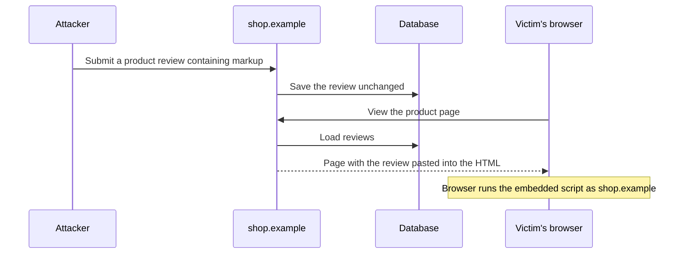

# Cross-site scripting (XSS) and output encoding

> **Before this lesson:** you need the same-origin policy from [HTTP, origins and the same-origin policy](#/lesson/web-security/http-same-origin) and the idea of a session cookie from [Cookies and sessions](#/lesson/web-security/cookies-sessions). A little HTML helps: tags such as `<p>` and `<b>`, and attributes such as `href="..."`.

## In plain words

Imagine a theatre where the audience may pass notes to the actors, and the actors are trained to read every note aloud. Most notes say "Happy birthday, Grandma!". One day a note says: "*Stage direction: walk to the box office and hand the cash to the man in row three.*" If the actor cannot tell a *message to be read out* from an *instruction to be followed*, the actor obeys.

A browser is that actor. It receives a page made of text, and it treats certain characters as instructions: `<script>` means "run this program". If your application takes text typed by one person and pastes it into a page shown to another person, and that text contains `<script>`, the browser runs it. The browser has no way of knowing that those characters came from a stranger and not from you.

This is **cross-site scripting**, abbreviated **XSS** (the X avoids confusion with CSS, the styling language). It is one of the most common web vulnerabilities, and the damage is serious because the injected program runs *as your site*: it can read what the user sees, press buttons on their behalf, and send their data elsewhere. The good news is that the defence is well understood, mostly automatic in modern tools, and built on one idea you will meet repeatedly in this track: **keep data and instructions apart**.

## How the weakness arises

### The simplest example

Our toy shop greets visitors by name, taken from the address: `/hello?name=Ann`.

```python
# VULNERABLE: the visitor's text becomes part of the page's HTML
@app.get("/hello", response_class=HTMLResponse)
def hello(name: str):
    return f"<h1>Hello, {name}!</h1>"
```

The `f"..."` is a Python *f-string*: `{name}` is replaced by the value of the variable. For `Ann` the page is `<h1>Hello, Ann!</h1>`. Fine.

Now suppose the address is `/hello?name=<b>Ann</b>`. The page becomes `<h1>Hello, <b>Ann</b>!</h1>` and the name appears in bold. The visitor has changed the *structure* of your page, not only its content. That harmless bold tag is the whole vulnerability in miniature. If bold works, so does this:

```html
<h1>Hello, <script>/* any program the sender likes */</script>!</h1>
```

The browser cannot distinguish the `<script>` you wrote from the one that arrived in the address. Both are part of the response from `shop.example`, so both run with the full rights of that origin.

### Why "the same-origin policy" does not save you

Recall the office building: tenants cannot enter each other's offices. XSS does not break into the office from outside. It gets a stranger's program *hired as an employee* of your office. The script runs inside your origin, so the same-origin policy sees nothing wrong. It can:

- read the page — account details, messages, anti-CSRF tokens;
- send requests to your API with the user's cookies attached;
- read cookies that lack `HttpOnly`, and anything in `localStorage`;
- rewrite the page, for instance to show a fake login form.

### Three varieties

XSS is classified by how the hostile text reaches the page.

**Reflected XSS.** The text is in the request and is echoed straight back in the response — like the `name` parameter above. The attacker must get a victim to open a prepared link.

**Stored XSS.** The text is saved (a review, a profile name, a support ticket) and served later to everyone who views it. No special link is needed, and one submission can reach many users — including administrators reading the ticket queue. This is usually the most damaging kind.



**DOM-based XSS.** The server's response is innocent; the page's *own JavaScript* takes untrusted data and writes it into the page unsafely. The **DOM** (Document Object Model) is the browser's in-memory tree of the page, which scripts can read and modify.

```javascript
// VULNERABLE: text from the URL is parsed as HTML
const params = new URLSearchParams(location.search);
document.getElementById("greeting").innerHTML = "Hello, " + params.get("name");
```

`location.search` is the query part of the address. `innerHTML` tells the browser "parse this string as HTML and put the result here". The server never sees anything unusual, which is why server-side filters and logs miss this variety.

```javascript
// FIXED: the text is inserted as text
document.getElementById("greeting").textContent = "Hello, " + params.get("name");
```

`textContent` says "these characters are text; do not interpret them". A `<` stays a visible `<`.

Places where untrusted data enters are called **sources** (URL, form fields, stored records, messages from other windows). Places where data can become code are called **sinks** (`innerHTML`, `document.write`, `eval`, the `href` of a link, event-handler attributes). XSS is an unbroken path from a source to a sink.

## The core defence: output encoding

The fix is not to forbid `<` in names. People are called O'Brien, companies are called "A & B <Holdings>", and a programming forum must be able to discuss `<script>`. The fix is to make sure the browser treats those characters as **text**.

HTML has a way to write a character so that it is displayed and not interpreted: **character references** (also called HTML entities). `&lt;` displays `<`. `&amp;` displays `&`. Converting special characters to these safe forms at the moment you place data into a page is called **output encoding** or **escaping**.

Python's standard library provides it. Run this and study the output:

```python-run
import html

samples = ["Ann", "<b>Ann</b>", "Tom & Jerry", 'say "hi"', "it's", "<script>alert(1)</script>"]
for text in samples:
    print(f"{text!r:32} -> {html.escape(text, quote=True)}")
```

`html.escape` replaces five characters: `&` → `&amp;`, `<` → `&lt;`, `>` → `&gt;`, `"` → `&quot;`, `'` → `&#x27;`. With `quote=True` (the default) the two quote characters are included, which matters when the value sits inside an attribute. The last line of output shows the script tag turned into inert text; a browser would *display* those characters and run nothing.

Now the fixed endpoint:

```python
# FIXED: encode at the point of output
import html

@app.get("/hello", response_class=HTMLResponse)
def hello(name: str):
    return f"<h1>Hello, {html.escape(name)}!</h1>"
```

In real projects you rarely call `html.escape` by hand, because **template engines** — tools that build pages from a template plus data — do it for you. Jinja2 (when autoescaping is enabled, as it is by default in the common web frameworks for HTML templates), Django templates, React's JSX and Vue's `{{ }}` all encode by default. In them, XSS almost always enters through an explicit opt-out:

| Tool | Safe by default | The escape hatch to search for in review |
|---|---|---|
| Jinja2 / Django | `{{ value }}` | `{{ value\|safe }}`, `Markup(...)`, `mark_safe(...)`, `` |
| React | `{value}` | `dangerouslySetInnerHTML` |
| Vue | `{{ value }}` | `v-html` |
| Angular | `{{ value }}` | `bypassSecurityTrust…`, `[innerHTML]` with untrusted input |
| Plain JavaScript | `textContent`, `setAttribute` for safe attributes | `innerHTML`, `outerHTML`, `document.write`, `insertAdjacentHTML` |

> [!TIP]
> Encode **on output, for the place the data is going** — not on input. If you encode when saving, the database holds `Tom &amp; Jerry`, which is wrong for emails, exports and mobile apps, and gets encoded a second time by the template. Store the data as the user typed it; make it safe at the moment of use.

## Context matters: one encoding does not fit every place

HTML encoding is correct for two **contexts**: text between tags, and quoted attribute values. A page has other contexts with different rules, and using the HTML rule in the wrong one leaves a hole.

| Context | Example | What is needed |
|---|---|---|
| Element content | `<p>DATA</p>` | HTML-encode |
| Quoted attribute | `<input value="DATA">` | HTML-encode, and always quote the attribute |
| URL in `href` / `src` | `<a href="DATA">` | Check the scheme is `http`/`https`, then HTML-encode |
| Inside `<script>` | `<script>var x = DATA</script>` | Avoid. Serialise as JSON into a `data-` attribute or a JSON script block instead |
| Inside CSS | `<div style="color: DATA">` | Avoid; use a fixed set of class names |
| Event handler attribute | `<div onclick="DATA">` | Never |

Two of these catch out experienced developers.

**Links.** HTML-encoding does not help if the user controls the *whole URL*, because a URL beginning with the `javascript:` scheme runs script when clicked, and it contains none of the five special characters. The defence is an allow-list of schemes:

```python-run
import html
from urllib.parse import urlsplit

def safe_link(url: str, label: str) -> str:
    scheme = urlsplit(url.strip()).scheme.lower()
    if scheme not in ("http", "https"):          # allow-list, not "block javascript:"
        url = "#"
    return f'<a href="{html.escape(url)}" rel="noopener noreferrer">{html.escape(label)}</a>'

print(safe_link("https://example.org/a?x=1&y=2", "My site"))
print(safe_link("javascript:doSomething()", "Click me"))
print(safe_link("https://example.org", ''))
```

`urlsplit(...).scheme` extracts the part before the colon. Only `http` and `https` are accepted; anything else is replaced by `#`. Then both the URL and the label are encoded for their HTML context. The second output line shows the hostile link neutralised, and the third shows markup in the label displayed as text.

**Data inside scripts.** Putting server data into inline JavaScript needs JavaScript-string encoding, and HTML encoding is the wrong tool. The robust approach is to avoid the context: place the value in a `data-` attribute (HTML-encoded as usual) and read it from script.

```html
<!-- Safe pattern: data travels as an attribute, code stays static -->
<div id="app" data-user-name="{{ user.name }}"></div>
<script src="/static/app.js"></script>
```

## When users are *supposed* to write HTML

Rich-text comments or a blog editor cannot be encoded wholesale, or the formatting disappears. Here you need **sanitisation**: parsing the HTML and keeping only an allow-list of harmless tags and attributes (`<b>`, `<i>`, `<p>`, `<a href>` with safe schemes), discarding the rest.

Do **not** write a sanitiser with regular expressions. Browsers parse malformed HTML in surprising ways, and home-made filters are bypassed routinely. Use a maintained library that works on a real parser — DOMPurify in the browser, `nh3` or `bleach` in Python — keep it updated, and sanitise as close to the sink as possible. An alternative that avoids HTML input entirely is a restricted format such as Markdown, rendered by a library with raw HTML disabled.

## Defence in depth

Encoding is the primary control. Because a single forgotten spot is enough, add layers that limit the damage when one is missed.

1. **Auto-escaping templates everywhere**; treat every escape hatch as needing a reviewer's signature.
2. **Safe DOM APIs** in JavaScript: `textContent`, `createElement`, `setAttribute`.
3. **Input validation** as a secondary measure: a quantity should be a number, a country code two letters. This narrows what can arrive but cannot replace encoding for free text.
4. **Content Security Policy (CSP)** — a response header that tells the browser which scripts may run. A strict policy stops injected inline scripts from executing even when the injection succeeds. Covered in [Security headers, CSP and CORS](#/lesson/web-security/headers-csp-cors).
5. **`HttpOnly` session cookies**, so script cannot copy the session identifier.
6. **Trusted Types**, a browser feature (enabled through CSP) that makes dangerous sinks such as `innerHTML` reject plain strings unless they have passed through a function you designate.
7. **Correct `Content-Type` and `X-Content-Type-Options: nosniff`**, so that JSON or uploaded files are never interpreted as HTML.

> [!WARNING]
> A block-list that removes `<script>` is not a defence. Scripts can run from event-handler attributes, from links, from many other tags, and filters are defeated by odd capitalisation, nesting and encodings. Every serious guide says the same: encode for the output context, and use an allow-list sanitiser when HTML must be accepted.

> [!INTERVIEW]
> "Explain XSS and how you prevent it." A complete answer: untrusted data is placed into a page without encoding, so the browser executes it in the site's origin. Name the three types (stored, reflected, DOM-based). Primary defence: context-aware output encoding, normally via auto-escaping templates and safe DOM APIs; sanitise with a library when HTML is required. Secondary layers: CSP, `HttpOnly` cookies, validation. Mention that encoding happens at output, not at input.

## How to test for it

**In code review** — follow data from sources to sinks:

- Search for the escape hatches in the table above. Each occurrence needs a justification: where does the value come from, and has it been sanitised?
- Search for string-built HTML: f-strings, `+` concatenation or `.format` producing tags.
- Check attribute values are quoted and that user-controlled URLs pass a scheme check.
- In JavaScript, search for `innerHTML`, `document.write`, `eval`, `setTimeout` with a string argument, and jQuery's `.html()`.

**In testing your own application** — use a harmless marker, not an attack. Enter `<b>xss-test-123</b>` or `"'<>&` in every field, URL parameter and header that is displayed anywhere, then view the page *source* where the value appears:

- If you see `&lt;b&gt;xss-test-123&lt;/b&gt;`, the output is encoded.
- If the text is bold, or the raw characters appear in the source, the output is not encoded and must be fixed.

Remember stored data shown in *other* places: admin dashboards, emails, PDF exports, log viewers. Add automated tests asserting that rendered pages contain the encoded form, and run a scanner (for example OWASP ZAP) against a test environment as a safety net.

## Pitfalls

- **Encoding in the wrong place**: on input, or twice.
- **Using HTML encoding inside `<script>`, a URL or CSS.** Each context has its own rules.
- **Unquoted attributes** (`<input value={{ x }}>`): a space ends the value, so encoding the five characters is not enough.
- **Trusting data because "it comes from our database".** The database stores what users typed.
- **Trusting data from other systems** — partner feeds, imported spreadsheets, file names, even error messages that echo input.
- **Rendering user-uploaded HTML or SVG files from your main origin.** They are pages, and their scripts run as you.
- **Relying on CSP alone.** It is a net beneath the trapeze, not the trapeze.
- **Forgetting JSON endpoints**: a response that reflects input and is served as `text/html` by mistake is an XSS vector.

## Summary

- XSS happens when untrusted text is placed into a page in a way that lets the browser interpret it as markup or script.
- The injected script runs inside your origin, so the same-origin policy offers no protection.
- Stored XSS is saved and served to many users; reflected XSS bounces off one request; DOM-based XSS happens entirely in page script.
- Encode at output for the specific context; let auto-escaping templates and `textContent` do it, and scrutinise every opt-out.
- Validate URL schemes with an allow-list; sanitise with a real library when HTML is required.
- Add CSP, `HttpOnly` cookies and correct content types as further layers.

## Glossary

- **Cross-site scripting (XSS)** — injection of script into a page viewed by other users.
- **Stored / reflected / DOM-based XSS** — the hostile text is saved by the server / echoed from the request / handled unsafely by page script.
- **DOM** — the browser's tree representation of a page.
- **Source** — where untrusted data enters. **Sink** — an operation that can turn data into code.
- **Output encoding (escaping)** — rewriting special characters so they are displayed, not interpreted.
- **Character reference (HTML entity)** — a code such as `&lt;` standing for a character.
- **Context** — the kind of place in a document where data is inserted (element, attribute, URL, script, CSS).
- **Template engine** — a tool that builds pages from templates and data, usually with auto-escaping.
- **Sanitisation** — removing everything except an allow-list of safe HTML.
- **Content Security Policy (CSP)** — a header restricting which scripts and resources a page may load.
- **Trusted Types** — a browser mechanism forcing values through approved functions before reaching dangerous sinks.

```quiz
[
  {"q": "Why does the same-origin policy not stop an XSS attack?",
   "options": ["It is disabled by default", "The injected script is delivered as part of the vulnerable site's own page, so it runs within that origin", "XSS only works over HTTP", "The policy applies only to images"], "answer": 1,
   "explain": "The browser cannot tell the injected script from the site's own. It executes with the origin's full access."},
  {"q": "A product review containing markup is saved and later shown to every visitor of the product page. Which type of XSS is this?",
   "options": ["Reflected", "Stored", "DOM-based", "Blind SQL"], "answer": 1,
   "explain": "The payload persists on the server and is served to many users without any special link."},
  {"q": "Which line is the safe way to show user-supplied text in the page from JavaScript?",
   "options": ["el.innerHTML = text", "document.write(text)", "el.textContent = text", "eval(text)"], "answer": 2,
   "explain": "textContent inserts characters as text. The other options parse or execute the string."},
  {"q": "When should data be HTML-encoded?",
   "options": ["Once, when it is saved to the database", "At the moment it is written into an HTML page, for that context", "Only if it contains the word script", "Never; validation is enough"], "answer": 1,
   "explain": "Encoding depends on the destination. Stored data should stay raw so it can be encoded correctly for each use."},
  {"q": "A template renders <a href=\"{{ user.website }}\"> with auto-escaping on. A user sets their website to a javascript: URL. What happens?",
   "options": ["Auto-escaping blocks it", "The link is still dangerous because the scheme, not special characters, is the problem", "The browser refuses javascript: links", "The attribute is removed"], "answer": 1,
   "explain": "HTML encoding does not change a URL's scheme. Allow-list http and https before rendering the link."},
  {"q": "Users must be able to post formatted comments containing a few HTML tags. What is the right approach?",
   "options": ["Strip the word script with a regular expression", "Encode everything and lose the formatting", "Sanitise with a maintained allow-list library such as DOMPurify or nh3", "Trust logged-in users"], "answer": 2,
   "explain": "A parser-based sanitiser keeps permitted tags and attributes and removes the rest. Regex filters are routinely bypassed."},
  {"q": "What does the HttpOnly cookie attribute contribute against XSS?",
   "options": ["It prevents XSS", "It stops injected script from reading the session cookie, limiting one consequence", "It encodes output", "It blocks inline scripts"], "answer": 1,
   "explain": "It is a damage-limiting layer. The script can still act as the user while the page is open."},
  {"q": "In a React code base, which construct should a security reviewer search for first?",
   "options": ["useState", "className", "dangerouslySetInnerHTML", "key props"], "answer": 2,
   "explain": "JSX encodes by default. dangerouslySetInnerHTML is the explicit opt-out through which unencoded HTML reaches the DOM."}
]
```

> **Source:** Hoffman, *Web Application Security*, ch. 10 (cross-site scripting) and ch. 22 (defending against XSS attacks), in original wording with original examples. OWASP Cross Site Scripting Prevention Cheat Sheet — https://cheatsheetseries.owasp.org/cheatsheets/Cross_Site_Scripting_Prevention_Cheat_Sheet.html ; OWASP DOM based XSS Prevention Cheat Sheet — https://cheatsheetseries.owasp.org/cheatsheets/DOM_based_XSS_Prevention_Cheat_Sheet.html ; MDN, Cross-site scripting — https://developer.mozilla.org/en-US/docs/Web/Security/Attacks/XSS ; MDN, Trusted Types API — https://developer.mozilla.org/en-US/docs/Web/API/Trusted_Types_API
