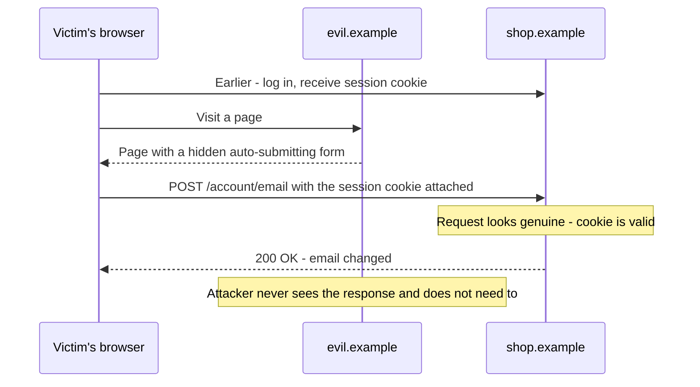

# Cross-site request forgery (CSRF)

> **Before this lesson:** you need three earlier ideas. From [HTTP, origins and the same-origin policy](#/lesson/web-security/http-same-origin): safe methods, and the fact that the same-origin policy blocks *reading* but not *sending*. From [Cookies and sessions](#/lesson/web-security/cookies-sessions): browsers attach cookies automatically, and the `SameSite` attribute. From that same lesson: what an HMAC signature is.

## In plain words

Suppose your bank accepts written payment instructions, and the only thing it checks is that the letter arrives in one of *your* personalised envelopes, which you keep on your desk. A visitor to your office slips their own letter — "Pay 500 to account 99" — into one of your envelopes and drops it in the outgoing tray. The bank sees your envelope and pays. You never wrote the letter. Nobody stole your envelopes; someone merely arranged for one to be used.

On the web, the envelope is your session cookie. Your browser puts it on **every** request to the bank's site, no matter which page caused the request. If you are logged in to `bank.example` in one tab and you open a hostile page in another, that page can make your browser send a request to the bank. The cookie goes along automatically, and the bank cannot tell the request from one you made on purpose.

That is **cross-site request forgery**, written **CSRF** and often pronounced "sea-surf". It matters because the attacker needs nothing from the victim except a visit to a page — no password, no malware, no bug in the browser. The defence is to require something in each important request that a foreign page cannot supply.

## How the weakness arises

### The ingredients

A CSRF attack is possible when three things are true together:

1. **An action worth forging** — changing an email address, making a payment, deleting data.
2. **Authentication that the browser attaches automatically** — a session cookie (or HTTP Basic credentials).
3. **A request the attacker can predict completely** — nothing in it is secret or unique to the user's session.

Remove any one of the three and the attack fails. Every defence in this lesson works by removing number 3, or by stopping number 2 for cross-site requests.

### The simplest example: an action behind GET

```python
# VULNERABLE: a state change triggered by a GET request
@app.get("/account/delete")
def delete_account(user=Depends(current_user)):
    db.delete_user(user.id)
    return {"deleted": True}
```

Any page on the internet can contain an image tag pointing at that address:

```html
<!-- On a page the attacker controls -->

```

The browser tries to load the "image". It sends a GET request to `shop.example` and — if the visitor is logged in there — includes the session cookie. The server deletes the account. The response is not an image, so nothing is displayed, but the damage is done before the response arrives. The hostile page never needed to *read* anything, which is why the same-origin policy did not help.

This is the reason behind the rule from the HTTP lesson: **GET must never change state.**

### One step further: forging a POST

Moving the action to POST is necessary but not sufficient. A hostile page can contain a form aimed at your site and submit it with a line of script:

```html
<!-- On a page the attacker controls -->
<form action="https://shop.example/account/email" method="POST" id="f">
  <input type="hidden" name="email" value="someone-else@evil.example">
</form>
<script>document.getElementById("f").submit();</script>
```

```python
# VULNERABLE: accepts any POST that carries a valid session cookie
@app.post("/account/email")
def change_email(email: str = Form(...), user=Depends(current_user)):
    db.set_email(user.id, email)
    return {"ok": True}
```

The form's fields are entirely predictable: one field called `email`. The browser sends the POST with the cookie. Once the email address on the account has been changed, the attacker uses "forgot password" to take the account over.



### What CSRF cannot do

Because the attacker cannot read responses, CSRF is a *write-only* attack: it can trigger actions but cannot extract data. It also depends on the browser sending credentials automatically. An API that authenticates only with a token placed by JavaScript in an `Authorization` header is not exposed to classic CSRF, because a foreign page cannot make the browser add that header. (Such a token is, however, exposed to theft by XSS — every design has a trade-off.)

## Defence 1: anti-CSRF tokens

The classic and most robust defence is to include in every state-changing request a value that:

- the server can verify,
- is tied to the user's session,
- and a foreign page cannot know.

This value is an **anti-CSRF token**. The hostile page can make the browser *send* a request, but it cannot *read* your pages (same-origin policy), so it cannot find out the token and cannot include the right one.

### The synchroniser token pattern

The server generates a random token, stores it in the user's session, and writes it into each form as a hidden field. On submission it compares the two.

```python
# FIXED: synchroniser token
import hmac, secrets

@app.get("/account", response_class=HTMLResponse)
def account_page(session=Depends(current_session)):
    session.setdefault("csrf", secrets.token_urlsafe(32))     # create once per session
    return templates.render("account.html", csrf_token=session["csrf"])

@app.post("/account/email")
def change_email(email: str = Form(...), csrf_token: str = Form(""), session=Depends(current_session)):
    if not hmac.compare_digest(csrf_token, session.get("csrf", "")):
        raise HTTPException(403, "CSRF token missing or wrong")
    db.set_email(session["user_id"], email)
    return {"ok": True}
```

```html
<!-- account.html -->
<form action="/account/email" method="POST">
  <input type="hidden" name="csrf_token" value="{{ csrf_token }}">
  <input name="email">
  <button>Save</button>
</form>
```

Reading the Python: `session.setdefault("csrf", ...)` stores a new random token only if the session does not already have one. The page template writes it into a hidden input. On POST, the handler takes the submitted `csrf_token` and compares it with the stored one using `hmac.compare_digest`, a comparison whose duration does not reveal how many leading characters matched. A mismatch — including a missing token, which arrives as the empty string — is rejected with `403` *before* any change is made.

The forged form from `evil.example` has no way to include the correct value, so it fails.

### Stateless tokens: sign instead of store

Storing a token per session needs server-side state. An alternative is a token the server can verify by *recomputing* it: an HMAC over the session identifier and a timestamp, made with a secret key. Nothing is stored; forging one requires the key.

```python-run
import hashlib, hmac

SECRET = b"csrf-signing-key-from-configuration"
MAX_AGE = 3600                                    # tokens are valid for one hour

def issue(session_id: str, now: int) -> str:
    message = f"{session_id}|{now}".encode()
    signature = hmac.new(SECRET, message, hashlib.sha256).hexdigest()
    return f"{now}.{signature}"                   # timestamp, dot, signature

def verify(session_id: str, token: str, now: int) -> bool:
    timestamp, dot, signature = token.partition(".")
    if not dot or not timestamp.isascii() or not timestamp.isdigit():
        return False                              # wrong shape
    if not 0 <= now - int(timestamp) <= MAX_AGE:
        return False                              # from the future, or expired
    expected = hmac.new(SECRET, f"{session_id}|{timestamp}".encode(), hashlib.sha256).hexdigest()
    return hmac.compare_digest(signature, expected)

token = issue("session-ann", now=1_000)
print("token                     :", token[:30] + "...")
print("same session, in time     :", verify("session-ann", token, now=1_500))
print("another user's session    :", verify("session-bob", token, now=1_500))
print("after expiry              :", verify("session-ann", token, now=9_000))
print("made-up token             :", verify("session-ann", "1000.deadbeef", now=1_500))
```

Step by step: `issue` builds the message `session-ann|1000`, computes its HMAC and returns the timestamp and signature joined by a dot. `verify` splits the token at the first dot (`partition` returns the part before, the separator, and the part after), checks that the timestamp is made of digits, checks the age, recomputes the signature **for the session making the request**, and compares. The output shows four outcomes: valid; rejected because the token was issued for a different session; rejected because it is too old; rejected because the signature is invented.

Binding the token to the session is essential. Without it, an attacker could log in to their own account, copy their own valid token, and place it in the forged form.

### Tokens in JavaScript applications

A single-page application usually sends the token in a custom request header — commonly `X-CSRF-Token` — which the server checks the same way. Custom headers bring a bonus: a cross-site page cannot attach one without the browser first asking the server's permission (a CORS *preflight* request), which a correctly configured server refuses.

A related technique is the **double-submit cookie**: the server sets a random value in a cookie, the page's script copies it into a header, and the server checks that the two match. A foreign site cannot read the cookie to copy it. The plain version is weakened if any subdomain can set cookies for the parent domain, so prefer the *signed* variant shown above, where the value is an HMAC tied to the session.

> [!TIP]
> Do not write this plumbing by hand in production. Django, Rails, Laravel, Spring Security and ASP.NET include CSRF protection that is on by default; for FastAPI and Express there are well-used middleware packages. Your job in review is to confirm it is enabled, covers every state-changing route, and has not been switched off "temporarily" for one endpoint.

## Defence 2: SameSite cookies

`SameSite` attacks ingredient number 2: it stops the browser attaching the cookie to requests that start on another site.

| Setting | Cookie sent on a cross-site request? |
|---|---|
| `SameSite=Strict` | Never |
| `SameSite=Lax` | Only for top-level navigations using a safe method (clicking a link) |
| `SameSite=None; Secure` | Always |

With `Lax` — which current browsers apply when no attribute is given — the hidden image and the auto-submitting POST form in our examples arrive **without** the session cookie, and the server treats them as coming from an anonymous visitor.

This small function models the browser's decision so you can test your understanding:

```python-run
def cookie_is_sent(samesite, same_site_request, method, top_level_navigation):
    mode = (samesite or "lax").lower()              # missing attribute behaves as Lax
    if mode == "none":
        return True
    if same_site_request:
        return True                                 # your own pages always work
    if mode == "strict":
        return False
    return top_level_navigation and method in ("GET", "HEAD")

cases = [
    ("Lax",    "cross-site hidden form POST", False, "POST", True),
    ("Lax",    "cross-site image GET",        False, "GET",  False),
    ("Lax",    "user clicks a link to us",    False, "GET",  True),
    ("Strict", "user clicks a link to us",    False, "GET",  True),
    ("None",   "cross-site hidden form POST", False, "POST", True),
]
for mode, what, same, method, top in cases:
    print(f"{mode:7} {what:30} -> cookie sent: {cookie_is_sent(mode, same, method, top)}")
```

The third line of output shows why `Lax` is the usual choice: someone following a link from an email or another site still arrives logged in. With `Strict` (fourth line) they arrive logged out and must reload — safer, less convenient.

**Why SameSite alone is not enough:**

- `Lax` still sends cookies on cross-site top-level **GET** navigations. Any state-changing GET endpoint remains forgeable.
- "Same *site*" is wider than "same *origin*". `blog.shop.example` and `shop.example` are the same site. A vulnerable or attacker-controlled sibling subdomain can send requests that carry `Strict` cookies.
- Some applications must use `SameSite=None` because they are embedded in other sites or use cross-site single sign-on.
- Older or unusual clients may not enforce it.

So the standard recommendation is both: `SameSite=Lax` (or `Strict`) **and** tokens.

## Defence 3: checking where the request came from

Browsers add an `Origin` header to cross-origin and state-changing requests, and newer ones add **Fetch Metadata** headers such as `Sec-Fetch-Site`, whose value is `same-origin`, `same-site`, `cross-site` or `none` (typed directly by the user). A server can refuse state-changing requests that the browser labels as cross-site:

```python
# A resource isolation policy as middleware
SAFE_METHODS = {"GET", "HEAD", "OPTIONS"}

@app.middleware("http")
async def reject_cross_site_writes(request, call_next):
    site = request.headers.get("sec-fetch-site")
    if request.method not in SAFE_METHODS and site not in (None, "same-origin", "none"):
        return JSONResponse({"error": "cross-site request refused"}, status_code=403)
    return await call_next(request)
```

The condition reads: for a method that changes state, if the browser says the request came from another site (or a sibling subdomain), stop. A missing header (`None`) is allowed through here because older browsers and non-browser clients do not send it; those cases are covered by the token. These headers cannot be set by page script, so a hostile page cannot lie about them. This is an excellent additional layer, and a poor *only* layer.

## Defence in depth

1. **No state changes on GET.**
2. **Anti-CSRF tokens** on every state-changing request, bound to the session and compared in constant time.
3. **`SameSite=Lax` or `Strict`** on session cookies.
4. **Origin / Fetch Metadata checks** as a server-wide backstop.
5. **Re-authentication or confirmation** for the most sensitive actions (changing the password, email or payout details; large payments). Asking for the current password is something a forged request cannot supply.
6. **Fix XSS.** Script running in your origin can read tokens from the page and send perfectly valid requests. An XSS hole defeats every CSRF defence.

> [!WARNING]
> Login and logout need protection too. *Login CSRF* signs the victim in to the **attacker's** account without them noticing; anything they then save — a card number, an address, search history — lands in an account the attacker controls. Issue a pre-login session and protect the login form with a token like any other.

> [!INTERVIEW]
> "Explain XSS versus CSRF" is a staple. XSS: the attacker's *script runs in your origin*; it can read and act; fixed by output encoding. CSRF: the attacker's *page makes the victim's browser send a request* that carries their cookies; it can act but not read; fixed by tokens and SameSite. Finish with the relationship: XSS breaks CSRF defences, but not the other way round.

## How to test for it

**In code review:**

- List every route that is not GET/HEAD/OPTIONS. For each, find the CSRF check. In a framework with built-in protection, search for the opt-out: `@csrf_exempt` (Django), `csrf().disable()` (Spring), `skip_before_action :verify_authenticity_token` (Rails).
- Search for GET handlers whose names contain verbs: `delete`, `remove`, `approve`, `logout`, `toggle`.
- Check the session cookie's `SameSite` attribute.
- Confirm the token is compared with the *session's* token and not merely checked for presence or length.

**In testing your own application:**

1. Perform an action normally and capture the request in the browser's Network tab.
2. Replay it with the token **removed** — expect `403`.
3. Replay it with the token **changed** by one character — expect `403`.
4. Log in as a second user, copy *their* valid token into the first user's request — expect `403`. This catches tokens that are not bound to the session.
5. Change the method from POST to GET with the same parameters — expect the action not to happen.
6. Create a local HTML file containing a form that posts to your test environment, open it in a browser where you are logged in, and confirm the request is refused.

Automate steps 2–5 as integration tests so that a future refactoring cannot silently remove the check.

## Pitfalls

- **Checking the token only when it is present.** A request with no token at all must fail.
- **A token that is global or per-user instead of per-session**, or one that never changes.
- **Putting the token in the URL**, where it leaks through history, logs and the `Referer` header.
- **Accepting the token from a cookie alone.** The cookie is sent automatically; the proof must travel somewhere the attacker cannot fill in — a form field or header.
- **Exempting "API" routes** that are in fact called by the browser with cookies.
- **Assuming JSON bodies are safe.** A form can be coaxed into sending something a lenient JSON parser accepts; require the correct `Content-Type` and still check the token.
- **Believing HTTPS, POST-only or a secret URL prevents CSRF.** None of them does.
- **CORS confusion.** A permissive CORS policy with credentials can let a foreign page read your pages — and therefore your tokens.

## Summary

- CSRF abuses the browser's habit of attaching cookies to every request to a site, whoever initiated it.
- The attacker can cause actions but cannot read responses.
- It needs a valuable action, automatic credentials and a fully predictable request; defences remove the predictability or the automatic credentials.
- Anti-CSRF tokens — stored in the session or signed with HMAC — are the primary defence; they must be bound to the session and required on every state-changing request.
- `SameSite` cookies and Origin/Fetch Metadata checks are strong additional layers, not replacements.
- GET must not change state, and XSS must be fixed first because it defeats all of the above.

## Glossary

- **Cross-site request forgery (CSRF)** — causing a victim's browser to send an authenticated request they did not intend.
- **State-changing request** — one that creates, modifies or deletes something.
- **Anti-CSRF token** — an unpredictable value required in each state-changing request.
- **Synchroniser token pattern** — the token is stored in the server-side session and compared on submission.
- **Double-submit cookie** — the same random value is sent in a cookie and in a header or field, and the server compares them.
- **Signed (stateless) token** — a token the server verifies by recomputing an HMAC.
- **`SameSite`** — cookie attribute controlling cross-site sending (`Strict`, `Lax`, `None`).
- **Top-level navigation** — a request that changes the address in the browser's address bar.
- **`Origin` header** — browser-set header naming the origin that initiated a request.
- **Fetch Metadata** — browser-set `Sec-Fetch-*` headers describing a request's context.
- **Preflight** — a preliminary `OPTIONS` request by which the browser asks permission for certain cross-origin requests.
- **Login CSRF** — forging a login so the victim uses the attacker's account.

```quiz
[
  {"q": "Why can a hostile page make a logged-in user's browser perform an action on another site?",
   "options": ["It steals the password", "Browsers attach the site's cookies to requests regardless of which page triggered them", "It reads the session cookie with JavaScript", "HTTPS is disabled"], "answer": 1,
   "explain": "CSRF relies on automatically attached credentials. The attacker never sees the cookie; the browser sends it for them."},
  {"q": "What can an attacker NOT do with a pure CSRF attack?",
   "options": ["Change the victim's email address", "Read the response containing the victim's data", "Submit a form as the victim", "Trigger a GET request"], "answer": 1,
   "explain": "The same-origin policy still blocks reading cross-origin responses. CSRF is write-only."},
  {"q": "Why does an anti-CSRF token defeat the forged form?",
   "options": ["It encrypts the form", "The foreign page cannot read the victim's pages, so it cannot learn the correct token to include", "It hides the form's action URL", "It disables cookies"], "answer": 1,
   "explain": "The token makes the request unpredictable. Sending is possible; knowing the value is not."},
  {"q": "A site's CSRF tokens are valid for any session. How can this be abused?",
   "options": ["It cannot", "The attacker obtains a token from their own account and places it in the forged request", "The token expires too quickly", "The token is too long"], "answer": 1,
   "explain": "A token must be bound to the session of the user making the request; otherwise anyone's valid token works for everyone."},
  {"q": "With SameSite=Lax on the session cookie, which cross-site request still carries the cookie?",
   "options": ["An auto-submitted POST form", "An image tag", "A top-level navigation by clicking a link (GET)", "A background fetch"], "answer": 2,
   "explain": "Lax permits safe-method top-level navigations so links work. This is why state-changing GET endpoints remain dangerous."},
  {"q": "Why is SameSite not sufficient by itself?",
   "options": ["Browsers ignore it", "Sibling subdomains count as same-site, Lax allows cross-site GET navigations, and some deployments need SameSite=None", "It only works over HTTP", "It disables HttpOnly"], "answer": 1,
   "explain": "SameSite narrows the attack considerably but has gaps; tokens cover them."},
  {"q": "How does an XSS vulnerability affect CSRF protection?",
   "options": ["It has no effect", "Script running in the site's own origin can read the token and send valid requests, bypassing CSRF defences", "It makes tokens longer", "It turns POST into GET"], "answer": 1,
   "explain": "CSRF defences assume the attacker cannot read your pages. XSS removes that assumption."},
  {"q": "During a review you find `if token and token != session_token: reject()`. What is the bug?",
   "options": ["It should use GET", "A request with no token at all passes the check", "The token is too short", "Nothing"], "answer": 1,
   "explain": "The check runs only when a token is present. Absence must be treated as failure."}
]
```

> **Source:** Hoffman, *Web Application Security*, ch. 11 (cross-site request forgery) and ch. 23 (defending against CSRF attacks), in original wording with original examples. OWASP Cross-Site Request Forgery Prevention Cheat Sheet — https://cheatsheetseries.owasp.org/cheatsheets/Cross-Site_Request_Forgery_Prevention_Cheat_Sheet.html ; MDN, Cross-site request forgery — https://developer.mozilla.org/en-US/docs/Web/Security/Attacks/CSRF ; MDN, SameSite cookies — https://developer.mozilla.org/en-US/docs/Web/HTTP/Headers/Set-Cookie#samesitesamesite-value ; MDN, Sec-Fetch-Site — https://developer.mozilla.org/en-US/docs/Web/HTTP/Headers/Sec-Fetch-Site
