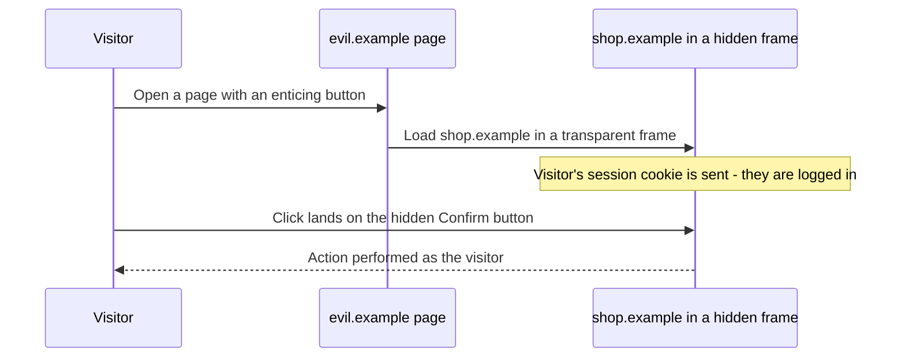

# Clickjacking and open redirects

> **Before this lesson:** you should know the parts of a URL and what a response header is from [HTTP, origins and the same-origin policy](#/lesson/web-security/http-same-origin), and how CSRF works from [Cross-site request forgery (CSRF)](#/lesson/web-security/csrf).

## In plain words

Two everyday tricks share this lesson because both abuse the **trust a user places in what they see**.

**The first trick.** Someone tapes a sheet of paper over a contract, with a hole cut exactly where the signature line is. The paper says "Sign here to receive your free gift". You sign through the hole. Your signature is genuine and it is on the contract — you were shown one thing while acting on another. On the web, a hostile page can load *your* site invisibly and position it so that the visitor's click lands on *your* button. This is **clickjacking**.

**The second trick.** A hotel concierge will forward any note you hand over, on the hotel's own letterhead. A fraudster hands in a note saying "Please go to the bank on the corner and give them your card details". The guest sees the hotel's letterhead and trusts the instruction. On the web, a site that will redirect visitors to *any* address named in a link lends its good name to wherever the link leads. This is an **open redirect**.

Neither involves code injection or broken cryptography. Both are fixed with a few lines once you know they exist — which is exactly why interviewers like them: they test whether you think about how a feature can be misused.

## Part 1: clickjacking

### How it arises

HTML lets one page display another inside a rectangle called a **frame**, written `<iframe src="...">`. Maps, videos and payment widgets are embedded this way. A frame can be styled like any other element: moved, resized, and made transparent.

The attack combines those ordinary features:

1. The attacker's page loads your site in a frame. The visitor's browser sends your cookies with the frame's request, so the framed page shows the visitor **logged in**.
2. The frame is made fully transparent and layered above a harmless-looking decoy ("Click to play the video").
3. The decoy is positioned so that the play button sits precisely under your "Delete account" or "Confirm transfer" button.
4. The visitor clicks. The click goes to the topmost layer — your invisible page.



Notice what is different from CSRF. The request is not forged: it is a real click on your real page, and it carries a valid anti-CSRF token, because your own page supplied it. **CSRF tokens do not stop clickjacking.** The same-origin policy does not stop it either — the attacker's page never reads your content; it only has to *show* it.

A minimal sketch of the hostile page makes the mechanism concrete:

```html
<!-- The attacker's page (illustration of the layering only) -->
<style>
  iframe { position: absolute; top: 0; left: 0; width: 600px; height: 400px;
           opacity: 0;        /* invisible */
           z-index: 2; }      /* on top, so it receives the click */
  .decoy { position: absolute; top: 210px; left: 180px; z-index: 1; }
</style>
<button class="decoy">Play video</button>
<iframe src="https://shop.example/account/settings"></iframe>
```

`opacity: 0` makes the frame invisible; `z-index` orders the layers, higher numbers on top. Nothing here is exotic; it is everyday CSS.

### The defence: tell browsers not to frame you

The fix is a response header that instructs the browser who may embed the page. There are two; send both.

**`Content-Security-Policy: frame-ancestors`** — the modern control. *Ancestors* means the pages that contain this one.

| Value | Meaning |
|---|---|
| `frame-ancestors 'none'` | Nobody may frame this page |
| `frame-ancestors 'self'` | Only pages from my own origin may |
| `frame-ancestors https://partner.example` | Only the named origin(s) may |

**`X-Frame-Options`** — the older header, still worth sending for old browsers. It has two useful values: `DENY` and `SAMEORIGIN`. (A third, `ALLOW-FROM`, was never widely supported and should not be used.) When both headers are present, modern browsers follow `frame-ancestors`.

```python
# VULNERABLE: no framing policy, so any site may embed every page
@app.get("/account/settings", response_class=HTMLResponse)
def settings(user=Depends(current_user)):
    return render("settings.html", user=user)
```

```python
# FIXED: one middleware protects every response
@app.middleware("http")
async def no_framing(request, call_next):
    response = await call_next(request)
    response.headers["Content-Security-Policy"] = "frame-ancestors 'none'"
    response.headers["X-Frame-Options"] = "DENY"
    return response
```

The middleware runs for every request: it lets the normal handler produce the response (`call_next`), then adds the two headers before the response is sent. Doing it centrally means no individual page can be forgotten. If your application has other CSP directives, `frame-ancestors` is added to that same policy string; the full header is covered in [Security headers, CSP and CORS](#/lesson/web-security/headers-csp-cors).

A small audit function shows the logic a reviewer applies:

```python-run
def framing_protected(headers: dict) -> bool:
    h = {name.lower(): value for name, value in headers.items()}    # header names ignore case
    xfo = h.get("x-frame-options", "").strip().upper()
    csp = h.get("content-security-policy", "").lower()
    return xfo in ("DENY", "SAMEORIGIN") or "frame-ancestors" in csp

print(framing_protected({}))
print(framing_protected({"X-Frame-Options": "DENY"}))
print(framing_protected({"x-frame-options": "ALLOWALL"}))
print(framing_protected({"Content-Security-Policy": "default-src 'self'; frame-ancestors 'self'"}))
```

The first line lower-cases the header names because HTTP treats `X-Frame-Options` and `x-frame-options` as the same header. The third call prints `False`: a header being *present* is not enough; its value must be one that browsers honour.

### Additional layers

- **`SameSite=Lax` or `Strict` cookies.** A frame is a cross-site sub-resource request, so the session cookie is withheld and the framed page shows the logged-out view — nothing worth clicking.
- **Confirmation for destructive actions.** Requiring the user to type a value (their password, the name of the thing being deleted) cannot be accomplished with a single misdirected click.
- **Avoid one-click state changes** for the most sensitive operations.

> [!WARNING]
> Older articles recommend "frame-busting" JavaScript such as `if (top !== self) top.location = self.location`. Do not rely on it. A framing page can disable scripts in the frame with the `sandbox` attribute, and the check then never runs. Headers are enforced by the browser before your page is displayed at all.

### What if you *want* to be embedded?

Some pages are meant to be framed — a payment widget, an embeddable player. Then:

- Allow only the specific partner origins in `frame-ancestors`.
- Serve embeddable content from a separate path or origin that contains no sensitive one-click actions.
- Keep everything else on `'none'`.

## Part 2: open redirects

### How it arises

Redirecting is a normal feature. A visitor who is not logged in asks for `/orders/17`; you send them to `/login?next=/orders/17`; after login you send them on to the page in `next`. A **redirect** is a response with a 3xx status and a `Location` header telling the browser where to go.

```python
# VULNERABLE: the destination is whatever the URL says
@app.post("/login")
def login(form: LoginForm, next: str = "/"):
    user = authenticate(form)
    start_session(user)
    return RedirectResponse(next, status_code=303)
```

The trouble is that `next` comes from the address, so anyone can write it. A link such as

```
https://shop.example/login?next=https://shop-example-login.evil.example/
```

begins with your genuine domain. The visitor checks the start of the link, sees a name they trust, logs in on your real page — and is then delivered to a look-alike site that says "Session expired, please sign in again". That is phishing with your reputation attached. An application that redirects to arbitrary, unchecked destinations has an **open redirect**.

Besides phishing, open redirects are used as a stepping stone in other attacks: they can help bypass allow-lists that check only the first address of a chain, and they are a classic ingredient in stealing authorisation codes from badly configured OAuth logins (see [OAuth 2.0 and OpenID Connect](#/lesson/web-security/oauth-oidc)).

### Why the obvious checks fail

Developers reach for string tests. Each has a well-known hole. Assume the allowed site is `shop.example`:

| Naive check | A target that passes it but leaves the site | Why |
|---|---|---|
| `next.startswith("/")` | `//evil.example` | Two slashes mean "same scheme, **different host**" |
| `next.startswith("/")` | `/\evil.example` | Many browsers treat a backslash like a slash |
| `"shop.example" in next` | `https://evil.example/?shop.example` | The name appears, but not as the host |
| `next.startswith("https://shop.example")` | `https://shop.example.evil.example` | A longer host with the same beginning |
| `host.endswith("shop.example")` | `https://notshop.example` | A different domain with the same ending |
| host check on the raw text | `https://shop.example@evil.example` | Text before `@` is a user name; the host is what follows |

The lesson is the one from the HTTP lesson: **do not guess what a URL means from its text. Parse it and compare the parsed host exactly.**

### The fix

There are three designs, from strongest to most flexible.

**1. Do not take a URL at all.** Accept a short key and map it to a destination you chose:

```python
DESTINATIONS = {"orders": "/orders", "basket": "/basket", "home": "/"}

def destination(key: str) -> str:
    return DESTINATIONS.get(key, "/")        # unknown key -> home page
```

**2. Accept only local paths.** Good for "return to the page you were on".

**3. Accept absolute URLs only for exactly allow-listed hosts.**

The function below implements options 2 and 3 together. Read the comments, then run it:

```python-run
from urllib.parse import urlsplit

ALLOWED_HOSTS = {"shop.example", "help.shop.example"}

def safe_redirect(target, fallback="/"):
    if not isinstance(target, str) or not target:
        return fallback
    # Control characters, whitespace and backslashes have no place in a redirect target
    if any(ch.isspace() or ord(ch) < 32 or ch == "\\" for ch in target):
        return fallback
    if target.startswith("/"):
        # "/orders" is local; "//host" is another site
        return fallback if target.startswith("//") else target
    try:
        parts = urlsplit(target)
        host, port = parts.hostname, parts.port
    except ValueError:                      # for example a non-numeric port
        return fallback
    if parts.scheme != "https" or not host:
        return fallback
    if parts.username is not None or port not in (None, 443):
        return fallback
    return target if host.lower() in ALLOWED_HOSTS else fallback

tests = [
    "/orders/17",
    "//evil.example",
    "/\\evil.example",
    "https://help.shop.example/returns",
    "https://shop.example.evil.example/",
    "https://shop.example@evil.example/",
    "https://evil.example/?shop.example",
    "javascript:alert(1)",
    "http://shop.example/",
]
for t in tests:
    print(f"{t!r:45} -> {safe_redirect(t)}")
```

What each block does:

- The first `if` rejects missing or non-text values.
- The `any(...)` line scans every character and refuses whitespace, control characters (code points below 32, which include newlines) and backslashes.
- A target starting with one slash is a path on this site and is returned as is; two slashes are refused.
- Otherwise `urlsplit` parses the URL. `.hostname` is the real host as a browser would see it, with any `user@` part removed.
- The scheme must be `https`, there must be a host, no user name, and the standard port.
- Finally the lower-cased host must be an **exact member** of the allow-list.

Only the first and fourth test values survive; every trick from the table returns the fallback `/`.

```python
# FIXED endpoint
@app.post("/login")
def login(form: LoginForm, next: str = "/"):
    user = authenticate(form)
    start_session(user)
    return RedirectResponse(safe_redirect(next), status_code=303)
```

> [!TIP]
> On invalid input, **fall back to a safe default — do not try to repair the value.** "Stripping the bad part" of a URL is how filters get bypassed: the attacker supplies input that becomes dangerous *after* your clean-up.

### Redirects done in the browser

The same flaw appears in front-end code, where the server never sees it:

```javascript
// VULNERABLE: navigates wherever the query string says
const next = new URLSearchParams(location.search).get("next");
window.location = next;
```

This is worse than a server redirect: a `javascript:` value assigned to `window.location` runs script, turning an open redirect into DOM-based XSS.

```javascript
// FIXED: resolve against our own origin and insist the result stays there
function safeNext(raw) {
  try {
    const url = new URL(raw, window.location.origin);   // relative values resolve to our origin
    if (url.origin === window.location.origin) return url.pathname + url.search;
  } catch (e) { /* unparseable */ }
  return "/";
}
window.location.assign(safeNext(new URLSearchParams(location.search).get("next")));
```

`new URL(raw, base)` parses `raw` the way the browser itself would, resolving it against `base` if it is relative. Comparing `url.origin` with our own origin catches `//evil.example`, `javascript:` and every other escape, because each produces a different origin.

### When you must send users to arbitrary external sites

A link-sharing or forum application legitimately links anywhere. Then the goal changes from *preventing* departure to *not lending your credibility* to it:

- Show an interstitial page: "You are leaving shop.example for **evil.example**. Continue?" displaying the real destination host.
- Never auto-redirect from a login or other trusted flow to a user-supplied external address.
- Add `rel="noopener noreferrer"` to external links so that the new page cannot manipulate the one that opened it.

> [!INTERVIEW]
> A typical "review this code" snippet is a login handler ending in `return redirect(request.args["next"])`. Name the bug (open redirect), explain the impact (phishing under the site's name, token theft in login flows), and give the fix: allow only local paths that start with a single `/`, or parse and compare the host against an allow-list, falling back to `/`. Mention `//host` and backslashes to show depth.

## Defence in depth

For **clickjacking**: `frame-ancestors` plus `X-Frame-Options` on every response; `SameSite` cookies; confirmation steps for destructive actions.

For **open redirects**: prefer keys over URLs; otherwise parse and allow-list; fall back instead of repairing; interstitials for external links; a restrictive `Referrer-Policy` so tokens in URLs are not leaked onward; in OAuth, exact-match registered redirect URIs.

## How to test for them

**Clickjacking**

- Run `curl -I https://your-site.example/account` and look for `X-Frame-Options` and a CSP containing `frame-ancestors`. Check several pages, including error pages and static HTML, since each response needs the header.
- Save a local HTML file containing `<iframe src="https://your-test-site.example/account"></iframe>` and open it. A protected page renders as blank or as a browser error, and the developer console reports that framing was refused.
- Add an automated test asserting the headers on a sample of routes.

**Open redirects**

- Search the code for redirect calls (`RedirectResponse`, `redirect(`, `Location` headers, `window.location`, `location.href`, `location.assign`) and check where the argument comes from. Parameter names worth searching for: `next`, `url`, `return`, `returnTo`, `redirect`, `continue`, `dest`, `callback`.
- Against your own test environment, try the values from the table above and confirm each lands on the fallback page.
- Write those values into a unit test for your validation function, as in the runnable example. Such a test is cheap and guards the function against future "simplifications".

## Pitfalls

- **Adding framing headers only to "sensitive" pages.** Any page with a button is a target; apply the header globally and make exceptions deliberately.
- **`X-Frame-Options: ALLOW-FROM …`** — ignored by modern browsers, leaving the page unprotected.
- **Believing CSRF tokens cover clickjacking.** The token is supplied by your own framed page.
- **Validating a redirect target and then redirecting to a different, re-read value.** Validate and use the same variable.
- **Decoding after validating.** If any layer URL-decodes the value again after your check, `%2F%2Fevil.example` becomes `//evil.example`. Validate the final form.
- **Allow-listing by suffix** (`*.shop.example`) when any customer can create a subdomain or one of them hosts user content.
- **Forgetting other redirect-like sinks**: `<meta http-equiv="refresh">`, links in emails ("click to verify"), and the `Location` header on file downloads.

## Summary

- Clickjacking shows a decoy while the click lands on your invisible, framed page. The request is genuine, so CSRF tokens do not help.
- Stop it with `Content-Security-Policy: frame-ancestors` and `X-Frame-Options`, applied to every response; `SameSite` cookies and confirmation steps add depth.
- An open redirect sends visitors from your trusted address to a destination chosen by whoever wrote the link, enabling convincing phishing and helping other attacks.
- String checks on URLs fail in well-known ways; parse the URL and compare the host exactly against an allow-list, or avoid URLs by using keys or local paths.
- On bad input, fall back to a safe default.

## Glossary

- **Frame (`iframe`)** — an element that displays another page inside the current one.
- **Clickjacking (UI redressing)** — tricking a user into clicking a concealed element of another site.
- **`frame-ancestors`** — CSP directive listing who may embed a page.
- **`X-Frame-Options`** — older header controlling framing (`DENY`, `SAMEORIGIN`).
- **Frame-busting** — JavaScript attempting to escape a frame; unreliable.
- **Redirect** — a 3xx response telling the browser to go to another URL.
- **`Location` header** — the destination of a redirect.
- **Open redirect** — a redirect whose destination is controlled by the requester and not validated.
- **Phishing** — deceiving someone into revealing credentials on a fake site.
- **Protocol-relative URL** — an address starting with `//`, which keeps the scheme and changes the host.
- **Interstitial** — an intermediate page warning the user before they leave a site.
- **`rel="noopener"`** — link attribute preventing the opened page from controlling the opener.

```quiz
[
  {"q": "Why does an anti-CSRF token not protect against clickjacking?",
   "options": ["Tokens expire too fast", "The victim clicks the real page in a hidden frame, and that page includes its own valid token", "Tokens are not sent in frames", "Clickjacking uses GET"], "answer": 1,
   "explain": "The request is genuine and carries everything a legitimate request would. The defence is to prevent the page from being framed."},
  {"q": "Which header value prevents every other site from framing a page in modern browsers?",
   "options": ["X-Frame-Options: ALLOW-FROM self", "Content-Security-Policy: frame-ancestors 'none'", "Access-Control-Allow-Origin: none", "Referrer-Policy: no-referrer"], "answer": 1,
   "explain": "frame-ancestors 'none' forbids all embedding. ALLOW-FROM is not supported by current browsers."},
  {"q": "Why is JavaScript 'frame-busting' code an unreliable defence?",
   "options": ["It is too slow", "The framing page can disable scripts in the frame with the sandbox attribute", "Browsers do not support the top object", "It breaks cookies"], "answer": 1,
   "explain": "If the frame's scripts do not run, the check never executes. Header-based policies are enforced by the browser itself."},
  {"q": "A redirect check accepts any target for which target.startswith('/') is true. Which target defeats it?",
   "options": ["/orders", "//evil.example/login", "/account?tab=2", "/"], "answer": 1,
   "explain": "A leading double slash is a protocol-relative URL pointing at a different host."},
  {"q": "Why is checking next.startswith('https://shop.example') insufficient?",
   "options": ["It rejects valid URLs", "https://shop.example.evil.example also starts with that text", "startswith is case-sensitive", "It allows HTTP"], "answer": 1,
   "explain": "String prefixes do not respect host boundaries. Parse the URL and compare the hostname exactly."},
  {"q": "What is the host of https://shop.example@evil.example/ ?",
   "options": ["shop.example", "evil.example", "shop.example@evil.example", "There is none"], "answer": 1,
   "explain": "Text before the @ is the user-info part. A parser's hostname attribute returns evil.example."},
  {"q": "When a redirect target fails validation, what should the application do?",
   "options": ["Remove the suspicious characters and redirect anyway", "Redirect to a fixed safe default such as the home page", "Show the raw value in an error page", "Redirect to the Referer header"], "answer": 1,
   "explain": "Repairing input invites bypasses. A known-good fallback is predictable and safe."},
  {"q": "Which measure reduces clickjacking impact even if a framing header is missing on one page?",
   "options": ["A longer session timeout", "SameSite=Lax or Strict session cookies, so the framed page loads logged out", "Minifying JavaScript", "Using GET for actions"], "answer": 1,
   "explain": "Frames are cross-site sub-resource requests, so SameSite cookies are withheld and there is no authenticated button to click."}
]
```

> **Source:** Hoffman, *Web Application Security* — the book treats UI and redirect abuse only briefly within its offence and architecture chapters (ch. 9, ch. 18); this lesson extends that material using OWASP Clickjacking Defense Cheat Sheet — https://cheatsheetseries.owasp.org/cheatsheets/Clickjacking_Defense_Cheat_Sheet.html ; OWASP Unvalidated Redirects and Forwards Cheat Sheet — https://cheatsheetseries.owasp.org/cheatsheets/Unvalidated_Redirects_and_Forwards_Cheat_Sheet.html ; MDN, CSP frame-ancestors — https://developer.mozilla.org/en-US/docs/Web/HTTP/Headers/Content-Security-Policy/frame-ancestors ; MDN, X-Frame-Options — https://developer.mozilla.org/en-US/docs/Web/HTTP/Headers/X-Frame-Options
