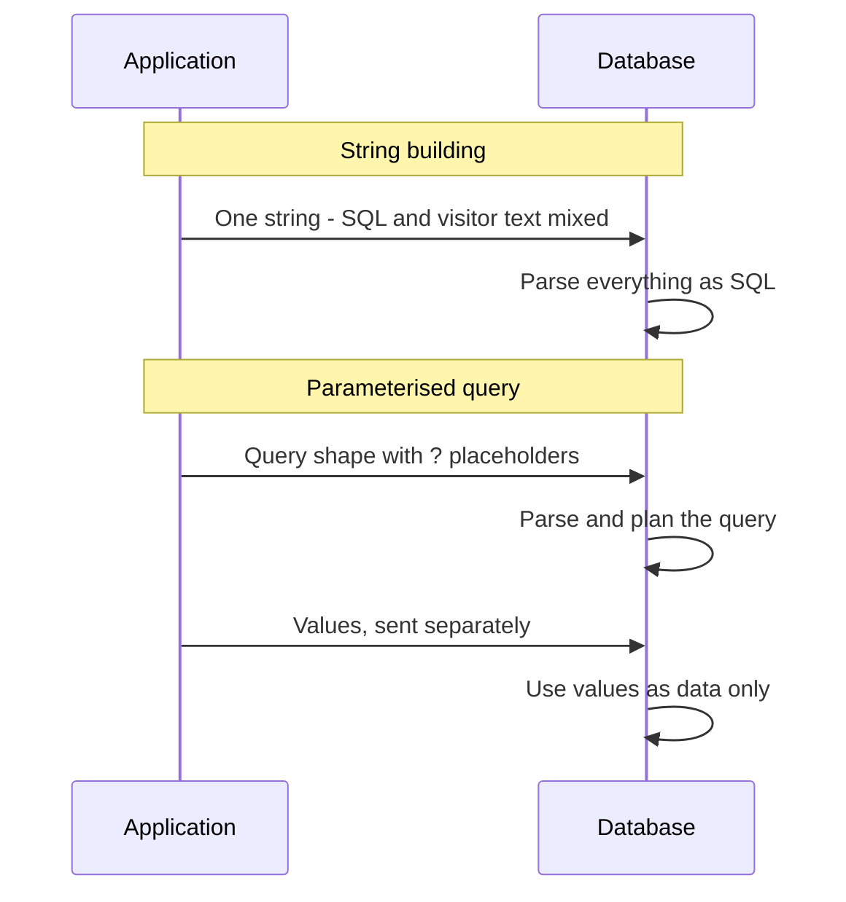

# SQL injection and parameterised queries

> **Before this lesson:** you should understand *untrusted input* and the telephone-tones story from [The security mindset and a short history](#/lesson/web-security/security-mindset). It helps to have seen a basic SQL `SELECT` statement; if you have not, the first section below introduces what you need.

## In plain words

Imagine a bank teller who processes paper slips. The slip reads "Pay ______ to the bearer", and the customer writes an amount in the blank. One customer writes: `10 pounds. Also, open the vault`. If the teller reads the completed slip as one continuous instruction, the vault opens. The customer was supposed to supply a *value*; they supplied a value **and a command**, and the form gave no way to tell them apart.

A database is the application's filing clerk, and it takes orders written in a language called **SQL** (Structured Query Language). When a program builds an order by pasting a visitor's text into the middle of an SQL sentence, the visitor can add words of their own to the sentence. That is **SQL injection**.

It matters because the database is where everything valuable lives: customers, passwords, payments. An injectable query can let a stranger read all of it, change it, or delete it, and injection has sat in the OWASP Top 10 since the list began. It also has one of the cleanest fixes in all of security — the **parameterised query** — which makes the mistake impossible instead of merely unlikely. Knowing why that fix works is a standard interview expectation.

## A two-minute introduction to SQL

A database stores **tables**: grids of rows and columns. SQL statements ask questions of them or change them.

```sql
SELECT name, email FROM users WHERE id = 7;
```

Read it as: "from the `users` table, give me the `name` and `email` columns of rows whose `id` is 7". Two details matter for this lesson:

- Text values are written between **single quotes**: `WHERE name = 'Ann'`. The quote marks where the text starts and ends.
- `--` begins a **comment**; the database ignores the remainder of the line.

That is all the SQL you need.

## How the weakness arises

### The simplest example

Our toy shop looks a customer up by name:

```python
# VULNERABLE: the query is assembled by pasting text together
def find_user(conn, name):
    query = "SELECT id, name FROM users WHERE name = '" + name + "'"
    return conn.execute(query).fetchall()
```

For the name `Ann`, the string becomes `SELECT id, name FROM users WHERE name = 'Ann'`. Fine.

Now consider a perfectly innocent customer called `O'Brien`. The string becomes:

```sql
SELECT id, name FROM users WHERE name = 'O'Brien'
```

The quote in the name **ends the text early**. The database sees the text `'O'`, followed by the stray word `Brien'`, and reports a syntax error. That error is the vulnerability showing itself. If one quote can end the text and make the rest be read as SQL, then the "rest" can be chosen deliberately:

```
name supplied:   x' OR '1'='1
query produced:  SELECT id, name FROM users WHERE name = 'x' OR '1'='1'
```

`'1'='1'` is always true, so the `WHERE` condition is true for every row and the query returns the entire table. The visitor has changed the *logic* of your query using nothing but the search box.

The root cause is the one from the telephone network: **instructions and data are travelling in the same channel.** The program built one string, and the database cannot tell which characters the programmer wrote and which the visitor wrote.

### See it for yourself — and see the fix

The demonstration below runs against a throwaway in-memory database. It shows the vulnerable function returning rows it should not, and then the fixed function treating the same input as plain data.

```python-run
import sqlite3

conn = sqlite3.connect(":memory:")            # a temporary database that lives in RAM
conn.execute("CREATE TABLE users (id INTEGER, name TEXT, is_admin INTEGER)")
conn.executemany("INSERT INTO users VALUES (?, ?, ?)",
                 [(1, "Ann", 0), (2, "O'Brien", 0), (3, "root", 1)])

def find_vulnerable(name):
    query = "SELECT id, name FROM users WHERE name = '" + name + "'"
    return conn.execute(query).fetchall()

def find_fixed(name):
    # The ? is a placeholder. The value travels separately, in the tuple.
    return conn.execute("SELECT id, name FROM users WHERE name = ?", (name,)).fetchall()

hostile = "x' OR '1'='1"

print("vulnerable, 'Ann'   :", find_vulnerable("Ann"))
print("vulnerable, hostile :", find_vulnerable(hostile))      # every row comes back
print("fixed, 'Ann'        :", find_fixed("Ann"))
print("fixed, hostile      :", find_fixed(hostile))           # no user has that odd name
print("fixed, O'Brien      :", find_fixed("O'Brien"))         # and honest quotes work

try:
    find_vulnerable("O'Brien")
except sqlite3.OperationalError as error:
    print("vulnerable, O'Brien : crashes with", error)
```

Line by line: `sqlite3.connect(":memory:")` creates an empty database in memory. `executemany` inserts three rows. `find_vulnerable` joins strings. `find_fixed` passes **two** arguments to `execute`: the SQL text containing a `?`, and a tuple of values — `(name,)` is a tuple with one element; the comma is what makes it a tuple. The output shows the hostile input dumping the whole table through the vulnerable function, and returning an empty list through the fixed one, because no user is literally named `x' OR '1'='1`. Mr O'Brien, who crashed the vulnerable version, is found correctly by the fixed one.

## Why parameterised queries work

A **parameterised query** (also called a **prepared statement**) sends the database two separate things:

1. The **query shape**, with placeholders where values will go: `SELECT id, name FROM users WHERE name = ?`
2. The **values**, as a separate list.

The database works out the meaning of the query — which table, which condition — from the shape alone, *before* it looks at the values. When the values arrive they are slotted in as data. Whatever characters they contain, they cannot become keywords, because the decision about what is a keyword has already been made.



This is not *filtering* bad characters; it is making the confusion structurally impossible. The telephone company's fix was the same: move the control signals to a separate channel.

Different drivers write the placeholder differently — `?` in SQLite, `%s` in psycopg (PostgreSQL), `:name` for named parameters — but the principle is identical:

```python
# FIXED, PostgreSQL driver. Note: a comma, not the % operator.
cur.execute("SELECT id, name FROM users WHERE name = %s", (name,))
```

> [!WARNING]
> `cur.execute("... WHERE name = %s" % name)` and `cur.execute(f"... WHERE name = '{name}'")` are **string building**, not parameterisation, even though they look similar. The test is simple: are the values passed as a **separate argument** to `execute`? If the SQL string already contains the value before `execute` is called, it is vulnerable.

### ORMs

An **ORM** (object-relational mapper) such as SQLAlchemy or the Django ORM lets you write `session.query(User).filter(User.name == name)` instead of SQL. ORMs generate parameterised queries for you, which is why they prevent most injection. They also offer escape hatches for raw SQL — `text(...)`, `.raw()`, `.extra()` — and injection in ORM-based code bases lives in those hatches. With SQLAlchemy the safe raw form uses bound parameters:

```python
from sqlalchemy import text
rows = session.execute(text("SELECT id, name FROM users WHERE name = :name"), {"name": name})
```

## What placeholders cannot do

A placeholder stands for a **value**. It cannot stand for a table name, a column name, or a keyword such as `ASC`/`DESC`, because those are part of the query's shape. So what about a feature like "sort by the column the user clicked"?

```python
# VULNERABLE: the column name comes from the request
query = f"SELECT id, name FROM products ORDER BY {sort}"
```

Parameterising it does not work — the database would sort by a constant string, not a column. The fix is an **allow-list**: translate the request's value into one of a fixed set of identifiers that *you* wrote.

```python-run
SORT_COLUMNS = {"name": "name", "price": "price", "newest": "created_at"}

def build_product_query(sort_key, descending, limit):
    column = SORT_COLUMNS.get(sort_key, "name")          # unknown key -> a safe default
    direction = "DESC" if descending else "ASC"          # only two possible outputs
    limit = max(1, min(int(limit), 100))                 # a number between 1 and 100
    sql = f"SELECT id, name, price FROM products ORDER BY {column} {direction} LIMIT ?"
    return sql, (limit,)

print(build_product_query("price", True, 20))
print(build_product_query("price; DROP TABLE products", False, 99999))
```

`SORT_COLUMNS.get(sort_key, "name")` looks the request's value up in a dictionary and falls back to `name`. The text that ends up in the SQL is always one of three strings from your own source code; the visitor only *selects among* them. The second call shows a hostile key being ignored and an absurd limit being clamped to 100. The `LIMIT` value, being a value, is still passed as a parameter.

The same thinking applies to building `WHERE` clauses from a dictionary of filters and to `IN (...)` lists: generate one `?` per value, allow-list every column name, and pass the values separately. That is exactly the practice problem attached to this module.

## Defence in depth

Parameterisation is the primary control. The layers behind it limit the damage if one query is missed.

1. **Parameterised queries or an ORM everywhere**, with raw-SQL escape hatches treated as high-risk in review.
2. **Allow-lists for identifiers** — column names, sort directions, table names.
3. **Input validation.** An `id` should be an integer; a country code two letters. Typed parameters (`user_id: int` in FastAPI) reject malformed input before any query runs. Validation narrows the attack surface; it does not replace parameterisation, because legitimate text can contain any character.
4. **Least privilege for the database account.** The application's login should be able to read and write its own tables and nothing more — no dropping tables, no reading other schemas, no file access. A reporting feature can use a read-only account. Then even a successful injection has limited reach.
5. **No detailed database errors to the client.** Error text helps an attacker refine input (see [The attacker's view: leaks and attack surface](#/lesson/web-security/attack-surface)).
6. **Protect the data itself**: hash passwords properly so that a leaked table does not reveal them; encrypt especially sensitive columns.
7. **Monitoring**: alerts on bursts of SQL syntax errors, and on queries returning unusually many rows.
8. A **web application firewall** can block crude attempts. Treat it as a speed bump, not as the fix.

> [!TIP]
> "Escaping" — adding backslashes or doubling quotes in the input by hand — is the historical defence and is fragile: the rules differ between databases, between character sets, and between quoted and unquoted positions. If you find yourself writing or calling an escaping function for SQL values, stop and use a placeholder.

### Stored procedures and second-order injection

Two refinements complete the picture.

A **stored procedure** is a routine saved inside the database. Calling one with parameters is safe; but a procedure that builds SQL by concatenation internally is as injectable as application code.

**Second-order injection** occurs when hostile text is stored safely (through a parameterised `INSERT`) and later *read back* and pasted into a different query by code that assumed "it came from our own database, so it is trusted". Data does not become trustworthy by being stored. Every query parameterises every value, wherever the value came from.

### Blind injection

An application that hides errors and shows no query results can still be vulnerable. If a page behaves differently — or responds more slowly — depending on whether an injected condition is true, information can be extracted one yes/no question at a time. This is called **blind SQL injection**. The practical consequence for defenders: "we do not show error messages" is not a fix. The fix is still parameterisation.

## Related: other query languages

The same flaw exists wherever a query is assembled from untrusted input.

- **NoSQL databases.** With a document database, passing a request's JSON straight into a query lets a client supply an *operator object* where a string was expected — for instance `{"password": {"$ne": ""}}` ("password is not empty") in place of a password. Defence: validate types strictly (a password must be a string) and never pass request objects directly as query filters.
- **LDAP, XPath, search-engine query strings, GraphQL assembled as text** — all have injection variants, and all are fixed by the library's parameter mechanism or strict allow-list validation.

> [!INTERVIEW]
> "What is SQL injection and how do you prevent it?" State the cause — untrusted input concatenated into a query, so data is parsed as code — and the fix: parameterised queries, where the query structure is sent separately from the values. Then show depth: placeholders cannot be used for identifiers, so those need an allow-list; ORMs are safe until raw SQL is used; least-privilege database accounts limit the blast radius; and validation is a supporting layer, not the cure.

## How to test for it

**In code review** — this is where most injection is found:

- Search for SQL keywords near string operations: `"SELECT` or `"INSERT` together with `+`, `%`, `.format(`, or `f"`.
- Search for the raw-SQL escape hatches of your ORM.
- For each `execute(` call, check that values are in the *second* argument.
- For any dynamic `ORDER BY`, table or column name, find the allow-list.

**In testing your own application:**

- Enter a single quote `'` in every input and parameter. A database error, a `500` response, or a page that behaves differently from normal input is a strong sign of string-built SQL. A correctly parameterised application treats the quote as an ordinary character — remember Mr O'Brien.
- Add unit tests that call your data-access functions with names containing quotes, semicolons and comment markers, asserting that they return zero or the correct rows and never raise.
- Run a static analyser in continuous integration: Bandit (Python) flags string-built SQL; Semgrep and CodeQL have rules for most languages.
- A dynamic scanner such as OWASP ZAP, pointed at a **test** environment, automates the quote test across every parameter.

## Pitfalls

- **Parameterising most queries and forgetting one** — typically an old report, an admin search, or a bulk export.
- **`execute(sql % values)`** instead of `execute(sql, values)`.
- **Validating in the browser** and assuming the server receives clean data.
- **Block-listing keywords** such as `DROP` or `--`. It breaks honest input and is bypassed by variations in case, spacing and encoding.
- **Believing numeric parameters are safe.** `"WHERE id = " + user_id` needs no quote to inject; the input is not checked to be a number.
- **Trusting stored data** (second-order injection).
- **Giving the application the database owner's account** "to keep things simple", so one flaw exposes everything.
- **`LIKE` patterns.** A parameter in `LIKE ?` is safe from injection, but `%` and `_` typed by the user still act as wildcards and can make queries slow; escape them if exact matching is intended.

## Summary

- SQL injection occurs when untrusted text is concatenated into a query and the database parses it as SQL.
- A single quote that breaks the query is the tell-tale sign; if a quote can end a string, the remainder can be chosen deliberately.
- Parameterised queries send the query shape and the values separately, so values can never become code.
- Identifiers cannot be parameters; choose them through an allow-list.
- ORMs parameterise by default; their raw-SQL hatches need the same care.
- Add least-privilege accounts, validation, quiet errors and monitoring as layers.
- The same principle applies to NoSQL and every other query language.

## Glossary

- **SQL** — the language used to query and modify relational databases.
- **Table / row / column** — a grid of data, one record, one named field.
- **SQL injection** — altering a query's meaning by supplying crafted input.
- **String concatenation** — joining pieces of text into one string.
- **Parameterised query / prepared statement** — a query whose values are sent separately from its text.
- **Placeholder (bind parameter)** — the marker (`?`, `%s`, `:name`) where a value will be bound.
- **ORM** — a library mapping database rows to objects and generating SQL.
- **Identifier** — a table or column name.
- **Allow-list** — a fixed set of permitted values.
- **Least privilege** — giving the database account only the rights it needs.
- **Blind injection** — extracting information through behaviour or timing when no output is shown.
- **Second-order injection** — stored input used unsafely in a later query.
- **Stored procedure** — a routine saved and run inside the database.

```quiz
[
  {"q": "Why does a name such as O'Brien crash a query built by string concatenation?",
   "options": ["Names cannot contain letters", "The apostrophe ends the SQL text literal early, leaving invalid SQL after it", "The database rejects Irish names", "The name is too long"], "answer": 1,
   "explain": "The quote is interpreted as the end of the string. That the input can end the literal is exactly what makes injection possible."},
  {"q": "What makes a parameterised query immune to SQL injection?",
   "options": ["It removes dangerous characters from input", "The query structure is parsed separately from the values, so values are only ever treated as data", "It encrypts the query", "It runs the query twice"], "answer": 1,
   "explain": "The database decides what the query means before seeing the values. Nothing in a value can become a keyword."},
  {"q": "Which call is correctly parameterised?",
   "options": ["cur.execute(\"SELECT * FROM t WHERE a = '%s'\" % a)", "cur.execute(f\"SELECT * FROM t WHERE a = '{a}'\")", "cur.execute(\"SELECT * FROM t WHERE a = %s\", (a,))", "cur.execute(\"SELECT * FROM t WHERE a = \" + a)"], "answer": 2,
   "explain": "Only the third passes the value as a separate argument. The others build the final string before execute is called."},
  {"q": "A user chooses which column a product list is sorted by. How should this be implemented safely?",
   "options": ["Use a ? placeholder for the column name", "Map the user's choice through an allow-list of known column names", "Escape quotes in the column name", "Reject requests containing spaces"], "answer": 1,
   "explain": "Placeholders bind values, not identifiers. An allow-list ensures only names written by the developer reach the SQL text."},
  {"q": "An application uses an ORM throughout. Where should a reviewer look for SQL injection?",
   "options": ["Nowhere; ORMs are immune", "Places where raw SQL is used through the ORM's escape hatches", "The HTML templates", "The session cookie"], "answer": 1,
   "explain": "ORM query builders parameterise automatically. Raw SQL helpers accept strings and can be concatenated like any other."},
  {"q": "Why give the application's database account only the privileges it needs?",
   "options": ["It makes queries faster", "It limits what an attacker can do if an injection flaw is found", "It prevents XSS", "Databases require it"], "answer": 1,
   "explain": "Least privilege is damage limitation: an account that cannot drop tables or read other schemas contains the breach."},
  {"q": "A value was inserted with a parameterised query. Later code reads it back and concatenates it into another query. What is this?",
   "options": ["Safe, because the value came from the database", "Second-order injection", "A stored procedure", "Mass assignment"], "answer": 1,
   "explain": "Stored data is still untrusted. Every query must bind every value regardless of where the value came from."},
  {"q": "An application shows no database errors and no query output. Can it still be vulnerable?",
   "options": ["No", "Yes: differences in behaviour or response time can reveal information (blind injection)", "Only over HTTP", "Only for admins"], "answer": 1,
   "explain": "Hiding errors removes a clue, not the flaw. The query must be parameterised."}
]
```

> **Source:** Hoffman, *Web Application Security*, ch. 13 (injection) and ch. 25 (defending against injection), in original wording with original examples. OWASP SQL Injection Prevention Cheat Sheet — https://cheatsheetseries.owasp.org/cheatsheets/SQL_Injection_Prevention_Cheat_Sheet.html ; OWASP Query Parameterization Cheat Sheet — https://cheatsheetseries.owasp.org/cheatsheets/Query_Parameterization_Cheat_Sheet.html ; OWASP Top 10 A03 Injection — https://owasp.org/Top10/A03_2021-Injection/ ; Python sqlite3 documentation (placeholders) — https://docs.python.org/3/library/sqlite3.html#sqlite3-placeholders
