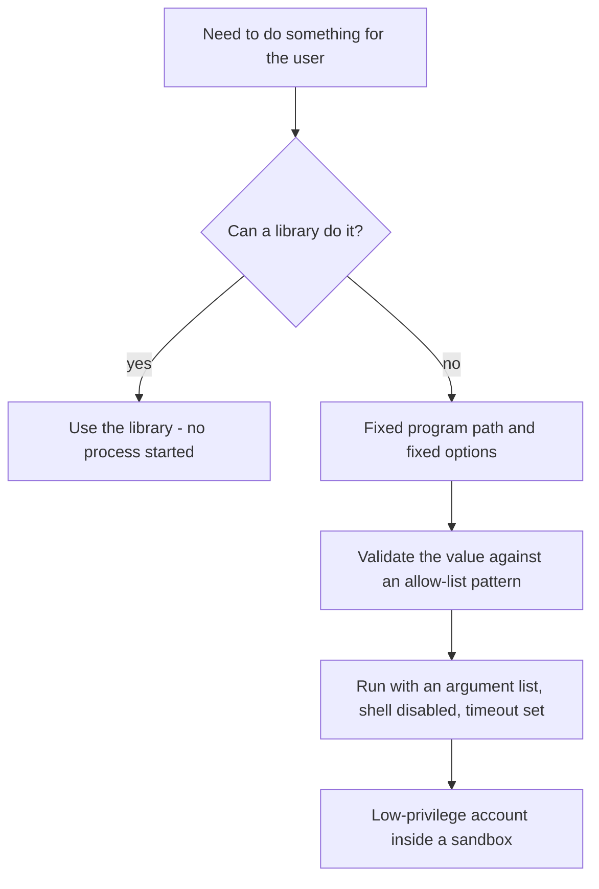

# Command and template injection

> **Before this lesson:** read [SQL injection and parameterised queries](#/lesson/web-security/sql-injection). This lesson applies the same idea — keep data out of the instruction channel — to three other interpreters. You should also know what a template engine is from [Cross-site scripting (XSS) and output encoding](#/lesson/web-security/xss).

## In plain words

You hire a temporary assistant and leave notes for them: "Please photocopy the file called ______." A visitor is allowed to fill in the blank, and writes: `report.pdf, and then shred everything in the cabinet`. The assistant follows the whole sentence.

In the previous lesson the assistant was a database and the language was SQL. But a server program talks to several other "assistants" that also obey text instructions:

- the **operating system shell**, a program that runs other programs from typed command lines;
- the programming language's own **evaluator**, which can run a string as code;
- the **template engine**, which fills in pages and emails from templates and has a small programming language of its own.

Whenever your code builds an instruction for one of these by pasting in text from a visitor, the visitor can extend the instruction. These are **command injection**, **code injection** and **server-side template injection**. They matter even more than SQL injection in one respect: the result is usually the ability to run arbitrary programs on your server — the most severe outcome there is, known as **remote code execution** (RCE).

The reassuring part: you already know the cure. Do not build instructions out of untrusted text. Each interpreter offers a safe way to pass data separately, and this lesson shows the safe way for each.

## Part 1: command injection

### What a shell is

A **shell** (such as `bash` on Linux or `cmd.exe` on Windows) reads a line of text and runs programs. `ping -c 1 example.com` runs the program `ping` with three **arguments**. The shell also gives special meaning to certain characters, called **metacharacters**: `;` separates two commands, `|` feeds one program's output to another, `&&` runs a second command if the first succeeded, `$( )` and backticks run a command and substitute its output, `>` writes to a file. Those characters are what make a shell powerful for a human at a keyboard, and dangerous when the line is assembled from a stranger's input.

### The simplest example

A network-tools page lets a user check whether a host is reachable:

```python
# VULNERABLE: the visitor's text is spliced into a shell command line
import subprocess

@app.get("/tools/ping")
def ping(host: str):
    output = subprocess.run(f"ping -c 1 {host}", shell=True, capture_output=True, text=True)
    return {"output": output.stdout}
```

`subprocess.run` starts another program. `shell=True` means "hand this whole string to the shell and let it interpret it". For `host=example.com` the shell runs one program. For a `host` value that contains a semicolon followed by another command, the shell runs **two** programs: `ping`, and then whatever the visitor typed — with the web application's permissions. The application has become a remote keyboard for the server.

### Step 1 of the fix: no shell, arguments as a list

```python
# BETTER: no shell; each argument is a separate list element
output = subprocess.run(["ping", "-c", "1", host], capture_output=True, text=True, timeout=5)
```

Without `shell=True`, Python starts `ping` directly and passes each list element as exactly one argument. No shell is involved, so `;`, `|` and `$( )` have no special meaning; they would be part of an (invalid) host name handed to `ping`. This is the direct counterpart of a parameterised query: the *program to run* is fixed by you, and the visitor's text can only ever be data.

You cannot run real processes in the browser sandbox, but Python's `shlex` module can show how a shell would divide a line into words — which is enough to see the difference:

```python-run
import shlex

user_input = "example.com; cat /etc/passwd"

as_shell_line = "ping -c 1 " + user_input
print("What a shell would see (split into words):")
print("  ", shlex.split(as_shell_line))
print("   ...and a real shell treats the ';' as the END of the first command: what follows is a SECOND command")

as_argument_list = ["ping", "-c", "1", user_input]
print("With an argument list, the program receives:")
for position, argument in enumerate(as_argument_list):
    print("   arg", position, "=", repr(argument))
```

`shlex.split` breaks a string the way a POSIX shell breaks a command line into words. In the first form, the visitor's text has dissolved into the command line. In the second, it stays one single argument — the fourth — however many odd characters it contains.

### Step 2: argument injection, and validating the value

Removing the shell is necessary and not quite sufficient. The visitor's text is now one argument, but an argument beginning with `-` is read by the program as an **option**. A "host name" of `-f` would ask `ping` to flood; with other tools an injected option can write files or run helpers. This is **argument injection**.

Two defences, used together:

- **Validate the value against what it is supposed to be.** A host name consists of letters, digits, dots and hyphens and does not start with a hyphen.
- **Use `--`** where the program supports it. By convention it means "everything after this is a positional argument, not an option".

```python-run
import re

HOSTNAME = re.compile(r"^(?!-)[A-Za-z0-9.-]{1,253}(?<!-)$")   # letters, digits, dots, hyphens

def ping_arguments(host: str):
    if not HOSTNAME.fullmatch(host):
        raise ValueError("not a valid host name")
    return ["ping", "-c", "1", "--", host]            # fixed program, fixed options, then data

for candidate in ["example.com", "10.0.0.1", "-f", "example.com; cat /etc/passwd", "a b"]:
    try:
        print(f"{candidate!r:32} ->", ping_arguments(candidate))
    except ValueError as error:
        print(f"{candidate!r:32} -> rejected:", error)
```

The regular expression reads: start of string; `(?!-)` — not beginning with a hyphen; one to 253 characters from the allowed set; `(?<!-)` — not ending with a hyphen; end of string. `fullmatch` requires the **entire** input to fit the pattern, so no extra characters can hide after a valid prefix. The first two candidates are accepted; the other three are refused before any program is started.

### Step 3: prefer not to run a program at all

The safest command is the one you never execute. Most things developers shell out for have a library equivalent:

| Instead of running… | Use… |
|---|---|
| `ping`, `nslookup`, `curl` | A socket or HTTP library call |
| `rm`, `cp`, `mkdir`, `ls` | `os`, `shutil`, `pathlib` functions |
| `zip`, `tar` | `zipfile`, `tarfile` (with care about extraction paths) |
| `convert` (image resizing) | An imaging library |

A library call takes typed arguments, has no shell and no option parser, and removes the whole category of bug.

When an external program is unavoidable, add layers: an **allow-list of permitted commands** (never let the request name the program); a **timeout**; a **low-privilege user account**; and a **sandbox** or container with no network access and a read-only file system, so that even a successful attack reaches very little.



> [!WARNING]
> `os.system(...)`, `os.popen(...)`, `subprocess.*(..., shell=True)`, and — in JavaScript — `child_process.exec(...)` all pass their string to a shell. In Node.js use `execFile` or `spawn` with an argument array. Any of the shell-invoking forms next to user-influenced data is a finding in code review, even if the data "is validated somewhere".

## Part 2: code injection

Most languages can treat a string as program text and run it: `eval` and `exec` in Python, `eval` and `new Function` in JavaScript. If any part of that string comes from a visitor, they are writing your program.

```python
# VULNERABLE: a "calculator" that runs whatever expression it is sent
@app.get("/calc")
def calc(expr: str):
    return {"result": eval(expr)}
```

`eval("2 + 2")` returns `4`. It equally evaluates any Python expression at all — including ones that import modules and read files. Attempts to "sandbox" `eval` by removing built-in names are routinely defeated and should not be trusted.

The fix depends on what you needed:

- **To read a literal value** (a number, a list, a dictionary), use `ast.literal_eval`, which accepts only literals and raises an error for anything else.
- **To read structured data**, use a data format: `json.loads`.
- **To evaluate arithmetic**, write or use a small parser that understands numbers and operators only.

```python-run
import ast, json

print(ast.literal_eval("[1, 2, {'a': 3}]"))          # a literal: accepted
print(json.loads('{"qty": 2, "item": "mug"}'))       # data: accepted

for text in ["__import__('os').getcwd()", "2 ** 8", "open('x')"]:
    try:
        print(ast.literal_eval(text))
    except (ValueError, SyntaxError) as error:
        print(f"{text!r:30} -> refused ({type(error).__name__})")
```

`ast.literal_eval` parses the text and checks that it contains nothing but literals. A function call, an attribute access, even the arithmetic `2 ** 8` is refused. That strictness is the feature.

## Part 3: server-side template injection

### How it arises

A **template** is a document with holes: `Hello, {{ name }}!`. The engine fills the holes with **data**. The mistake is to let a visitor supply part of the **template itself**, typically when building a personalised message by string concatenation before rendering.

```python
# VULNERABLE: user text becomes template SOURCE
from jinja2 import Template

@app.get("/greet", response_class=HTMLResponse)
def greet(name: str):
    template = Template("<h1>Hello, " + name + "!</h1>")
    return template.render()
```

Template languages contain expressions: `{{ 7 * 7 }}` renders as `49`. If the page above is requested with a `name` of `{{ 7 * 7 }}` and the response shows `49`, the visitor's text was *executed by the template engine*. From arithmetic it is a short road, in many engines, to reaching the objects of the underlying language and, from there, to reading configuration and secrets or running commands. This is **server-side template injection** (SSTI). Unlike XSS, it runs on **your server**, not in someone's browser.

```python
# FIXED: the template is a constant; user text is passed as DATA
TEMPLATE = Template("<h1>Hello, {{ name }}!</h1>", autoescape=True)

@app.get("/greet", response_class=HTMLResponse)
def greet(name: str):
    return TEMPLATE.render(name=name)
```

Now the template text is entirely yours. `name` is a value handed to `render`; if it contains `{{ 7 * 7 }}`, those characters are displayed literally (and HTML-encoded, thanks to `autoescape=True`). The rule is the same one as for SQL: **the visitor fills the blank; the visitor never writes the form.**

### A demonstration with Python's own formatting

You can see the same class of problem without installing anything. Python's `str.format` is a tiny template language: `"{user.name}".format(user=u)` reads an attribute. If a visitor chooses the *format string*, they choose which attributes are read.

```python-run
from string import Template

class User:
    def __init__(self, name, api_key):
        self.name = name
        self.api_key = api_key          # should never be shown to anyone

ann = User("Ann", "key-7f3a-secret")

# VULNERABLE pattern: the visitor controls the format string
visitor_template = "Welcome, {user.name}! (debug: {user.api_key})"
print(visitor_template.format(user=ann))

# FIXED pattern 1: the format string is a constant; the visitor controls only values
print("Welcome, {name}!".format(name=ann.name))

# FIXED pattern 2: if users must design their own message, use a format that
# can only substitute named values and cannot reach into objects
user_designed = Template("Dear $name, your order $order_id has shipped. {user.api_key}")
print(user_designed.safe_substitute(name=ann.name, order_id="A-1042"))
```

The first `print` leaks the API key, because `{user.api_key}` in a format string walks from the object to its attribute. The second uses a fixed format string. The third uses `string.Template`, whose `$name` placeholders can only be replaced by values you pass explicitly; the `{user.api_key}` text is left as inert characters. When users really must write their own templates — email campaigns, invoice layouts — give them a **logic-less** format like this (or Mustache), never the full engine.

> [!TIP]
> If user-authored templates in a full-featured engine are a business requirement, use the engine's sandbox mode (for Jinja2, `SandboxedEnvironment`), render in an isolated process with minimal privileges and no secrets in its environment, and treat the feature as high-risk. A sandbox inside the engine is a layer, not a guarantee.

## Defence in depth

1. **Avoid the interpreter**: library calls instead of shell commands; data formats instead of `eval`; fixed templates.
2. **Separate code from data**: argument lists without a shell; values passed to `render`.
3. **Validate by allow-list** what each value is meant to be.
4. **Least privilege**: the application runs as an unprivileged user that cannot write to its own code, read other services' files, or reach the internal network unnecessarily.
5. **Isolation**: containers, read-only file systems, no outbound network where it is not needed.
6. **Secrets out of reach**: a process that has no credentials in its environment cannot leak them.
7. **Detection**: log every external command with its arguments; alert on the web process starting unexpected child programs.

> [!INTERVIEW]
> Asked to "review this code" containing `os.system("convert " + filename + " out.png")`, say: this is command injection — the file name reaches a shell, so metacharacters in it run additional commands. Fix by avoiding the shell (`subprocess.run([...])` with a list), validating or generating the file name, adding `--` against option injection, and ideally replacing the external tool with a library. Then mention least privilege and sandboxing as containment.

## How to test for it

**In code review** — search for the dangerous calls and trace their inputs:

- Python: `os.system`, `os.popen`, `subprocess` with `shell=True`, `eval`, `exec`, `compile`, `Template(` or `render_template_string(` with non-constant arguments, `.format(` on a string that is not a literal.
- JavaScript: `child_process.exec`, `eval`, `new Function`, `setTimeout`/`setInterval` with a string, template `compile` calls on request data.
- For each hit, ask: can any part of this string be influenced by a request, a file name, a database field, or another service?

**In testing your own application:**

- For template injection, submit a harmless arithmetic probe such as `{{7*7}}` or `${7*7}` in fields that end up in rendered pages or emails. If `49` appears where your text should be, the input is being evaluated as a template.
- For command features, submit values containing a space, a hyphen at the start, and a semicolon. The correct result is a validation error, never a changed behaviour.
- Static analysers catch most of this cheaply: Bandit flags `shell=True`, `eval` and `exec`; Semgrep has rule packs for command and template injection. Run them in continuous integration.

## Pitfalls

- **Quoting by hand.** Wrapping the value in quotes, or calling an escaping helper and still using a shell, is fragile; rules differ between shells and platforms.
- **`shell=True` with a list.** The list's first element is still interpreted by a shell.
- **Validating with `re.match` and no end anchor.** `match` checks only the beginning; use `fullmatch`.
- **Block-listing metacharacters.** There are more than you will remember, plus newlines.
- **Trusting file names.** An uploaded file's name is user input and frequently ends up in a command line.
- **"It's only for admins."** Admin sessions are stolen, and CSRF or XSS can drive admin features.
- **Leaving debug consoles or template-preview tools enabled in production.**
- **Confusing SSTI with XSS.** Output encoding stops the browser running injected script; it does nothing if the *server* evaluated the template expression first.

## Summary

- Shells, language evaluators and template engines are all interpreters; building their input from untrusted text lets a visitor issue instructions.
- The usual consequence is remote code execution on the server.
- For commands: prefer a library; otherwise fix the program, pass arguments as a list with no shell, validate each value, and use `--`.
- Never `eval` request data; use `json.loads`, `ast.literal_eval` or a purpose-built parser.
- Keep templates constant and pass user data as values; give users only logic-less template formats.
- Contain the damage with least privilege, isolation and monitoring.

## Glossary

- **Shell** — a program that interprets command lines and starts other programs.
- **Metacharacter** — a character with special meaning to a shell, such as `;`, `|`, `&`, `$`.
- **Argument** — one item passed to a program when it starts. **Option** — an argument beginning with `-` that changes behaviour.
- **Command injection** — causing a server to run unintended operating-system commands.
- **Argument injection** — supplying a value that the program interprets as an option.
- **Code injection** — getting untrusted text evaluated as program code.
- **Remote code execution (RCE)** — an attacker running code of their choice on your machine.
- **`eval`** — a function that executes a string as code.
- **Template / template engine** — a document with placeholders / the software that fills them.
- **Server-side template injection (SSTI)** — untrusted input interpreted as template source on the server.
- **Logic-less template** — a template format that can only substitute values.
- **Sandbox** — a restricted environment limiting what code can access.

```quiz
[
  {"q": "What does shell=True do in subprocess.run that makes it dangerous with user input?",
   "options": ["It runs the command as root", "It passes the string to a shell, which interprets metacharacters such as ; and |", "It disables timeouts", "It prints the output"], "answer": 1,
   "explain": "The shell parses the whole line, so characters in the input can start additional commands."},
  {"q": "Why is subprocess.run(['ping', '-c', '1', host]) safer than building one command string?",
   "options": ["Lists are faster", "No shell is involved and host is delivered as exactly one argument", "It validates the host name", "It hides errors"], "answer": 1,
   "explain": "With an argument list the program is started directly; metacharacters have no special meaning."},
  {"q": "After removing the shell, a user supplies the value '-f' as the host. What risk remains?",
   "options": ["SQL injection", "Argument injection: the value is read as an option", "XSS", "None"], "answer": 1,
   "explain": "Values beginning with a hyphen may be interpreted as options. Validate the value and place it after '--'."},
  {"q": "Which is the most robust way to delete a temporary file from a web handler?",
   "options": ["os.system('rm ' + path)", "subprocess.run('rm ' + path, shell=True)", "A library call such as os.remove on a validated path", "eval('remove(' + path + ')')"], "answer": 2,
   "explain": "A library function has no shell and no option parsing, eliminating the injection class. The path still needs validation against traversal."},
  {"q": "A page requested with name={{7*7}} displays 'Hello, 49!'. What does this show?",
   "options": ["Reflected XSS", "The input was evaluated as template source on the server (SSTI)", "A caching problem", "Correct behaviour"], "answer": 1,
   "explain": "The template engine computed the expression, proving that user input became part of the template itself."},
  {"q": "What is the fix for server-side template injection?",
   "options": ["HTML-encode the output", "Keep the template constant and pass user input as a variable to render", "Remove curly braces with a regular expression", "Use HTTPS"], "answer": 1,
   "explain": "User data must be a value, never template source. Encoding output does not help once the server has already evaluated the expression."},
  {"q": "Which function safely parses the text \"[1, 2, 3]\" from a request into a Python list?",
   "options": ["eval", "exec", "ast.literal_eval or json.loads", "compile"], "answer": 2,
   "explain": "These accept only literal data and raise errors for function calls or attribute access."},
  {"q": "Why should re.fullmatch be preferred over re.match when validating a host name?",
   "options": ["It is faster", "match only anchors at the start, so trailing hostile characters after a valid prefix would pass", "match is deprecated", "fullmatch ignores case"], "answer": 1,
   "explain": "Validation must cover the entire value. A valid-looking prefix followed by '; other-command' passes a start-only match."}
]
```

> **Source:** Hoffman, *Web Application Security*, ch. 13 (code and command injection) and ch. 25 (generic injection defences, least authority, whitelisting commands), in original wording with original examples. OWASP OS Command Injection Defense Cheat Sheet — https://cheatsheetseries.owasp.org/cheatsheets/OS_Command_Injection_Defense_Cheat_Sheet.html ; OWASP Injection Prevention Cheat Sheet — https://cheatsheetseries.owasp.org/cheatsheets/Injection_Prevention_Cheat_Sheet.html ; OWASP Web Security Testing Guide, Testing for Server-Side Template Injection — https://owasp.org/www-project-web-security-testing-guide/ ; Python subprocess security considerations — https://docs.python.org/3/library/subprocess.html#security-considerations
