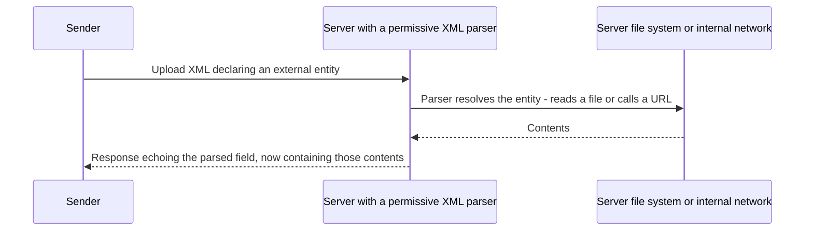

# XML external entities and insecure deserialisation

> **Before this lesson:** read [SQL injection and parameterised queries](#/lesson/web-security/sql-injection) for the idea of data being treated as instructions, and [Cookies and sessions](#/lesson/web-security/cookies-sessions) for HMAC signatures. You should know what JSON looks like; XML is introduced below.

## In plain words

You order flat-pack furniture. The box contains wooden panels and an instruction sheet, and you follow the sheet step by step. Now imagine a parcel from a stranger whose instruction sheet says: "Step 3: fetch the spare key from under your neighbour's mat and post it to this address." If you follow instruction sheets without thinking, the parcel has made you do something that has nothing to do with furniture.

Programs constantly receive parcels of data and "assemble" them into something usable — a process called **parsing** (reading a format) or **deserialising** (rebuilding objects from stored bytes). Some data formats are plain panels: they describe values and nothing else. Others carry instruction sheets: features that tell the reader to fetch a file, contact a server, or construct an object by running code. When a program reads such a format from an untrusted sender with those features switched on, the sender is giving your program orders.

Two vulnerabilities come from this. **XML external entity** attacks (XXE) abuse a feature of the XML format that pulls in outside content. **Insecure deserialisation** abuses formats that can rebuild arbitrary program objects. Both have led to large real-world breaches, and both are prevented by the same rule: *for untrusted input, use a format that can only describe data, and switch off every feature you do not need.*

## Part 1: XML external entities (XXE)

### XML in two minutes

**XML** (Extensible Markup Language) is a text format built from nested tags, like HTML:

```xml
<order>
  <item>mug</item>
  <quantity>2</quantity>
</order>
```

It is older than JSON and still used in office documents (`.docx`, `.xlsx`), vector images (SVG), RSS feeds, payment and banking interfaces, and single sign-on messages (SAML). Even an application that "does not use XML" often parses it somewhere, for example when importing a spreadsheet.

### The feature that causes trouble

XML lets a document define **entities**: named shortcuts that the parser replaces with text. They are declared in an optional section at the top called the **DTD** (document type definition).

```xml
<?xml version="1.0"?>
<!DOCTYPE order [
  <!ENTITY shop "Grand Line Mugs Ltd">
]>
<order><seller>&shop;</seller></order>
```

A parser reading this replaces `&shop;` with `Grand Line Mugs Ltd`. That is an *internal* entity and is harmless on a small scale.

The standard also allows **external** entities, whose replacement text is loaded from a URL or a file path. The keyword is `SYSTEM`:

```xml
<!DOCTYPE order [
  <!ENTITY note SYSTEM "file:///etc/hostname">
]>
<order><comment>&note;</comment></order>
```

A parser with external entities enabled will open that file **on the server** and insert its contents into the document. If the application then echoes the `comment` field back — "Thanks, your comment was: …" — the sender receives the contents of a server file. Point the entity at an `http://` address inside your network instead, and the parser makes a request there, which turns XXE into server-side request forgery (see [Server-side request forgery (SSRF)](#/lesson/web-security/ssrf)).



A second abuse needs no external access at all. Entities can refer to other entities, so a tiny document can define one that expands to ten copies of another, which expands to ten of another, and so on for ten levels — a few hundred bytes of input demanding gigabytes of memory. This is an **entity expansion** attack (nicknamed "billion laughs") and is a denial-of-service problem.

### Vulnerable and fixed

The risk depends on the parser and its settings. Historically many parsers shipped with DTDs and external entities enabled by default.

```python
# VULNERABLE: lxml asked explicitly to resolve entities and allow network access
from lxml import etree

@app.post("/import")
async def import_order(request: Request):
    parser = etree.XMLParser(resolve_entities=True, no_network=False, load_dtd=True)
    tree = etree.fromstring(await request.body(), parser)
    return {"comment": tree.findtext("comment")}
```

```python
# FIXED: a hardened parser that refuses DTDs and entities altogether
import defusedxml.ElementTree as ET
from defusedxml import DefusedXmlException

@app.post("/import")
async def import_order(request: Request):
    try:
        tree = ET.fromstring(await request.body())
    except (DefusedXmlException, ET.ParseError):
        raise HTTPException(400, "Invalid XML")
    return {"comment": tree.findtext("comment")}
```

`defusedxml` is a small Python package that wraps the standard XML parsers with the dangerous features turned off; a document containing a DTD or entity declaration raises an exception. The Python documentation itself recommends it for parsing untrusted XML. With `lxml`, the equivalent is `etree.XMLParser(resolve_entities=False, no_network=True, load_dtd=False)`.

The general rule, in order of preference:

1. **Disallow DTDs completely.** Ordinary data documents do not need one, and without a DTD there are no entities to abuse.
2. If DTDs must be accepted, **disable external entities and external DTD loading**, and limit entity expansion.
3. Keep the parser library **up to date**; defaults have become safer over the years.

Here is the "refuse any DTD" rule implemented with nothing but the standard library, so that you can run it. It uses the low-level `expat` parser, which lets us register a function to be called when a DOCTYPE is met:

```python-run
import xml.etree.ElementTree as ET
from xml.parsers import expat

class ForbiddenXml(ValueError):
    pass

def parse_untrusted_xml(text: str):
    def refuse(*args):
        raise ForbiddenXml("DTDs and entity declarations are not accepted")
    checker = expat.ParserCreate()
    checker.StartDoctypeDeclHandler = refuse      # called for <!DOCTYPE ...>
    checker.EntityDeclHandler = refuse            # called for <!ENTITY ...>
    checker.Parse(text, True)                     # first pass: structure check only
    return ET.fromstring(text)                    # second pass: build the tree

plain = "<order><item>mug</item><quantity>2</quantity></order>"
with_dtd = """<?xml version="1.0"?>
<!DOCTYPE order [ <!ENTITY note SYSTEM "file:///etc/hostname"> ]>
<order><comment>&note;</comment></order>"""

print(parse_untrusted_xml(plain).findtext("item"))
try:
    parse_untrusted_xml(with_dtd)
except ForbiddenXml as error:
    print("rejected:", error)
```

`expat.ParserCreate()` makes a parser object. Assigning a function to `StartDoctypeDeclHandler` asks expat to call it whenever a `<!DOCTYPE` declaration begins; our function raises an exception, which stops parsing at once. The plain order is parsed and prints `mug`; the document carrying a DTD is rejected before any entity could be resolved. In real projects use `defusedxml`, which does this and more.

### Indirect XML

XXE is easy to miss because the XML is often hidden inside something else:

- **Office files and e-books** are ZIP archives full of XML.
- **SVG images** are XML; an "image upload" may run them through an XML parser to make thumbnails.
- **SAML** single sign-on responses are XML.
- A JSON API whose framework also accepts `Content-Type: application/xml` for the same endpoint.

For the last case: accept only the content types you intend, and reject the rest with `415 Unsupported Media Type`.

> [!TIP]
> If you control both ends of an interface, the strongest XXE defence is not to use XML. JSON has no entities, no DTDs and no "fetch this for me" feature, so the entire category disappears.

## Part 2: insecure deserialisation

### Serialising and deserialising

Programs hold data in memory as **objects**. To store an object in a file, a cache or a cookie, or to send it over a network, it must be turned into a sequence of bytes: **serialisation**. Turning the bytes back into an object is **deserialisation**.

There are two families of format, and the distinction is the whole lesson:

| | Data-only formats | Native object formats |
|---|---|---|
| Examples | JSON, CSV, Protocol Buffers, MessagePack | Python `pickle`, Java serialisation, PHP `unserialize`, Ruby `Marshal`, .NET `BinaryFormatter` |
| Can represent | Numbers, strings, lists, maps | Arbitrary objects of arbitrary classes |
| Reading them… | builds plain values | may **construct objects and call code** chosen by the data |

A native format has to be able to rebuild any object, so its byte stream contains instructions like "create an instance of this class" or "call this function with these arguments". Python's documentation carries a prominent warning about `pickle` for precisely this reason: the data, not your program, decides what gets called during loading. Whoever writes the bytes controls what your process executes. The result is remote code execution, with no further bug required.

In Java and .NET the mechanism is subtler but ends the same way: the attacker chooses which classes already present in the application get instantiated, and chains their side effects together — so-called **gadget chains** built from ordinary library code.

### The simplest example

```python
# VULNERABLE: the server unpickles bytes that came from the browser
import base64, pickle

@app.get("/basket")
def basket(cart: str = Cookie("")):
    items = pickle.loads(base64.b64decode(cart))      # the cookie is attacker-controlled
    return {"items": items}
```

The developer wanted to keep the shopping basket in a cookie and reached for the convenient built-in. But a cookie is untrusted input, and `pickle.loads` on untrusted input lets the sender run code in the server process.

```python
# FIXED: a data-only format, validated, and signed so it cannot be altered
import base64, hashlib, hmac, json

def load_basket(cookie: str):
    payload_b64, _, signature = cookie.rpartition(".")
    expected = hmac.new(SECRET, payload_b64.encode(), hashlib.sha256).hexdigest()
    if not hmac.compare_digest(signature, expected):
        return []                                          # tampered: ignore it
    items = json.loads(base64.urlsafe_b64decode(payload_b64))
    if not isinstance(items, list) or len(items) > 50:
        return []
    return [i for i in items if isinstance(i, dict) and set(i) == {"sku", "qty"}]
```

Three separate protections are stacked here, and each matters:

1. **JSON instead of pickle.** `json.loads` can only produce dictionaries, lists, strings, numbers, booleans and `None`. No code runs.
2. **A signature**, checked *before* parsing, so only values this server issued are accepted.
3. **Validation of the shape** after parsing: a list of at most 50 dictionaries with exactly the keys `sku` and `qty`.

Run the complete round trip:

```python-run
import base64, hashlib, hmac, json

SECRET = b"basket-signing-key-from-configuration"

def dump_basket(items) -> str:
    payload = base64.urlsafe_b64encode(json.dumps(items).encode()).decode()
    signature = hmac.new(SECRET, payload.encode(), hashlib.sha256).hexdigest()
    return payload + "." + signature

def load_basket(cookie: str):
    payload, _, signature = cookie.rpartition(".")
    expected = hmac.new(SECRET, payload.encode(), hashlib.sha256).hexdigest()
    if not hmac.compare_digest(signature, expected):
        return None                                   # signature check comes FIRST
    items = json.loads(base64.urlsafe_b64decode(payload))
    if not isinstance(items, list) or len(items) > 50:
        return None
    for item in items:
        if not isinstance(item, dict) or set(item) != {"sku", "qty"}:
            return None
        if not isinstance(item["qty"], int) or isinstance(item["qty"], bool) or not 1 <= item["qty"] <= 20:
            return None
    return items

cookie = dump_basket([{"sku": "mug", "qty": 2}])
print("round trip :", load_basket(cookie))

edited = dump_basket([{"sku": "mug", "qty": 2}]).replace("e", "f", 1)
print("edited     :", load_basket(edited))

odd = dump_basket([{"sku": "mug", "qty": -5, "price": 0}])     # correctly signed but nonsensical
print("bad shape  :", load_basket(odd))
```

`dump_basket` turns the list into JSON text, encodes it in URL-safe base64 (a way of writing bytes using only letters, digits, `-` and `_`), and appends an HMAC. `load_basket` splits at the last dot, verifies the signature, and only then decodes and validates. The second result is `None` because one character of the cookie was changed; the third is `None` because, although the signature is valid, the content breaks the rules. The third case is a reminder that a signature proves *who wrote* the data, not that the data is sensible.

### Where it hides

Search for native deserialisation in all of these places, not only in request handlers:

- cookies, hidden form fields, "view state" parameters, API parameters containing long base64 text;
- caches and message queues that other systems can write to;
- file uploads of "saved state", including machine-learning model files (many are pickles — see [Security for ML and LLM applications](#/lesson/web-security/llm-security));
- configuration parsers: PyYAML's `yaml.load` can construct arbitrary Python objects, so use `yaml.safe_load`.

```python
import yaml
config = yaml.safe_load(text)        # FIXED: plain data types only
# config = yaml.load(text, Loader=yaml.Loader)   # VULNERABLE on untrusted text
```

### If you truly cannot avoid a native format

Sometimes a legacy system leaves no choice. Then, in order:

1. **Never accept it from an untrusted source.** Keep it to internal, authenticated channels.
2. **Sign the bytes** and verify the signature *before* deserialising, so only data your own systems produced is ever loaded.
3. **Restrict the classes** that may be created to an explicit allow-list (Java's serialisation filters; a restricted `Unpickler.find_class` in Python).
4. **Run the deserialising code with minimal privileges**, isolated from secrets.
5. Plan the migration to a data-only format.

> [!WARNING]
> Encrypting or base64-encoding a serialised blob does not make loading it safe. If an attacker can obtain or guess the key — or if the application encrypts values on request — the blob is still attacker-controlled. Integrity (a signature checked first) and a harmless format are what matter.

> [!INTERVIEW]
> "Why is `pickle.loads(request_data)` dangerous?" Because pickle is not a data format but a small program for rebuilding objects; the byte stream chooses which callables run, so deserialising attacker-controlled bytes is code execution. Fix: use JSON (or another data-only format) with schema validation; if objects must cross a boundary, sign them and verify before loading. Mention `yaml.safe_load` as the same issue in a different library.

## Defence in depth

For **XML**: disallow DTDs; disable external entities and network access; limit document size and nesting depth; restrict accepted content types; run conversion of uploaded documents in a sandbox with no network; keep parsers patched.

For **deserialisation**: data-only formats; schema validation after parsing; signatures checked before parsing; class allow-lists where native formats persist; least privilege and isolation; monitoring for deserialisation errors and unexpected outbound connections.

Both belong to the OWASP category *Software and Data Integrity Failures*: trusting data or code without verifying where it came from.

## How to test for it

**In code review:**

- Search for XML parsing: `lxml`, `xml.etree`, `xml.dom`, `xml.sax`, `DocumentBuilderFactory`, `XMLReader`. For each parser, find where its configuration disables DTDs and external entities; if you cannot find it, check the library's defaults for the version in use.
- Search for native deserialisation: `pickle.load`, `pickle.loads`, `yaml.load(` without a safe loader, `marshal.loads`, `ObjectInputStream`, `unserialize(`, `BinaryFormatter`.
- Trace where the bytes come from. "From our cache" or "from our cookie" still means untrusted unless a signature is verified first.

**In testing your own application:**

- Send a small XML document containing a harmless internal entity (as in the `&shop;` example) to each XML-accepting endpoint in a test environment. If the entity is expanded in the response, DTD processing is enabled and must be turned off. If the document is rejected, good.
- Send `Content-Type: application/xml` to JSON endpoints and confirm a `415` response.
- Add unit tests around your parsing wrapper asserting that a document with a DOCTYPE raises an error.
- Static analysers flag these calls: Bandit reports `pickle`, unsafe `yaml.load` and unsafe XML parsers; Semgrep and CodeQL have matching rules.

## Pitfalls

- **Assuming defaults are safe** without checking the specific library and version.
- **Hardening one parser and missing another** used by an import feature or a third-party library.
- **Forgetting that office documents and SVG are XML.**
- **Verifying the signature after deserialising** — the damage is done during loading.
- **Treating base64 as protection.** It is an encoding, readable and writable by anyone.
- **Using pickle for caching** in a store that other applications, or an attacker with network access, can write to.
- **Validating the type but not the size**: a syntactically valid, enormous or deeply nested document can still exhaust memory.

## Summary

- Some data formats include features that make the reader perform actions. Reading them from untrusted sources gives the sender control.
- XXE abuses XML external entities to read server files or reach internal systems; entity expansion can exhaust memory.
- Defend XML by refusing DTDs, disabling external entities, and using hardened parsers such as `defusedxml`.
- Native serialisation formats (pickle, Java serialisation and similar) can construct arbitrary objects; deserialising untrusted bytes is code execution.
- Use data-only formats, verify a signature before parsing, and validate the shape afterwards.
- A signature proves origin, not sanity: still validate the content.

## Glossary

- **Parsing** — reading text or bytes in some format into a structured form.
- **XML** — a tag-based text format for structured data.
- **DTD (document type definition)** — an optional XML section declaring structure and entities.
- **Entity** — a named placeholder in XML replaced by other content.
- **External entity** — an entity whose content is loaded from a file or URL.
- **XXE** — XML external entity attack.
- **Entity expansion attack** — nested entities that expand to an enormous size.
- **Serialisation / deserialisation** — converting objects to bytes / rebuilding objects from bytes.
- **Native object format** — a serialisation format able to reconstruct arbitrary classes.
- **Gadget chain** — existing classes whose side effects are chained during deserialisation.
- **Data-only format** — a format that can represent values but not behaviour, such as JSON.
- **Base64** — a way of writing bytes as text; an encoding, not encryption.
- **Schema validation** — checking parsed data against an expected structure.

```quiz
[
  {"q": "What does an XML external entity allow a document to do when the parser permits it?",
   "options": ["Run JavaScript in the browser", "Make the parser load content from a file path or URL chosen by the document's author", "Encrypt the document", "Compress the document"], "answer": 1,
   "explain": "The SYSTEM keyword points the parser at an external resource, which it fetches from the server's own position."},
  {"q": "What is the most robust XXE defence for an endpoint that needs plain data documents?",
   "options": ["Block the word SYSTEM with a regular expression", "Disallow DTDs entirely in the parser", "Limit uploads to 1 MB", "Require HTTPS"], "answer": 1,
   "explain": "Without a DTD there are no entity declarations at all. Text filters are bypassable; parser configuration is not."},
  {"q": "An application only accepts image uploads. Why might it still be exposed to XXE?",
   "options": ["Images are always safe", "SVG images are XML and may be processed by an XML parser", "PNG files contain DTDs", "Browsers add entities"], "answer": 1,
   "explain": "XML hides inside other formats: SVG, office documents, SAML. Any of them may reach an XML parser."},
  {"q": "Why is pickle.loads on data from a cookie dangerous?",
   "options": ["Pickle is slow", "The byte stream determines which callables run during loading, so the sender can execute code", "Cookies are too small", "Pickle output is not base64"], "answer": 1,
   "explain": "Pickle is a program for rebuilding objects, not a passive data format. Untrusted input must never reach it."},
  {"q": "Which replacement for the pickled basket cookie is appropriate?",
   "options": ["marshal", "JSON with shape validation and an HMAC signature verified before parsing", "pickle with base64", "yaml.load"], "answer": 1,
   "explain": "JSON cannot carry behaviour; the signature ensures only server-issued values are accepted; validation checks they are sensible."},
  {"q": "When must the signature of a serialised blob be checked?",
   "options": ["After deserialising, on the resulting object", "Before deserialising", "Only in production", "It does not matter"], "answer": 1,
   "explain": "With native formats the harm happens during loading. Verification must come first so that unknown data is never parsed."},
  {"q": "Which PyYAML call is safe for untrusted configuration text?",
   "options": ["yaml.load(text, Loader=yaml.Loader)", "yaml.unsafe_load(text)", "yaml.safe_load(text)", "eval(text)"], "answer": 2,
   "explain": "safe_load builds only plain data types. The full loader can construct arbitrary Python objects."},
  {"q": "A correctly signed basket cookie contains a quantity of -5. What does this illustrate?",
   "options": ["The signature algorithm is broken", "A signature proves origin, not validity; the content must still be validated", "JSON is unsafe", "The cookie should be pickled"], "answer": 1,
   "explain": "Integrity and validity are separate properties. Check both."}
]
```

> **Source:** Hoffman, *Web Application Security*, ch. 12 (XML external entity) and ch. 24 (defending against XXE), in original wording; the deserialisation half extends the book using OWASP material. OWASP XML External Entity Prevention Cheat Sheet — https://cheatsheetseries.owasp.org/cheatsheets/XML_External_Entity_Prevention_Cheat_Sheet.html ; OWASP Deserialization Cheat Sheet — https://cheatsheetseries.owasp.org/cheatsheets/Deserialization_Cheat_Sheet.html ; OWASP Top 10 A08 Software and Data Integrity Failures — https://owasp.org/Top10/A08_2021-Software_and_Data_Integrity_Failures/ ; Python documentation, XML vulnerabilities — https://docs.python.org/3/library/xml.html#xml-vulnerabilities ; Python documentation, pickle — https://docs.python.org/3/library/pickle.html
