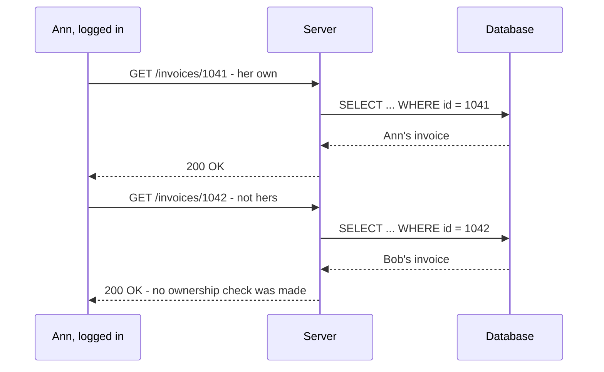

# Broken access control and IDOR

> **Before this lesson:** read [Authentication and authorisation models](#/lesson/web-security/authn-authz) — especially the three questions *who, what action, which object* — and [APIs, dependencies and architecture review](#/lesson/web-security/apis-architecture) for REST resources.

## In plain words

A block of flats has a locked front door, and every resident has a key to it. Inside, the flats are numbered 1, 2, 3… Now suppose the individual flat doors have **no locks at all**, because the builder reasoned: "Only residents can get into the building." Any resident can walk into any flat. The front door worked perfectly, and it made no difference.

Many web applications are built like that building. Logging in is the front door. Once inside, a user asks for "invoice number 1041" and the application hands it over without asking whether invoice 1041 is *theirs*. Changing the number in the address to 1042 opens the neighbour's flat.

This family of flaws is called **broken access control**: the rules about who may do what are missing or wrong. It is ranked first in the OWASP Top 10, ahead of every kind of injection. The reason is uncomfortable: no library can fix it for you. A framework can encode HTML and parameterise SQL automatically, but only *you* know that invoices belong to customers and that only managers approve refunds. This lesson shows the common ways the rules go missing, and how to structure code so that they cannot be forgotten.

## The forms it takes

"Access control" covers several different mistakes. Learn to name them; interviewers use these names.

| Name | What goes wrong | Example |
|---|---|---|
| **IDOR** (insecure direct object reference), also **BOLA** (broken object-level authorisation) | A user reaches another user's *record* by changing an identifier | `/invoices/1042` |
| **Horizontal privilege escalation** | Acting as a *peer* — another user of the same level | Reading a colleague's payslip |
| **Vertical privilege escalation** | Gaining a *higher* level | A customer calling an admin function |
| **Broken function-level authorisation** | An endpoint lacks its role check | `DELETE /api/users/7` open to everyone logged in |
| **Missing property-level authorisation** | A user may see or set a *field* they should not | Sending `"role": "admin"` in a profile update |
| **Forced browsing** | Reaching a page by typing its address although no link is shown | `/admin/reports` |
| **Tenant isolation failure** | One customer organisation sees another's data | Company A's user lists Company B's projects |

IDOR is a kind of horizontal escalation, and the commonest. We begin there.

## How IDOR arises

### The simplest example

```python
# VULNERABLE: authenticated, but any user can read any invoice
@app.get("/invoices/{invoice_id}")
def get_invoice(invoice_id: int, user=Depends(current_user)):
    invoice = db.execute("SELECT * FROM invoices WHERE id = ?", (invoice_id,)).fetchone()
    if invoice is None:
        raise HTTPException(404)
    return invoice
```

Everything about this handler looks careful. It requires a login (`Depends(current_user)`). The query is parameterised. A missing invoice gives a clean 404. What is absent is a single condition: nothing connects `invoice_id` to `user`. The identifier in the address is a *request*; the code treats it as *permission*.

Ann's own invoice is number 1041. She edits the address to 1042 and receives Bob's. With sequential numbers, a short loop retrieves every invoice the company has ever issued.



### Fix 1: scope the query

The most reliable fix puts the ownership rule *inside the data access*, so that a record the user may not see is never loaded:

```python
# FIXED: the query itself is limited to the caller's own rows
@app.get("/invoices/{invoice_id}")
def get_invoice(invoice_id: int, user=Depends(current_user)):
    invoice = db.execute(
        "SELECT * FROM invoices WHERE id = ? AND customer_id = ?",
        (invoice_id, user.id),
    ).fetchone()
    if invoice is None:
        raise HTTPException(404)          # "not found" and "not yours" look the same
    return invoice
```

The added `AND customer_id = ?` uses `user.id` from the verified session — never from the request. If the invoice belongs to someone else, the query returns nothing and the handler answers 404. Returning 404 for both cases has a pleasant side effect: the caller cannot even learn which invoice numbers exist.

You can watch both versions against a tiny database:

```python-run
import sqlite3

db = sqlite3.connect(":memory:")
db.execute("CREATE TABLE invoices (id INTEGER, customer_id INTEGER, total INTEGER)")
db.executemany("INSERT INTO invoices VALUES (?, ?, ?)", [(1041, 7, 120), (1042, 8, 990)])

def get_invoice_vulnerable(invoice_id, user_id):
    return db.execute("SELECT id, total FROM invoices WHERE id = ?", (invoice_id,)).fetchone()

def get_invoice_scoped(invoice_id, user_id):
    return db.execute(
        "SELECT id, total FROM invoices WHERE id = ? AND customer_id = ?",
        (invoice_id, user_id),
    ).fetchone()

ANN = 7
print("vulnerable, own   :", get_invoice_vulnerable(1041, ANN))
print("vulnerable, other :", get_invoice_vulnerable(1042, ANN))   # Bob's invoice leaks
print("scoped, own       :", get_invoice_scoped(1041, ANN))
print("scoped, other     :", get_invoice_scoped(1042, ANN))       # None -> respond 404
```

Both functions take the same arguments. The vulnerable one ignores `user_id`. The scoped one adds it to the `WHERE` clause, and the request for invoice 1042 as Ann returns `None`.

### Fix 2: an explicit policy check

Ownership is not always one column. Support staff may read any invoice in their organisation; an archived invoice may be read-only. When the rule is richer, load the object and pass it to a **policy function** that returns yes or no:

```python-run
def can_access(user, invoice, action):
    if action not in ("read", "update", "delete"):
        return False                               # unknown action: refuse
    if user["tenant"] != invoice["tenant"]:
        return False                               # another organisation: always refuse
    if user["role"] == "admin":
        return True
    if user["id"] == invoice["owner_id"]:
        return action != "delete"                  # owners may read and update, not delete
    return action == "read" and user["role"] == "support"

invoice = {"id": 1042, "owner_id": 8, "tenant": "acme"}
people = {
    "bob (owner)":          {"id": 8, "tenant": "acme",   "role": "member"},
    "ann (colleague)":      {"id": 7, "tenant": "acme",   "role": "member"},
    "sam (support)":        {"id": 9, "tenant": "acme",   "role": "support"},
    "eve (other company)":  {"id": 3, "tenant": "globex", "role": "admin"},
}
for name, user in people.items():
    answers = {action: can_access(user, invoice, action) for action in ("read", "update", "delete")}
    print(f"{name:22}", answers)
```

Read the function from the top: each `if` is a rule, and the first rule that applies decides. An unknown action is refused. A user from another tenant is refused **before** their role is considered — which is why Eve, an administrator at a different company, gets `False` for everything. The last line is the default: only a support agent reading is allowed; everyone else falls through to refusal.

Having one such function per resource type means the rule is written once, can be unit-tested exhaustively, and can be read by a reviewer in a minute.

### What does *not* fix IDOR

**Unguessable identifiers.** Replacing `1042` with a random UUID such as `3f1c9a2e-…` stops casual counting, and it is worth doing. It is not access control. Identifiers leak — through shared links, browser history, logs, the `Referer` header, other API responses — and anyone holding one gets in.

**Hiding the link.** Not showing a button does not remove the endpoint.

**Encoding the ID.** Base64 or hashing an identifier is reversible or guessable; it merely disguises the same number.

**Checks in the client.** Covered in the authorisation lesson; the server decides.

> [!WARNING]
> Watch for identifiers that arrive by routes other than the path. The same flaw appears when the object ID is in a query string (`?account=88`), in the JSON body (`{"order_id": 17}`), in a hidden form field, or in a header. Wherever an ID comes from a request, an ownership check is owed.

## Function-level failures

Here the missing check is about the *action*, not the record.

```python
# VULNERABLE: the admin area relies on nobody knowing the address
@app.post("/admin/users/{user_id}/promote")
def promote(user_id: int, user=Depends(current_user)):
    db.set_role(user_id, "admin")
```

Any logged-in user who learns the path — from the JavaScript bundle, the API documentation, or a guess — can make themselves an administrator. That is vertical privilege escalation.

```python
# FIXED: permission declared on the route and enforced before the body runs
@app.post("/admin/users/{user_id}/promote")
def promote(user_id: int, user=Depends(require("users:promote"))):
    db.set_role(user_id, "admin")
```

The structural defence is **deny by default at the router**. Configure the application so that every route requires authentication *and* a declared permission unless explicitly marked public. In FastAPI that means attaching dependencies to the application or to each router; in Django, a middleware or a base view class. With that in place, forgetting the annotation produces a 403 that a developer notices immediately — the failure is loud and safe.

A second, cheaper defence is a test that enumerates every route and asserts each one has a declared policy:

```python-run
ROUTES = {
    ("GET", "/products"):                  {"public": True},
    ("GET", "/invoices/{id}"):             {"permission": "invoices:read", "object_check": True},
    ("POST", "/admin/users/{id}/promote"): {"permission": "users:promote", "object_check": False},
    ("DELETE", "/invoices/{id}"):          {},                                   # someone forgot
    ("PATCH", "/orders/{id}"):             {"permission": "orders:update", "object_check": False},
}

for (method, path), policy in ROUTES.items():
    problems = []
    if not policy.get("public") and "permission" not in policy:
        problems.append("no permission declared")
    if "{id}" in path and not policy.get("public") and not policy.get("object_check") and not path.startswith("/admin"):
        problems.append("takes an object id but declares no object-level check")
    if problems:
        print(method, path, "->", ", ".join(problems))
```

The dictionary stands in for metadata a real framework can supply. Two rules are applied: every non-public route must declare a permission, and any route with an `{id}` in its path must declare an object-level check. Two forgotten cases are printed. A check like this running in continuous integration turns "someone forgot" into a failed build.

## Property-level failures and mass assignment

A user may be allowed to update their own profile yet not every *field* of it.

```python
# VULNERABLE: all submitted fields are applied
@app.patch("/users/me")
def update_me(body: dict, user=Depends(current_user)):
    db.update("users", user.id, body)        # body may contain role, credit, email_verified...
```

```python
# FIXED: a schema names the fields a user may change about themselves
class SelfUpdate(BaseModel):
    model_config = ConfigDict(extra="forbid")
    display_name: str | None = None
    timezone: str | None = None
```

The read side has the same issue in reverse: `GET /users/8` might properly return Bob's display name to Ann while wrongly including his email, phone number and password hash. Use a different response model for "my own profile" and "someone else's profile".

## Multi-tenant isolation

In software sold to organisations, the gravest access-control failure is one customer seeing another's data. The defensive pattern is to make the tenant filter impossible to omit:

- Every table carries a `tenant_id`.
- Data access goes through a layer that **adds `tenant_id = ?` to every query automatically**, using the tenant from the authenticated session. Individual handlers cannot forget it because they never write it.
- Where the database supports it, add **row-level security**: a rule inside the database itself, so that a query from the application cannot see rows of another tenant even if the application code is wrong. PostgreSQL offers this.

That last point is defence in depth applied to authorisation: the application enforces the rule, and the database enforces it again.

## Other places the rule goes missing

- **Other HTTP methods.** `GET /orders/5` is checked; `PUT /orders/5` was added later and is not.
- **Multi-step flows.** Step 1 checks permission; step 3 ("confirm") trusts an ID carried in a hidden field.
- **Exports and bulk endpoints.** `/invoices/export?ids=1041,1042,1043` checks none of them, or only the first.
- **Static files.** `/uploads/invoice-1042.pdf` is served directly by the web server, bypassing the application's checks. Serve private files through an authorising handler or short-lived signed URLs.
- **Parameters that name the acting user.** `?user_id=8` or `X-User-Id: 8` used instead of the session's identity.
- **Client-held roles.** A `role` claim in an unsigned cookie or a token whose signature is not verified.
- **CORS misconfiguration** letting a foreign origin read authenticated responses (see [Security headers, CSP and CORS](#/lesson/web-security/headers-csp-cors)).

> [!TIP]
> Write the ownership test *first*. For every new endpoint that takes an identifier, begin with a test that logs in as user A, requests user B's object, and expects 404 or 403. It takes two minutes, fails until you add the check, and stays as a guard forever.

> [!INTERVIEW]
> "What is IDOR and how do you prevent it?" Definition: the application exposes a reference to an internal object (an ID) and fails to verify that the caller is authorised for that specific object. Prevention: enforce object-level authorisation on the server for every request — preferably by scoping the query to the authenticated user or tenant — centralise the policy, deny by default, and test with two accounts. Add that random IDs help against enumeration but are not a substitute.

## Defence in depth

1. **Deny by default** in routing: authentication and a declared permission for everything not marked public.
2. **Object-level checks** via scoped queries or a policy function, using identity from the session only.
3. **Field-level schemas** for both input and output.
4. **Tenant filter applied automatically**, plus row-level security in the database where available.
5. **Unpredictable identifiers** to make enumeration impractical.
6. **Rate limiting and alerting** on bursts of 403/404 responses from one account — the signature of someone walking an ID range.
7. **Audit logging** of who accessed which object.
8. **Automated authorisation tests** covering every route with at least two users and two roles.

## How to test for it

Access control cannot be found by a generic scanner, because the scanner does not know your rules. It is found by people and by tests that encode the rules.

**In code review**, for each handler:

1. Where does the identity come from? (Must be the session or verified token.)
2. Which identifiers come from the request?
3. For each identifier: show me the line that ties it to this user or tenant.
4. Is there a role or permission check for the action?
5. Do `PUT`, `PATCH` and `DELETE` on the same resource have the same checks as `GET`?

**In testing your own application** — the two-account method:

1. Create users A and B (and, for multi-tenant systems, tenants X and Y).
2. As A, perform every action and record each request.
3. Replay each request with B's session. Every response that returns or changes A's data is a finding.
4. Replay each request with no session. Expect 401.
5. As a low-privilege user, request every admin route.
6. For update endpoints, add fields the user should not control and re-read the object.

Automate this as a parametrised integration test; browser extensions and proxy tools can also replay a recorded session under a second identity.

## Pitfalls

- **Assuming authentication implies authorisation.**
- **Checking the parent but not the child**: verifying the user owns order 17, then loading *item* 99 by its ID without confirming it belongs to order 17.
- **Checking on read but not on write.**
- **Inconsistent answers**: 403 for "exists but not yours" and 404 for "does not exist" reveals which IDs are real.
- **Caching authorised responses** under a key that omits the user, so the next caller receives someone else's page.
- **Forgetting background jobs and internal endpoints**, which often run with full privileges on user-supplied IDs.
- **Admin impersonation features** without logging or limits.
- **Assuming a UUID makes a URL safe to share.**

## Summary

- Broken access control means the server fails to enforce who may do what to which object; it is the most common serious web flaw.
- IDOR is the object-level case: an identifier from the request is used without checking ownership.
- Fix it by scoping queries to the authenticated user or tenant, or by a central policy function evaluated on the loaded object.
- Function-level failures are prevented by deny-by-default routing and declared permissions; property-level failures by input and output schemas.
- Random identifiers and hidden links are helpful obstacles, never controls.
- Frameworks cannot know your rules, so write them down, centralise them, and test them with two accounts.

## Glossary

- **Access control** — enforcement of who may perform which action on which resource.
- **IDOR / BOLA** — insecure direct object reference / broken object-level authorisation: reaching another's object by changing an identifier.
- **Horizontal privilege escalation** — acting as another user of the same level.
- **Vertical privilege escalation** — gaining the abilities of a higher level.
- **Function-level authorisation** — checking permission to invoke an operation.
- **Property-level authorisation** — checking permission to read or write a specific field.
- **Forced browsing** — reaching unlinked pages by requesting their addresses directly.
- **Scoped query** — a query that includes the user or tenant as a condition.
- **Policy function** — a single function that decides whether a subject may perform an action on an object.
- **Tenant isolation** — keeping each customer organisation's data separate.
- **Row-level security** — database-enforced rules limiting which rows a session can see.
- **Enumeration** — iterating through identifiers to discover or collect records.

```quiz
[
  {"q": "A handler requires login, parameterises its SQL, and returns the invoice whose id is in the URL. What is missing?",
   "options": ["Output encoding", "A check that the invoice belongs to the logged-in user", "HTTPS", "A CSRF token"], "answer": 1,
   "explain": "The identifier is treated as permission. Object-level authorisation must tie the record to the caller."},
  {"q": "Which fix for IDOR is the most robust?",
   "options": ["Hide the link in the user interface", "Base64-encode the identifier", "Add the authenticated user's id to the WHERE clause of the query", "Use POST instead of GET"], "answer": 2,
   "explain": "A scoped query cannot return rows the caller does not own, regardless of what identifier is supplied."},
  {"q": "A team replaces sequential invoice numbers with random UUIDs and removes the ownership check. Is the endpoint safe?",
   "options": ["Yes, UUIDs cannot be guessed", "No: identifiers leak through links, logs and other responses, and anyone holding one gets access", "Yes, if HTTPS is used", "Only for admins"], "answer": 1,
   "explain": "Unpredictable identifiers reduce enumeration but are not authorisation."},
  {"q": "A customer discovers POST /admin/users/7/promote and it works for them. Which category is this?",
   "options": ["Horizontal privilege escalation", "Vertical privilege escalation through broken function-level authorisation", "Reflected XSS", "SQL injection"], "answer": 1,
   "explain": "The user gained a higher privilege level because the endpoint lacked a role check."},
  {"q": "Why return 404 instead of 403 when a user requests another user's invoice?",
   "options": ["404 is faster", "It avoids confirming that the identifier exists", "403 is deprecated", "Browsers cache 403"], "answer": 1,
   "explain": "Identical answers for 'missing' and 'not yours' prevent an attacker from mapping which identifiers are valid."},
  {"q": "In a multi-tenant system, where should the tenant filter ideally be applied?",
   "options": ["In each handler, by hand", "Automatically in the data-access layer, and again in the database with row-level security", "In the browser", "Only on admin pages"], "answer": 1,
   "explain": "Automatic application removes the chance of forgetting; database enforcement adds a second independent layer."},
  {"q": "Why can't a generic vulnerability scanner reliably find broken access control?",
   "options": ["Scanners cannot send HTTP requests", "The scanner does not know the application's business rules about who owns what", "Access control bugs only occur offline", "They only affect mobile apps"], "answer": 1,
   "explain": "Whether a response is a violation depends on rules specific to the application. Tests must encode those rules."},
  {"q": "The code checks that the user owns order 17 and then loads line item 99 by its id alone. What is the flaw?",
   "options": ["None", "The child object is not verified to belong to the authorised parent", "Line items should use UUIDs", "Orders should be cached"], "answer": 1,
   "explain": "Each identifier from the request needs its own tie to the caller; verifying a parent does not cover unrelated children."}
]
```

> **Source:** Hoffman, *Web Application Security*, ch. 3 and ch. 18 (authorisation in application architecture) and ch. 19 (custom logic bugs in code review), extended in original wording. OWASP Top 10 A01 Broken Access Control — https://owasp.org/Top10/A01_2021-Broken_Access_Control/ ; OWASP Insecure Direct Object Reference Prevention Cheat Sheet — https://cheatsheetseries.owasp.org/cheatsheets/Insecure_Direct_Object_Reference_Prevention_Cheat_Sheet.html ; OWASP Authorization Cheat Sheet — https://cheatsheetseries.owasp.org/cheatsheets/Authorization_Cheat_Sheet.html ; OWASP API Security Top 10, API1 Broken Object Level Authorization — https://owasp.org/API-Security/editions/2023/en/0xa1-broken-object-level-authorization/
