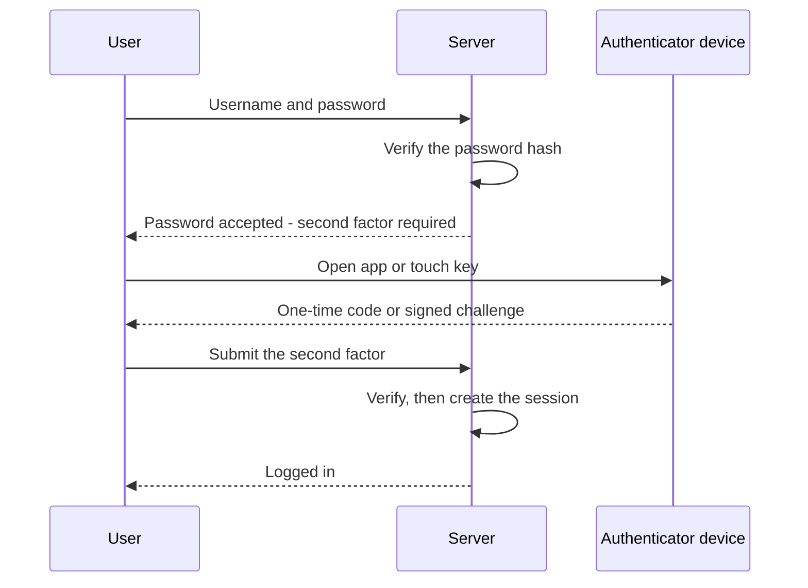

# Authentication failures, password storage and MFA

> **Before this lesson:** read [Authentication and authorisation models](#/lesson/web-security/authn-authz) for the three factors of authentication, and [The attacker's view: leaks and attack surface](#/lesson/web-security/attack-surface) for user enumeration and timing side channels.

## In plain words

A password is a shared secret between one person and one website: both sides must be able to check it. The obvious way to check is to keep a list of everyone's passwords and look them up. That is like a hotel keeping a labelled copy of every guest's house key in a drawer at reception. The day someone forces the drawer, they do not only have the hotel's rooms — they have everybody's *homes*, because people use the same key (password) in many places.

A well-run site therefore never keeps the passwords. It keeps something that lets it *recognise* the right password without being able to *produce* it, in the way a lock recognises a key without containing a spare. That "something" is a **password hash**, and choosing the right kind is the heart of this lesson.

Authentication fails in other ways too: weak or reused passwords, unlimited guessing, sloppy "forgot password" flows, and reliance on a single secret. OWASP groups these as *Identification and Authentication Failures*. "How would you store passwords?" may be the most frequently asked security interview question for developers, so this lesson builds the answer from first principles.

## How accounts are attacked

Knowing the attacks tells you what each defence is for.

| Attack | What the attacker does | Why it works |
|---|---|---|
| **Brute force** | Tries many passwords against one account | No limit on attempts |
| **Password spraying** | Tries one or two very common passwords against *many* accounts | Stays under per-account limits; someone always uses `Summer2026!` |
| **Credential stuffing** | Replays email/password pairs leaked from *other* sites | People reuse passwords |
| **Offline cracking** | Steals the password database and guesses at leisure on their own hardware | Weakly stored passwords can be tested billions of times per second |
| **Phishing** | Tricks the user into typing the password into a fake site | Passwords can be given away |
| **Reset abuse** | Attacks "forgot password" instead of login | The reset flow is often the weakest path |

Two of these — credential stuffing and offline cracking — are the reason password *storage* matters so much. If your database leaks and the passwords are recoverable, your users are attacked everywhere else as well.

## Storing passwords, step by step

We build up from the worst design to the right one. Each step fixes one specific weakness.

### Step 0: plain text (never)

```python
# VULNERABLE: the password itself is stored
db.execute("INSERT INTO users (email, password) VALUES (?, ?)", (email, password))
```

Anyone who can read the table — an attacker using SQL injection, a stolen backup, a curious employee — has every password.

### Step 1: a hash function

A **cryptographic hash function** takes any input and produces a fixed-size output called a **digest**. It has two properties we need: the same input always gives the same digest, and it is *one-way* — there is no practical method to compute the input from the digest. SHA-256 is a well-known example.

Store the digest; at login, hash what the user typed and compare. The site can now recognise the password without holding it.

Alas, a plain hash is still weak, for two reasons the next steps address.

### Step 2: add a salt

With a plain hash, two users with the same password have the same digest. Worse, attackers prepare giant lookup tables of digests for common passwords in advance; one glance at your table reveals every common password in it.

The cure is a **salt**: a random value, different for every user, mixed into the hash and stored beside it. The salt is not secret. Its job is to make every user's hash unique, so that precomputed tables are useless and each password must be attacked separately.

### Step 3: make it slow

SHA-256 was designed to be *fast* — excellent for checking file integrity, terrible for passwords. Commodity graphics cards compute billions of SHA-256 digests per second, so an attacker with your (salted) table can still test every likely password for every user in an afternoon.

Password storage therefore uses deliberately **slow** functions, known as password-hashing functions or **key-derivation functions** (KDFs). They have a **work factor** (or *cost*): a setting that controls how much computation — and, in the better ones, how much memory — one hash requires. A login that takes a tenth of a second is unnoticeable to a person and reduces an attacker from billions of guesses per second to a handful.

| Function | Notes |
|---|---|
| **Argon2id** | The current first choice; costly in both time and memory, which blunts specialised cracking hardware |
| **scrypt** | Also memory-hard; a good second choice |
| **bcrypt** | Long-established and still acceptable; ignores input beyond 72 bytes |
| **PBKDF2-HMAC-SHA256** | Not memory-hard, but in every standard library and approved where FIPS compliance is required; use a very high iteration count |

OWASP's Password Storage Cheat Sheet gives concrete parameters and revises them as hardware improves — at the time of writing, for example, 600,000 iterations for PBKDF2-HMAC-SHA256. Check the current figures; do not copy numbers from old tutorials.

### The complete picture, in runnable code

Python's standard library includes PBKDF2, so we can demonstrate salt, work factor, storage format and verification with no installation. (In a real project, prefer a maintained library such as `argon2-cffi`; the *structure* is identical.)

```python-run
import hashlib, hmac, secrets

ITERATIONS = 100_000       # kept modest so the demo runs quickly in the browser

def hash_password(password: str) -> str:
    salt = secrets.token_bytes(16)                                  # fresh random salt per password
    digest = hashlib.pbkdf2_hmac("sha256", password.encode(), salt, ITERATIONS)
    # Store everything needed to verify later, in one self-describing string
    return f"pbkdf2_sha256${ITERATIONS}${salt.hex()}${digest.hex()}"

def verify_password(password: str, stored: str) -> bool:
    try:
        algorithm, iterations, salt_hex, digest_hex = stored.split("$")
        if algorithm != "pbkdf2_sha256":
            return False
        candidate = hashlib.pbkdf2_hmac("sha256", password.encode(), bytes.fromhex(salt_hex), int(iterations))
    except ValueError:
        return False                                                # malformed record: refuse, never crash
    return hmac.compare_digest(candidate.hex(), digest_hex)         # constant-time comparison

record_ann = hash_password("correct horse battery")
record_bob = hash_password("correct horse battery")                 # same password, different user

print(record_ann)
print(record_bob)
print("same password, same record? ", record_ann == record_bob)
print("right password verifies:     ", verify_password("correct horse battery", record_ann))
print("wrong password verifies:     ", verify_password("correct horse", record_ann))
print("corrupt record verifies:     ", verify_password("x", "not-a-valid-record"))
```

Walking through it:

- `secrets.token_bytes(16)` produces 16 random bytes for the salt.
- `hashlib.pbkdf2_hmac("sha256", password, salt, ITERATIONS)` runs the underlying hash 100,000 times, feeding each result into the next. That repetition is the work factor.
- The stored string has four parts separated by `$`: algorithm, iteration count, salt, digest. Keeping the parameters *with* each record is what lets you raise the cost next year without breaking old accounts.
- `verify_password` splits the record, repeats the calculation with **the record's own** salt and iteration count, and compares using `hmac.compare_digest`.
- The output shows two different records for the same password (different salts), a successful check, a failed check, and a malformed record handled calmly.

### Upgrading over time

Hardware gets faster, so the work factor must rise. You cannot re-hash stored digests without the passwords — but at each successful login the server briefly *has* the password. That is the moment to upgrade:

```python
# After verify_password() has returned True:
if needs_rehash(user.password_record):           # old algorithm or too few iterations
    user.password_record = hash_password(password)
    db.save(user)
```

### Pepper

A **pepper** is an additional secret, the same for all users, mixed into the hashing and stored *outside* the database (for example in a secrets manager). If only the database leaks, the attacker cannot even begin guessing without it. It is an optional extra layer on top of salted slow hashing, never a replacement for it.

> [!WARNING]
> Never design your own password scheme. `sha256(password + salt)`, double hashing, or "MD5 then SHA-1" all remain fast, and fast is the problem. Encryption is not the answer either: encrypted passwords can be decrypted by anyone who obtains the key, whereas a hash cannot be reversed at all.

## Comparing secrets safely

The final line of `verify_password` deserves its own explanation. Ordinary equality (`==`) on strings stops at the first character that differs. The comparison therefore takes very slightly longer the more leading characters match, and that difference can in principle be measured and used to discover a secret piece by piece. `hmac.compare_digest` examines every byte regardless.

Use it whenever you compare something secret with something a client supplied: API keys, session tokens, CSRF tokens, reset codes, signatures.

```python
# VULNERABLE                              # FIXED
if supplied_key == stored_key:            if hmac.compare_digest(supplied_key, stored_key):
```

## Password policy: what to require

Old policies demanded an upper-case letter, a digit and a symbol, and forced a change every 90 days. Research showed that people respond predictably — `Password1!`, then `Password2!` — so current guidance from NIST (the US National Institute of Standards and Technology, publication SP 800-63B) and OWASP recommends:

- **Length matters most.** Require a reasonable minimum (many organisations choose 12 or more) and allow long passphrases — at least 64 characters.
- **Allow all characters**, including spaces and non-English letters. Never silently truncate.
- **No composition rules** (do not force symbols).
- **No periodic forced changes**; require a change only when there is evidence of compromise.
- **Screen new passwords against lists of known-breached and common passwords.** This single check removes the passwords that spraying and stuffing depend on.
- **Allow pasting** so that password managers work.

```python-run
COMMON = {"password1234", "qwertyuiop12", "letmein12345", "iloveyou1234"}

def password_problems(password: str, username: str):
    problems = []
    if len(password) < 12:
        problems.append("shorter than 12 characters")
    if len(password) > 128:
        problems.append("longer than 128 characters")
    if len(username) >= 3 and username.lower() in password.lower():
        problems.append("contains the user name")
    if password.lower() in COMMON:
        problems.append("appears in a list of common passwords")
    return problems

for candidate in ["Password1234", "ann-loves-mugs", "correct horse battery", "Tr0ub4dor&3"]:
    print(f"{candidate!r:26} ->", password_problems(candidate, "ann") or "acceptable")
```

Notice what passes and what fails. `Password1234` satisfies an old-style composition rule and is rejected as common. `correct horse battery` has no digits or symbols and is accepted because it is long and not on a list. `Tr0ub4dor&3` looks complicated and is rejected only for being short.

## Throttling guesses

Slow hashing protects a *stolen* database. Against guessing through the login form, you need limits:

- **Per account**: after several failures within a window, add increasing delays or a temporary lock.
- **Per source address**: slows spraying across many accounts.
- **Across the whole site**: alert when failed logins spike.
- **Challenges** (a CAPTCHA) or a second factor when behaviour looks automated.

A hard lockout has a cost: anyone can lock a victim out by deliberately failing their login. Prefer progressive delays, and never lock on the basis of the account name alone without a path for the genuine owner. A full limiter is built in [Denial of service and rate limiting](#/lesson/web-security/dos-rate-limiting).

## Multi-factor authentication

Even a strong, well-stored password can be phished or reused. **Multi-factor authentication (MFA)** requires a second kind of evidence, so that a stolen password alone is not enough.

| Method | How it works | Resistance to phishing |
|---|---|---|
| **SMS or email code** | A code is sent to the user | Weak — codes can be intercepted, phone numbers hijacked, and codes typed into fake sites |
| **TOTP authenticator app** | App and server share a secret and each computes a 6-digit code from it and the current time (*time-based one-time password*) | Moderate — no interception in transit, but a fake site can still relay the code |
| **Push approval** | User taps "approve" on their phone | Moderate — vulnerable to "approval fatigue" unless number matching is used |
| **Security key / passkey (WebAuthn, FIDO2)** | A device signs a challenge with a private key, and the signature is bound to the genuine site's origin | Strong — the device will not answer a look-alike domain |



Implementation points that are easy to get wrong:

- **Do not create the full session until both factors pass.** Use a short-lived, limited "pending" state between the steps.
- **Rate-limit the second step** — a 6-digit code has only a million possibilities.
- **Make codes single-use** and short-lived.
- **Protect recovery.** Backup codes and "I lost my phone" procedures must be as strong as the factor they replace, or they become the way in.
- **Require the factor again** for sensitive actions and for changing the MFA settings themselves.

**Passkeys** go further and replace the password entirely with a key pair held on the user's device. Nothing reusable is stored on the server, and nothing can be typed into a fake site. They are the direction the industry is moving.

## The reset flow

"Forgot password" is a second login path and deserves the same care.

```python
# VULNERABLE: predictable token, never expires, reveals whether the account exists
token = hashlib.md5(email.encode()).hexdigest()
if not user: return {"error": "No such account"}
send_email(email, f"https://shop.example/reset?token={token}")
```

```python
# FIXED
token = secrets.token_urlsafe(32)                                  # unguessable
db.save_reset(user.id, sha256(token), expires=now + 30 * 60)       # store only a hash; 30 minutes
send_email(user.email, f"https://shop.example/reset?token={token}")
return {"message": "If that address is registered, we have sent a link."}   # same reply always
```

The reset token is a temporary password, so: generate it randomly, store only its hash, expire it quickly, allow one use, give the same response whether or not the account exists, invalidate existing sessions when the password changes, and notify the user by email that a change occurred.

> [!INTERVIEW]
> **"How would you store passwords?"** Never in plain text or reversibly encrypted. Hash each with a dedicated slow password-hashing function — Argon2id preferred, or scrypt, bcrypt, or PBKDF2 with a high iteration count — using a unique random salt per user, storing algorithm, parameters, salt and digest together so the cost can be raised later; re-hash at login when parameters are outdated. Compare in constant time. Optionally add a pepper kept outside the database. Then widen the answer: screen for breached passwords, rate-limit logins, offer MFA, and secure the reset flow.

## Defence in depth

1. **Salted, slow hashing** with current parameters and upgrade-on-login.
2. **Breached-password screening** and a length-based policy.
3. **Rate limiting** per account, per address and globally.
4. **MFA**, ideally phishing-resistant, with protected recovery.
5. **Uniform responses and timing** so accounts cannot be enumerated.
6. **Secure reset**: random, hashed, short-lived, single-use tokens.
7. **Session hygiene** after login — next lesson.
8. **Monitoring**: failed-login spikes, logins from new devices or countries, notification emails to users.

## How to test for it

**In code review:**

- Find where passwords are written to the database. What function produces the stored value? A plain hash (`md5`, `sha1`, `sha256`) or a reversible cipher is a critical finding.
- Is there a per-user random salt? Are parameters stored with the record?
- Search for `==` near words such as `token`, `key`, `secret`, `signature`, `hmac`.
- Search logs and error handlers for places where a request body — and therefore a password — might be written out.
- Read the reset flow end to end: token source, storage, expiry, reuse, response text.

**In testing your own application:**

- Create two accounts with the same password and compare the stored records; they must differ.
- Time a login: it should take a perceptible fraction of a second of computation.
- Fail a login twenty times in a row and observe throttling.
- Compare responses for a real and a non-existent account on login, registration and reset.
- Request two reset links and check that the first stops working; use a link twice; use one after its expiry.
- Try to reach a post-login page after the password step but before the second factor.

## Pitfalls

- **Fast hashes with a salt** — still crackable at enormous speed.
- **One global salt** for all users.
- **Truncating passwords** or restricting characters, often to suit a legacy database column.
- **Verifying with the current iteration count** instead of the one stored in the record, which locks out every existing user after an upgrade.
- **Logging passwords** in request logs, error traces or analytics.
- **Emailing passwords**, or being able to. If support can tell a user their password, it is not hashed.
- **Security questions** as a reset mechanism; the answers are guessable or public.
- **MFA that can be skipped** by calling the post-login endpoint directly, or switched off without re-authentication.
- **"Remember this device" for ever.**

## Summary

- Accounts are attacked by guessing, by reusing leaked credentials, by cracking stolen hashes offline, by phishing, and through reset flows.
- Store passwords only as salted digests from a deliberately slow function (Argon2id, scrypt, bcrypt or high-iteration PBKDF2), with parameters kept alongside so they can be strengthened.
- A salt makes each hash unique; slowness makes each guess expensive; a pepper adds a secret outside the database.
- Compare secrets with a constant-time function.
- Prefer long passwords, screen against breached lists, and drop composition and expiry rules.
- Throttle attempts, add MFA — phishing-resistant where possible — and treat password reset as a login path.

## Glossary

- **Hash function** — a one-way function producing a fixed-size digest from any input.
- **Digest** — the output of a hash function.
- **Salt** — a random, per-user value mixed into a password hash; stored with it; not secret.
- **Pepper** — an additional secret shared by all hashes, kept outside the database.
- **Work factor (cost)** — a setting controlling how expensive one hash computation is.
- **Key-derivation function (KDF)** — a deliberately slow function for hashing passwords.
- **Argon2id / scrypt / bcrypt / PBKDF2** — standard password-hashing functions.
- **Offline cracking** — guessing passwords against a stolen hash table on the attacker's own hardware.
- **Credential stuffing** — replaying credentials leaked from other services.
- **Password spraying** — trying a few common passwords across many accounts.
- **Constant-time comparison** — a comparison whose duration does not depend on where inputs differ.
- **MFA** — multi-factor authentication. **TOTP** — time-based one-time password.
- **WebAuthn / passkey** — public-key authentication bound to the site's origin.
- **Reset token** — a temporary secret allowing a password change.

```quiz
[
  {"q": "What is the purpose of a salt in password storage?",
   "options": ["To keep the password secret from the user", "To make each user's hash unique so identical passwords differ and precomputed tables are useless", "To make hashing faster", "To encrypt the database"], "answer": 1,
   "explain": "A salt is random, per-user and not secret. It forces an attacker to attack every hash individually."},
  {"q": "Why is salted SHA-256 still a poor choice for passwords?",
   "options": ["SHA-256 is broken", "It is very fast, so an attacker with the stolen table can test enormous numbers of guesses per second", "It produces digests that are too long", "It cannot be salted"], "answer": 1,
   "explain": "General-purpose hashes are designed for speed. Password hashing needs a tunable, deliberately high cost."},
  {"q": "Which is OWASP's first-choice algorithm for hashing passwords today?",
   "options": ["MD5", "SHA-1", "Argon2id", "AES"], "answer": 2,
   "explain": "Argon2id is memory-hard and tunable. scrypt, bcrypt and high-iteration PBKDF2 are acceptable alternatives. AES is encryption, not hashing."},
  {"q": "Why store the iteration count inside each password record?",
   "options": ["To save space", "So old records can still be verified after the default cost is increased, and upgraded at next login", "To hide the algorithm", "It is required by SQL"], "answer": 1,
   "explain": "Verification must use the parameters the record was created with. Self-describing records make gradual upgrades possible."},
  {"q": "Why use hmac.compare_digest instead of == to compare a supplied token with a stored one?",
   "options": ["It is shorter to type", "Its running time does not reveal how many leading characters matched", "It ignores case", "It hashes the values"], "answer": 1,
   "explain": "Early-exit comparison leaks timing information that can be used to recover a secret incrementally."},
  {"q": "According to current NIST and OWASP guidance, which password rule is recommended?",
   "options": ["Force a change every 90 days", "Require a symbol and a digit", "Check new passwords against lists of breached and common passwords", "Limit passwords to 16 characters"], "answer": 2,
   "explain": "Screening removes the passwords attackers try first. Composition rules and forced rotation lead to predictable patterns."},
  {"q": "Which second factor resists phishing best?",
   "options": ["SMS code", "Email code", "TOTP app code", "A WebAuthn security key or passkey"], "answer": 3,
   "explain": "WebAuthn binds the signature to the genuine site's origin, so a look-alike site receives nothing usable. Codes can be relayed."},
  {"q": "Which reset-token design is correct?",
   "options": ["MD5 of the email address", "A random token stored hashed, single-use, expiring within minutes, with the same response for any email", "The user's ID in base64", "A four-digit code valid for a week"], "answer": 1,
   "explain": "A reset token is a temporary password and needs the same protections: unpredictable, short-lived, single-use, and no account enumeration."}
]
```

> **Source:** Hoffman, *Web Application Security*, ch. 18 (secure credentials, hashing credentials, 2FA), in original wording with original examples. OWASP Password Storage Cheat Sheet — https://cheatsheetseries.owasp.org/cheatsheets/Password_Storage_Cheat_Sheet.html ; OWASP Authentication Cheat Sheet — https://cheatsheetseries.owasp.org/cheatsheets/Authentication_Cheat_Sheet.html ; OWASP Multifactor Authentication Cheat Sheet — https://cheatsheetseries.owasp.org/cheatsheets/Multifactor_Authentication_Cheat_Sheet.html ; OWASP Forgot Password Cheat Sheet — https://cheatsheetseries.owasp.org/cheatsheets/Forgot_Password_Cheat_Sheet.html ; NIST SP 800-63B — https://pages.nist.gov/800-63-3/sp800-63b.html ; OWASP Top 10 A07 — https://owasp.org/Top10/A07_2021-Identification_and_Authentication_Failures/
