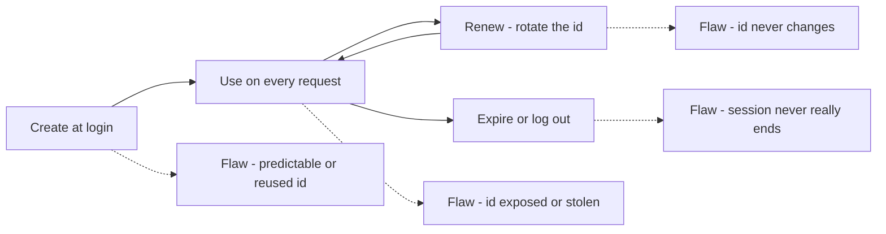
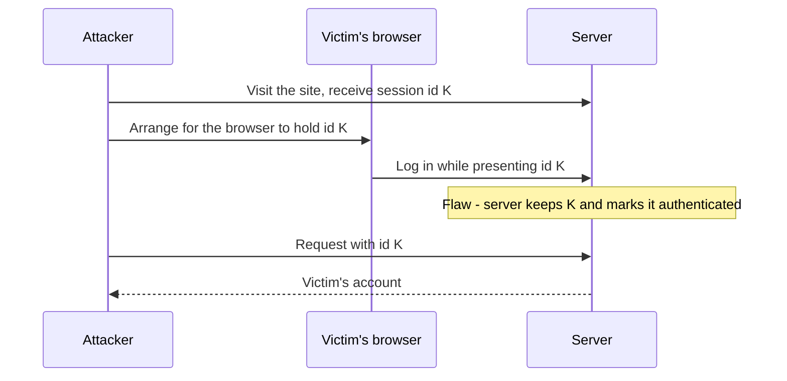

# Session management flaws and cookie attributes

> **Before this lesson:** read [Cookies and sessions](#/lesson/web-security/cookies-sessions), which explains session identifiers and the `HttpOnly`, `Secure` and `SameSite` attributes, and [Authentication failures, password storage and MFA](#/lesson/web-security/authentication-passwords).

## In plain words

At a festival you show your ticket once at the gate and receive a wristband. For the rest of the weekend nobody asks for the ticket again; stewards glance at your wrist. The wristband has replaced your identity. So everything about the wristband now matters: can it be copied? Can someone slip theirs onto your wrist while you sleep? Does it stop working on Monday? If you report it lost, can the organisers cancel it?

A **session** is the web's wristband. The login page checks the password once; afterwards the session identifier in the cookie *is* the user. The previous lessons made the gate strong — hashed passwords, rate limits, a second factor. All of that is wasted if the wristband is easy to steal, plant or keep for ever, because an attacker who obtains a live session needs neither the password nor the second factor.

**Session management** is the set of rules for issuing, protecting, renewing and cancelling that identifier. Its failures sit in the same OWASP category as authentication failures, and they are a favourite interview topic because they reveal whether a candidate understands what happens *after* login.

## The life cycle, and where it breaks



Each stage has its typical failure. We take them in order.

## Flaw 1: session fixation — keeping the old identifier at login

### How it arises

Many applications give every visitor a session before login, to hold a shopping basket or a language preference. The flaw appears when that same identifier is kept after the visitor authenticates:

```python
# VULNERABLE: the pre-login session id becomes the authenticated session
@app.post("/login")
def login(form: LoginForm, sid: str = Cookie(None)):
    user = authenticate(form)
    SESSIONS[sid]["user_id"] = user.id          # same sid as before login
    return {"ok": True}
```

Here is why that matters. Suppose an attacker can cause the victim's browser to use a session identifier the attacker already knows — for instance through a vulnerable sibling subdomain that can set cookies for the whole site, or through an application that accepts identifiers in the URL. The victim then logs in. The server attaches the victim's account to *that* identifier. The attacker, who has known the identifier all along, is now logged in as the victim without ever stealing anything. The identifier was *fixed* in advance, hence **session fixation**.



### The fix: rotate at every change of privilege

```python
# FIXED: a brand-new identifier is issued at the moment of login
@app.post("/login")
def login(form: LoginForm, response: Response, sid: str = Cookie(None)):
    user = authenticate(form)
    basket = SESSIONS.pop(sid, {}).get("basket", [])        # discard the old session entirely
    new_sid = secrets.token_urlsafe(32)
    SESSIONS[new_sid] = {"user_id": user.id, "basket": basket, "created": now(), "last_seen": now()}
    response.set_cookie("__Host-sid", new_sid, httponly=True, secure=True, samesite="lax", path="/")
    return {"ok": True}
```

`SESSIONS.pop(sid, {})` removes the old entry so the old identifier stops working. A fresh random identifier is created and sent. Any identifier an attacker planted is now worthless. The same **rotation** should happen whenever the privilege level changes: after login, after the second factor succeeds, when an administrator enters an elevated mode, and after a password change. Mature frameworks provide one call for this (`request.session.cycle_key()` in Django, `session.regenerate()` in Express).

## Flaw 2: exposure — the identifier gets out

A session identifier can leak through several routes. Each has a specific counter-measure, most of which you met as cookie attributes:

| Leak | Counter-measure |
|---|---|
| Injected script reads `document.cookie` | `HttpOnly` |
| Sent over plain HTTP and observed on the network | `Secure`, HTTPS everywhere, HSTS |
| Placed in a URL (`/account;sid=…` or `?sid=…`), ending up in history, logs and `Referer` headers | Cookies only; never accept identifiers from URLs |
| Written to application logs or error reports | Redact cookies and `Authorization` headers in logging |
| A sibling subdomain reads or overwrites it | No `Domain` attribute; `__Host-` prefix |
| Cached by a shared proxy together with a personalised page | `Cache-Control: no-store` on authenticated responses |

```python
# VULNERABLE: identifier accepted from the query string and echoed into links
sid = request.query_params.get("sid") or request.cookies.get("sid")
```

```python
# FIXED: one source only
sid = request.cookies.get("__Host-sid")
```

The `__Host-` name prefix is worth a second look. A browser refuses to store a cookie with that prefix unless it is `Secure`, has `Path=/`, and has **no** `Domain` attribute. That makes the cookie belong to exactly one host, sent only over HTTPS — and no other subdomain can set a cookie of the same name for your host, which also closes one route to fixation.

## Flaw 3: sessions that never end

### How it arises

```python
# VULNERABLE: logout only asks the browser to forget; nothing ever expires
@app.post("/logout")
def logout(response: Response):
    response.delete_cookie("sid")
    return {"ok": True}
```

The server-side entry survives. A copy of the identifier — taken from a shared computer, a proxy log, or malware — works indefinitely. Similarly, sessions with no time limit turn every stolen identifier into permanent access.

### The fix: three ways to end a session

1. **Idle timeout** — end the session after a period with no requests. Protects the unattended, still-logged-in browser. Typical values range from a few minutes for banking to hours for low-risk sites.
2. **Absolute timeout** — end the session a fixed time after login, however active it has been. Without this, an attacker who keeps a stolen session busy keeps it for ever.
3. **Explicit revocation** — logout, "log out of all devices", password change, or an administrator's action deletes the entry on the server.

All three must be enforced **on the server**. The cookie's `Max-Age` is an instruction to an honest browser, not a control: a copied identifier is not bound by it.

The class below puts creation, rotation, validation and revocation together. Time is passed in explicitly so that the behaviour is easy to follow.

```python-run
import secrets

class SessionStore:
    def __init__(self, idle_timeout, absolute_timeout):
        self.idle = idle_timeout
        self.absolute = absolute_timeout
        self.sessions = {}                          # session id -> record

    def create(self, user_id, now):
        sid = secrets.token_urlsafe(32)
        self.sessions[sid] = {"user": user_id, "created": now, "last_seen": now}
        return sid

    def check(self, sid, now):
        record = self.sessions.get(sid)
        if record is None:
            return "unknown"
        if now - record["created"] >= self.absolute:
            del self.sessions[sid]
            return "absolute-expired"
        if now - record["last_seen"] >= self.idle:
            del self.sessions[sid]
            return "idle-expired"
        record["last_seen"] = now                   # activity resets the idle clock only
        return "ok"

    def rotate(self, sid, now):
        record = self.sessions.pop(sid)             # old id stops working immediately
        new_sid = secrets.token_urlsafe(32)
        self.sessions[new_sid] = record
        return new_sid

    def revoke_all(self, user_id):
        for sid in [s for s, r in self.sessions.items() if r["user"] == user_id]:
            del self.sessions[sid]

store = SessionStore(idle_timeout=900, absolute_timeout=8 * 3600)   # 15 minutes, 8 hours
sid = store.create("ann", now=0)
print("5 min later          :", store.check(sid, now=300))
print("after 20 idle minutes:", store.check(sid, now=300 + 1200))

sid = store.create("ann", now=0)
new_sid = store.rotate(sid, now=10)
print("old id after rotation:", store.check(sid, now=11))
print("new id after rotation:", store.check(new_sid, now=11))

t = 11
while store.check(new_sid, now=t) == "ok":          # stay active every 10 minutes
    t += 600
print("kept active until t =", t, "->", "absolute timeout reached")

a, b = store.create("ann", 0), store.create("ann", 0)
store.revoke_all("ann")
print("after revoke_all     :", store.check(a, 1), store.check(b, 1))
```

Reading the output: an active session is `ok`; twenty idle minutes later it is `idle-expired`. After `rotate`, the old identifier is `unknown` and the new one works. The loop simulates a user (or an attacker) making a request every ten minutes: the idle clock keeps being reset, yet the session ends when eight hours have passed since creation. Finally `revoke_all` removes every session for a user — what should happen on a password change.

`check` deletes expired entries as it finds them, so an expired identifier can never come back to life.

## Flaw 4: weak or home-made identifiers

Covered in the first cookies lesson, repeated here because it belongs in every review: identifiers must come from a cryptographically secure generator (`secrets` in Python, `crypto.randomBytes` in Node.js) with at least 64 bits of entropy — in practice, 128 bits or more. Counters, timestamps, user IDs, and hashes of any of those are guessable. Do not write your own session layer; use the framework's, and configure it.

## Stateless sessions and their trade-off

Some applications avoid a session store by placing a signed token (commonly a JWT) in the cookie. The server verifies the signature on each request and looks nothing up. This scales pleasantly and has one hard problem: **revocation**. A signed token is valid until it expires. Logout, password change and "this account is compromised" cannot cancel it unless you add server-side state back — a deny-list of revoked tokens, or a per-user "tokens issued before time T are invalid" marker.

The usual compromise is a pair: a **short-lived access token** (minutes) and a longer-lived **refresh token** kept server-side and revocable, exchanged for new access tokens. The next module treats this properly in [JWT handling pitfalls](#/lesson/web-security/jwt). For a conventional website, a server-side session store remains the simplest design that supports immediate logout.

## Binding and step-up

Two refinements make a stolen session less useful.

**Step-up authentication.** Before the most sensitive actions — changing email or password, adding a payout account, viewing recovery codes — ask for the password or second factor again, and record *when* the user last proved themselves. A thief with only the session cookie is stopped at exactly the operations that would let them keep the account.

```python
# FIXED pattern: sensitive action demands recent proof of identity
@app.post("/account/email")
def change_email(body: EmailChange, session=Depends(current_session)):
    if now() - session.get("reauthenticated_at", 0) > 300:       # five minutes
        raise HTTPException(401, "Please confirm your password")
    ...
```

**Context signals.** Recording the browser's user-agent string and approximate network location at login lets you notice a session that suddenly appears from a different continent with a different browser. Treat such signals as reasons to *challenge* (ask for the second factor), not as hard binding: honest users change networks all the time, and both values can be imitated.

**Visibility for the user.** A page listing active sessions with device and last-seen time, a "log out everywhere" button, and an email on new sign-ins give the account owner a chance to notice misuse.

## "Remember me"

A persistent login is a second, long-lived credential and should be designed as one:

- a separate random token in its own `HttpOnly`, `Secure`, `SameSite` cookie;
- stored **hashed** on the server, tied to one device entry;
- **rotated** each time it is used, so a stolen copy is detected when both copies are presented;
- revocable individually;
- granting a *reduced* session that still requires step-up authentication for sensitive actions.

> [!WARNING]
> Never implement "remember me" by lengthening the main session to months or, worse, by storing the user's password or a reversible form of it in a cookie.

> [!TIP]
> Send `Cache-Control: no-store` on every authenticated page and API response. Without it, a personalised page may be saved by the browser or by an intermediate cache, and reappear on the back button after logout or — with a shared cache — be served to another user.

> [!INTERVIEW]
> "A user logs out. What should happen?" Server side: the session record is deleted (or the token is added to a deny-list), so the identifier stops working everywhere. Client side: the cookie is cleared with the same name, path and attributes it was set with. Responses carry `Cache-Control: no-store` so cached pages are not shown. For single sign-on, the upstream session may need ending too. Then mention the related rules: rotate the identifier at login, enforce idle and absolute timeouts on the server.

## Defence in depth

1. **Framework session management**, not home-made.
2. **Random identifiers**, rotated at login and on every privilege change.
3. **Cookie hardening**: `__Host-` prefix, `HttpOnly`, `Secure`, `SameSite=Lax` or `Strict`, no `Domain`.
4. **Server-enforced idle and absolute timeouts**, plus real logout and "log out everywhere".
5. **Invalidate all sessions** on password change and on suspected compromise.
6. **Step-up authentication** for sensitive operations.
7. **No identifiers in URLs or logs**; `no-store` caching for authenticated content.
8. **Fix XSS** — `HttpOnly` stops the cookie being read, but injected script can still *use* the session from inside the page.
9. **Monitoring**: concurrent use from distant locations, rapid session creation, old identifiers being replayed.

## How to test for it

**In code review:**

- Find the login handler. Is a new identifier issued, and the old one destroyed?
- Find logout. Does it delete server-side state?
- Where are timeouts enforced — in a server-side check on each request, or only in the cookie's lifetime?
- Search for session identifiers read from query strings, path segments or request bodies.
- Check every `set_cookie` for the attributes and the absence of `Domain`.
- Is there code that invalidates sessions when the password changes?

**In testing your own application:**

1. Note the session cookie *before* login, log in, and compare. The value must have changed.
2. Copy the cookie value, log out, and replay the old value with `curl`. Expect `401`.
3. Leave a session idle beyond the documented timeout and make a request. Expect to be logged out.
4. Log in on two browsers, change the password in one, and confirm the other is logged out.
5. Type `document.cookie` in the console; the session cookie should be absent.
6. Press the back button after logout; a protected page should not reappear from cache.
7. Inspect the cookie's attributes in the developer tools.

Steps 1, 2 and 4 make excellent automated integration tests.

## Pitfalls

- **Rotating at login but not after the second factor**, leaving a half-authenticated identifier that later becomes fully authenticated.
- **Deleting the cookie with different attributes** from those it was set with; the browser then keeps the original.
- **Sliding expiry with no absolute cap.**
- **Trusting the cookie's expiry date** as the session's expiry.
- **Long-lived stateless tokens** with no revocation path.
- **Storing sensitive data in the client-side session** (signed but readable).
- **One session shared across trust levels** — the same cookie for the public site and the admin console.
- **Hard-binding sessions to an IP address**, which logs out mobile users constantly and gives little real protection.
- **Forgetting non-browser sessions**: API tokens and mobile refresh tokens need expiry and revocation too.

## Summary

- After login the session identifier is the user's identity; protecting it matters as much as protecting the password.
- Issue a fresh identifier at login and at every privilege change to defeat session fixation.
- Keep the identifier out of URLs, logs and script: cookies only, with `__Host-`, `HttpOnly`, `Secure` and `SameSite`.
- Enforce idle and absolute timeouts and real revocation on the server; cookie lifetimes are advisory.
- Stateless tokens trade a session store for difficult revocation; keep them short-lived.
- Require re-authentication for sensitive actions, and give users visibility of their sessions.

## Glossary

- **Session management** — issuing, protecting, renewing and ending session identifiers.
- **Session fixation** — forcing a victim to use an identifier known to the attacker, then waiting for them to log in.
- **Session hijacking** — using a stolen identifier to act as its owner.
- **Rotation (regeneration)** — replacing the session identifier with a new one and invalidating the old.
- **Idle timeout** — expiry after a period without activity.
- **Absolute timeout** — expiry at a fixed time after creation.
- **Revocation** — deliberately ending a session on the server.
- **`__Host-` prefix** — cookie-name prefix enforcing Secure, Path=/ and no Domain.
- **Stateless session** — a signed token carrying session data, verified without a store.
- **Access token / refresh token** — a short-lived credential and the longer-lived, revocable one used to renew it.
- **Step-up authentication** — asking for credentials again before a sensitive action.
- **`Cache-Control: no-store`** — header forbidding caches from keeping a response.

```quiz
[
  {"q": "What is the defence against session fixation?",
   "options": ["Longer session identifiers", "Issuing a new session identifier at login and invalidating the old one", "Encrypting the cookie", "Using GET for login"], "answer": 1,
   "explain": "If the identifier changes at authentication, any value an attacker planted beforehand is useless."},
  {"q": "A logout handler only instructs the browser to delete the cookie. What is the problem?",
   "options": ["The user stays logged in visually", "Any copy of the identifier remains valid because the server-side session still exists", "The password is reset", "Cookies cannot be deleted"], "answer": 1,
   "explain": "Logout must invalidate the session on the server. Clearing one browser's copy does not affect copies elsewhere."},
  {"q": "Why is an absolute timeout needed in addition to an idle timeout?",
   "options": ["To save memory", "Otherwise a session kept continuously active, for example by an attacker, would never expire", "Browsers require both", "It replaces HTTPS"], "answer": 1,
   "explain": "Activity resets the idle clock. Only a limit measured from creation guarantees an end."},
  {"q": "Where must session timeouts be enforced?",
   "options": ["In the cookie's Max-Age only", "In JavaScript", "On the server, at each request", "In the database schema"], "answer": 2,
   "explain": "Cookie lifetimes are advice to the browser. A copied identifier ignores them, so the server must check."},
  {"q": "What does the __Host- cookie name prefix guarantee?",
   "options": ["The cookie is encrypted", "The browser accepts it only with Secure, Path=/ and no Domain attribute, pinning it to one host", "It cannot expire", "It is readable by all subdomains"], "answer": 1,
   "explain": "The prefix makes the browser enforce the strictest scope, preventing sibling subdomains from setting or receiving it."},
  {"q": "What is the main drawback of purely stateless signed session tokens?",
   "options": ["They cannot be sent in cookies", "They cannot easily be revoked before they expire", "They are slower to verify than a database lookup", "They require HTTP instead of HTTPS"], "answer": 1,
   "explain": "Without server-side state there is nothing to delete at logout. Short lifetimes or a deny-list are needed."},
  {"q": "A thief holds a valid session cookie. Which control stops them changing the account's email address?",
   "options": ["HttpOnly", "Step-up authentication requiring the password again for that action", "A longer session identifier", "SameSite=None"], "answer": 1,
   "explain": "Re-authentication demands something the cookie alone does not provide."},
  {"q": "After a user changes their password, what should happen to their other sessions?",
   "options": ["Nothing", "They should all be invalidated", "They should be extended", "They should be converted to remember-me tokens"], "answer": 1,
   "explain": "A password change often follows suspected compromise. Existing sessions, possibly held by an attacker, must end."}
]
```

> **Source:** Hoffman, *Web Application Security*, ch. 3 (authentication and client-side data stores) and ch. 18 (secure application architecture), extended in original wording. OWASP Session Management Cheat Sheet — https://cheatsheetseries.owasp.org/cheatsheets/Session_Management_Cheat_Sheet.html ; OWASP Top 10 A07 Identification and Authentication Failures — https://owasp.org/Top10/A07_2021-Identification_and_Authentication_Failures/ ; MDN, Set-Cookie (cookie prefixes) — https://developer.mozilla.org/en-US/docs/Web/HTTP/Headers/Set-Cookie#cookie_prefixes ; MDN, Cache-Control — https://developer.mozilla.org/en-US/docs/Web/HTTP/Headers/Cache-Control
