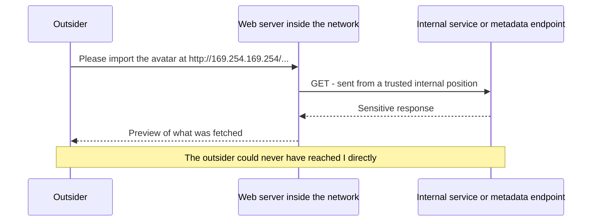

# Server-side request forgery (SSRF)

> **Before this lesson:** you should be able to read the parts of a URL from [HTTP, origins and the same-origin policy](#/lesson/web-security/http-same-origin) and understand why string checks on URLs fail from [Clickjacking and open redirects](#/lesson/web-security/clickjacking-redirects).

## In plain words

An office has a receptionist who is trusted by everyone inside. Staff can ask the receptionist to fetch things from locked rooms, and the security guard waves the receptionist through every door. A visitor at the front desk cannot enter those rooms. But suppose the visitor may ask the receptionist for favours: "Could you pop into the room marked *Payroll* and read me what is on the desk?" If the receptionist does whatever a visitor asks, the locked doors are pointless.

Your web server is that receptionist. It sits inside your network, where databases, admin panels and cloud control services will talk to it without asking for a password, because "only our own machines can reach us". Many features make the server fetch a web address on a user's behalf: previewing a link, importing an image from a URL, calling a webhook, converting a web page to PDF. If the user can choose *any* address, they can point your server at those internal services and read the answers.

This is **server-side request forgery**, **SSRF**: an outsider makes *your server* send a request it should not send. It earned its own entry in the OWASP Top 10 because cloud platforms made it especially damaging. Understanding it shows an interviewer that you think about what your server can reach, not only what reaches your server.

## How the weakness arises

### The simplest example

A profile page lets users set an avatar by pasting an image address:

```python
# VULNERABLE: the server fetches whatever address it is given
import httpx

@app.post("/avatar/import")
def import_avatar(url: str, user=Depends(current_user)):
    response = httpx.get(url)                 # the request leaves from INSIDE our network
    save_avatar(user.id, response.content)
    return {"preview": response.text[:200]}
```

`httpx.get(url)` makes an HTTP request, like a browser would — except that it is made by the server. For `https://pictures.example/cat.png` everything is fine. The trouble comes from addresses that mean something different when used from the server's position.

### Addresses that are special from the inside

Every machine on the internet has an **IP address**, a number written like `203.0.113.7`. Some ranges of numbers are reserved and never travel across the public internet:

| Range | Name | What lives there |
|---|---|---|
| `127.0.0.0/8` (e.g. `127.0.0.1`), `::1` | **Loopback** — "this machine itself" | Admin consoles, debug ports, local databases that assume only local programs can call them |
| `10.0.0.0/8`, `172.16.0.0/12`, `192.168.0.0/16` | **Private networks** | Internal services: databases, caches, dashboards |
| `169.254.0.0/16` | **Link-local** | On cloud platforms, the **instance metadata service** |

The notation `10.0.0.0/8` is called CIDR: it means "all addresses whose first 8 bits match `10.`", that is, everything from `10.0.0.0` to `10.255.255.255`.

The last row needs explaining. A virtual machine in a public cloud can ask a special address, `169.254.169.254`, for information about itself — including, on many setups, **temporary credentials** for the cloud account's services. The service has no password because it is reachable only from the machine itself. An SSRF flaw makes the vulnerable application read it and hand the credentials to a stranger. Several very large breaches followed this exact path.



Even when the response is *not* shown back (a "blind" SSRF), the attacker can learn which internal hosts and ports exist from error messages and timing, or trigger actions on internal services that accept simple requests.

### Where SSRF hides

Any feature in which the server contacts an address influenced by input:

- link previews, "import from URL", remote avatar or document fetchers;
- **webhooks** — you call a URL the customer configured;
- PDF or screenshot generators that load user-supplied HTML (which can reference internal URLs);
- XML parsers resolving external entities (see [XML external entities and insecure deserialisation](#/lesson/web-security/xxe-deserialisation));
- media processors that follow URLs inside playlists or image formats;
- integrations where the user enters a "server address" (email, calendar, single sign-on).

## Why the obvious checks fail

The first instinct is a block-list on the text of the URL: refuse anything containing `localhost` or `127.0.0.1`. It fails in at least five ways, each worth understanding because each shapes the real fix.

1. **Many spellings of one address.** `127.0.0.1` can also be written as a single decimal number, in hexadecimal, as the IPv6 loopback `::1`, or as an IPv4 address wrapped inside IPv6 (`::ffff:127.0.0.1`). A text filter would need to know them all.
2. **Names that resolve inward.** Anyone can register a domain and point it at `127.0.0.1` or `10.0.0.5`. The URL text contains nothing suspicious. The translation from name to address is done by **DNS**, the Domain Name System — the internet's phone book.
3. **Redirects.** The URL points to an innocent external server, which answers `302 Found` with `Location: http://169.254.169.254/…`. An HTTP client that follows redirects automatically goes there.
4. **Check now, use later.** The application resolves the name, sees a public address and approves; then the HTTP library resolves the name *again* to connect, and this time the attacker's DNS server answers with an internal address. This is **DNS rebinding**, an instance of a *time-of-check to time-of-use* gap.
5. **Other schemes.** `file:///etc/passwd` reads a local file; `gopher://` and similar old schemes can send hand-crafted bytes to internal services.

The conclusion: judge the **actual destination address at the moment of connecting**, not the text.

## The fix, in layers

### Layer 1: prefer an allow-list of destinations

If the feature only ever needs a few known partners — a payment provider, an image host — do not accept arbitrary URLs. Let the user choose from identifiers, or accept only exact allow-listed hosts.

```python
PARTNER_HOSTS = {"images.partner.example", "cdn.shop.example"}

def allowed_partner(url: str) -> bool:
    parts = urlsplit(url)
    return parts.scheme == "https" and parts.hostname in PARTNER_HOSTS
```

This is the strongest defence because it does not depend on recognising what is dangerous.

### Layer 2: when any public address must be allowed, validate what you connect to

For webhooks and link previews, arbitrary external hosts are the point. Then:

1. Parse the URL; allow only `http` and `https`; no user name or password; standard ports only.
2. Resolve the host name to its addresses **once**.
3. Reject if **any** address is loopback, private, link-local or otherwise non-public — after unwrapping IPv4 addresses embedded in IPv6.
4. Connect to **the address you validated**, not to the name again (this defeats rebinding).
5. Do not follow redirects automatically; if you must, repeat steps 1–4 for each hop, with a small limit.

The function below implements steps 1 and 3 using Python's `ipaddress` module, which understands addresses numerically. The resolved addresses are passed in, as a real implementation would obtain them from one DNS lookup.

```python-run
import ipaddress
from urllib.parse import urlsplit

BLOCKED = [ipaddress.ip_network(n) for n in (
    "0.0.0.0/8", "10.0.0.0/8", "100.64.0.0/10", "127.0.0.0/8", "169.254.0.0/16",
    "172.16.0.0/12", "192.168.0.0/16", "224.0.0.0/4", "240.0.0.0/4",
    "::/128", "::1/128", "fc00::/7", "fe80::/10", "ff00::/8")]

def is_public(address_text: str) -> bool:
    try:
        ip = ipaddress.ip_address(address_text)        # numeric parsing, not string matching
    except ValueError:
        return False                                   # not an IP address at all
    if ip.version == 6 and ip.ipv4_mapped is not None:
        ip = ip.ipv4_mapped                            # ::ffff:10.0.0.5 -> 10.0.0.5
    return not any(ip.version == net.version and ip in net for net in BLOCKED)

def is_safe_destination(url: str, resolved_addresses: list) -> bool:
    try:
        parts = urlsplit(url)
        host, port = parts.hostname, parts.port
    except ValueError:
        return False
    if parts.scheme not in ("http", "https") or not host:
        return False
    if parts.username is not None or port not in (None, 80, 443):
        return False
    return bool(resolved_addresses) and all(is_public(a) for a in resolved_addresses)

checks = [
    ("https://pictures.example/cat.png", ["93.184.216.34"]),
    ("http://169.254.169.254/latest/meta-data/", ["169.254.169.254"]),
    ("https://looks-harmless.example/", ["10.0.0.5"]),              # public name, private address
    ("https://two-answers.example/", ["93.184.216.34", "127.0.0.1"]),
    ("https://v6.example/", ["::ffff:192.168.1.10"]),
    ("file:///etc/passwd", ["93.184.216.34"]),
    ("https://pictures.example:6379/", ["93.184.216.34"]),
]
for url, addresses in checks:
    print(f"{str(is_safe_destination(url, addresses)):5}  {url}  {addresses}")
```

What to notice in the code:

- `ipaddress.ip_network("10.0.0.0/8")` builds an object representing a whole range; `ip in net` asks whether an address falls inside it. No string comparison is involved, so alternative spellings do not matter.
- `ip.ipv4_mapped` extracts an IPv4 address hidden inside an IPv6 one.
- `all(...)` requires **every** resolved address to be public. A name may have several addresses and the client could pick any.
- The third test is the important one: nothing about the URL looks internal, yet its address is. Only resolving reveals it.

And the fixed endpoint in outline:

```python
# FIXED (outline): validate, pin the connection, no redirects, strict limits
@app.post("/avatar/import")
def import_avatar(url: str, user=Depends(current_user)):
    addresses = resolve_once(urlsplit(url).hostname)             # one DNS lookup
    if not is_safe_destination(url, addresses):
        raise HTTPException(400, "That address cannot be used")
    response = fetch_pinned(url, connect_to=addresses[0],        # connect to the checked address
                            follow_redirects=False, timeout=5, max_bytes=2_000_000)
    if not response.headers.get("content-type", "").startswith("image/"):
        raise HTTPException(400, "Not an image")
    save_avatar(user.id, response.content)
    return {"ok": True}                                           # no raw response echoed back
```

`resolve_once` and `fetch_pinned` stand for small helpers (or a hardened library) that perform one lookup and then connect to that exact address while still sending the original host name for TLS. Note also what was removed: the response is no longer echoed to the caller.

### Layer 3: the network should not trust the web server either

Application checks can have bugs, so add controls outside the code:

- **Egress filtering**: firewall rules stating which destinations the web tier may contact at all. If the application servers cannot route to the database admin port or the metadata address, a successful SSRF finds nothing.
- **A dedicated fetch service** in an isolated network segment with access only to the public internet, through which all user-driven fetches go.
- **Hardened metadata service.** Cloud providers offer a session-based version (on AWS, *IMDSv2*) that requires a special `PUT` request and header first, which a simple forged GET cannot produce. Require it, and give each machine's role the minimum permissions.
- **Authentication on internal services.** "It is only reachable internally" should never be a service's sole protection. This principle is called **zero trust**.

> [!WARNING]
> Do not return raw fetched content or detailed fetch errors to the user. "Connection refused", "timed out" and "200 OK" for different internal addresses let an outsider map your network one request at a time.

> [!TIP]
> Limits matter as much as destinations: a short timeout, a maximum response size, a maximum number of redirects (ideally zero), and a check of the response's content type. They also protect you from a remote server that sends an endless response.

> [!INTERVIEW]
> "What is SSRF and how do you defend against it?" The server is induced to make requests to a destination chosen by the attacker, reaching internal services or cloud metadata that trust the server's network position. Defences in order: avoid fetching arbitrary URLs or use an allow-list of hosts; otherwise allow only http/https, resolve the name, reject private, loopback and link-local addresses, connect to the validated address, and do not follow redirects blindly; add egress firewalling, protected metadata endpoints and authentication on internal services. Mention DNS rebinding to show you know why "check the URL string" is not enough.

## Defence in depth

1. **Design**: avoid server-side fetching of user-supplied URLs where a client-side fetch or an upload would do.
2. **Allow-list** hosts whenever the set of destinations is known.
3. **Validate the resolved address**, pin the connection, restrict schemes and ports.
4. **No automatic redirects**; re-validate each hop.
5. **Limits**: timeouts, size caps, content-type checks.
6. **Do not echo** responses or errors.
7. **Network**: egress filtering, isolated fetcher, hardened metadata service, least-privilege cloud roles.
8. **Internal services authenticate** their callers.
9. **Logging and alerting** on outbound requests to internal ranges.

## How to test for it

**In code review:**

- Search for outbound request calls: `requests.`, `httpx.`, `urllib.request`, `aiohttp`, `fetch(`, `axios`, `curl`, plus PDF, image and XML libraries able to load remote resources.
- For each, trace the URL. Can a request, a stored setting or an uploaded document influence the scheme, host, port or path?
- Is there validation of the resolved address? Are redirects followed? Is there a timeout and a size limit?
- Is the raw response or error returned to the caller?

**In testing your own application**, in a test environment you control:

- Supply `http://127.0.0.1/` and `http://localhost/` and a private address to each URL-accepting feature. The correct result is a generic rejection, identical in each case.
- Supply a URL on a test server you run that responds with a redirect to a loopback address, and confirm the redirect is not followed.
- Supply a non-HTTP scheme such as `file:///`.
- Turn the runnable checks above into unit tests for your validator; add a new case whenever you learn a new trick.
- Review firewall rules: from an application server, try connecting to internal admin ports and to the metadata address. Ideally those connections fail at the network layer.

## Pitfalls

- **Block-lists on URL text.**
- **Validating the host name and then letting the library resolve it again.**
- **Following redirects** after a single validation.
- **Checking only the first of several resolved addresses**, or forgetting IPv6.
- **Allowing any port**, turning the feature into an internal port scanner.
- **Trusting a partner's domain for ever** — domains expire and are re-registered.
- **Webhook URLs validated only when saved**, not each time they are called; DNS can change in between.
- **Assuming a container or serverless function has no metadata endpoint.** Most platforms have an equivalent.
- **Leaving internal services unauthenticated** because "SSRF is fixed".

## Summary

- SSRF abuses a server-side fetch to reach destinations the attacker cannot reach directly, exploiting the trust internal systems place in the server's position.
- Loopback, private and link-local addresses — above all the cloud metadata service — are the usual targets.
- Text filters fail because of alternative address spellings, DNS, redirects, rebinding and unusual schemes.
- Prefer allow-listed destinations; otherwise validate the resolved address numerically, pin the connection, and refuse redirects.
- Back the code with network egress controls, a hardened metadata service and authenticated internal services.
- Never echo fetched content or connection errors.

## Glossary

- **SSRF** — server-side request forgery: making a server send a request to an attacker-chosen destination.
- **IP address** — the numeric address of a machine on a network.
- **CIDR notation** — writing an address range as a prefix and a bit count, such as `10.0.0.0/8`.
- **Loopback** — addresses referring to the local machine (`127.0.0.1`, `::1`).
- **Private network ranges** — addresses reserved for internal use, not routed on the public internet.
- **Link-local** — addresses valid only on the local network segment (`169.254.0.0/16`).
- **Instance metadata service** — a cloud endpoint giving a virtual machine information and credentials.
- **DNS** — the system translating host names to IP addresses.
- **DNS rebinding** — changing a name's address between validation and use.
- **Time-of-check to time-of-use (TOCTOU)** — a gap between verifying something and acting on it.
- **Egress filtering** — restricting which outbound connections a system may make.
- **Webhook** — an HTTP call your server makes to a customer-configured URL.
- **Zero trust** — authenticating every request regardless of network location.

```quiz
[
  {"q": "Why is SSRF dangerous even though the attacker only supplies a URL?",
   "options": ["URLs can contain viruses", "The request is made from the server's trusted network position, reaching services the attacker cannot reach directly", "It slows down the server", "It reveals the attacker's IP address"], "answer": 1,
   "explain": "Internal services often trust anything coming from inside the network. SSRF borrows that trust."},
  {"q": "What makes the address 169.254.169.254 a common SSRF target on cloud platforms?",
   "options": ["It is the DNS server", "It is the instance metadata service, which can return temporary credentials", "It is the public load balancer", "It hosts the database"], "answer": 1,
   "explain": "The metadata endpoint is reachable only from the instance and may expose credentials for the cloud account."},
  {"q": "A filter rejects URLs containing 'localhost' or '127.0.0.1'. Which input defeats it without containing either string?",
   "options": ["A domain name whose DNS record points to 127.0.0.1", "https://example.com", "A URL with a long path", "A URL using port 443"], "answer": 0,
   "explain": "The text looks harmless; only resolving the name reveals the internal address. Validation must examine the resolved address."},
  {"q": "What is DNS rebinding in the context of SSRF?",
   "options": ["Using two DNS servers for speed", "The name resolves to a safe address when checked and to an internal address when the connection is made", "Caching DNS answers for ever", "Encrypting DNS traffic"], "answer": 1,
   "explain": "A second lookup can give a different answer. Connecting to the exact address that was validated closes the gap."},
  {"q": "Why should an SSRF-hardened fetcher not follow redirects automatically?",
   "options": ["Redirects are slow", "A permitted external server can redirect the client to an internal address after validation", "Redirects break HTTPS", "Browsers forbid them"], "answer": 1,
   "explain": "Each hop is a new destination that needs the same checks as the first."},
  {"q": "A host name resolves to two addresses: one public, one private. What should the validator do?",
   "options": ["Accept, because one is public", "Reject, because every resolved address must be public", "Use the first one", "Retry until both are public"], "answer": 1,
   "explain": "The client may connect to any returned address. All of them must pass."},
  {"q": "Which defence still helps if the application-level URL validation has a bug?",
   "options": ["A longer timeout", "Network egress rules preventing the web tier from reaching internal admin services and the metadata address", "Returning detailed errors", "Using GET instead of POST"], "answer": 1,
   "explain": "Network controls are an independent layer: even a successful forged request has nowhere sensitive to go."},
  {"q": "What is the strongest design when a feature only needs to fetch from three known partner hosts?",
   "options": ["Block private IP ranges", "Allow-list exactly those hosts over HTTPS", "Allow any URL but limit size", "Ask users to promise not to misuse it"], "answer": 1,
   "explain": "An allow-list does not depend on recognising every dangerous destination."}
]
```

> **Source:** Hoffman, *Web Application Security* — the first edition does not give SSRF its own chapter (it touches on server-initiated requests under XXE, ch. 12, and architecture, ch. 18); this lesson extends the book using OWASP Server-Side Request Forgery Prevention Cheat Sheet — https://cheatsheetseries.owasp.org/cheatsheets/Server_Side_Request_Forgery_Prevention_Cheat_Sheet.html ; OWASP Top 10 A10 Server-Side Request Forgery — https://owasp.org/Top10/A10_2021-Server-Side_Request_Forgery_%28SSRF%29/ ; Python ipaddress documentation — https://docs.python.org/3/library/ipaddress.html
