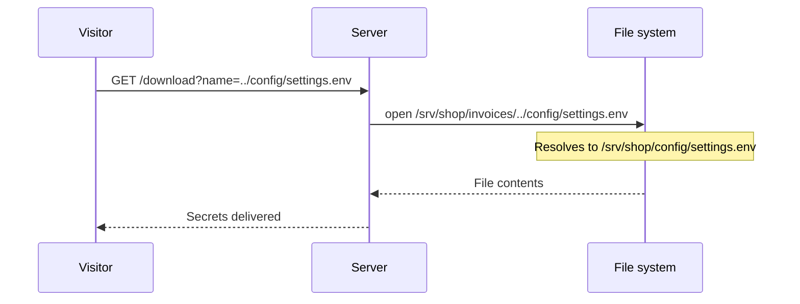

# Path traversal and file upload risks

> **Before this lesson:** read [SQL injection and parameterised queries](#/lesson/web-security/sql-injection) for allow-lists versus block-lists, and [Cross-site scripting (XSS) and output encoding](#/lesson/web-security/xss), because uploaded files can carry script. No knowledge of file systems is assumed.

## In plain words

A library has a public reading room and, behind a staff door, the archive. At the desk you fill in a slip with the title you want and the librarian fetches it from the reading-room shelves. Now someone writes on the slip: "the book that is *two doors back and one room left of* the reading room". If the librarian follows directions literally, they end up in the archive, carrying out a confidential file.

A web application is often that librarian. It keeps certain files in one folder and serves them by name. If the name comes from a visitor and may include *directions* — "go up one folder" — the visitor can walk the application out of its folder to configuration files, source code and keys. That is **path traversal**.

The reverse direction is as risky. When visitors may *give* the library books — **file uploads** — a careless librarian might shelve a booby-trapped book, put it in the wrong room, or accept ten thousand volumes until the shelves collapse.

Nearly every real application serves or accepts files: avatars, invoices, attachments, exports. These two problems are therefore common in code reviews and interviews alike, and both are solved by the same attitude: **never let the visitor's text decide where on disk something goes, or what kind of thing it is.**

## Part 1: path traversal

### Paths in two minutes

Files live in folders (directories), which live inside other folders, forming a tree. A **path** is the route to a file: `/srv/shop/invoices/1041.pdf`. Two special names exist in every folder:

- `.` means "this folder";
- `..` means "the folder above" — the **parent**.

So `/srv/shop/invoices/../config/settings.env` means: go into `invoices`, step up to `shop`, then down into `config`. The result is `/srv/shop/config/settings.env`. A path that begins with `/` is **absolute** (it starts from the top of the tree); otherwise it is **relative** to wherever you currently are.

### The simplest example

```python
# VULNERABLE: the file name from the request is joined to the folder and opened
BASE = "/srv/shop/invoices"

@app.get("/download")
def download(name: str, user=Depends(current_user)):
    return FileResponse(os.path.join(BASE, name))
```

For `name=1041.pdf` the path is `/srv/shop/invoices/1041.pdf`. For `name=../config/settings.env` it is `/srv/shop/invoices/../config/settings.env` — the application's secrets. Enough `../` segments reach the top of the disk, and from there any file the application's account can read.

There is a second trap in that one line. `os.path.join(BASE, "/etc/passwd")` returns `/etc/passwd`: when the second argument is an absolute path, `join` **discards the base entirely**. No `..` is needed at all.



### Why filtering `..` is the wrong fix

The tempting repair is to delete or refuse `../` in the input. It fails for the usual block-list reasons: the same step can be written with backslashes on Windows, in URL-encoded form that some later layer decodes, or doubled so that removing one copy leaves another. And it refuses honest names such as `report..final.pdf`.

### The right fix: resolve, then check containment

Do not inspect the input for bad shapes. Compute where the path **actually ends up** and ask one question: is that inside my folder?

```python-run
import posixpath

def safe_join(base: str, user_path: str):
    if not user_path or "\x00" in user_path or "\\" in user_path:
        return None                                   # empty, NUL byte or backslash: refuse
    if user_path.startswith("/"):
        return None                                   # absolute paths discard the base
    root = posixpath.normpath(base)
    full = posixpath.normpath(posixpath.join(root, user_path))    # collapses . and ..
    if full == root or full.startswith(root + "/"):
        return full
    return None                                       # ended up outside the base

BASE = "/srv/shop/invoices"
for name in ["1041.pdf", "2026/march/1041.pdf", "../config/settings.env", "/etc/passwd",
             "a/../../invoices-private/x.pdf", "report..final.pdf", "a/./b/../1041.pdf"]:
    print(f"{name!r:36} -> {safe_join(BASE, name)}")
```

Line by line:

- The first two `if` statements reject shapes that are never legitimate: an empty name, a NUL character (historically used to cut a name short inside lower-level libraries), a backslash, or an absolute path.
- `posixpath.join` glues base and name; `posixpath.normpath` then *normalises* the result, resolving every `.` and `..` and removing doubled slashes. (`posixpath` is the Unix-style half of `os.path`; using it makes the demo behave the same on every system.)
- The containment test accepts the path only if it equals the base or begins with the base **followed by a slash**. That trailing slash is essential: without it, `/srv/shop/invoices-private/x.pdf` would pass a plain `startswith("/srv/shop/invoices")`.

In the output the third, fourth and fifth names return `None`. The honest `report..final.pdf` is accepted, and `a/./b/../1041.pdf` is cleaned to `/srv/shop/invoices/a/1041.pdf`.

On a real disk one more thing can redirect a path: a **symbolic link**, a file that points to another location. Production code therefore resolves links as well — `os.path.realpath` or `pathlib.Path.resolve()` — before the containment check:

```python
# FIXED
from pathlib import Path
BASE = Path("/srv/shop/invoices").resolve()

@app.get("/download")
def download(name: str, user=Depends(current_user)):
    target = (BASE / name).resolve()
    if not target.is_relative_to(BASE) or not target.is_file():
        raise HTTPException(404)
    return FileResponse(target)
```

`resolve()` returns the absolute path with every `..` and symbolic link worked out; `is_relative_to(BASE)` is the containment test.

### The better fix: do not accept paths

The strongest design removes the question. Store files under names **you** generate, and let requests refer to a database identifier:

```python
# BEST: the request names a record; the server knows where the file is
@app.get("/invoices/{invoice_id}/pdf")
def invoice_pdf(invoice_id: int, user=Depends(current_user)):
    row = db.fetch("SELECT storage_key FROM invoices WHERE id = ? AND customer_id = ?",
                   (invoice_id, user.id))
    if row is None:
        raise HTTPException(404)
    return FileResponse(STORAGE_DIR / row.storage_key)     # storage_key was generated by us
```

No user text reaches the file system at all, and the query's `customer_id` condition supplies the authorisation that the first version also lacked. Remember that a traversal-proof download endpoint still needs an ownership check — otherwise it is an IDOR that happens to be tidy.

> [!WARNING]
> Archives are paths in disguise. A ZIP or TAR file lists each entry with a path, and a hostile archive can contain entries named `../../something`. Extracting it naively writes files outside the target folder — a bug known as "zip slip". Validate every entry name with the same resolve-and-contain check, or use the library's safe extraction mode (in Python, `tarfile` extraction filters).

## Part 2: file uploads

### What can go wrong

An upload has three properties, **all chosen by the sender**: the file name, the declared content type, and the bytes. Each can be abused.

| Risk | How it happens |
|---|---|
| **Code execution on the server** | A script file is stored inside a folder the web server executes from, then requested |
| **Stored XSS** | An HTML or SVG file is served from your origin and its script runs as your site |
| **Path traversal on write** | The supplied file name contains `../` and overwrites another file |
| **Denial of service** | Enormous files, vast numbers of files, or a tiny archive that expands to gigabytes (a "zip bomb") |
| **Malware distribution** | Your site hosts and serves a harmful file to other users |
| **Parser exploits** | A crafted image or document triggers a bug in the library that processes it |

### The simplest example

```python
# VULNERABLE: trusts the name, the type and the size, and stores inside the web root
@app.post("/upload")
async def upload(file: UploadFile, user=Depends(current_user)):
    with open(f"/srv/shop/static/uploads/{file.filename}", "wb") as out:
        out.write(await file.read())
    return {"url": f"/static/uploads/{file.filename}"}
```

Four mistakes in five lines. The file name goes straight into a path (traversal). Any type is accepted. `file.read()` loads the whole upload into memory with no limit. And the file lands in a folder served directly by the web server from the main origin.

### Validating an upload

Check three things against one short allow-list, and insist they agree:

1. the **extension** of the file name;
2. the **declared type** in the request (a *MIME type* such as `image/png`);
3. the **magic bytes** — the first few bytes of the content, which identify most formats. Every PNG file begins with the same eight bytes; every JPEG with `FF D8 FF`; every PDF with `%PDF-`.

```python-run
ALLOWED = {
    "png":  ("image/png",       bytes([137, 80, 78, 71, 13, 10, 26, 10])),
    "jpg":  ("image/jpeg",      bytes([255, 216, 255])),
    "jpeg": ("image/jpeg",      bytes([255, 216, 255])),
    "pdf":  ("application/pdf", b"%PDF-"),
}
MAX_BYTES = 5 * 1024 * 1024                         # five megabytes

def check_upload(filename: str, declared_type: str, content: bytes) -> str:
    if len(content) == 0:
        return "empty"
    if len(content) > MAX_BYTES:
        return "too large"
    if "/" in filename or "\\" in filename or filename.startswith("."):
        return "bad name"
    extension = filename.rsplit(".", 1)[-1].lower() if "." in filename else ""
    if extension not in ALLOWED:
        return "extension not allowed"
    expected_type, signature = ALLOWED[extension]
    if declared_type != expected_type:
        return "declared type does not match extension"
    if not content.startswith(signature):
        return "content does not match extension"
    return "ok"

png = bytes([137, 80, 78, 71, 13, 10, 26, 10]) + b"...image data..."
print(check_upload("cat.png", "image/png", png))
print(check_upload("cat.png", "image/png", b"<script>alert(1)</script>"))
print(check_upload("notes.html", "text/html", b"<h1>hi</h1>"))
print(check_upload("cat.png", "application/pdf", png))
print(check_upload("../../cat.png", "image/png", png))
```

`ALLOWED` maps each permitted extension to the type and signature that must accompany it. The function returns the first problem found. `rsplit(".", 1)[-1]` takes the text after the last dot; `.lower()` makes `PHOTO.PNG` acceptable. The second call shows a script wearing a `.png` name being caught by its content; the fourth shows a mismatch between claims.

Validation like this is necessary and **not sufficient**. A file can begin with a perfectly valid PNG header and still contain other material further in (a *polyglot*). That is why the next section matters more than the checks.

### Storing and serving safely

How you keep and deliver the file decides whether a bad upload can hurt anyone.

```python
# FIXED: generated name, size cap while reading, stored outside the web root
import secrets

@app.post("/upload")
async def upload(file: UploadFile, user=Depends(current_user)):
    content = await file.read(MAX_BYTES + 1)                 # read at most one byte over the limit
    verdict = check_upload(file.filename or "", file.content_type or "", content)
    if verdict != "ok":
        raise HTTPException(400, "File not accepted")
    extension = file.filename.rsplit(".", 1)[-1].lower()
    key = secrets.token_hex(16) + "." + extension            # OUR name, never the user's
    (PRIVATE_STORAGE / key).write_bytes(content)             # a folder the web server does not serve
    db.save_upload(owner=user.id, key=key, original_name=file.filename)
    return {"id": key}
```

The rules behind that code, and the serving side:

- **Generate the stored name.** The user's file name is kept only as text in the database, to display later (HTML-encoded).
- **Store outside the web root**, in a folder the web server will never execute from or serve directly — or in object storage such as S3.
- **Serve through a handler that checks authorisation**, or through short-lived signed URLs.
- **Serve from a separate origin** (for example `usercontent-shop.example`). Then even if an HTML or SVG file slips through, its script runs in an origin with no cookies and no access to your application.
- **Send defensive headers on download:**

```http
Content-Type: image/png
X-Content-Type-Options: nosniff
Content-Disposition: attachment; filename="cat.png"
Content-Security-Policy: default-src 'none'; sandbox
```

`nosniff` stops browsers guessing a different type from the content. `Content-Disposition: attachment` makes the browser download instead of rendering. The restrictive CSP neutralises any script if the file is rendered anyway.

- **Re-encode images.** Decoding an uploaded image and saving it afresh with an imaging library discards hidden extras and metadata. Do it in a sandboxed worker, since the decoder itself may have bugs.
- **Scan for malware** where files are shared between users.
- **Limit quantity**: per-request size, per-user storage quota, upload rate.

> [!TIP]
> SVG looks like an image format and is really a document format that can contain script. Unless you sanitise it with a dedicated library or convert it to PNG on the server, leave SVG off the allow-list for user uploads.

> [!INTERVIEW]
> "How would you design a secure file upload?" Walk the pipeline: authenticate and rate-limit; cap the size while streaming; allow-list extension, declared type and magic bytes, all agreeing; generate the storage name; store outside the web root or in object storage; serve via an authorising handler from a separate origin with `nosniff` and `Content-Disposition`; re-encode images and scan for malware; log the upload. State that validation alone is insufficient — safe storage and serving are what contain a bad file.

## Defence in depth

**Reading files:** indirect references (IDs) instead of paths; otherwise resolve and check containment; ownership check; run the application under an account that can read only what it must; keep secrets out of the served tree.

**Writing files:** allow-list validation of all three properties; generated names; isolated storage; separate serving origin with restrictive headers; re-encoding and scanning; quotas; processing in a sandbox without network access.

## How to test for it

**In code review:**

- Search for file operations: `open(`, `os.path.join`, `Path(`, `send_file`, `FileResponse`, `shutil`, `zipfile`, `tarfile`, `extractall`. Does any path component come from a request, a database field that users can set, or an archive entry?
- For each, find the resolve-and-contain check — or, better, confirm no user text is involved.
- For uploads: where is the size limited? Which name is used on disk? Where is the folder, and does the web server serve or execute from it? Which headers accompany downloads?

**In testing your own application:**

- On every parameter that names a file, try `../` sequences and an absolute path in a test environment, and expect a uniform 404.
- Upload a file larger than the limit; expect rejection before the server runs out of memory.
- Upload a text file renamed to `.png`; expect rejection.
- Upload an allowed image, then request it and inspect the response headers for `nosniff` and the correct `Content-Type`.
- Upload a file named `../../x.png` and confirm the stored name is generated.
- Make the `safe_join` and `check_upload` cases above into unit tests.

## Pitfalls

- **`startswith(base)` without the separator**, admitting sibling folders.
- **Validating before decoding.** If the framework URL-decodes again after your check, encoded dots and slashes reappear. Validate the final value.
- **Trusting `Content-Type`** — it is typed by the client.
- **Checking only the extension**, or only the last of several (`shell.php.png` on a misconfigured server).
- **Block-listing "dangerous" extensions.** There are always more; allow-list the few you need.
- **Keeping the original file name on disk**, risking traversal, overwriting and odd characters.
- **Displaying the original name unencoded** — a file name can carry an XSS payload.
- **Unbounded reads** of uploads into memory.
- **Extracting archives** without checking entry paths and total uncompressed size.
- **Assuming cloud storage is private.** A public bucket is a public folder.

## Summary

- Path traversal occurs when user-supplied text becomes part of a file path and can step outside the intended folder with `..` or an absolute path.
- Do not filter the input; resolve the final path (including symbolic links) and verify it lies inside the base folder — or avoid paths by using generated names and IDs.
- A download endpoint also needs an ownership check.
- Uploads are untrusted in name, declared type and content; validate all three against an allow-list and enforce size limits.
- Validation is not enough: generate storage names, store outside the web root, serve from a separate origin with `nosniff` and attachment headers, re-encode and scan.
- Archives contain paths and can expand enormously; treat extraction as traversal plus denial of service.

## Glossary

- **Path** — the route to a file through a tree of folders. **Absolute / relative** — starting from the top / from the current folder.
- **Parent directory (`..`)** — the folder one level up.
- **Path traversal (directory traversal)** — escaping an intended folder by manipulating a path.
- **Normalisation** — resolving `.`, `..` and duplicate separators into a canonical path.
- **Symbolic link** — a file that points to another path.
- **Containment check** — verifying a resolved path lies within a base folder.
- **Web root** — the folder a web server serves files from directly.
- **MIME type (content type)** — a label such as `image/png` describing a file's format.
- **Magic bytes (file signature)** — fixed bytes at the start of a file identifying its format.
- **Polyglot file** — a file valid as more than one format at once.
- **Zip slip** — archive extraction writing outside the target folder via `../` entry names.
- **Zip bomb** — a small archive that expands to an enormous size.
- **`X-Content-Type-Options: nosniff`** — header stopping browsers from guessing content types.
- **`Content-Disposition: attachment`** — header instructing the browser to download, not render.

```quiz
[
  {"q": "What does the path /srv/app/files/../config/key.pem resolve to?",
   "options": ["/srv/app/files/config/key.pem", "/srv/app/config/key.pem", "/config/key.pem", "/srv/app/files/key.pem"], "answer": 1,
   "explain": "The '..' steps from files up to /srv/app, then the path descends into config."},
  {"q": "What does os.path.join('/srv/files', '/etc/passwd') return?",
   "options": ["/srv/files/etc/passwd", "/etc/passwd", "An error", "/srv/files"], "answer": 1,
   "explain": "An absolute second argument discards everything before it. No '..' is needed to escape."},
  {"q": "Why is removing '../' from the input a poor defence against traversal?",
   "options": ["It is too slow", "The same step can be expressed in other encodings or nested forms, and honest names containing dots are damaged", "File systems ignore '..'", "It only works on Windows"], "answer": 1,
   "explain": "Block-lists on input shape are bypassable. Judging the resolved destination is not."},
  {"q": "A check uses full_path.startswith('/srv/files'). Which path wrongly passes?",
   "options": ["/srv/files/a.txt", "/srv/files-private/keys.txt", "/etc/passwd", "/srv/other/a.txt"], "answer": 1,
   "explain": "Without a trailing separator, a sibling folder sharing the prefix is accepted."},
  {"q": "Which design eliminates path traversal in a download feature altogether?",
   "options": ["URL-encoding the file name", "Looking the file up by a database identifier and using a server-generated storage key", "Limiting names to 20 characters", "Using POST"], "answer": 1,
   "explain": "If no user-supplied text reaches the file system, there is nothing to traverse with."},
  {"q": "An upload endpoint accepts a file because its Content-Type header says image/png. Why is that insufficient?",
   "options": ["PNG is unsafe", "The header is supplied by the client and can claim anything", "Content-Type is only for responses", "It is sufficient"], "answer": 1,
   "explain": "Name, declared type and content are all attacker-controlled; they must be checked against each other and an allow-list."},
  {"q": "Why serve user uploads from a separate origin?",
   "options": ["It is faster", "Script in an uploaded HTML or SVG file would run without access to the main application's cookies and data", "Browsers require it", "It avoids the need for HTTPS"], "answer": 1,
   "explain": "The same-origin policy then isolates any active content in uploads from the application."},
  {"q": "What does X-Content-Type-Options: nosniff do for downloaded user files?",
   "options": ["Encrypts them", "Prevents the browser from guessing a different, possibly executable, content type from the bytes", "Compresses them", "Deletes metadata"], "answer": 1,
   "explain": "Without it a browser may treat a file labelled as an image as HTML if its content looks like markup."}
]
```

> **Source:** Hoffman, *Web Application Security* — the book covers file-system exposure only in passing (ch. 12 on reading server files, ch. 19 on review anti-patterns); this lesson extends it with OWASP File Upload Cheat Sheet — https://cheatsheetseries.owasp.org/cheatsheets/File_Upload_Cheat_Sheet.html ; OWASP Path Traversal — https://owasp.org/www-community/attacks/Path_Traversal ; OWASP Input Validation Cheat Sheet — https://cheatsheetseries.owasp.org/cheatsheets/Input_Validation_Cheat_Sheet.html ; MDN, X-Content-Type-Options — https://developer.mozilla.org/en-US/docs/Web/HTTP/Headers/X-Content-Type-Options ; Python pathlib documentation — https://docs.python.org/3/library/pathlib.html
