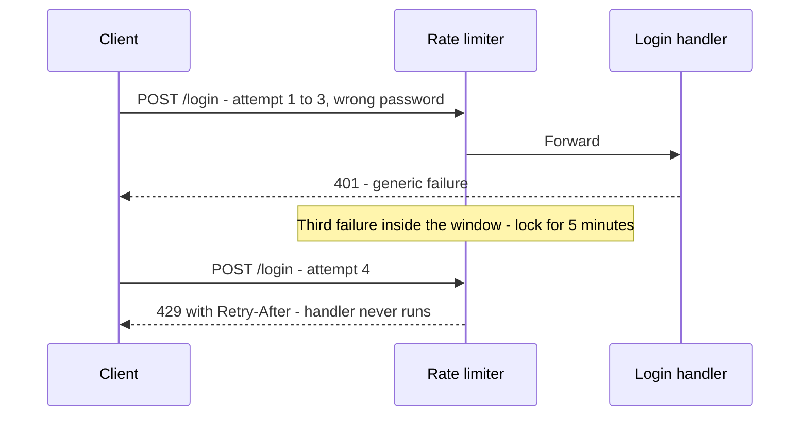

# Denial of service and rate limiting

> **Before this lesson:** read [The security mindset and a short history](#/lesson/web-security/security-mindset) for the *availability* part of the CIA triad, and [Authentication failures, password storage and MFA](#/lesson/web-security/authentication-passwords) for password guessing attacks.

## In plain words

A small café has one barista. Fifty people who each order a coffee are a busy morning. One person who orders five hundred different drinks, each with a paragraph of special instructions, and then walks out without paying, is a **denial of service**: the café is not robbed, nothing is stolen, but real customers cannot be served.

Websites can be put out of action the same way. Sometimes it takes a flood of traffic from thousands of machines. Surprisingly often it takes a *single cleverly chosen request* that makes the server do an enormous amount of work — because somewhere in the code, a small input can trigger a huge cost.

**Availability** is the third property of security, and the one developers most often leave to "the infrastructure team". Yet many outages of this kind are caused by application code: an unbounded query, an expensive regular expression, an endpoint anyone can call as fast as they like. The main tool for defending against them, **rate limiting**, is also what stops password guessing, scraping and abuse of expensive features. So this lesson covers two interview topics in one: how services are overwhelmed, and how to build a limiter.

## Three families of denial of service

| Family | Idea | Example |
|---|---|---|
| **Volumetric / distributed (DDoS)** | Sheer quantity of traffic from many sources | A network of hijacked devices sending millions of requests |
| **Logical (application-level)** | A few requests that are each very expensive | `GET /export?from=1900-01-01` generating a 4 GB report |
| **Algorithmic** | Input crafted to hit the worst case of an algorithm | A regular expression that takes years on a 40-character string |

The first is fought mainly in front of the application; the second and third are fixed *in* the application, by you.

## Algorithmic: regular-expression denial of service (ReDoS)

### How it arises

A **regular expression** (regex) is a pattern for matching text. Most engines, including Python's `re` and JavaScript's, work by **backtracking**: when a choice does not lead to a match, they go back and try the alternative. For certain patterns the number of alternatives doubles with every extra character of input. A pattern with a repeated group that itself contains repetition — `(a+)+` — is the classic case.

Run this small experiment. It measures how long one failing match takes as the input grows by two characters at a time:

```python-run
import re, time

dangerous = re.compile(r"^(a+)+$")          # a repeated group containing a repetition
safe = re.compile(r"^a+$")                  # matches exactly the same strings

for n in (10, 14, 18, 20):
    text = "a" * n + "!"                    # the trailing "!" makes the match fail
    start = time.perf_counter()
    dangerous.match(text)
    slow = time.perf_counter() - start
    start = time.perf_counter()
    safe.match(text)
    fast = time.perf_counter() - start
    print(f"n = {n:2}   dangerous: {slow:8.4f} s    safe: {fast:.6f} s")
```

`time.perf_counter()` reads a precise clock; subtracting two readings gives the elapsed time. Each additional `a` roughly doubles the time for the dangerous pattern, while the safe one stays near zero. At 20 characters the difference is already striking; at 40 the dangerous pattern would run for longer than you would care to wait. An input field validated with such a pattern lets anyone freeze a server thread with one short request. This is **regular-expression denial of service**, **ReDoS**.

In Node.js the effect is worse, because one thread serves every request: a single stuck regex stalls the whole process.

### Vulnerable and fixed

```python
# VULNERABLE: nested repetition, applied to input of unlimited length
SLUG = re.compile(r"^([a-z0-9]+-?)+$")

def valid_slug(text):
    return bool(SLUG.match(text))
```

```python
# FIXED: length checked first, and a pattern with no ambiguity
SLUG = re.compile(r"[a-z0-9]+(?:-[a-z0-9]+)*")

def valid_slug(text):
    return len(text) <= 80 and bool(SLUG.fullmatch(text))
```

Two changes. The length cap means no input can be large enough to matter. The rewritten pattern says "letters and digits, then any number of *hyphen followed by letters and digits*" — there is only one way to match any given string, so there is nothing to backtrack over.

Defences against ReDoS, in order of usefulness:

1. **Limit input length before matching.** Cheap and effective.
2. **Avoid nested quantifiers** (`(x+)+`, `(x*)*`, `(x|xy)+`) and overlapping alternatives.
3. **Use a linear-time engine** such as RE2 (available for most languages), which cannot backtrack, when patterns are complex.
4. **Never run user-supplied patterns** with a backtracking engine.
5. **Set timeouts** where the engine or platform supports them.
6. Run a linter that detects risky patterns as part of the build.

## Logical: expensive requests

Here nothing is clever; the endpoint will plainly do as much work as it is asked to.

```python
# VULNERABLE: the caller decides how much work the server does
@app.get("/api/orders")
def list_orders(limit: int = 20, user=Depends(current_user)):
    return db.fetch_all("SELECT * FROM orders WHERE customer_id = ? LIMIT ?", (user.id, limit))
```

A request with `limit=100000000` asks the database, the JSON encoder and the network to move every row. The same shape appears as: no pagination at all; searches with leading wildcards across huge tables; report or export generation done inside the request; image resizing to arbitrary dimensions; deeply nested GraphQL queries; uploads without size limits; password hashing on unauthenticated endpoints with no throttle; archive extraction.

```python
# FIXED: every dimension of cost has an upper bound
@app.get("/api/orders")
def list_orders(limit: int = Query(20, ge=1, le=100), cursor: str | None = None,
                user=Depends(current_user)):
    return db.fetch_page(user.id, limit=limit, cursor=cursor)
```

`Query(20, ge=1, le=100)` declares a default of 20, a minimum of 1 and a maximum of 100; FastAPI rejects anything outside with a validation error before your code runs. The general rule: **find every parameter that scales the work and put a ceiling on it.**

| Dimension | Bound |
|---|---|
| Rows returned | Page size maximum; cursor-based pagination |
| Request body | Maximum size at the web server and in the application |
| Time | Timeouts on database queries, outbound calls and the request overall |
| Nesting | Maximum depth for JSON, XML and GraphQL |
| Concurrency | Limit simultaneous expensive jobs per user |
| Heavy work | Move to a background queue; return "accepted" and notify when done |

> [!TIP]
> Ask of every endpoint: "What is the most expensive request a single anonymous caller can make, and how many can they make per second?" If the answer is "unbounded" for either half, you have found a denial-of-service bug before anyone else has.

## Volumetric: distributed denial of service

A **distributed denial of service (DDoS)** attack sends traffic from many machines at once — often a **botnet**, a collection of compromised computers and devices under one controller. No single source sends much, so blocking individual addresses does not help, and the sheer volume can exceed what your servers or network links can carry.

This cannot be solved inside one application process. The defences are architectural:

- A **content delivery network** or DDoS-protection service in front of the site, which has enormous capacity and filters traffic before it reaches you.
- **Caching** of anything cacheable, so repeated requests never reach application code.
- **Autoscaling** with sensible upper limits (unbounded autoscaling converts an attack into a bill).
- **Load shedding**: when overloaded, quickly refuse some requests with `503 Service Unavailable` so the rest succeed, instead of letting everything slow to a halt.
- Keeping the **origin servers' addresses private**, so traffic cannot bypass the protective layer.

Your part as an application developer is to make each request as cheap as possible to reject, and to make sure the cheap, cacheable paths really are.

## Rate limiting

**Rate limiting** restricts how many requests a client may make in a period. It is the common defence for application-level denial of service, password guessing, scraping, and abuse of costly features such as sending email or SMS.

Three questions define a limiter:

1. **What is counted?** — the *key*: an IP address, a user account, an API key, or a combination.
2. **How many are allowed, over what period?**
3. **What happens when the limit is exceeded?** — normally a `429 Too Many Requests` response with a `Retry-After` header saying how many seconds to wait.

### Algorithms, simplest first

**Fixed window.** Count requests per calendar minute; reset at the start of each minute. Simple, but a client can send a full allowance at 11:59:59 and another at 12:00:00 — double the intended rate across the boundary.

**Sliding window.** Keep the timestamps of recent requests and count those within the last 60 seconds, measured from *now*. Accurate; costs memory per client.

**Token bucket.** Picture a bucket that holds up to *capacity* tokens. Tokens drip in at a steady *refill rate*. Each request removes one token; if the bucket is empty, the request is refused. This allows short bursts (up to the capacity) while enforcing the average rate, and needs only two numbers per client. It is the most widely used algorithm.

```python-run
class TokenBucket:
    def __init__(self, capacity, refill_per_second):
        self.capacity = capacity
        self.refill = refill_per_second
        self.tokens = capacity          # start full
        self.updated = 0.0              # time of the last calculation

    def allow(self, now):
        elapsed = now - self.updated
        self.tokens = min(self.capacity, self.tokens + elapsed * self.refill)   # add what dripped in
        self.updated = now
        if self.tokens >= 1:
            self.tokens -= 1            # spend one token on this request
            return True
        return False                    # empty: respond 429

bucket = TokenBucket(capacity=5, refill_per_second=1)
times = [0, 0.1, 0.2, 0.3, 0.4, 0.5, 0.6, 2.0, 2.1, 2.2, 2.3, 10.0]
for t in times:
    print(f"t = {t:5.1f}s  ->  {'allowed' if bucket.allow(t) else '429 Too Many Requests'}")
```

`allow` first works out how many tokens have accumulated since the last call (`elapsed * refill`), never exceeding the capacity. Then it either spends a token or refuses. In the output the first five rapid requests pass (the burst), the sixth and seventh are refused, and by `t = 2.0` two tokens have dripped back in, so the next two requests pass before the bucket is empty again. Time is passed in as an argument, which makes the class easy to test.

### Protecting login: counting failures

Login needs a limiter keyed by **account**, counting **failures**, because the attacker's goal is to try many passwords for one user. The simplest sound design: within a sliding window, after a number of failures, refuse all attempts for a cooling-off period — including correct ones, since otherwise the lock would only delay the guesser between tries.

```python-run
class LoginLimiter:
    def __init__(self, max_failures, window, lockout):
        self.max_failures, self.window, self.lockout = max_failures, window, lockout
        self.failures = {}          # account -> list of recent failure times
        self.locked_until = {}      # account -> time the lock ends

    def attempt(self, username, now, success):
        user = username.strip().lower()                    # "Ann " and "ann" are one account
        if now < self.locked_until.get(user, 0):
            return "locked"                                # not even evaluated
        if success:
            self.failures.pop(user, None)                  # a good login clears the slate
            return "ok"
        recent = [t for t in self.failures.get(user, []) if t > now - self.window]
        recent.append(now)
        if len(recent) >= self.max_failures:
            self.locked_until[user] = now + self.lockout
            recent = []
        self.failures[user] = recent
        return "fail"

limiter = LoginLimiter(max_failures=3, window=60, lockout=300)
events = [("ann", 0, False), ("Ann", 10, False), ("ann ", 20, False),
          ("ann", 30, True), ("ann", 200, True), ("ann", 320, True)]
for name, t, good in events:
    print(f"t={t:3}  {name!r:7} password {'right' if good else 'wrong'}  ->  {limiter.attempt(name, t, good)}")
```

Follow the output: three wrong passwords — typed with different capitalisation and a stray space, which the first line of `attempt` normalises — trigger the lock at `t = 20`. The correct password at `t = 30` and `t = 200` is answered `locked`. At `t = 320` the lock has ended and login succeeds.



### Design decisions that matter

**Choose the key carefully.**

- *Per account* stops brute force on one user, but lets an attacker lock a victim out on purpose.
- *Per IP address* slows one source, but many users can share an address (offices, mobile networks), and attackers rotate addresses.
- Use **both**, plus a **global** alert on failed-login volume, to catch password spraying across many accounts from many addresses.

**Prefer slowing to locking.** Increasing delays (1 s, 2 s, 4 s…) or a CAPTCHA after a few failures frustrate automation with less risk of locking out the real owner than a hard lock.

**Find the real client address.** Behind a load balancer every request seems to come from the balancer. The original address arrives in a header such as `X-Forwarded-For` — which a client can also forge. Trust that header **only** as set by your own proxy, and take the entry your proxy added, not the first one in the list.

**Share the state.** With several application servers, counters kept in each process's memory let a client have N times the limit. Keep them in a shared store such as Redis, using atomic operations.

**Limit at more than one layer.** A coarse limit at the gateway or CDN protects everything cheaply; fine-grained limits in the application protect specific expensive actions.

**Fail deliberately.** If the limiter's store is down, decide in advance: for login and other security-critical limits, refuse (fail closed); for ordinary browsing, allow (fail open) so that an outage of the limiter is not an outage of the site.

> [!WARNING]
> A lockout that depends only on the user name is itself a denial-of-service tool: an attacker who knows a victim's email can keep their account permanently locked. Combine per-account limits with per-source limits, keep lockouts short, and offer the owner a way back in (an emailed unlock link, a second factor).

> [!INTERVIEW]
> "Design a rate limiter" is a classic. Structure the answer: clarify the key (user, IP, API key) and the limit; choose an algorithm — token bucket for burst-tolerant APIs, sliding window for strict limits — and explain the fixed-window boundary problem; store counters in Redis with atomic increments and expiry; respond `429` with `Retry-After`; apply at gateway and application; discuss failure mode, trusted client-IP extraction, and separate stricter limits for login, password reset and other sensitive endpoints.

## Defence in depth

1. **Bound every cost**: sizes, counts, depths, durations.
2. **Validate cheaply first**; do expensive work (hashing, database, external calls) only after authentication and limits.
3. **Rate-limit** per user, per address and globally; stricter for login, registration, password reset, messaging.
4. **Safe regular expressions** with length caps.
5. **Queues and background workers** for heavy jobs, with per-user concurrency limits.
6. **Caching and a CDN** in front; origin addresses hidden.
7. **Timeouts and circuit breakers** so one slow dependency does not consume every worker.
8. **Monitoring and alerting** on latency, error rates, queue length and `429` counts, with a rehearsed response plan.

## How to test for it

**In code review:**

- For each endpoint list the parameters that scale work (`limit`, `page_size`, date ranges, dimensions, lists of IDs). Is each bounded?
- Search for regular expressions applied to request data; look for nested quantifiers and missing length checks.
- Find outbound calls and database queries without timeouts.
- Check login, registration, reset and "send code" endpoints for limiters, and how the client address is obtained.
- Look for expensive operations reachable without authentication.

**In testing your own application**, against a test environment:

- Request extreme values: `limit=1000000`, a ten-megabyte JSON body, deeply nested JSON. Expect fast, polite rejections.
- Call the login endpoint in a tight loop and confirm `429` responses with `Retry-After` appear after the configured number of failures.
- Feed your validation patterns long near-matching strings in a unit test with a time assertion.
- Run a modest load test (with a tool such as k6 or Locust) to find the endpoint that degrades first; that is your weakest point.

## Pitfalls

- **Limits kept in process memory** on a multi-server deployment.
- **Fixed windows with generous limits**, doubled at the boundary.
- **Trusting `X-Forwarded-For` from the client.**
- **Limiting only by IP address**, defeated by address rotation and unfair to shared networks.
- **No limit on the second step** of two-factor login or on password-reset code entry.
- **Returning different errors when limited**, revealing which accounts exist.
- **Unbounded autoscaling** as the only defence.
- **Doing expensive work before rejecting**: verifying a slow password hash for every request, including those over the limit.
- **Forgetting internal callers and retries** — your own services retrying aggressively can produce a self-inflicted outage.

## Summary

- Denial of service attacks availability; it can come from volume, from individually expensive requests, or from inputs that trigger algorithmic worst cases.
- ReDoS exploits backtracking regular expressions; cap input length and avoid nested repetition.
- Logical denial of service is prevented by bounding every dimension of cost and moving heavy work off the request path.
- Volumetric attacks are absorbed in front of the application by CDNs, caching and load shedding.
- Rate limiting needs a key, a limit and a response (`429` with `Retry-After`); token bucket and sliding window are the standard algorithms.
- Protect login with per-account and per-source limits, prefer delays to hard locks, keep counters in a shared store, and extract the client address only from trusted proxies.

## Glossary

- **Denial of service (DoS)** — making a service unavailable to legitimate users.
- **DDoS** — distributed denial of service, from many sources at once. **Botnet** — a network of compromised machines used for it.
- **Logical DoS** — exhausting resources with a small number of expensive requests.
- **Regular expression (regex)** — a pattern for matching text.
- **Backtracking** — a regex engine retrying alternative ways to match.
- **ReDoS** — denial of service through catastrophic regex backtracking.
- **Rate limiting** — restricting requests per client per period.
- **Fixed window / sliding window / token bucket** — rate-limiting algorithms.
- **`429 Too Many Requests`** — status code for an exceeded limit. **`Retry-After`** — header stating when to try again.
- **Lockout** — temporary refusal of all attempts on an account.
- **Load shedding** — deliberately rejecting some requests under overload to keep the service responsive.
- **Circuit breaker** — a mechanism that stops calling a failing dependency for a while.
- **Pagination** — returning results in bounded pages.

```quiz
[
  {"q": "Why can the pattern ^(a+)+$ take exponential time on the input 'aaaa…a!'?",
   "options": ["The input is too long for Python", "The engine backtracks through an exponentially growing number of ways to split the a's between the inner and outer repetition", "The dollar sign is slow", "It uses too much memory"], "answer": 1,
   "explain": "Nested quantifiers create many equivalent ways to match; when the overall match fails, the engine tries them all."},
  {"q": "What is the cheapest effective defence against ReDoS in input validation?",
   "options": ["Run the regex twice", "Limit the length of the input before matching", "Use upper-case patterns", "Catch the exception"], "answer": 1,
   "explain": "Exponential behaviour only hurts with enough characters. A small length cap removes the problem regardless of the pattern."},
  {"q": "An endpoint accepts ?limit= with no maximum. What kind of weakness is this?",
   "options": ["Volumetric DDoS", "Logical denial of service: one request can demand unbounded work", "XSS", "CSRF"], "answer": 1,
   "explain": "The caller controls the cost. Every such parameter needs an upper bound."},
  {"q": "What is the weakness of a fixed-window rate limiter?",
   "options": ["It needs too much memory", "A client can send a full allowance immediately before and immediately after a window boundary, doubling the rate briefly", "It cannot return 429", "It only works with cookies"], "answer": 1,
   "explain": "Counts reset at the boundary. Sliding windows and token buckets avoid the effect."},
  {"q": "In a token bucket with capacity 5 and a refill of 1 token per second, what happens to 7 requests arriving in the same instant after a long idle period?",
   "options": ["All 7 are allowed", "5 are allowed and 2 are refused", "1 is allowed", "None are allowed"], "answer": 1,
   "explain": "The bucket is full with 5 tokens, permitting a burst of 5. No time passes to refill, so the remaining two are refused."},
  {"q": "Why should a locked account refuse even the correct password during the lockout?",
   "options": ["To punish the user", "Otherwise the attacker could keep guessing through the lock and succeed on a correct guess", "Because hashes expire", "It should not"], "answer": 1,
   "explain": "If correct attempts were evaluated, the lock would only be a message, not a barrier."},
  {"q": "Rate-limit counters are stored in each application server's memory, and there are ten servers. What is the effect?",
   "options": ["Limits are ten times stricter", "A client may get up to ten times the intended limit", "Nothing changes", "Limits never reset"], "answer": 1,
   "explain": "Each server counts independently. A shared store with atomic operations is needed."},
  {"q": "Why is it unsafe to key a limiter on the first value of X-Forwarded-For as sent by the client?",
   "options": ["The header is encrypted", "Clients can set that header themselves and rotate fake addresses to evade the limit", "It only contains IPv6", "It is always empty"], "answer": 1,
   "explain": "Only the value appended by your own trusted proxy is reliable."}
]
```

> **Source:** Hoffman, *Web Application Security*, ch. 14 (denial of service: regex DoS, logical DoS, distributed DoS) and ch. 26 (defending against DoS), in original wording with original examples. OWASP Denial of Service Cheat Sheet — https://cheatsheetseries.owasp.org/cheatsheets/Denial_of_Service_Cheat_Sheet.html ; OWASP Regular expression Denial of Service — https://owasp.org/www-community/attacks/Regular_expression_Denial_of_Service_-_ReDoS ; OWASP Authentication Cheat Sheet (login throttling) — https://cheatsheetseries.owasp.org/cheatsheets/Authentication_Cheat_Sheet.html ; MDN, 429 Too Many Requests — https://developer.mozilla.org/en-US/docs/Web/HTTP/Status/429
