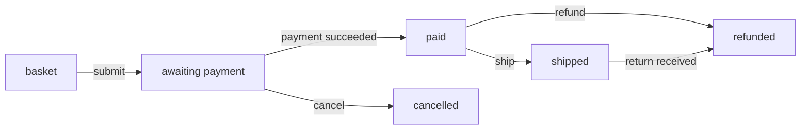
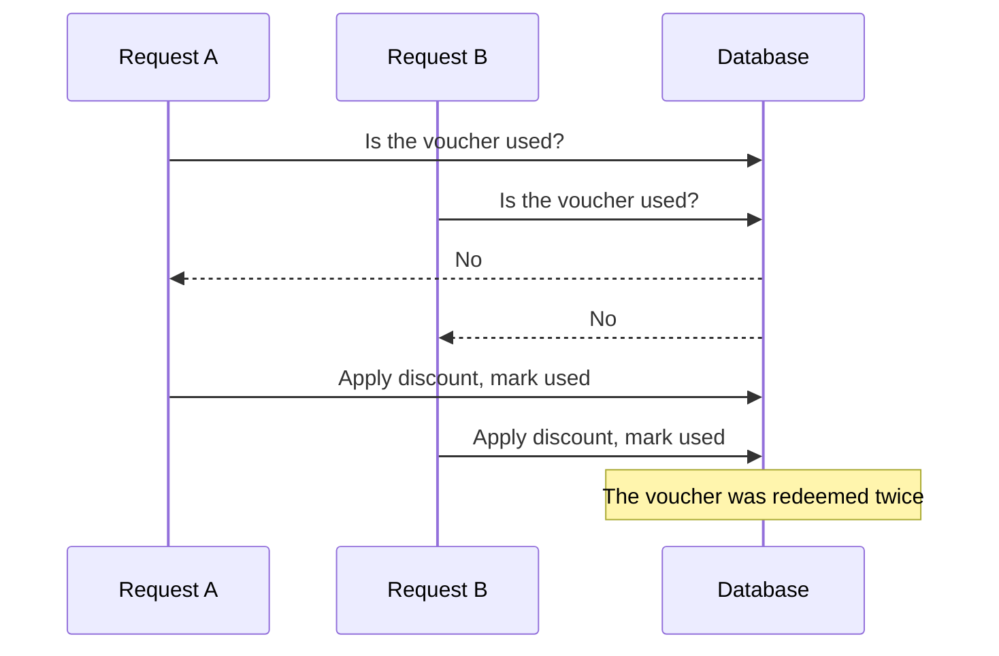

# Business-logic flaws

> **Before this lesson:** read [The security mindset and a short history](#/lesson/web-security/security-mindset) — its checkout example is the seed of this lesson — and [Broken access control and IDOR](#/lesson/web-security/broken-access-control).

## In plain words

A supermarket runs an offer: "Buy one, get one free." The till is programmed correctly; the scanner works; the card machine is secure. A shopper takes two items to the till, gets one free, then walks to the service desk and returns the *paid* item for a refund, keeping the free one. No lock was picked and no machine malfunctioned. The shopper used the shop's own rules in an order nobody had thought about.

A **business-logic flaw** is that kind of mistake in software: the program does exactly what the code says, the code is free of injection and encoding bugs, and yet the *rules* it implements can be combined, reordered, repeated or fed unexpected values to produce a result the business never intended — free goods, negative prices, skipped approvals, the same voucher used a thousand times.

These flaws matter for two reasons. They often lead directly to lost money. And no scanner can find them, because a scanner does not know that a refund should never exceed the payment. Only someone who understands what the feature is *for* can see them — which is why "how could this feature be abused?" is such a common interview question for developers.

## Why they are different from other vulnerabilities

| | Injection, XSS and similar | Business-logic flaws |
|---|---|---|
| What is wrong | Data is treated as code | The rules themselves are incomplete |
| Looks like | Strange characters in input | Perfectly ordinary requests |
| Generic fix | Yes (parameterise, encode) | No — depends on the feature |
| Found by scanners | Often | Almost never |
| Found by | Tools, pattern review | Thinking about intent; tests of rules |

OWASP calls the underlying category *Insecure Design*: a missing or ineffective control that no amount of careful typing would have supplied, because nobody decided it was needed.

The common root is an **unstated assumption**. Developers picture the *happy path* — the sequence of steps a well-behaved user follows — and write code for it. "The quantity will be positive." "Nobody will call step 3 before step 2." "A voucher is applied once." Each assumption that is not enforced by the server is a possible flaw. The rest of this lesson is a tour of the usual assumptions, from the simplest to the subtlest.

## Pattern 1: trusting values the client should not control

The simplest case, met in lesson one: the browser sends something the server should have computed itself.

```python
# VULNERABLE: price and discount come from the request
@app.post("/checkout")
def checkout(body: CheckoutBody, user=Depends(current_user)):
    total = sum(line.price * line.qty for line in body.lines) - body.discount
    charge(user, total)
```

The page's JavaScript fills in `price` and `discount` honestly. A request sent by hand need not.

```python
# FIXED: the client says WHAT it wants; the server decides what that COSTS
@app.post("/checkout")
def checkout(body: CheckoutBody, user=Depends(current_user)):
    total = 0
    for line in body.lines:
        product = catalogue.get(line.sku)                 # our own price list
        if product is None or not 1 <= line.qty <= 20:
            raise HTTPException(400, "Invalid basket")
        total += product.price_cents * line.qty
    total -= discount_for(user, body.voucher_code, total) # server-side rule, see below
    charge(user, max(total, 0))
```

Rule of thumb: the client may supply **identifiers and choices** (which product, how many, which voucher code). The server derives every **consequence** (price, discount, tax, eligibility, ownership).

## Pattern 2: values outside the range you imagined

Even a field the client legitimately controls can hold a value you did not picture.

```python-run
PRICES = {"mug": 1200, "poster": 800}          # prices in cents, as integers

def total_naive(lines):
    return sum(PRICES[sku] * qty for sku, qty in lines)

def total_checked(lines):
    total = 0
    for sku, qty in lines:
        if sku not in PRICES:
            raise ValueError("unknown product")
        if not isinstance(qty, int) or isinstance(qty, bool) or not 1 <= qty <= 20:
            raise ValueError("quantity must be a whole number from 1 to 20")
        total += PRICES[sku] * qty
    return total

basket = [("mug", 1), ("poster", -1), ("poster", -1)]     # negative quantities
print("naive total  :", total_naive(basket), "cents")      # the shop would PAY the customer
try:
    print("checked total:", total_checked(basket))
except ValueError as error:
    print("checked      : rejected -", error)
```

`total_naive` multiplies whatever it is given: one mug at 1200 cents plus two "minus one" posters at −800 each gives −400. A negative total may be processed as a refund. `total_checked` states the allowed range explicitly and refuses. The `isinstance(qty, bool)` test is there because Python treats `True` as the integer 1.

Values worth trying against every numeric input in your own tests: zero, negative numbers, fractions, enormous numbers, and — for text — the empty string and very long strings. For money specifically:

- **Use integers of the smallest unit (cents) or a decimal type, never floating point.** Floating-point arithmetic cannot represent most decimal fractions exactly, and rounding differences can be harvested at scale.
- **Round once, in one documented place.**
- **Check totals at the end**: a total must not be negative; a refund must not exceed what was paid.

```python-run
from decimal import Decimal

print(0.1 + 0.2)                        # floating point: not exactly 0.3
print(0.1 + 0.2 == 0.3)
print(Decimal("0.10") + Decimal("0.20") == Decimal("0.30"))
print(10 + 20 == 30, "(integer cents)")
```

The first line prints a number that is very slightly more than 0.3, and the comparison is `False`. `Decimal`, built from text, and integer cents both behave as accountants expect.

## Pattern 3: skipping or reordering steps

Multi-step processes — basket → address → payment → confirmation — are designed as a line. HTTP does not enforce the line: each step is an endpoint that can be called alone.

```python
# VULNERABLE: the final step assumes the earlier steps happened
@app.post("/orders/{order_id}/confirm")
def confirm(order_id: int, user=Depends(current_user)):
    order = load_own_order(order_id, user)
    order.status = "confirmed"            # ...whether or not it was ever paid
    ship(order)
```

Calling `confirm` directly, without visiting the payment step, ships an unpaid order. The fix is to model the process as a **state machine**: a fixed set of states and an explicit table of which moves between them are allowed. Every action first checks the current state stored on the server.



```python-run
ALLOWED = {
    ("basket", "submit"):            "awaiting_payment",
    ("awaiting_payment", "pay"):     "paid",
    ("awaiting_payment", "cancel"):  "cancelled",
    ("paid", "ship"):                "shipped",
    ("paid", "refund"):              "refunded",
    ("shipped", "return"):           "refunded",
}

def apply(state, action):
    new_state = ALLOWED.get((state, action))
    if new_state is None:
        raise ValueError(f"cannot {action!r} an order that is {state!r}")
    return new_state

state = "basket"
for action in ["submit", "ship"]:                 # trying to ship before paying
    try:
        state = apply(state, action)
        print(action, "->", state)
    except ValueError as error:
        print(action, "-> refused:", error)

state = apply(apply(apply("basket", "submit"), "pay"), "refund")
try:
    apply(state, "refund")                        # a second refund
except ValueError as error:
    print("second refund -> refused:", error)
```

`ALLOWED` is a dictionary whose keys are `(current state, action)` pairs. `apply` looks the pair up; anything not in the table is refused. Shipping an order that is only `awaiting_payment` fails, and so does refunding one that is already `refunded`. Everything not explicitly allowed is denied — the allow-list idea applied to behaviour.

In the real handler the "pay" transition is triggered not by the browser saying "I paid" but by a **verified notification from the payment provider** (a signed webhook), and the amount paid is compared with the amount due.

## Pattern 4: doing the same thing twice — and race conditions

"A voucher can be used once." "A balance cannot go below zero." These rules are usually written as *check, then act*:

```python
# VULNERABLE: check and update are separate steps
def redeem(voucher_code, user):
    voucher = db.fetch("SELECT used FROM vouchers WHERE code = ?", (voucher_code,))
    if voucher.used:
        raise HTTPException(400, "Already used")
    apply_discount(user)                                             # takes a moment
    db.execute("UPDATE vouchers SET used = 1 WHERE code = ?", (voucher_code,))
```

One request at a time, this is correct. But servers handle requests **concurrently** — many at once. If twenty copies of the request arrive in the same instant, all twenty may run the `SELECT` before any has run the `UPDATE`. All twenty see `used = 0` and all twenty apply the discount. This is a **race condition**; the specific shape is called *time-of-check to time-of-use*. The same flaw empties gift cards, overdraws balances, oversells the last concert ticket and beats "one free trial per account".



The fix is to make checking and changing **one indivisible operation** — an **atomic** operation — so that the database itself guarantees only one request can win:

```python-run
import sqlite3

db = sqlite3.connect(":memory:")
db.execute("CREATE TABLE vouchers (code TEXT PRIMARY KEY, used INTEGER NOT NULL DEFAULT 0)")
db.execute("INSERT INTO vouchers (code) VALUES ('WELCOME10')")

def redeem_atomic(code):
    # One statement: it only changes the row if it is still unused.
    cursor = db.execute("UPDATE vouchers SET used = 1 WHERE code = ? AND used = 0", (code,))
    db.commit()
    return cursor.rowcount == 1           # 1 row changed -> we won; 0 -> someone else already did

print("first attempt :", redeem_atomic("WELCOME10"))
print("second attempt:", redeem_atomic("WELCOME10"))
print("unknown code  :", redeem_atomic("NOPE"))
```

The `UPDATE` carries its own condition, `AND used = 0`. `cursor.rowcount` reports how many rows were changed. The database processes each statement as a unit, so even when requests arrive together exactly one of them changes the row and sees `1`; the rest see `0` and are refused. No separate check exists to race against.

Other tools for the same job:

- **Unique constraints**: a table `redemptions(voucher_code, user_id)` with a uniqueness rule makes a second insert fail.
- **Conditional arithmetic**: `UPDATE accounts SET balance = balance - ? WHERE id = ? AND balance >= ?`.
- **Row locking inside a transaction** (`SELECT … FOR UPDATE`) when several rows must change together.
- **Idempotency keys**: the client sends a unique key with each "create payment" request; the server stores it and treats a repeat with the same key as the *same* operation, not a new one. This also makes honest retries after a network failure safe.

> [!WARNING]
> Checks in application code ("if not already used…") do not prevent races, however quickly the lines follow one another. Only the data store can make check-and-update atomic. If a rule says "at most once" or "never below zero", look for the constraint or conditional update in the database that enforces it.

## Pattern 5: features combined in ways nobody planned

Each feature is reasonable alone; the flaw is in the combination.

- A referral bonus paid when a friend signs up, plus free account creation, equals unlimited bonuses from invented friends.
- A discount code that can be stacked with itself, or with a loyalty discount, until the price is zero.
- "Free shipping over 50" satisfied by adding an item, checking out, then cancelling that one item.
- An "invite a colleague" email whose text the sender can edit, turned into a spam cannon that sends from your domain.
- Loyalty points awarded on purchase and not removed on refund.
- A plan downgrade that keeps the features of the higher plan until the next billing run that never comes.

There is no general rule, only a general habit: for each feature ask **"what does the user gain, what does it cost them, and can they get the gain without the cost — or get it many times?"**

A useful technique is to write **abuse cases** alongside the usual user stories. A user story says, "As a customer, I want to apply a voucher so that I pay less." The matching abuse cases say, "As a dishonest customer, I want to apply the voucher twice / apply someone else's single-use voucher / apply it after the price changed / apply it to an already discounted item." Each abuse case becomes a test that must fail safely.

## Pattern 6: limits and quotas that are not enforced

Rules such as "three free exports a month", "five team members on this plan" or "one vote per user" must be counted on the server and enforced atomically (pattern 4). Related: actions that cost *you* money per use — sending SMS, calling a paid API, generating a document with a large language model — need per-user limits and budget alarms, or one enthusiastic script produces a very large bill. That is a business-logic flaw whose victim is your own finance department.

> [!TIP]
> State the **invariants** of a feature — facts that must always remain true — and enforce them in the data layer. "A refund never exceeds the captured payment." "Stock never goes below zero." "An order has exactly one owner." "The sum of ledger entries for a transfer is zero." Invariants written as database constraints hold no matter which code path, old endpoint or background job touches the data.

> [!INTERVIEW]
> "How would someone abuse this feature?" is often asked about a gift-card or voucher system. Go through the patterns aloud: Who controls the amount — is it derived on the server? Can values be negative or fractional? Can steps be skipped — is there a state machine? Can it be used twice — is redemption atomic, with a unique constraint or conditional update? Can it be combined with refunds or other discounts? Are there rate limits and audit logs? Naming *race condition* and *idempotency key* signals real experience.

## Defence in depth

1. **Derive consequences on the server**; accept only choices from the client.
2. **Validate ranges and types** for every value, including "impossible" ones.
3. **Explicit state machines** for multi-step processes; verify payments with the provider.
4. **Atomic enforcement** of once-only and never-below rules via constraints, conditional updates or locks; idempotency keys for money-moving requests.
5. **Invariants as database constraints.**
6. **Limits** on anything that costs money or can be farmed.
7. **Reconciliation and monitoring**: nightly comparison of orders with payments, alerts on unusual refund rates, voucher redemption spikes, or many accounts sharing one device or card.
8. **Audit trails** so that abuse can be traced and reversed.
9. **Design review with abuse cases** before building — the cheapest fix of all.

## How to test for it

**In design and code review:**

- Read the feature's rules and list its assumptions. For each, find the line of server code or the database constraint that enforces it.
- Mark every value that arrives from the client and ask whether the server should have computed it instead.
- For every "if not X then do Y" touching shared data, ask what happens when two requests run it together.
- Trace each multi-step flow and ask what happens if a step is called first, twice, or after completion.
- Look at how refunds, cancellations and downgrades undo what the forward path did.

**In testing your own application:**

- Send zero, negative, fractional and huge quantities and amounts.
- Call the last step of each flow first.
- Replay a successful request — and then send the same request several times in parallel (most HTTP testing tools can fire a batch at once) and count how many succeed. A once-only rule must yield exactly one success.
- Apply a voucher, change the basket, and check the discount is recalculated.
- Complete a purchase that earns something, then refund it, and check the earnings are reversed.
- Turn each abuse case into an automated test that asserts the invariant afterwards (for example: total redemptions ≤ 1).

## Pitfalls

- **Enforcing rules only in the user interface.**
- **Floating-point money.**
- **Believing the redirect from the payment page** ("status=success" in the URL) instead of a verified server-to-server notification.
- **"It can't happen twice, the button is disabled after the first click."**
- **Fixing a race with a `sleep` or an in-memory flag**, which fails as soon as there are two servers.
- **Forgetting the reverse paths**: refunds, cancellations, chargebacks, account deletion.
- **Separate code paths with different rules** — the mobile API, the admin tool, the bulk importer.
- **Promotions launched without limits or an off switch.**
- **Assuming rate limiting solves logic flaws.** It slows abuse; it does not make an incorrect rule correct.

## Summary

- Business-logic flaws are errors in the rules a feature implements, not in how input is handled; ordinary-looking requests exploit them.
- They arise from unstated assumptions about values, order, repetition and combination.
- Let clients choose; let the server compute prices, discounts, eligibility and ownership.
- Validate every value's range, use exact arithmetic for money, and model flows as explicit state machines.
- "Once only" and "never below zero" must be enforced atomically in the data store, because concurrent requests defeat check-then-act code.
- Write abuse cases and invariants, test them, and monitor for the patterns of abuse that slip through.

## Glossary

- **Business logic** — the rules that define what an application is supposed to do.
- **Business-logic flaw** — a weakness where legitimate functionality can be used to reach an unintended outcome.
- **Insecure design** — OWASP category for missing or ineffective controls at the design level.
- **Happy path** — the sequence of steps an expected, well-behaved user follows.
- **Abuse case** — a description of how a feature might be misused, written like a user story.
- **Invariant** — a condition that must always hold true.
- **State machine** — a model with defined states and permitted transitions.
- **Concurrency** — several operations in progress at the same time.
- **Race condition** — a flaw where the outcome depends on the timing of concurrent operations.
- **Time-of-check to time-of-use (TOCTOU)** — a gap between verifying a condition and acting on it.
- **Atomic operation** — one that happens entirely or not at all, with no observable intermediate state.
- **Idempotency key** — a client-supplied unique value letting the server recognise repeats of the same request.
- **Reconciliation** — comparing two records of the same events (for example orders and payments) to find discrepancies.

```quiz
[
  {"q": "What distinguishes a business-logic flaw from an injection flaw?",
   "options": ["It requires special characters in input", "The requests look normal; the application's rules themselves allow an unintended outcome", "It only affects databases", "It is always found by scanners"], "answer": 1,
   "explain": "Nothing is malformed. The weakness is a missing rule, so only knowledge of the feature's intent reveals it."},
  {"q": "A checkout endpoint receives {\"sku\": \"mug\", \"qty\": 2, \"price\": 0.01}. What is the design error?",
   "options": ["JSON should not be used", "The price is accepted from the client instead of being looked up on the server", "The quantity is too low", "The SKU is too short"], "answer": 1,
   "explain": "Clients may choose items and quantities. Prices, discounts and totals must be derived by the server."},
  {"q": "Why should money be stored as integer cents or decimals instead of floating-point numbers?",
   "options": ["Floats are slower", "Floating point cannot represent most decimal fractions exactly, causing rounding discrepancies", "Databases cannot store floats", "Integers use less memory"], "answer": 1,
   "explain": "0.1 + 0.2 is not exactly 0.3 in binary floating point. Exact types avoid errors that can be exploited or fail audits."},
  {"q": "An order can be confirmed by calling the final endpoint without visiting the payment step. What is the appropriate fix?",
   "options": ["Hide the final URL", "Store the order's state on the server and allow only defined transitions, with payment verified by the provider", "Add a CAPTCHA", "Use a longer order ID"], "answer": 1,
   "explain": "A state machine makes every action check the current state, so steps cannot be skipped or repeated."},
  {"q": "Twenty simultaneous requests redeem the same single-use voucher and all succeed. What is this called?",
   "options": ["SQL injection", "A race condition (time-of-check to time-of-use)", "Session fixation", "Clickjacking"], "answer": 1,
   "explain": "Each request checked before any had updated. Check and update must be one atomic operation."},
  {"q": "Which statement redeems a voucher atomically?",
   "options": ["SELECT used, then UPDATE in a second statement", "UPDATE vouchers SET used = 1 WHERE code = ? AND used = 0, then check that one row changed", "Set a flag in a Python variable", "Sleep 100 ms before updating"], "answer": 1,
   "explain": "The conditional update lets the database guarantee a single winner; the row count tells each request whether it won."},
  {"q": "What is an idempotency key used for?",
   "options": ["Encrypting requests", "Letting the server recognise a repeated request as the same operation so it is not performed twice", "Signing cookies", "Compressing responses"], "answer": 1,
   "explain": "Retries and duplicates carrying the same key return the original result instead of creating a second payment or order."},
  {"q": "Which practice is most likely to uncover logic flaws before code is written?",
   "options": ["Running a vulnerability scanner", "Writing abuse cases and invariants during design review", "Minifying JavaScript", "Enabling HTTPS"], "answer": 1,
   "explain": "Scanners do not know the business rules. Deliberately asking how each feature could be misused does."}
]
```

> **Source:** Hoffman, *Web Application Security*, ch. 18 (analysing feature requirements) and ch. 19 (archetypical vulnerabilities versus custom logic bugs), extended in original wording with original examples. OWASP Top 10 A04 Insecure Design — https://owasp.org/Top10/A04_2021-Insecure_Design/ ; OWASP Web Security Testing Guide, Business Logic Testing — https://owasp.org/www-project-web-security-testing-guide/latest/4-Web_Application_Security_Testing/10-Business_Logic_Testing/ ; OWASP Abuse Case Cheat Sheet — https://cheatsheetseries.owasp.org/cheatsheets/Abuse_Case_Cheat_Sheet.html ; OWASP Transaction Authorization Cheat Sheet — https://cheatsheetseries.owasp.org/cheatsheets/Transaction_Authorization_Cheat_Sheet.html
