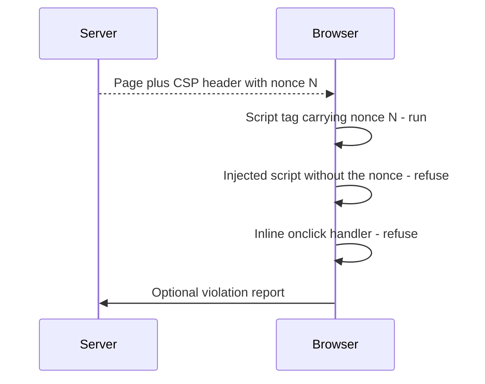
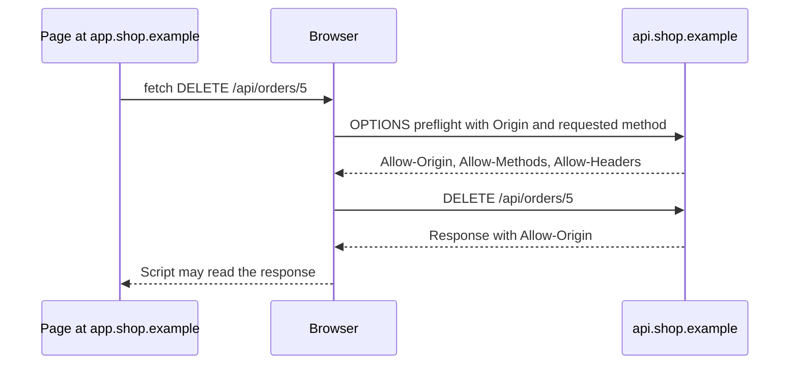

# Security headers, CSP and CORS

> **Before this lesson:** you need origins and the same-origin policy from [HTTP, origins and the same-origin policy](#/lesson/web-security/http-same-origin), XSS from [Cross-site scripting (XSS) and output encoding](#/lesson/web-security/xss), and framing from [Clickjacking and open redirects](#/lesson/web-security/clickjacking-redirects).

## In plain words

When you rent out a flat, you hand the tenant a sheet of house rules: "No smoking. No pets. Visitors only from this list. Keep the front door locked." The rules do not rebuild the flat, but a tenant who follows them prevents a great many accidents.

A web server can hand the browser a similar sheet with every page. The rules travel as **response headers** — the `Name: value` lines that precede the page — and the browser enforces them on your behalf: "Only run scripts from these places." "Never show this page inside someone else's frame." "Always use HTTPS for this site." "This other website may read my responses; nobody else may."

These **security headers** are among the best-value defences available. Each is one line of configuration; together they blunt whole categories of attack even when your code has a bug. Two of them need real understanding. **Content Security Policy (CSP)** is the house rule about scripts, and the main safety net under XSS. **CORS** is different in kind: it *relaxes* a browser protection, and misconfiguring it is a common way to create a vulnerability while trying to fix an error message. Both are frequent interview topics.

## Part 1: the one-line headers

Start with the headers that need little thought. Each is shown with what it prevents.

| Header and typical value | What it tells the browser | Prevents |
|---|---|---|
| `Strict-Transport-Security: max-age=31536000; includeSubDomains` | For the next year, use only HTTPS for this site and its subdomains | Downgrade to plain HTTP; cookie theft on hostile networks |
| `X-Content-Type-Options: nosniff` | Believe the declared `Content-Type`; do not guess from the content | A text or image upload being run as script or HTML |
| `X-Frame-Options: DENY` (or CSP `frame-ancestors`) | Do not display this page inside a frame | Clickjacking |
| `Referrer-Policy: strict-origin-when-cross-origin` | When following links to other sites, send only the origin, not the full URL | Leaking paths, IDs and tokens in the `Referer` header |
| `Permissions-Policy: camera=(), microphone=(), geolocation=()` | Disable these browser features for the page and anything it embeds | A compromised script or embedded frame using the camera or location |
| `Cross-Origin-Opener-Policy: same-origin` | Windows opened to or from other origins get no handle on this one | Certain cross-window attacks |
| `Cache-Control: no-store` (on personalised responses) | Do not keep a copy | Private pages reappearing from caches |

And the headers to **remove**, because they only help an attacker choose a technique: `Server` with a version number, `X-Powered-By`, `X-AspNet-Version`.

One older header should not be used: `X-XSS-Protection`. It controlled a filter that browsers have since removed, and in some modes it introduced problems of its own.

```python
# VULNERABLE: the framework's defaults - none of the above is sent
app = FastAPI()
```

```python
# FIXED: one middleware attaches the baseline to every response
BASELINE = {
    "Strict-Transport-Security": "max-age=31536000; includeSubDomains",
    "X-Content-Type-Options": "nosniff",
    "X-Frame-Options": "DENY",
    "Referrer-Policy": "strict-origin-when-cross-origin",
    "Permissions-Policy": "camera=(), microphone=(), geolocation=()",
    "Cross-Origin-Opener-Policy": "same-origin",
}

@app.middleware("http")
async def security_headers(request, call_next):
    response = await call_next(request)
    for name, value in BASELINE.items():
        response.headers.setdefault(name, value)      # do not overwrite a deliberate per-route value
    return response
```

The middleware runs for every request. After the normal handler has produced a response, it adds each header that is not already present (`setdefault`). Doing this in one place — or at the reverse proxy or CDN in front of the application — means error pages, static files and forgotten routes are covered too.

An audit of a response is a short piece of code, and a good way to fix the checklist in memory:

```python-run
import re

def audit(headers: dict) -> list:
    h = {name.lower(): str(value).strip() for name, value in headers.items()}   # names ignore case
    findings = []
    hsts = re.search(r"max-age\s*=\s*(\d+)", h.get("strict-transport-security", "").lower())
    if not hsts or int(hsts.group(1)) < 31536000:
        findings.append("HSTS missing or shorter than a year")
    if h.get("x-content-type-options", "").lower() != "nosniff":
        findings.append("nosniff missing")
    csp = h.get("content-security-policy", "")
    if not csp:
        findings.append("no Content-Security-Policy")
    if h.get("x-frame-options", "").upper() not in ("DENY", "SAMEORIGIN") and "frame-ancestors" not in csp.lower():
        findings.append("page can be framed")
    if h.get("referrer-policy", "").lower() in ("", "unsafe-url"):
        findings.append("referrer policy missing or unsafe")
    if any(ch.isdigit() for ch in h.get("server", "")):
        findings.append("Server header reveals a version")
    if "x-powered-by" in h:
        findings.append("X-Powered-By present")
    return findings

before = {"Server": "nginx/1.25.3", "X-Powered-By": "Express", "Strict-Transport-Security": "max-age=300"}
after = {"Strict-Transport-Security": "max-age=63072000; includeSubDomains", "X-Content-Type-Options": "nosniff",
         "Content-Security-Policy": "default-src 'self'; frame-ancestors 'none'",
         "Referrer-Policy": "strict-origin-when-cross-origin", "Server": "web"}
print("before:", *audit(before), sep="\n  - ")
print("after :", audit(after) or "no findings")
```

The first line of `audit` rebuilds the dictionary with lower-case names, because HTTP header names are case-insensitive. Each check then looks at the *value*, not only at whether the header exists: an HSTS lifetime of 300 seconds is present and nearly useless. The `before` response produces seven findings; the `after` response none.

## Part 2: Content Security Policy

### What it is

**Content Security Policy** is a response header listing, by type of resource, where the page is allowed to load things from. If something on the page violates the list — including a script that an attacker managed to inject — the browser refuses to load or run it.

Recall the cause of XSS: the browser cannot tell your scripts from an attacker's. CSP gives it a way to tell.

### The syntax, built up in steps

A policy is a list of **directives** separated by semicolons. Each directive has a name and a list of permitted **sources**.

**Step 1 — the simplest useful policy:**

```http
Content-Security-Policy: default-src 'self'
```

`default-src` is the fallback for all resource types. `'self'` (with the quotes) means "this page's own origin". So: scripts, styles, images, fonts and connections may come only from my own origin. This already has a powerful side effect: **inline scripts are blocked** — both `<script>…</script>` blocks written in the HTML and handlers such as `onclick="…"`. Injected markup containing script therefore does not run.

**Step 2 — more specific directives override the fallback:**

```http
Content-Security-Policy: default-src 'self'; img-src 'self' https://images.cdn.example; object-src 'none'
```

| Directive | Controls |
|---|---|
| `script-src` | JavaScript |
| `style-src` | Stylesheets |
| `img-src`, `font-src`, `media-src` | Images, fonts, audio and video |
| `connect-src` | Where script may send requests (`fetch`, WebSocket) |
| `frame-src` | What this page may embed in frames |
| `object-src` | Legacy plugins — set to `'none'` |
| `base-uri` | Which URLs a `<base>` tag may use — set to `'self'` or `'none'` |
| `form-action` | Where forms may submit |
| `frame-ancestors` | Who may embed *this page* (the clickjacking control) |

`base-uri`, `form-action` and `frame-ancestors` do **not** fall back to `default-src`; they must be written explicitly.

**Step 3 — the values that undo the protection.** Two keywords appear in many real policies because they make things "work":

- `'unsafe-inline'` in `script-src` permits inline scripts again — and with them, injected ones. A policy with this is close to worthless against XSS.
- `'unsafe-eval'` permits turning strings into code with `eval`.

Wildcards have a similar effect: `script-src *` or `script-src https:` allows a script from any site at all, including one the attacker controls.

**Step 4 — allowing your own inline scripts safely: nonces.** Real pages often need a little inline script. Instead of `'unsafe-inline'`, the server generates a fresh random value for each response — a **nonce**, short for "number used once" — and puts it both in the header and on each legitimate script tag:

```http
Content-Security-Policy: script-src 'nonce-R4nd0mV4lu3' 'strict-dynamic'; object-src 'none'; base-uri 'none'
```

```html
<script nonce="R4nd0mV4lu3">startApp();</script>     <!-- runs: nonce matches -->
<script>stealThings();</script>                       <!-- blocked: injected, no nonce -->
```

An attacker who injects markup cannot know the nonce for this particular response, so their script is refused. `'strict-dynamic'` adds: "scripts that my trusted scripts load are trusted too", which avoids long lists of hosts. This nonce-based form is known as a **strict CSP** and is what current guidance recommends. (A **hash** — `'sha256-…'` of the script's exact text — is the alternative for static pages.)

```python-run
import secrets

def build_csp(nonce: str) -> str:
    directives = {
        "default-src": ["'self'"],
        "script-src": [f"'nonce-{nonce}'", "'strict-dynamic'"],
        "style-src": ["'self'"],
        "img-src": ["'self'", "https://images.cdn.example"],
        "object-src": ["'none'"],
        "base-uri": ["'none'"],
        "form-action": ["'self'"],
        "frame-ancestors": ["'none'"],
    }
    return "; ".join(name + " " + " ".join(sources) for name, sources in directives.items())

for request_number in (1, 2):
    nonce = secrets.token_urlsafe(16)              # new for EVERY response
    print(f"response {request_number}:")
    print("  header:", build_csp(nonce))
    print(f'  page  : <script nonce="{nonce}">startApp()</script>')
```

`secrets.token_urlsafe(16)` produces a fresh unguessable value per response. `build_csp` joins each directive name to its sources, and the directives to each other with semicolons. Notice the two responses carry different nonces — a nonce that is reused or predictable protects nothing.



### Vulnerable and fixed policies

```http
# WEAK: looks like a policy, stops almost nothing
Content-Security-Policy: default-src *; script-src 'self' 'unsafe-inline' 'unsafe-eval' https:
```

```http
# STRONG: strict, nonce-based
Content-Security-Policy: default-src 'self'; script-src 'nonce-{random}' 'strict-dynamic'; object-src 'none'; base-uri 'none'; frame-ancestors 'none'; form-action 'self'
```

### Rolling it out without breaking the site

A strict policy on an existing site will block things you forgot about. The safe path:

1. Move inline scripts and `onclick` handlers into files, or add nonces to them.
2. Deploy the policy in **report-only** mode: the header `Content-Security-Policy-Report-Only` makes the browser *report* violations (to an address you name with a reporting directive) without blocking anything.
3. Read the reports, fix the page or adjust the policy.
4. Switch to the enforcing header and keep reporting on.

> [!WARNING]
> CSP is the net under the trapeze, not the trapeze. It does not fix the injection; it reduces what an injection can do. Output encoding remains the primary XSS defence, and a policy containing `'unsafe-inline'` for scripts gives a false sense of safety.

## Part 3: CORS

### What problem it solves

The same-origin policy stops script on one origin from **reading** responses from another. That is exactly what you want when the other origin is a bank and the script is hostile. It is a nuisance when both are yours: a front end at `https://app.shop.example` calling an API at `https://api.shop.example` — different hosts, so different origins.

**Cross-Origin Resource Sharing (CORS)** is how a server grants a specific exception. The server adds headers to its response saying which other origins may read it. Hold on to this: **CORS loosens a protection. It is never a security feature you add; it is a permission you grant, and the risk is granting too much.**

### How it works, step by step

**Simple case.** The browser sends the request with an `Origin` header naming the page's origin. The server answers; the browser hands the response to the script **only if** the response carries a matching permission:

```http
GET /api/products HTTP/1.1
Host: api.shop.example
Origin: https://app.shop.example
```

```http
HTTP/1.1 200 OK
Access-Control-Allow-Origin: https://app.shop.example
Vary: Origin
```

**Preflight.** For requests that could change state in ways a plain HTML form could not — methods such as `PUT` or `DELETE`, a JSON content type, custom headers — the browser first sends a **preflight**: an `OPTIONS` request asking whether the real request is allowed. Only if the server agrees does the browser send the real one.



**Credentials.** By default cross-origin requests from script do not include cookies. If the page asks for them and the server wants to permit it, the response must include `Access-Control-Allow-Credentials: true` **and** must name one exact origin — browsers reject the wildcard `*` together with credentials.

| Response header | Meaning |
|---|---|
| `Access-Control-Allow-Origin` | Which origin may read: one exact origin, or `*` for anyone (without credentials) |
| `Access-Control-Allow-Credentials: true` | Cookies may be sent and the authenticated response read |
| `Access-Control-Allow-Methods` / `-Headers` | Answers to a preflight |
| `Access-Control-Max-Age` | How long the browser may remember a preflight answer |
| `Vary: Origin` | Tells caches the response differs per origin |

### The classic mistake

A developer sees "blocked by CORS policy" in the console. `*` does not work because the API uses cookies. So they make the server copy whatever `Origin` arrives into the response:

```python
# VULNERABLE: every website on the internet is granted access, with the user's cookies
@app.middleware("http")
async def cors(request, call_next):
    response = await call_next(request)
    response.headers["Access-Control-Allow-Origin"] = request.headers.get("origin", "*")
    response.headers["Access-Control-Allow-Credentials"] = "true"
    return response
```

The error disappears — and so does the same-origin policy for this API. Any page the user visits can now call the API with the user's cookies and **read the answers**: profile, orders, anti-CSRF tokens. This is worse than CSRF, which can only send.

Related errors: matching the origin by prefix or suffix (`startswith("https://app.shop.example")` also matches `https://app.shop.example.evil.example`), a loose regular expression, and allowing the special origin `null`, which sandboxed frames and local files send and which an attacker can produce at will.

```python
# FIXED: an exact allow-list; anything else gets no CORS headers at all
ALLOWED_ORIGINS = {"https://app.shop.example", "https://admin.shop.example"}

@app.middleware("http")
async def cors(request, call_next):
    response = await call_next(request)
    origin = request.headers.get("origin")
    if origin in ALLOWED_ORIGINS:
        response.headers["Access-Control-Allow-Origin"] = origin
        response.headers["Access-Control-Allow-Credentials"] = "true"
        response.headers["Vary"] = "Origin"
    return response
```

In practice use the framework's CORS middleware (for FastAPI, `CORSMiddleware` with `allow_origins=[...]` listing exact origins) instead of hand-written code; the logic to verify is the same. Here it is as a pure function you can run:

```python-run
def cors_headers(origin, allowed_origins, allow_credentials):
    if origin is None or origin == "null":
        return {}                                           # no Origin, or the untrustworthy "null"
    if origin in allowed_origins and origin != "*":
        headers = {"Access-Control-Allow-Origin": origin, "Vary": "Origin"}
        if allow_credentials:
            headers["Access-Control-Allow-Credentials"] = "true"
        return headers
    if "*" in allowed_origins and not allow_credentials:
        return {"Access-Control-Allow-Origin": "*"}         # public, cookie-less data only
    return {}

private_api = ({"https://app.shop.example"}, True)
public_api = ({"*"}, False)

print(cors_headers("https://app.shop.example", *private_api))
print(cors_headers("https://app.shop.example.evil.example", *private_api))
print(cors_headers("null", *private_api))
print(cors_headers("https://anyone.example", *public_api))
print(cors_headers("https://anyone.example", {"*"}, True))
```

The membership test `origin in allowed_origins` is an **exact** comparison, so the look-alike origin on the second line receives an empty dictionary — no permission. The fourth line shows the legitimate use of `*`: truly public data with no credentials. The fifth shows the dangerous combination being refused.

### What CORS does not do

- It does **not** stop requests reaching your server. Preflighted requests are held back by the browser, but simple ones are sent, and non-browser clients ignore CORS entirely. CORS is not authentication or authorisation.
- It does **not** protect against CSRF; a forged form post is not subject to it.
- A missing CORS header is the *secure* default, not a bug.

> [!TIP]
> If the front end and API can be served from the same origin — for example by routing `/api/` through the same host — you need no CORS configuration at all, and a whole class of mistakes disappears.

> [!INTERVIEW]
> "What is CORS, and what is dangerous about `Access-Control-Allow-Origin: *`?" CORS is a controlled relaxation of the same-origin policy: the server tells browsers which origins may read its responses. `*` is fine for public, unauthenticated data. The real danger is reflecting the request's `Origin` together with `Allow-Credentials: true`, which lets any site read a logged-in user's data. Correct configuration: exact-match allow-list, credentials only where required, `Vary: Origin`, never `null`. Add that CORS is enforced by browsers and is not access control.

## Defence in depth

- **Set headers centrally** (middleware, proxy or CDN) so nothing is missed.
- **CSP as a second layer** behind output encoding; strict, nonce-based, with reporting.
- **CORS by exact allow-list**; same-origin deployment where possible.
- **Hardened cookies** (earlier lessons) alongside.
- **Automated checks** in the build and in production monitoring, so a configuration change that drops a header is noticed.

## How to test for it

- `curl -I https://your-site.example` shows the response headers. Check several kinds of response: a page, an API call, a static file, a 404, a redirect.
- Free scanners such as Mozilla's HTTP Observatory grade a site's headers; Google's CSP Evaluator points out weak policies.
- In the browser console, CSP violations are listed with the directive that blocked them. Deliberately add an inline `<script>` to a test page and confirm it is refused.
- For CORS, in a test environment: `curl -H "Origin: https://not-allowed.example" -I https://api.your-site.example/me` — the response should contain **no** `Access-Control-Allow-Origin`. Repeat with `Origin: null` and with a look-alike of an allowed origin.
- In code review, search for `Access-Control-Allow-Origin`, `allow_origins`, `origin` reflected from the request, `'unsafe-inline'`, `'unsafe-eval'` and wildcard sources.
- Add an integration test asserting the baseline headers on a sample of routes.

## Pitfalls

- **Headers set in the application but stripped or duplicated by a proxy**; test what the browser really receives.
- **HSTS with `includeSubDomains`** before every subdomain supports HTTPS — they become unreachable. Start with a short `max-age` and lengthen it.
- **A CSP that grows by copy-paste** until it lists dozens of hosts, some of which serve content that can be turned against you.
- **Static or reused nonces.**
- **Two CSP headers**: the browser enforces both, and the result is the intersection — sometimes stricter than intended, sometimes confusing.
- **`Access-Control-Allow-Origin: *` on an internal API**, readable by any site a member of staff visits from inside the network.
- **Forgetting `Vary: Origin`**, so a cache serves one origin's permission to another.
- **Treating a scanner's "A+" as proof of security.** Headers are a layer; the application still needs to be right.

## Summary

- Security headers are instructions the browser enforces for you; set a baseline centrally and remove version-revealing headers.
- HSTS enforces HTTPS, `nosniff` stops type guessing, framing controls stop clickjacking, `Referrer-Policy` limits URL leakage.
- CSP restricts where scripts and other resources may come from; a strict nonce-based policy without `'unsafe-inline'` is a strong second layer against XSS, rolled out via report-only mode.
- CORS relaxes the same-origin policy for origins the server names. Use exact allow-lists, never reflect the origin with credentials, never allow `null`, and add `Vary: Origin`.
- CORS is enforced by browsers only and is neither authentication nor CSRF protection.

## Glossary

- **Security header** — a response header instructing the browser to apply a protection.
- **HSTS** — `Strict-Transport-Security`; forces HTTPS for a site.
- **MIME sniffing** — a browser guessing a file's type from its content; disabled by `nosniff`.
- **Referrer-Policy** — controls how much of the current URL is sent to other sites.
- **Permissions-Policy** — switches browser features such as camera access on or off.
- **Content Security Policy (CSP)** — a header listing permitted sources for scripts and other resources.
- **Directive** — one rule within a CSP, such as `script-src`.
- **`'self'`** — CSP keyword for the page's own origin.
- **`'unsafe-inline'` / `'unsafe-eval'`** — CSP keywords permitting inline scripts / string evaluation; they weaken the policy.
- **Nonce** — a random value generated per response, authorising specific script tags.
- **Strict CSP** — a policy based on nonces or hashes instead of host lists.
- **Report-only mode** — CSP that reports violations without blocking.
- **CORS** — Cross-Origin Resource Sharing: headers permitting cross-origin reads.
- **Preflight** — the `OPTIONS` request a browser sends before certain cross-origin requests.
- **Credentialed request** — a cross-origin request that includes cookies.

```quiz
[
  {"q": "What does 'Strict-Transport-Security: max-age=31536000' instruct the browser to do?",
   "options": ["Encrypt cookies for a year", "Use only HTTPS for this site for the next year", "Block all third-party scripts", "Cache pages for a year"], "answer": 1,
   "explain": "HSTS makes the browser upgrade every request to HTTPS itself for the stated number of seconds."},
  {"q": "With the policy \"default-src 'self'\", what happens to an injected <script>…</script> block in the page?",
   "options": ["It runs, because it is on the same origin", "It is blocked, because inline scripts are not permitted without 'unsafe-inline', a nonce or a hash", "It is rewritten", "It runs only on HTTPS"], "answer": 1,
   "explain": "'self' permits script files from the origin, not inline code. That is why even a basic CSP limits XSS."},
  {"q": "Why does adding 'unsafe-inline' to script-src largely defeat CSP as an XSS defence?",
   "options": ["It disables HTTPS", "It allows all inline scripts, including ones an attacker injects", "It blocks your own scripts", "It removes the nonce"], "answer": 1,
   "explain": "The browser can no longer distinguish legitimate inline code from injected code."},
  {"q": "What must be true of a CSP nonce?",
   "options": ["It is the same for every user", "It is a fresh unpredictable value for each response", "It is the user's session ID", "It is stored in localStorage"], "answer": 1,
   "explain": "An attacker who could predict or reuse the nonce could attach it to injected scripts."},
  {"q": "What does CORS do?",
   "options": ["Blocks malicious requests at the server", "Lets a server allow named origins to read its responses, relaxing the same-origin policy", "Encrypts cross-origin traffic", "Prevents CSRF"], "answer": 1,
   "explain": "CORS grants exceptions. It adds no protection of its own and is enforced only by browsers."},
  {"q": "An API echoes the request's Origin into Access-Control-Allow-Origin and sends Allow-Credentials: true. What is the consequence?",
   "options": ["Nothing; it is equivalent to *", "Any website can make authenticated requests with the visitor's cookies and read the responses", "Only same-site pages can call it", "Browsers reject the response"], "answer": 1,
   "explain": "Reflecting the origin with credentials removes the same-origin policy's protection for that API entirely."},
  {"q": "Why should the origin 'null' never be on a CORS allow-list?",
   "options": ["It is slow", "Sandboxed frames and local files send it, so an attacker can easily produce requests with that origin", "Browsers ignore it", "It only applies to HTTP"], "answer": 1,
   "explain": "'null' is not a unique trustworthy identity; allowing it effectively allows anyone."},
  {"q": "A team wants to introduce a strict CSP on a large existing site. What is the recommended first step after preparing the policy?",
   "options": ["Enforce it immediately in production", "Deploy it with Content-Security-Policy-Report-Only and study the violation reports", "Add 'unsafe-inline' everywhere", "Remove HSTS"], "answer": 1,
   "explain": "Report-only mode reveals what would break without breaking it, allowing fixes before enforcement."}
]
```

> **Source:** Hoffman, *Web Application Security*, ch. 22 (Content Security Policy for XSS prevention), ch. 23 (header verification) and ch. 18 (transport security), extended in original wording. OWASP HTTP Security Response Headers Cheat Sheet — https://cheatsheetseries.owasp.org/cheatsheets/HTTP_Headers_Cheat_Sheet.html ; OWASP Content Security Policy Cheat Sheet — https://cheatsheetseries.owasp.org/cheatsheets/Content_Security_Policy_Cheat_Sheet.html ; MDN, Content Security Policy — https://developer.mozilla.org/en-US/docs/Web/HTTP/CSP ; MDN, Cross-Origin Resource Sharing — https://developer.mozilla.org/en-US/docs/Web/HTTP/CORS ; MDN, Practical security implementation guides — https://developer.mozilla.org/en-US/docs/Web/Security/Practical_implementation_guides
