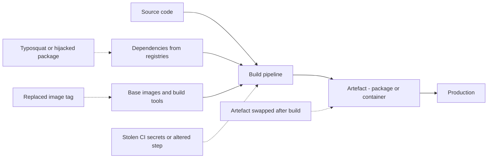

# Vulnerable dependencies and the supply chain

> **Before this lesson:** read [APIs, dependencies and architecture review](#/lesson/web-security/apis-architecture) for what direct and transitive dependencies are, and [Security misconfiguration and secrets management](#/lesson/web-security/misconfiguration-secrets).

## In plain words

A restaurant does not grow its own wheat, press its own oil or raise its own chickens. It buys ingredients from suppliers, who buy from farms, who buy feed from someone else. If one farm ships contaminated lettuce, every restaurant downstream serves it — and none of the chefs did anything wrong at the stove. The path from farm to plate is the **supply chain**, and a kitchen is only as safe as the weakest link in it.

Modern software is cooked the same way. A typical web application consists of a small amount of code its team wrote and a very large amount they downloaded: frameworks, libraries, build tools, container base images. Each of those has suppliers of its own. All of it runs with the same permissions as your own code.

Two things can go wrong. A component may contain an honest mistake that becomes publicly known — a **vulnerable dependency**. Or someone may deliberately tamper with a component or with the process that builds your software — a **supply-chain attack**. Both let attackers in through code you never read. OWASP has ranked this area highly for years, and it has moved further up in recent editions, because the incidents keep getting larger. Managing it is mostly unglamorous routine: knowing what you ship, updating it, and verifying where it came from.

## How the weakness arises

### Vulnerable and outdated components

Software has bugs; some are security bugs. When one is found in a public library it is usually given a **CVE** identifier (Common Vulnerabilities and Exposures — a public catalogue entry such as `CVE-2021-44228`) and a severity score, and a fixed version is released. From that moment the flaw is public knowledge. Anyone running the old version is exposed to an attack that is documented, often automated, and needs no cleverness.

The December 2021 flaw in the Java logging library Log4j, nicknamed *Log4Shell*, is the textbook case. A logging library is about as unexciting as dependencies get; it was present in enormous numbers of products, often several layers down in the dependency tree where its users did not know they had it. A string placed in a logged field could make servers load and run remote code. Organisations spent the following weeks answering one question: **where are we running this?** Those with an inventory answered in hours.

### The simplest example

```text
# VULNERABLE requirements.txt: no versions, no record of what was installed
flask
requests
pyyaml
```

Each install fetches "whatever is newest today". Two builds a week apart may contain different code. Nobody can say which versions are in production, so nobody can say whether an advisory applies. And a malicious release published this morning is pulled in automatically this afternoon.

```text
# FIXED: exact versions, with hashes, generated by a tool into a lock file
flask==3.0.3 \
    --hash=sha256:<64 hexadecimal characters>
requests==2.32.3 \
    --hash=sha256:<64 hexadecimal characters>
# ...every transitive dependency listed the same way
```

This is a **lock file**: the complete, exact list of every package — direct and transitive — at a specific version. The `--hash` lines add an **integrity check**: a fingerprint of the package file. If the file that arrives differs by a single byte from the one that was recorded, installation fails. (The hash values are shown as placeholders; real ones are produced by your tooling, for example `pip-compile --generate-hashes`, `poetry lock`, `uv lock`, or `npm ci` with `package-lock.json`.)

Pinning brings a duty with it: pinned versions do not update themselves. So the second half of the practice is **updating deliberately and often**.

### Knowing whether you are affected

The check that tools perform is conceptually small: compare each installed version with the affected ranges in an advisory database. Here is that core, written out:

```python-run
def parse(version: str):
    parts = [int(p) for p in version.split(".")]
    return tuple((parts + [0, 0, 0])[:3])            # "2.31" -> (2, 31, 0)

def in_range(version: str, spec: str) -> bool:
    current = parse(version)
    for comparator in spec.split(","):               # every comparator must hold
        comparator = comparator.strip()
        if comparator.startswith(">="):
            ok = current >= parse(comparator[2:])
        elif comparator.startswith("<="):
            ok = current <= parse(comparator[2:])
        elif comparator.startswith("<"):
            ok = current < parse(comparator[1:])
        elif comparator.startswith(">"):
            ok = current > parse(comparator[1:])
        else:
            ok = current == parse(comparator.lstrip("="))
        if not ok:
            return False
    return True

INSTALLED = {"requests": "2.30.0", "pyyaml": "6.0.1", "leftpadder": "1.10.0"}
ADVISORIES = [
    {"id": "ADV-101", "package": "requests",   "affected": ">=2.0.0,<2.31.1", "fixed": "2.31.1"},
    {"id": "ADV-102", "package": "pyyaml",     "affected": "<5.4",            "fixed": "5.4"},
    {"id": "ADV-103", "package": "leftpadder", "affected": "<1.9.0",          "fixed": "1.9.0"},
]
for adv in ADVISORIES:
    version = INSTALLED.get(adv["package"])
    if version and in_range(version, adv["affected"]):
        print(f"{adv['package']} {version} is affected by {adv['id']} -> upgrade to {adv['fixed']}")

print("string comparison says 1.10.0 < 1.9.0:", "1.10.0" < "1.9.0", "(wrong!)")
print("numeric comparison says            :", parse("1.10.0") < parse("1.9.0"))
```

`parse` turns a version string into a tuple of integers so that Python compares it numerically, part by part. `in_range` checks each comparator in a range such as `>=2.0.0,<2.31.1`; all must be true. Only `requests` is reported. The last two lines show the classic trap: compared as *text*, `"1.10.0"` sorts before `"1.9.0"` because the character `1` comes before `9`. A checker with that bug would call a patched package vulnerable — or a vulnerable one safe.

Real tools do this against large public databases, across the whole lock file. The practice is called **software composition analysis (SCA)**: `pip-audit`, `npm audit`, OWASP Dependency-Check, OSV-Scanner, and the scanners built into code-hosting platforms (Dependabot, Renovate), which also open pull requests proposing the fixed version.

### Supply-chain attacks

Here the component is not accidentally flawed; someone made it hostile. The main routes:

| Route | What happens |
|---|---|
| **Typosquatting** | A malicious package is published under a name one keystroke from a popular one (`reqeusts`), waiting for a slip of the fingers |
| **Dependency confusion** | A company uses a private package called `acme-utils`; an attacker publishes a public package with the same name and a higher version number, and a misconfigured installer prefers the public one |
| **Compromised maintainer** | A real, trusted package gets a malicious release after its author's account is taken over or an unknown "helper" is given publish rights |
| **Malicious install scripts** | Packages can run code at install time — on developers' laptops and build servers, where credentials live |
| **Compromised build system** | The source code is clean; the *build pipeline* inserts something extra into the released artefact (the 2020 SolarWinds incident worked this way) |
| **Tampered third-party scripts** | A script loaded into your pages from another company's server is altered there |
| **Poisoned base images and CI actions** | A container image or pipeline plugin referenced by a movable tag (`latest`, `v1`) is replaced |



Every solid arrow is something you rely on; every dotted arrow is a place where trust can be abused.

## Defences, layer by layer

### 1. Know what you ship

Keep lock files in version control. Generate a **software bill of materials (SBOM)** — a machine-readable ingredients list of every component and version in a release (common formats are CycloneDX and SPDX). When the next Log4Shell arrives, the question "are we affected, and where?" becomes a search.

### 2. Reduce what you ship

Every dependency is permanent attack surface and permanent maintenance. Before adding one, ask:

- Is it actively maintained? When was the last release? How quickly are security reports handled?
- How many dependencies does it bring with it?
- How widely is it used, and by whom?
- Could a few lines of your own code do the job?

Remove dependencies that are no longer used. Use minimal container base images; a smaller image has fewer packages to be vulnerable.

### 3. Pin and verify

- **Exact versions** in a lock file, including transitive ones.
- **Hashes** verified at install.
- **Container images by digest** (`image@sha256:…`) instead of a tag that can be moved; **pipeline actions by commit hash** instead of `@v3`.
- **Subresource Integrity** for scripts loaded from other origins.

That last point deserves an example:

```html
<!-- VULNERABLE: whatever this other server returns, today or tomorrow, runs in your page -->
<script src="https://cdn.widgets.example/widget.js"></script>
```

```html
<!-- FIXED: the browser refuses the file unless it matches the recorded hash -->
<script src="https://cdn.widgets.example/widget-4.2.1.js"
        integrity="sha384-(base64 hash of the exact file)"
        crossorigin="anonymous"></script>
```

**Subresource Integrity (SRI)** adds an `integrity` attribute holding a hash of the expected file. The browser computes the hash of what it downloads and runs the script only if the two match. If the other company's server is compromised and the file changes, your visitors' browsers reject it. Better still, host a reviewed copy yourself and restrict script sources with a Content Security Policy.

A hash check is three lines of standard-library code, and seeing it removes the mystery:

```python-run
import hashlib

def sha256_hex(data: bytes) -> str:
    return hashlib.sha256(data).hexdigest()

published = b"def add(a, b):\n    return a + b\n"
recorded_hash = sha256_hex(published)              # stored in the lock file at review time

downloaded_ok = b"def add(a, b):\n    return a + b\n"
downloaded_tampered = b"def add(a, b):\n    send_home(a, b)\n    return a + b\n"

for name, data in [("identical file", downloaded_ok), ("tampered file", downloaded_tampered)]:
    verdict = "install" if sha256_hex(data) == recorded_hash else "REFUSE - hash mismatch"
    print(f"{name:15} -> {verdict}")
```

`hashlib.sha256(data).hexdigest()` returns a 64-character fingerprint of the bytes. The same bytes always give the same fingerprint; any change gives a completely different one. The tampered download is refused.

### 4. Update continuously

- Automated update pull requests (Dependabot, Renovate) with your test suite as the safety net.
- SCA scanning in continuous integration on every change **and** on a schedule — new advisories appear for code that has not changed.
- A policy with deadlines by severity, for example: critical within days, high within two weeks.
- Stay on supported versions of languages and frameworks; an unsupported version receives no fixes at all.

A short delay before adopting brand-new releases (a "cool-down" of a few days) lets the community catch a hijacked release before you install it; security fixes are the exception that you take promptly.

### 5. Protect the pipeline

The build system holds the keys to production, which makes it a prime target.

- **Least privilege for CI credentials**; prefer short-lived tokens obtained through identity federation over stored long-lived secrets.
- **Do not expose secrets to builds of untrusted code**, such as pull requests from forks.
- **Protected branches and mandatory review** for code *and* for pipeline definitions.
- **Private registries configured correctly**: reserve your organisation's namespace on public registries and force internal package names to resolve only from the internal source — the fix for dependency confusion.
- **Sign artefacts** and verify signatures at deployment; record **provenance** (which source commit and which pipeline produced this artefact). The SLSA framework (Supply-chain Levels for Software Artifacts) describes graded levels of such assurance.
- **Isolated, ephemeral build machines** that start clean for each build.

### 6. Limit the blast radius

Assume a dependency will one day turn hostile and ask what it could reach. A service that runs as an unprivileged user, with no unnecessary credentials in its environment, and no outbound network access beyond what it needs, gives a malicious package very little to steal or contact. This is least privilege and egress filtering again, applied to your own software.

> [!WARNING]
> A scanner reporting "0 vulnerabilities" means only that no *known, catalogued* issue matches your versions. It says nothing about a malicious package published yesterday, an abandoned library with unreported flaws, or code the scanner cannot see — a file copied into the repository, a statically linked binary.

> [!TIP]
> Triage findings by whether the vulnerable code is actually *reachable* in your application and exposed to untrusted input. A critical-severity flaw in a function you never call is less urgent than a medium one sitting on your login path. Record the reasoning; do not dismiss the alert without one.

> [!INTERVIEW]
> "How do you manage third-party dependency risk?" Give a life-cycle answer: *choose* carefully (maintenance, popularity, transitive footprint); *pin* with lock files and hashes; *inventory* with an SBOM; *scan* continuously with SCA in CI and on a schedule; *update* through automated pull requests with severity-based deadlines; *verify* integrity (hashes, SRI, signatures); *protect the pipeline* (least-privilege secrets, review, pinned actions); and *contain* with least privilege at runtime. Mention typosquatting and dependency confusion by name.

## How to test for it

**In review:**

- Is there a lock file, committed, with hashes? Does the build install strictly from it (`pip install --require-hashes`, `npm ci`)?
- Do container files use `latest` or unpinned tags? Do pipeline definitions reference actions by movable tags?
- For each new dependency in a change: who maintains it, and is the name exactly right?
- Are external `<script>` tags protected by SRI and a CSP?
- Which secrets can the build pipeline read, and can pull requests from outside reach them?
- For private packages: can the installer fall back to a public registry for those names?

**In practice:**

- Run the ecosystem's audit tool locally and in CI; make the build fail above an agreed severity.
- Generate an SBOM for a release and search it for a known-vulnerable component as a drill: "if this were announced today, how long to find every affected service?"
- Scan container images for vulnerable operating-system packages.
- Check how old your oldest dependency is, and whether any runtime or framework version is past its end of support.

## Pitfalls

- **Unpinned versions**, or pinning direct dependencies only.
- **Pinning and never updating**, which converts supply-chain risk into known-vulnerability risk.
- **Ignoring transitive dependencies** — most of the tree.
- **Alert fatigue**: hundreds of unprioritised findings that everyone learns to ignore.
- **Copy-pasted library code** in the repository, invisible to scanners and never updated.
- **Installing packages on a production machine by hand** to "try something".
- **Trusting a package because it has a familiar-sounding name** or many downloads (download counts can be inflated).
- **Running install scripts with production credentials in the environment.**
- **Third-party scripts added through a tag manager**, bypassing code review entirely.
- **Forgetting development tools**: a compromised linter or test plugin runs on every developer's machine.

## Summary

- Most of an application is other people's code, running with your privileges.
- Known vulnerabilities in dependencies are public and easily exploited; the defence is inventory, scanning and timely updates.
- Supply-chain attacks tamper with packages, registries, build systems or third-party scripts; the defence is pinning, integrity verification, a protected pipeline and careful selection.
- Lock files with hashes make builds repeatable and tamper-evident; SBOMs make "are we affected?" answerable; SRI protects scripts loaded from elsewhere.
- Version comparison must be numeric, findings must be prioritised by reachability, and "zero findings" is not proof of safety.
- Least privilege at runtime limits what a compromised component can do.

## Glossary

- **Dependency** — third-party code your application needs. **Transitive dependency** — a dependency of a dependency.
- **Supply chain** — everything involved in producing and delivering software: code, libraries, tools, build and distribution systems.
- **CVE** — a public identifier for a known vulnerability.
- **Advisory** — a published notice describing a vulnerability and its affected and fixed versions.
- **Lock file** — an exact list of every package and version in a build.
- **Pinning** — fixing a dependency to an exact version.
- **Integrity hash** — a fingerprint used to verify a file has not changed.
- **Software composition analysis (SCA)** — automated checking of dependencies against vulnerability databases.
- **SBOM** — software bill of materials: an inventory of components in a release.
- **Typosquatting** — publishing a malicious package under a misspelt popular name.
- **Dependency confusion** — a public package impersonating a private one by name.
- **Subresource Integrity (SRI)** — a browser check of a script's hash before running it.
- **Provenance** — a verifiable record of how and from what an artefact was built.
- **SLSA** — a framework of levels for supply-chain assurance.
- **Artefact** — the built output that gets deployed, such as a package or container image.

```quiz
[
  {"q": "Why did the Log4j flaw of 2021 affect so many organisations that had never chosen to use Log4j?",
   "options": ["It was installed by browsers", "It was a transitive dependency buried inside many other products", "It was part of the operating system kernel", "It was an email virus"], "answer": 1,
   "explain": "Deeply nested dependencies are present without being explicitly selected. An inventory is the only way to know."},
  {"q": "What does a lock file with hashes provide?",
   "options": ["Automatic updates", "Repeatable builds of exact versions, with installation failing if a package's contents differ from what was recorded", "Faster downloads", "Encryption of dependencies"], "answer": 1,
   "explain": "Exact versions make builds reproducible; hashes make substitution or tampering detectable."},
  {"q": "A checker compares versions as strings. Why is that a bug?",
   "options": ["Strings are slower", "'1.10.0' sorts before '1.9.0' as text, giving wrong answers about which version is newer", "Versions cannot be strings", "It is not a bug"], "answer": 1,
   "explain": "Version parts must be compared numerically, component by component."},
  {"q": "What is dependency confusion?",
   "options": ["Two packages requiring different versions of a third", "An installer fetching a public package that has the same name as an internal private one", "A circular import", "A package without a licence"], "answer": 1,
   "explain": "If name resolution can fall back to a public registry, an attacker can publish a higher-versioned impostor there."},
  {"q": "What does Subresource Integrity protect against?",
   "options": ["SQL injection", "A third-party script being changed on the server that hosts it", "Weak passwords", "Slow page loads"], "answer": 1,
   "explain": "The browser runs the script only if its hash matches the integrity attribute, so a modified file is rejected."},
  {"q": "A dependency scan reports zero vulnerabilities. What can you conclude?",
   "options": ["The application is secure", "No known, catalogued vulnerability matches the detected versions; unknown, unreported or malicious code may still be present", "All dependencies are up to date", "No further scanning is needed"], "answer": 1,
   "explain": "Scanners match against databases of known issues. They cannot see what has not been reported or what they cannot inventory."},
  {"q": "Why should CI pipeline secrets be short-lived and least-privilege?",
   "options": ["To reduce build time", "The pipeline is a high-value target; a compromised step or dependency should not obtain broad, lasting access", "Because registries require it", "To make logs smaller"], "answer": 1,
   "explain": "Build systems run third-party code and hold deployment credentials. Limiting those credentials limits the damage."},
  {"q": "Which finding should usually be fixed first?",
   "options": ["A critical flaw in a function the application never calls", "A medium-severity flaw in code reachable from the unauthenticated login endpoint", "A low-severity flaw in a test-only tool", "They are all equal"], "answer": 1,
   "explain": "Reachability and exposure determine real risk. Severity scores describe the flaw in general, not your use of it."}
]
```

> **Source:** Hoffman, *Web Application Security*, ch. 6 (identifying third-party dependencies), ch. 15 (exploiting third-party dependencies) and ch. 27 (securing third-party dependencies), in original wording with original examples. OWASP Top 10 A06 Vulnerable and Outdated Components — https://owasp.org/Top10/A06_2021-Vulnerable_and_Outdated_Components/ ; OWASP Software Supply Chain Security Cheat Sheet — https://cheatsheetseries.owasp.org/cheatsheets/Software_Supply_Chain_Security_Cheat_Sheet.html ; OWASP Vulnerable Dependency Management Cheat Sheet — https://cheatsheetseries.owasp.org/cheatsheets/Vulnerable_Dependency_Management_Cheat_Sheet.html ; MDN, Subresource Integrity — https://developer.mozilla.org/en-US/docs/Web/Security/Subresource_Integrity ; SLSA — https://slsa.dev/
