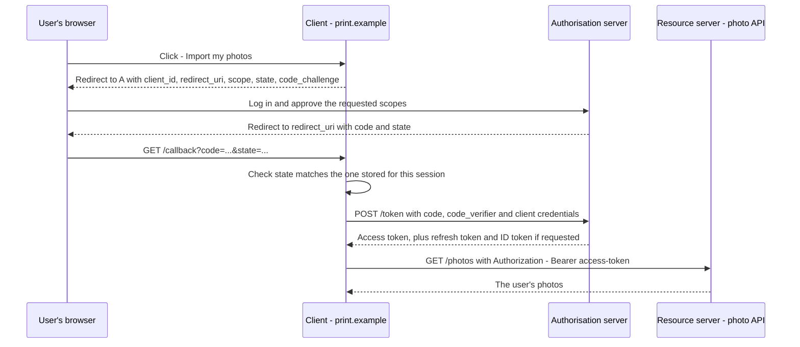

# OAuth 2.0 and OpenID Connect

> **Before this lesson:** read [Authentication and authorisation models](#/lesson/web-security/authn-authz) for the difference between the two words, [Cross-site request forgery (CSRF)](#/lesson/web-security/csrf), and [Clickjacking and open redirects](#/lesson/web-security/clickjacking-redirects) — redirect validation is central here.

## In plain words

You arrive at a hotel in a car and use valet parking. You do not hand the valet your whole key ring with the house keys on it. Many cars come with a *valet key*: it starts the engine and opens the driver's door, but it does not open the boot or the glove box, and you can ask for it back. The valet can do the one job you asked for and nothing else.

On the web, the same need arises constantly. A photo-printing site wants to fetch your pictures from your cloud storage. A calendar tool wants to read your work diary. The bad old way was to give the printing site your storage *password* — the whole key ring. **OAuth 2.0** is the standard that provides valet keys instead: you tell the storage service "let this application read my photos, and only that", and the service hands the application a limited, revocable **token**. Your password never leaves the service that owns it.

**OpenID Connect (OIDC)** is a thin layer added on top of OAuth that answers a different question — not "what may this app do?" but "**who is this user?**" It is what powers "Sign in with Google / Microsoft / GitHub".

Nearly every modern product uses one or both, so developers are expected to be able to draw the flow on a whiteboard and to name the handful of mistakes that turn it into an account-takeover bug. The protocol is sound; the vulnerabilities are almost always in how an application *integrates* it.

## The cast of characters

OAuth has four roles. The names are worth learning because every document uses them.

| Role | Plain meaning | In the photo example |
|---|---|---|
| **Resource owner** | The user who owns the data | You |
| **Client** | The application that wants access | The printing site |
| **Authorisation server** | The service that authenticates the user and issues tokens | The storage company's login service |
| **Resource server** | The API that holds the data and accepts tokens | The storage company's photo API |

And the vocabulary:

- **Access token** — the valet key: a credential the client presents to the resource server. Short-lived (minutes to an hour).
- **Refresh token** — a longer-lived credential the client can exchange for new access tokens without bothering the user again.
- **Scope** — the list of permissions being requested, such as `photos.read`. This is the "cannot open the boot" part.
- **Consent** — the screen where the user approves the scopes.
- **Client ID / client secret** — the client's public identifier, and a password proving the client's own identity (only for clients that can keep a secret, meaning server-side applications).
- **Redirect URI** — the address at the client to which the authorisation server sends the user back.

## The authorisation code flow, one step at a time

A **flow** (or *grant type*) is a prescribed sequence of messages. The one to learn is the **authorisation code flow with PKCE**; current guidance recommends it for every kind of client — server-side web applications, single-page applications and mobile apps.

Start with the plain idea, then add the two protections.

**The plain idea.** The client sends the user's browser to the authorisation server. The user logs in *there* and consents. The authorisation server sends the browser back to the client carrying a short-lived, single-use **authorisation code**. The client's server then swaps that code for tokens by calling the authorisation server *directly*, server to server.

Why the two-step dance, instead of returning the token straight away? Because the first step travels through the browser — through address bars, history and redirects, which are leaky places. The code is useless without the second step, which happens over a direct, authenticated connection the browser never sees. The valuable token never passes through the browser at all.



Now the two protections, each of which closes a specific attack.

### Protection 1: `state` — tying the response to the request

The callback (`/callback?code=…`) is an endpoint that accepts a parameter and logs something in. That makes it a target for cross-site request forgery: an attacker could start a flow with *their own* account, capture the callback URL containing *their* code, and trick a victim's browser into loading it. The victim's session on the client would become linked to the **attacker's** account — and anything the victim then uploads lands there. (This is login CSRF, from the CSRF lesson.)

The defence: before redirecting, the client generates an unguessable `state` value, stores it in the user's session, and includes it in the request. The authorisation server returns it unchanged. In the callback the client checks that the returned `state` equals the stored one. A forged callback cannot contain the right value.

### Protection 2: PKCE — proving the code belongs to whoever asked for it

Suppose the authorisation code leaks — from a log, a misdirected redirect, a hostile app on a phone registered for the same link. Whoever holds the code could try to redeem it.

**PKCE** (Proof Key for Code Exchange, pronounced "pixy") prevents that:

1. Before starting, the client invents a random secret, the **code verifier**, and keeps it.
2. It sends only a hash of it, the **code challenge**, in the first request.
3. When redeeming the code, it must present the original verifier.
4. The authorisation server hashes the verifier and compares it with the challenge it remembered.

A thief who has the code but not the verifier cannot complete step 3, and a hash cannot be reversed to find it.

Both protections are a few lines with the standard library:

```python-run
import base64, hashlib, hmac, secrets

def b64url(data: bytes) -> str:
    return base64.urlsafe_b64encode(data).rstrip(b"=").decode()     # URL-safe, no padding

# --- Client, before redirecting the user --------------------------------------
state = secrets.token_urlsafe(32)                    # stored in the user's session
code_verifier = secrets.token_urlsafe(64)            # stored in the user's session, never sent yet
code_challenge = b64url(hashlib.sha256(code_verifier.encode()).digest())
print("sent in the redirect  : state=%s..., code_challenge=%s..." % (state[:8], code_challenge[:12]))

# --- Client, in the callback --------------------------------------------------
def state_ok(returned: str, stored: str) -> bool:
    return bool(stored) and hmac.compare_digest(returned, stored)

print("genuine callback      :", state_ok(state, state))
print("forged callback       :", state_ok("attacker-chosen-value", state))

# --- Authorisation server, at the token endpoint ------------------------------
def pkce_ok(presented_verifier: str, remembered_challenge: str) -> bool:
    recomputed = b64url(hashlib.sha256(presented_verifier.encode()).digest())
    return hmac.compare_digest(recomputed, remembered_challenge)

print("client with verifier  :", pkce_ok(code_verifier, code_challenge))
print("thief with code only  :", pkce_ok("a-guess", code_challenge))
```

`b64url` writes bytes using only letters, digits, `-` and `_`, the form that is safe inside URLs. The challenge is the SHA-256 hash of the verifier, encoded that way (the method is called `S256`). `state_ok` and `pkce_ok` both compare with `hmac.compare_digest`. The four results show a genuine callback accepted, a forged one rejected, the real client able to redeem its code and a thief unable to.

## OpenID Connect: adding identity

OAuth by itself says nothing about *who the user is*. An access token means "the bearer may read photos"; it is meant for the photo API, and its content is none of the client's business.

**OpenID Connect** adds what login needs. When the client includes the scope `openid`, the token response also contains an **ID token**: a signed statement, in JWT format, addressed *to the client*, saying "this user is subject `12345` at issuer `https://accounts.idp.example`, they authenticated at such a time, and this token was issued for client `print-app`". The authorisation server is then usually called the **identity provider** (IdP) or OpenID provider.

| | Access token | ID token |
|---|---|---|
| Question it answers | What may the bearer do? | Who logged in? |
| Intended reader | The resource server (API) | The client application |
| Send it to APIs? | Yes | No |
| Use it to log the user in? | **No** | Yes, after validation |

Before trusting an ID token the client must validate it:

- the **signature**, using the provider's published keys;
- **`iss`** (issuer) is exactly the expected provider;
- **`aud`** (audience) is this client's own ID;
- **`exp`** (expiry) is in the future;
- **`nonce`** matches a value the client put in the request — this binds the token to this login attempt and prevents replay.

Use a maintained OIDC library; it performs these checks. Your job is to configure it and not switch any of them off. Token validation in general is the subject of [JWT handling pitfalls](#/lesson/web-security/jwt).

## Where integrations go wrong

Each of the following is a real, repeatedly observed vulnerability class. The pattern is the same every time: a check the protocol relies on was loosened or skipped.

### 1. Loose redirect URI matching

The authorisation server sends the code to the `redirect_uri` in the request, so it must make sure that address belongs to the client. The rule is **exact string match against a pre-registered list**.

```python
# VULNERABLE (authorisation server side): prefix or pattern matching
def redirect_allowed(client, uri):
    return uri.startswith(client.registered_prefix)       # "https://print.example"
```

A prefix match accepts `https://print.example.evil.example/cb`. A wildcard such as `https://*.print.example/*` accepts any subdomain — including one with a takeover or XSS problem — and any path, including an open redirect on the client that forwards the code elsewhere. Either way the authorisation code is delivered to the attacker.

```python
# FIXED: exact comparison with registered values
def redirect_allowed(client, uri):
    return uri in client.registered_redirect_uris          # full URLs, compared exactly
```

```python-run
REGISTERED = {"https://print.example/oauth/callback"}

def redirect_allowed(uri: str) -> bool:
    return uri in REGISTERED                               # exact match, nothing cleverer

for uri in ["https://print.example/oauth/callback",
            "https://print.example/oauth/callback/../../redirect?to=https://evil.example",
            "https://print.example.evil.example/oauth/callback",
            "http://print.example/oauth/callback",
            "https://print.example/oauth/callback?next=//evil.example"]:
    print(redirect_allowed(uri), uri)
```

Only the first line prints `True`. Exactness is the feature: no path tricks, no extra parameters, no look-alike hosts, no downgrade to `http`.

As the *client* developer, your side of this is: register the narrowest possible redirect URIs, and make sure your own site has no open redirects.

### 2. Missing or unchecked `state`

Covered above. In review, find the callback handler and look for the comparison; a library that "supports" state does nothing if the application never verifies it.

### 3. Using the wrong token for login

A client receives an access token, calls the provider's "who am I" API with it, and logs in whoever comes back. The flaw: an access token is not issued *to* a particular client in a way the client can check. A malicious application that legitimately obtained a user's access token for the same provider can present it to *your* application and be logged in as that user. Identity must come from a validated **ID token** whose `aud` is your client ID.

### 4. Confusing accounts across providers

Never match accounts by email address alone. The stable identity is the pair **(`iss`, `sub`)** — issuer and subject. Email addresses can be changed, recycled, or — at some providers — unverified. Linking "whoever has this email at any provider" to an existing account is an account-takeover path.

### 5. The implicit flow and tokens in URLs

An older flow returned the access token directly in the URL fragment. Tokens in URLs leak through history, logs and referrers, and there is no way to bind them to the client. It is deprecated; use the code flow with PKCE for browser-based applications as well. Likewise the **password grant**, where the client collects the user's password and sends it to the authorisation server, defeats the purpose of the whole design and should not be used.

### 6. Over-broad scopes and long-lived tokens

Requesting `full_access` "in case we need it later" means a leak of your token store exposes everything. Ask for the minimum; request more only when a feature needs it. Keep access tokens short-lived; store refresh tokens encrypted on the server; use **refresh token rotation**, where each use returns a new refresh token and invalidates the old one, so that a stolen copy is detected when both are presented.

### 7. Where tokens live in a browser application

Tokens held by JavaScript are readable by any script injected through XSS. The pattern currently recommended for single-page applications is a **backend for frontend (BFF)**: a small server-side component performs the OAuth flow, keeps the tokens, and gives the browser only an `HttpOnly`, `Secure`, `SameSite` session cookie. The browser never sees a token.

### 8. Leaking the client secret

A client secret in a mobile app or JavaScript bundle is public. Such clients are **public clients**: they have no secret and rely on PKCE. Only server-side **confidential clients** hold a secret, and it belongs in a secrets manager.

> [!WARNING]
> OAuth is an *authorisation delegation* protocol. "The user has a valid access token" tells your API that the token is valid — not that the user may access a particular record. Your resource server still has to check scopes **and** do its own object-level authorisation, exactly as in [Broken access control and IDOR](#/lesson/web-security/broken-access-control).

> [!TIP]
> Do not implement an authorisation server or the client-side protocol by hand. Use a certified OpenID Connect library and an established identity provider. Your security work is configuration: exact redirect URIs, PKCE on, state and nonce checked, minimal scopes, tokens stored server-side.

> [!INTERVIEW]
> "Walk me through 'Sign in with X'." Describe the authorisation code flow with PKCE: redirect with `client_id`, `redirect_uri`, `scope=openid …`, `state`, `nonce`, `code_challenge`; user authenticates and consents at the provider; redirect back with `code` and `state`; verify `state`; back-channel exchange of the code plus `code_verifier` for tokens; validate the ID token (signature, `iss`, `aud`, `exp`, `nonce`); create your own session keyed on (`iss`, `sub`). Then list pitfalls: loose redirect URI matching, missing state, using an access token as proof of identity, the implicit flow, broad scopes. Finish with the distinction: OAuth is authorisation, OIDC is authentication.

## Other flows you will hear about

| Flow | Use | Note |
|---|---|---|
| **Authorisation code + PKCE** | Users, in any kind of app | The default |
| **Client credentials** | One service calling another, no user involved | The client authenticates as itself |
| **Device authorisation** | TVs and command-line tools without a convenient browser | User types a code on another device; beware phishing of that code |
| **Refresh token** | Renewing access tokens | Rotate; revoke on logout |
| Implicit, password | — | Deprecated; do not use |

## Defence in depth

1. **Authorisation code flow with PKCE** everywhere; no implicit or password grants.
2. **Exact, pre-registered redirect URIs**; no open redirects on the client.
3. **`state`** verified; **`nonce`** verified for OIDC.
4. **ID token validation** by a library: signature, `iss`, `aud`, `exp`, `nonce`.
5. **Identity = (`iss`, `sub`)**; verified email only as an attribute.
6. **Minimal scopes**, short-lived access tokens, rotated refresh tokens.
7. **Tokens kept server-side** (BFF) with a hardened session cookie for the browser.
8. **APIs validate** every token's signature, issuer, audience, expiry and scope — and then apply object-level authorisation.
9. **Logout and revocation** paths; monitoring for refresh-token reuse.

## How to test for it

**In code review:**

- Find the code that builds the authorisation URL. Are `state` and a PKCE challenge generated per request from a secure random source and stored in the session?
- Find the callback. Is `state` compared before anything else? Is the code exchanged server-side with the verifier?
- How is the user identified afterwards — from a validated ID token, or from an API call with the access token?
- Which library validates tokens, and are any validation options disabled?
- Check the provider's configuration screen: exact redirect URIs, no wildcards, no unused ones (old staging hosts), no `http://`.
- Where are tokens stored? Search front-end code for `localStorage.setItem` near the word `token`.

**In testing your own integration**, in a test tenant:

- Replay a callback URL in a different browser session; it should be rejected (state mismatch) and the code should be single-use.
- Remove or alter `state` in the callback; expect rejection.
- Change `redirect_uri` in the authorisation request by one character, add a path segment, or switch to `http`; the provider should refuse.
- Present a token issued for a different client to your API; it should be rejected on audience.
- Use a refresh token twice and confirm the second use is refused and the session is revoked.

## Pitfalls

- **Treating OAuth as authentication** without OIDC.
- **"It works" as the only test.** Every pitfall above leaves the happy path working perfectly.
- **Wildcard redirect URIs** for convenience across preview environments.
- **Leaving development redirect URIs** (`http://localhost…`) registered on the production client.
- **Skipping `nonce`** because "state is enough".
- **Trusting the `email` claim** without `email_verified`.
- **Logging full callback URLs**, authorisation codes or tokens.
- **Accepting tokens from any issuer** in a multi-tenant provider instead of the specific tenant.
- **Never revoking**: a user disconnects the integration and the stored refresh token keeps working.

## Summary

- OAuth 2.0 lets a user grant an application limited, revocable access to their data at another service without sharing a password; OpenID Connect adds a signed statement of who the user is.
- The roles are resource owner, client, authorisation server and resource server; the artefacts are codes, access tokens, refresh tokens and ID tokens.
- Use the authorisation code flow with PKCE: the code travels through the browser, the tokens do not; `state` binds the callback to the session and PKCE binds the code to the client that requested it.
- Log users in from a validated ID token and key accounts on issuer plus subject.
- Most vulnerabilities are integration mistakes: loose redirect URI matching, missing state, wrong token for login, tokens in URLs or JavaScript, excessive scopes.
- A valid token is not authorisation for a specific object; APIs still enforce their own access control.

## Glossary

- **OAuth 2.0** — a standard for delegated authorisation using tokens.
- **OpenID Connect (OIDC)** — an identity layer on OAuth providing ID tokens.
- **Resource owner / client / authorisation server / resource server** — the user, the requesting application, the token issuer, and the API.
- **Identity provider (IdP)** — the service that authenticates users for other applications.
- **Access token** — credential presented to an API. **Refresh token** — credential used to obtain new access tokens. **ID token** — signed statement of the user's identity for the client.
- **Scope** — a named permission requested by the client. **Consent** — the user's approval of scopes.
- **Authorisation code** — a short-lived, single-use value exchanged for tokens.
- **Redirect URI** — the client address receiving the authorisation response.
- **`state`** — a random value binding the response to the user's session (anti-CSRF).
- **PKCE** — proof that the party redeeming a code is the one that requested it, via verifier and challenge.
- **`nonce`** — a random value binding an ID token to one login attempt.
- **Confidential / public client** — a client that can / cannot keep a secret.
- **Backend for frontend (BFF)** — a server component that holds tokens on behalf of a browser application.
- **Refresh token rotation** — issuing a new refresh token on each use and invalidating the old one.

```quiz
[
  {"q": "What problem does OAuth 2.0 solve?",
   "options": ["Encrypting passwords in a database", "Letting an application access a user's data at another service with limited, revocable permission, without the user's password", "Preventing SQL injection", "Compressing API responses"], "answer": 1,
   "explain": "OAuth is delegated authorisation: a scoped token replaces sharing the password."},
  {"q": "In the authorisation code flow, why is a code returned through the browser instead of the access token itself?",
   "options": ["Codes are shorter", "The browser channel is leaky; the code is useless alone and is exchanged for tokens over a direct server-to-server call", "Browsers cannot carry tokens", "It makes the flow faster"], "answer": 1,
   "explain": "URLs end up in history, logs and referrers. The valuable token is delivered on the back channel only."},
  {"q": "What does the state parameter protect against?",
   "options": ["Token expiry", "A forged callback that would link the victim's session to an attacker's authorisation (CSRF on the callback)", "Weak passwords", "Large responses"], "answer": 1,
   "explain": "The client checks that the returned state matches the value stored in the user's session before accepting the code."},
  {"q": "What does PKCE add?",
   "options": ["Encryption of the access token", "Proof that whoever redeems the authorisation code is the same client that started the flow", "A second password for the user", "Longer token lifetimes"], "answer": 1,
   "explain": "Only the original client knows the code verifier whose hash was sent as the challenge, so an intercepted code cannot be redeemed."},
  {"q": "How must an authorisation server compare the redirect_uri in a request with the registered ones?",
   "options": ["By prefix", "By exact string match", "By domain suffix", "By regular expression supplied by the client"], "answer": 1,
   "explain": "Any looser comparison lets codes be delivered to look-alike hosts, other paths or open redirects."},
  {"q": "Which token should a client use to establish who has logged in?",
   "options": ["The access token", "The refresh token", "A validated ID token whose audience is the client", "The authorisation code"], "answer": 2,
   "explain": "Access tokens are for APIs and are not bound to your client in a way you can verify; the ID token is addressed to you."},
  {"q": "On which values should a user account from an external provider be keyed?",
   "options": ["Email address alone", "Display name", "The issuer and subject pair (iss, sub)", "The access token"], "answer": 2,
   "explain": "Emails change and may be unverified. Issuer plus subject is the stable, unique identifier."},
  {"q": "An API receives a valid access token with scope orders.read and a request for order 42. What must it still do?",
   "options": ["Nothing; the token is valid", "Check that the token's user is actually permitted to read order 42", "Ask the user for their password", "Refresh the token"], "answer": 1,
   "explain": "Scopes describe kinds of access. Object-level authorisation remains the API's responsibility."}
]
```

> **Source:** Hoffman, *Web Application Security*, ch. 5 (authentication mechanisms in API analysis) and ch. 18 (authentication and authorisation in secure architecture) introduce token-based authentication; this lesson extends them in original wording using OWASP OAuth 2.0 Cheat Sheet — https://cheatsheetseries.owasp.org/cheatsheets/OAuth2_Cheat_Sheet.html ; RFC 6749 (OAuth 2.0) — https://datatracker.ietf.org/doc/html/rfc6749 ; RFC 7636 (PKCE) — https://datatracker.ietf.org/doc/html/rfc7636 ; RFC 9700 (OAuth 2.0 Security Best Current Practice) — https://datatracker.ietf.org/doc/html/rfc9700 ; OpenID Connect Core 1.0 — https://openid.net/specs/openid-connect-core-1_0.html
