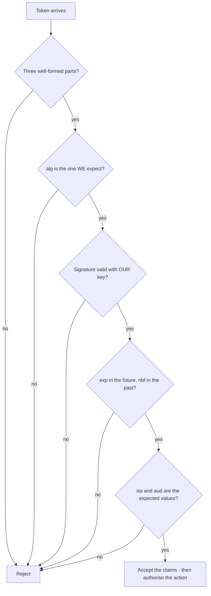

# JWT handling pitfalls

> **Before this lesson:** read [Cookies and sessions](#/lesson/web-security/cookies-sessions) for signed values and HMAC, [Session management flaws and cookie attributes](#/lesson/web-security/session-management) for stateless sessions and revocation, and [OAuth 2.0 and OpenID Connect](#/lesson/web-security/oauth-oidc), where ID tokens appeared.

## In plain words

A concert wristband has facts printed on it — "VIP, Saturday only, gate B" — and a holographic seal that the venue can check. Staff do not phone the box office for every person; they read the band and inspect the seal. Two things follow. Anyone can *read* what is printed. And the band is only trustworthy if staff really do inspect the seal, and inspect it properly: a steward who waves through any band that *looks* official, or who lets the wearer say which kind of seal to look for, has made the seal pointless.

A **JSON Web Token**, abbreviated **JWT** and usually pronounced "jot", is that wristband in digital form: a short text containing facts about a user (called **claims**) plus a cryptographic **signature**. A server that receives one can verify the signature and trust the facts without looking anything up in a database. JWTs are everywhere: API authentication, single sign-on, the ID tokens of OpenID Connect.

The format is sound. The trouble is that it is flexible, and verifying one correctly involves several distinct checks, each of which has been forgotten or done wrongly in real products with severe results — forged administrator tokens, accounts taken over. This lesson teaches you to read a token, verify it step by step, and recognise the classic mistakes. "What can go wrong with JWTs?" is a favourite interview question precisely because the list is concrete.

## Anatomy of a token

A JWT is three pieces of text joined by dots:

```
eyJhbGciOiJIUzI1NiIsInR5cCI6IkpXVCJ9.eyJzdWIiOiJ1c2VyLTciLCJleHAiOjE3MDAwMDM2MDB9.q1c...Zk
└────────── header ────────────────┘ └────────────── payload ─────────────────────┘ └ signature ┘
```

Each piece is **base64url**-encoded. Base64url is a way of writing arbitrary bytes using only letters, digits, `-` and `_`, so the result is safe inside URLs and headers. It is an *encoding*, not encryption: anyone can reverse it.

- The **header** is a small JSON object describing the token, chiefly `alg`, the signature algorithm.
- The **payload** is a JSON object of claims.
- The **signature** is computed over the text `header.payload` using a key.

Build one by hand and take it apart again; this removes all the mystery.

```python-run
import base64, hashlib, hmac, json

def b64url(data: bytes) -> str:
    return base64.urlsafe_b64encode(data).rstrip(b"=").decode()

def b64url_decode(text: str) -> bytes:
    return base64.urlsafe_b64decode(text + "=" * (-len(text) % 4))    # restore the padding

SECRET = b"server-signing-key-kept-in-a-secrets-manager"

header = {"alg": "HS256", "typ": "JWT"}
payload = {"sub": "user-7", "role": "member", "exp": 1700003600}

signing_input = b64url(json.dumps(header, separators=(",", ":")).encode()) + "." + \
                b64url(json.dumps(payload, separators=(",", ":")).encode())
signature = hmac.new(SECRET, signing_input.encode(), hashlib.sha256).digest()
token = signing_input + "." + b64url(signature)

print("token:", token)
print()
h, p, s = token.split(".")
print("header  decoded by anyone:", b64url_decode(h).decode())
print("payload decoded by anyone:", b64url_decode(p).decode())
```

What happened: the header and payload dictionaries were turned into compact JSON text, encoded, and joined with a dot. `hmac.new(SECRET, ..., hashlib.sha256)` computed the signature — that is what `HS256` means: **H**MAC with **S**HA-**256**. The last two lines decode the first two parts *without the key*, proving the first rule of JWTs:

> **The payload is readable by anyone who holds the token.** Signing protects against *changes*; it hides nothing. Never put passwords, card numbers or other secrets in a JWT.

### Standard claims

| Claim | Name | Meaning |
|---|---|---|
| `iss` | Issuer | Who created the token |
| `sub` | Subject | Who the token is about (the user ID) |
| `aud` | Audience | Which service the token is intended for |
| `exp` | Expiration | Time after which it must be rejected |
| `nbf` | Not before | Time before which it must be rejected |
| `iat` | Issued at | When it was created |
| `jti` | JWT ID | A unique identifier, useful for revocation |

Times are whole seconds since 1 January 1970 (Unix time).

### Two families of signature

| | Symmetric (`HS256`) | Asymmetric (`RS256`, `ES256`, `EdDSA`) |
|---|---|---|
| Keys | One shared secret both signs and verifies | A **private key** signs; a matching **public key** verifies |
| Who can create tokens | Anyone who can verify them | Only the holder of the private key |
| Typical use | One service issuing and checking its own tokens | An identity provider issuing tokens that many services verify |

With asymmetric algorithms the verifying services hold only the public key, which is safe to publish — providers expose theirs at a well-known URL as a **JWKS** (JSON Web Key Set). A service that only needs to *check* tokens then cannot *forge* them.

## Verifying a token: the full checklist

Verification is a sequence. Skipping any step is a vulnerability.



Here is that sequence in code. `now` is passed in so the behaviour can be tested deterministically.

```python-run
import base64, hashlib, hmac, json

def b64url(data): return base64.urlsafe_b64encode(data).rstrip(b"=").decode()
def b64url_decode(text): return base64.urlsafe_b64decode(text + "=" * (-len(text) % 4))

def make(payload, secret, header=None):
    head = header or {"alg": "HS256", "typ": "JWT"}
    signing_input = b64url(json.dumps(head).encode()) + "." + b64url(json.dumps(payload).encode())
    sig = hmac.new(secret, signing_input.encode(), hashlib.sha256).digest()
    return signing_input + "." + b64url(sig)

def verify(token, secret, now, expected_issuer, expected_audience):
    parts = token.split(".")
    if len(parts) != 3:
        return "malformed"
    try:
        header = json.loads(b64url_decode(parts[0]))
        payload = json.loads(b64url_decode(parts[1]))
        supplied = b64url_decode(parts[2])
    except Exception:
        return "malformed"
    if header.get("alg") != "HS256":                       # WE decide the algorithm
        return "wrong algorithm"
    expected = hmac.new(secret, (parts[0] + "." + parts[1]).encode(), hashlib.sha256).digest()
    if not hmac.compare_digest(supplied, expected):        # constant-time comparison
        return "bad signature"
    if not isinstance(payload.get("exp"), (int, float)) or now >= payload["exp"]:
        return "expired or no expiry"
    if payload.get("iss") != expected_issuer:
        return "wrong issuer"
    if payload.get("aud") != expected_audience:
        return "wrong audience"
    return payload

KEY = b"server-signing-key"
claims = {"sub": "user-7", "role": "member", "iss": "https://auth.shop.example", "aud": "shop-api", "exp": 2000}
good = make(claims, KEY)
check = lambda t, now=1000: verify(t, KEY, now, "https://auth.shop.example", "shop-api")

print("genuine token          :", check(good))

h, p, s = good.split(".")
forged_payload = b64url(json.dumps({**claims, "role": "admin"}).encode())
print("payload edited         :", check(h + "." + forged_payload + "." + s))

none_header = b64url(json.dumps({"alg": "none", "typ": "JWT"}).encode())
print("alg none, no signature :", check(none_header + "." + forged_payload + "."))

print("signed with other key  :", check(make(claims, b"guess")))
print("after expiry           :", check(good, now=2000))
print("meant for other service:", check(make({**claims, "aud": "billing-api"}, KEY)))
```

Go through the output line by line:

1. The genuine token returns its claims.
2. Changing `role` to `admin` in the payload while keeping the old signature fails: the signature was computed over the *original* text.
3. A token whose header announces `"alg": "none"` — "no signature" — and carries an empty third part is rejected because *our code* insists on `HS256`.
4. A token signed with a different key fails.
5. At `now = 2000`, exactly the expiry time, the token is rejected (`>=`, not `>`).
6. A correctly signed token intended for a different service is rejected on audience.

In production you would not write this function. Use a maintained library — PyJWT, `python-jose`, `jsonwebtoken` for Node — and pass the expected algorithm, issuer and audience explicitly:

```python
# FIXED: a library call with every expectation stated
import jwt   # PyJWT

claims = jwt.decode(
    token,
    key=PUBLIC_KEY,
    algorithms=["RS256"],                      # an allow-list chosen by the server
    issuer="https://auth.shop.example",
    audience="shop-api",
    options={"require": ["exp", "iss", "aud", "sub"]},
)
```

## The classic pitfalls

### Pitfall 1: decoding without verifying

```python
# VULNERABLE: reads the claims and never checks the signature
claims = jwt.decode(token, options={"verify_signature": False})
user_id = claims["sub"]
```

Libraries offer a way to read a token without verification, for debugging. Used in a request path, it means anyone can type any payload. The same mistake occurs when front-end code or a gateway "parses" the token and a downstream service trusts the parsed result. **Search for the unverified-decode call in every code review.**

### Pitfall 2: letting the token choose the algorithm

The header is part of the untrusted input. Three variants of trusting it:

- **`alg: none`.** The specification defines an "unsecured" token type with no signature. Early libraries accepted it by default; a token saying `none` with an empty signature passed "verification".
- **Algorithm confusion.** A service expects `RS256` and verifies with the provider's *public* key. An attacker sends a token whose header says `HS256`. A naive library then uses the same key material as an HMAC *secret* — and the public key is public, so the attacker can compute a valid HMAC. The forged token verifies.
- **Key injection.** Header fields such as `jwk`, `jku` and `kid` can tell the verifier where to find the key. If the verifier follows a URL or uses a key embedded in the token itself, the attacker supplies their own key. A `kid` value used unsafely in a file path or database query is also an injection point.

One rule defeats all three: **the server, not the token, decides which algorithm and which key are acceptable.** Pass an explicit `algorithms=[...]` allow-list; fetch keys only from the configured issuer's key set; treat `kid` as an identifier to look up in that trusted set and nothing more.

### Pitfall 3: weak secrets

An `HS256` signature can be attacked offline: anyone holding one token can try candidate secrets until the signature matches, with no contact with your server. Secrets such as `secret`, `changeme` or a company name fall in seconds. Use at least 256 bits from a cryptographic random generator (`secrets.token_bytes(32)`), store it in a secrets manager, and never reuse it across environments or purposes.

### Pitfall 4: not checking `exp`, `iss` and `aud`

A valid signature only says "our issuer created this at some point, for someone". Without `exp`, a token leaked years ago still works. Without `aud`, a token issued for a low-privilege service can be replayed against a high-privilege one that trusts the same issuer. Without `iss`, a multi-tenant provider's token from *another* customer's tenant may be accepted.

### Pitfall 5: no way to revoke

A JWT is valid until it expires. Logging out, changing a password, or discovering a theft does not un-sign it. Options, in rising cost:

- **Short lifetimes** for access tokens (5–15 minutes), with a revocable **refresh token** held server-side.
- A **deny-list** of revoked `jti` values, checked on each request (kept until each token's expiry).
- A per-user **"tokens issued before T are invalid"** timestamp, bumped on password change or logout-everywhere.

If you need instant revocation everywhere and have a single application, an ordinary server-side session is simpler than rebuilding one around a JWT.

### Pitfall 6: stale or over-trusted claims

Roles copied into a token are a snapshot. If an administrator's rights are removed, a token minted beforehand still says `admin` until it expires. Keep lifetimes short, or re-check sensitive permissions against the database. And never accept *identity-defining* claims from a place the user controls — the claims of an unverified token, or extra fields in a registration request that end up in the token.

### Pitfall 7: storage and transport

- In a browser, a token in `localStorage` is readable by any injected script; an `HttpOnly` cookie is not (but then needs CSRF protection). See the trade-off table in [Cookies and sessions](#/lesson/web-security/cookies-sessions).
- Never put tokens in URLs.
- Always HTTPS.
- Do not log tokens; redact the `Authorization` header.

### Pitfall 8: confusing signing with encryption

The common token type is a signed token (formally a JWS). An encrypted variant exists (JWE) for when the content must be hidden from the bearer, but it is rarely needed: put an opaque identifier in the token and keep the sensitive data on the server.

> [!WARNING]
> Online "JWT decoder" tools are convenient and are somebody else's server. Pasting a production token into one hands a working credential to a third party. Decode locally.

> [!TIP]
> Ask whether you need a JWT at all. For a single web application talking to its own back end, a random session ID in a hardened cookie is simpler, revocable, and has none of the pitfalls above. JWTs earn their place when independent services must verify identity without calling a central store — single sign-on, APIs consumed by third parties, microservices.

> [!INTERVIEW]
> "What are common JWT vulnerabilities?" Give the list crisply: (1) not verifying the signature, or using the decode-only call; (2) accepting `alg: none` or letting the header pick the algorithm — algorithm confusion between RS256 and HS256; (3) trusting key locations from the header (`jku`, `jwk`, unsafe `kid`); (4) weak HMAC secrets, crackable offline; (5) missing `exp`, `aud`, `iss` checks; (6) no revocation and long lifetimes; (7) secrets in the readable payload; (8) storing tokens where XSS can read them. Then state the fix pattern: a maintained library, explicit algorithm allow-list, server-chosen keys, mandatory claim validation, short lifetimes.

## Defence in depth

1. **A maintained library**, kept updated; no hand-rolled parsing in production.
2. **Explicit algorithm allow-list**; prefer asymmetric algorithms when tokens cross service boundaries.
3. **Keys chosen by configuration**, fetched from the trusted issuer's key set over HTTPS, cached, with rotation supported through `kid`.
4. **Mandatory claims**: `exp`, `iss`, `aud`, `sub`; small clock-skew allowance (a few seconds, not minutes).
5. **Short access-token lifetimes**; refresh tokens rotated and revocable.
6. **Strong, managed secrets**; separate keys per environment and purpose.
7. **No sensitive data in payloads.**
8. **Authorisation after authentication**: a valid token identifies the caller; object-level checks still apply.
9. **Monitoring**: spikes in signature failures, tokens with unexpected algorithms, reuse of revoked identifiers.

## How to test for it

**In code review:**

- Search for `verify_signature`, `verify=False`, `decode(` without a key or without `algorithms=`, `jwt.decode(token)` with one argument, and JavaScript `jwt.decode(` (which in the common Node library does *not* verify — `jwt.verify(` does).
- Is the list of algorithms a literal chosen by the developer? Is `none` anywhere near it?
- Where does the key come from? Is anything read from the token header used to locate it?
- Are `iss` and `aud` passed to the verification call? Is `exp` required?
- What is the token lifetime? How does logout work?
- Search for `localStorage` or `sessionStorage` holding tokens.

**In testing your own service**, with tokens for a test account:

- Change one character in the payload and send the token; expect `401`.
- Remove the signature part; send a header with `alg` set to `none`; expect `401`.
- Send an expired token; expect `401`.
- Send a token minted for a different audience or by a different (test) issuer; expect `401`.
- If the service uses `RS256`, send a token with header `HS256`; expect `401`.
- After logout or password change, replay the old token and observe when it stops working — that interval is your real revocation time.

Turn each into an automated test; they are short and guard against a library upgrade or refactoring silently loosening verification.

## Pitfalls (quick reference)

- Treating the payload as private.
- Reading claims before — or instead of — verifying.
- Trusting `alg`, `jwk`, `jku`, `x5u`, or an unsanitised `kid` from the header.
- One shared HMAC secret spread across many services, any of which can then forge tokens for all.
- Week-long access tokens.
- Generous clock-skew allowances that effectively extend lifetimes.
- Different validation rules in different services behind the same gateway.
- Believing that base64 text "looks encrypted".

## Summary

- A JWT is header, payload and signature, each base64url-encoded; the payload is readable by anyone, and the signature only prevents modification.
- `HS256` uses one shared secret; `RS256`/`ES256` use a private key to sign and a public key to verify, which suits tokens checked by many services.
- Verification is a sequence: structure, server-chosen algorithm, signature with a server-chosen key, expiry, issuer, audience — then authorisation.
- The notorious failures are unverified decoding, `alg: none`, algorithm confusion, key injection through header fields, weak secrets and unchecked claims.
- JWTs cannot be revoked by default; keep them short-lived and pair them with revocable refresh tokens or a deny-list.
- Use a maintained library with explicit expectations, and prefer plain sessions when you do not need what JWTs offer.

## Glossary

- **JWT (JSON Web Token)** — a compact, signed token carrying claims.
- **Claim** — a statement in the payload, such as `sub` or `exp`.
- **Base64url** — URL-safe encoding of bytes as text; not encryption.
- **Header / payload / signature** — the three dot-separated parts of a JWT.
- **`alg`** — header field naming the signature algorithm.
- **HS256** — HMAC with SHA-256, a symmetric algorithm using one shared secret.
- **RS256 / ES256** — asymmetric algorithms using a private signing key and a public verification key.
- **Private key / public key** — the secret half and the shareable half of an asymmetric key pair.
- **JWKS** — a published set of an issuer's public keys.
- **`kid`** — key ID: a header hint selecting which known key to use.
- **Algorithm confusion** — tricking a verifier into using a different algorithm than intended.
- **`iss` / `aud` / `exp` / `nbf` / `jti`** — issuer, audience, expiry, not-before, token ID.
- **Revocation** — invalidating a token before it expires.
- **Deny-list** — a stored list of revoked token IDs.
- **JWS / JWE** — the signed and the encrypted forms of JSON tokens.

```quiz
[
  {"q": "Who can read the payload of a standard signed JWT?",
   "options": ["Only the server holding the key", "Anyone who has the token", "Only the user it was issued to", "Nobody, it is encrypted"], "answer": 1,
   "explain": "The payload is base64url-encoded JSON. The signature prevents changes but hides nothing."},
  {"q": "A payload's role is changed from member to admin and the original signature is kept. Why does verification fail?",
   "options": ["The token is too long", "The signature was computed over the original header and payload text, so it no longer matches", "Roles cannot be in tokens", "It does not fail"], "answer": 1,
   "explain": "Any change to the signed text produces a different expected signature, which cannot be computed without the key."},
  {"q": "What is the defence against 'alg: none' and algorithm-confusion attacks?",
   "options": ["Longer tokens", "The server specifies an allow-list of acceptable algorithms instead of trusting the token's header", "Base64-encoding the token twice", "Storing tokens in cookies"], "answer": 1,
   "explain": "The header is attacker-controlled input. The verifier must decide which algorithm and key to use."},
  {"q": "A service verifying RS256 tokens is sent a token with header alg HS256, signed using the provider's public key as the HMAC secret. What flaw would make this succeed?",
   "options": ["Missing expiry check", "The verifier lets the token select the algorithm and reuses the public key as a shared secret", "A weak password", "Missing audience check"], "answer": 1,
   "explain": "This is algorithm confusion: the public key is known to everyone, so anyone can compute that HMAC."},
  {"q": "Why must the aud (audience) claim be checked?",
   "options": ["To measure token size", "So a token issued for one service cannot be replayed against another that trusts the same issuer", "To decrypt the payload", "It is optional decoration"], "answer": 1,
   "explain": "A valid signature proves who issued the token, not who it was intended for."},
  {"q": "A user logs out, but their JWT access token remains valid for 24 hours. Which change best reduces the exposure?",
   "options": ["Make the token longer", "Use short-lived access tokens with a revocable refresh token, or a deny-list of token IDs", "Base64-encode it again", "Remove the exp claim"], "answer": 1,
   "explain": "Stateless tokens cannot be un-signed. Short lifetimes or server-side revocation state are the remedies."},
  {"q": "Why is a short, human-chosen HS256 secret dangerous?",
   "options": ["It slows verification", "An attacker with one token can guess secrets offline until the signature matches, then forge any token", "It breaks base64url", "It disables the exp claim"], "answer": 1,
   "explain": "HMAC secrets can be brute-forced without contacting the server. Use at least 256 random bits."},
  {"q": "In a Node.js code base you find jwt.decode(token) used to obtain the user ID for a request. What is the problem?",
   "options": ["decode is slower than verify", "In the common library, decode does not verify the signature, so the claims are untrusted", "User IDs should not be in tokens", "Nothing"], "answer": 1,
   "explain": "Decode-only functions exist for inspection. Request handling must use the verifying call with an explicit algorithm list."}
]
```

> **Source:** Hoffman, *Web Application Security*, ch. 5 (authentication mechanisms) and ch. 18 (secure application architecture) introduce token authentication; this lesson extends them in original wording using OWASP JSON Web Token Cheat Sheet — https://cheatsheetseries.owasp.org/cheatsheets/JSON_Web_Token_Cheat_Sheet.html ; RFC 7519 (JSON Web Token) — https://datatracker.ietf.org/doc/html/rfc7519 ; RFC 8725 (JWT Best Current Practices) — https://datatracker.ietf.org/doc/html/rfc8725 ; OWASP Web Security Testing Guide, Testing JSON Web Tokens — https://owasp.org/www-project-web-security-testing-guide/latest/4-Web_Application_Security_Testing/06-Session_Management_Testing/10-Testing_JSON_Web_Tokens
