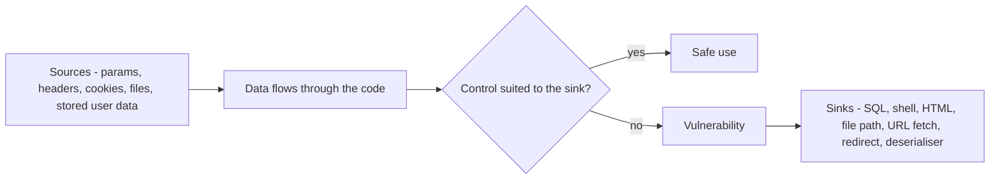

# Secure code review and input validation

> **Before this lesson:** this lesson draws together the vulnerability lessons — especially [Cross-site scripting (XSS) and output encoding](#/lesson/web-security/xss), [SQL injection and parameterised queries](#/lesson/web-security/sql-injection) and [Broken access control and IDOR](#/lesson/web-security/broken-access-control) — and the design view from [Secure architecture and threat modelling (STRIDE)](#/lesson/web-security/threat-modelling).

## In plain words

A proofreader and an editor read the same manuscript differently. The proofreader looks for spelling mistakes. The editor asks whether the argument holds: does chapter three contradict chapter one? Is a claim made that the evidence does not support?

Ordinary code review is mostly proofreading: naming, style, obvious bugs. A **security code review** reads the same change as an editor with one question in mind: *where does data come from that we do not control, and what can it reach?* The reviewer follows each outside value through the program, like tracing a pipe through a building, and checks that it passes through the right filters before it arrives anywhere it could do harm.

The first of those filters is **input validation**: checking at the door that incoming data is the kind of thing you expect. A nightclub with a guest list is the picture. The doorman does not try to recognise every troublemaker in the city (impossible); they admit the names on the list and turn everyone else away.

Review and validation are the two everyday practices through which the knowledge in this track actually reaches production code. Review is also the single most common practical exercise in security-flavoured interviews: you are shown thirty lines and asked what is wrong.

## Part 1: input validation

### What validation is, and what it is not

**Validation** checks that data conforms to expectations *before* the program acts on it: right type, right size, right format, right range, right set of fields.

It is a strong first layer and a poor only layer. The roles are worth stating exactly, because mixing them up causes real bugs:

| Control | Question it answers | Where it happens |
|---|---|---|
| **Validation** | Is this input the shape I expect? | At the trust boundary, on arrival |
| **Parameterisation / safe APIs** | Can this data ever be executed as code? | At the interpreter (SQL, shell, template) |
| **Output encoding** | Is this data safe to display *in this context*? | At the moment of output |
| **Authorisation** | May this user do this to this object? | Before the action |

A customer legitimately named `O'Brien` passes any sensible validation and still contains a quote. A comment may legitimately contain `<script>` on a programming forum. Validation narrows what arrives; it cannot make arbitrary text safe for every later use. That is the job of the controls on the other rows.

### Allow-lists, not block-lists

There are two philosophies:

- **Block-list**: describe what is bad and reject it. ("No `<`, no `'`, no `DROP`.")
- **Allow-list**: describe what is good and reject everything else. ("A product code is 3 to 10 capital letters or digits.")

Block-lists fail in two directions at once. They miss dangerous inputs nobody thought of — a different encoding, a different keyword — and they reject honest ones. Allow-lists fail safe: anything unanticipated is refused. Every recommendation in this track has been an allow-list in some form: permitted hosts for redirects, permitted columns for sorting, permitted file types, permitted fields in a request.

### The layers of validation

Check in this order, cheapest first:

1. **Size** — reject oversized bodies and strings before parsing them.
2. **Type** — is it a string, an integer, a boolean?
3. **Structure** — exactly the expected fields; no extras.
4. **Format (syntactic)** — pattern, length, range, set membership.
5. **Meaning (semantic)** — does it make sense in context? The end date is after the start date; the quantity is in stock; the referenced order belongs to this user.

### The simplest example, then the realistic one

```python
# VULNERABLE: no validation at all
@app.post("/reviews")
def add_review(body: dict, user=Depends(current_user)):
    db.insert("reviews", user_id=user.id, **body)
```

Whatever keys the client sends go into the database: `rating: 9000`, `approved: true`, `user_id: 1`, a ten-megabyte `text`.

```python
# FIXED: a schema describes exactly what is acceptable
from pydantic import BaseModel, ConfigDict, Field

class ReviewIn(BaseModel):
    model_config = ConfigDict(extra="forbid", str_strip_whitespace=True)
    product_code: str = Field(pattern=r"^[A-Z0-9]{3,10}$")
    rating: int = Field(ge=1, le=5)
    text: str = Field(min_length=1, max_length=2000)

@app.post("/reviews")
def add_review(body: ReviewIn, user=Depends(current_user)):
    if not catalogue.exists(body.product_code):                      # semantic check
        raise HTTPException(404)
    db.insert("reviews", user_id=user.id, **body.model_dump())       # user_id from the session
```

`ReviewIn` is a Pydantic model. `extra="forbid"` rejects unknown fields. `Field(ge=1, le=5)` means "greater than or equal to 1, less than or equal to 5". The pattern `^[A-Z0-9]{3,10}$` reads: start of string, three to ten characters each of which is a capital letter or digit, end of string. FastAPI runs all of this before the function body and answers `422` with a description if anything fails. `user_id` is not part of the model at all, so the client cannot supply it.

To see the mechanism without a framework, here is a small validator:

```python-run
import re

SCHEMA = {
    "product_code": {"type": str, "required": True, "pattern": r"[A-Z0-9]{3,10}"},
    "rating":       {"type": int, "required": True, "min": 1, "max": 5},
    "text":         {"type": str, "required": True, "max_len": 2000},
    "anonymous":    {"type": bool, "required": False},
}

def validate(data: dict, schema: dict) -> list:
    errors = [f"unexpected field: {key}" for key in data if key not in schema]
    for field, rule in schema.items():
        if field not in data:
            if rule.get("required"):
                errors.append(f"missing field: {field}")
            continue
        value = data[field]
        # bool is a subclass of int in Python, so exclude it explicitly for int fields
        wrong_type = not isinstance(value, rule["type"]) or (rule["type"] is int and isinstance(value, bool))
        if wrong_type:
            errors.append(f"wrong type: {field}")
            continue
        if "pattern" in rule and not re.fullmatch(rule["pattern"], value):
            errors.append(f"bad format: {field}")
        if "max_len" in rule and len(value) > rule["max_len"]:
            errors.append(f"too long: {field}")
        if "min" in rule and not rule["min"] <= value <= rule["max"]:
            errors.append(f"out of range: {field}")
    return sorted(errors)

print(validate({"product_code": "MUG01", "rating": 5, "text": "Great mug."}, SCHEMA))
print(validate({"product_code": "mug-01", "rating": 9000, "text": "x", "approved": True}, SCHEMA))
print(validate({"product_code": "MUG01", "rating": True}, SCHEMA))
```

`SCHEMA` describes each field. `validate` first lists any key that is not in the schema, then checks each expected field: presence, type, format, length, range. The first call returns an empty list — valid. The second reports three problems, including the unexpected `approved` field. The third shows two subtle points: `True` is rejected as a rating (in Python `isinstance(True, int)` is true, so the function excludes booleans explicitly), and the missing `text` is reported.

### Where validation must happen

**On the server, at every trust boundary.** Browser-side validation is a courtesy to honest users and is bypassed by anyone who sends a request directly. Validate too at the edges between your own services, on data read from queues and files, and on responses from third-party APIs — a partner's system can be compromised or merely wrong.

### Canonicalise before validating

The same value can often be written several ways: upper or lower case, with URL percent-encoding, with different Unicode forms that look identical, with `..` segments in a path. **Canonicalisation** means converting input to one standard form. Always decode and normalise *first*, then validate, then use that same normalised value. If you validate the raw form and something later decodes it again, the check and the use have seen different data — the cause of many bypasses in the path-traversal and redirect lessons.

### Reject; do not repair

When validation fails, refuse the request with a clear error. Do not try to "clean" the value by stripping the bad parts — an input crafted so that removing a fragment *creates* the dangerous string defeats that approach. (The one legitimate transformation is **sanitising rich HTML** with a dedicated library, covered in the XSS lesson.)

> [!TIP]
> Free-text fields — names, addresses, comments — cannot be meaningfully allow-listed by character. Validate what you can (length, that it is text, perhaps a Unicode normal form) and rely on parameterisation and output encoding for safety. Do not ban apostrophes; people's names contain them.

## Part 2: secure code review

### What a security review is for

Automated tools find the *archetypal* bugs with recognisable shapes. A human reviewer adds two things tools lack: knowledge of what the feature is supposed to do, and the ability to notice what is **missing** — the authorisation check that is not there, the limit nobody added.

### Sources, sinks and the path between

The core technique is **data-flow tracing** (also called *taint analysis* when done by tools).

- A **source** is where untrusted data enters: request parameters, headers, cookies, bodies, uploaded files, database fields that users can write, messages from queues, responses from other services, environment values a tenant controls.
- A **sink** is an operation where data can do damage: a SQL query, a shell command, HTML output, a file path, an outbound URL, a redirect, a deserialiser, a template, a log line.
- A **sanitiser** or control is whatever makes the data safe *for that particular sink*.

A vulnerability is a path from a source to a sink with no appropriate control on the way.



| Sink | The control to look for |
|---|---|
| SQL query | Parameters passed separately; allow-listed identifiers |
| Shell command | No shell; argument list; validated values |
| HTML page | Auto-escaping; no `\|safe` / `innerHTML` on user data |
| File path | Resolve and contain; or generated names |
| Outbound request | Host allow-list; resolved-address check |
| Redirect | Local path or exact allow-listed host |
| Deserialiser | Data-only format; signature checked first |
| Log line | No secrets; newlines neutralised |

### Where to start

You rarely have time to read everything. Go to the highest-risk code first:

1. **Authentication and session code** — login, registration, password reset, token issuance.
2. **Authorisation** — every handler that takes an identifier; the central policy code.
3. **Entry points** exposed to anonymous users.
4. **Anything touching money or personal data.**
5. **Sinks** — search the change for the dangerous calls in the table above.
6. **Code that departs from the project's usual patterns** — hand-written SQL in an ORM code base, a custom cryptographic helper, a route outside the normal router.
7. **Configuration and dependency changes.**

### The questions to ask of every change

A short, memorable checklist — the same six ideas as the rest of this track:

1. **Input**: what comes from outside, and is it validated on the server?
2. **Authentication**: does this route require a logged-in caller? Should it?
3. **Authorisation**: where is the line that ties *this object* to *this user*?
4. **Injection**: does any outside value reach an interpreter by string building?
5. **Output**: is anything rendered without encoding, or returned that should stay private?
6. **Secrets and errors**: are credentials, tokens or internal details hard-coded, logged or returned?

Then two wider ones: *What happens if this is called twice, out of order, or at the same moment by two requests?* and *What did the author assume that the server does not enforce?*

### A worked review

Here is a handler of the kind shown in interviews. Read it and list the problems before reading on.

```python
# VULNERABLE: how many issues can you find?
@app.get("/api/orders/export")
def export_orders(customer_id: int, sort: str = "created_at", fmt: str = "csv",
                  callback: str = None, user=Depends(current_user)):
    rows = db.execute(
        f"SELECT * FROM orders WHERE customer_id = {customer_id} ORDER BY {sort}"
    ).fetchall()
    path = f"/tmp/exports/{user.name}.{fmt}"
    write_file(path, rows)
    logger.info(f"export by {user.email} token={request.headers['authorization']}")
    if callback:
        requests.post(callback, json={"path": path})
    return FileResponse(path)
```

Walking it as a reviewer, source by source:

1. **`customer_id` — authorisation.** It comes from the request and is never compared with `user`. Any logged-in user exports any customer's orders. *Fix:* use `user.id`, or check a permission.
2. **`sort` — SQL injection.** Interpolated into `ORDER BY`. It cannot be a bound parameter. *Fix:* map through an allow-list of column names.
3. **`customer_id` in the f-string.** The `int` type annotation protects it today; the pattern is still wrong and will be copied. *Fix:* bind it as a parameter.
4. **`SELECT *` — excessive data.** Every column is exported, including internal ones. *Fix:* name the columns.
5. **`fmt` and `user.name` — path traversal.** Both go into a file path; a display name or format containing `../` writes elsewhere. *Fix:* generated file name; `fmt` from an allow-list `{"csv", "json"}`.
6. **Shared, predictable temporary file.** Two exports by users with the same name collide; files are never removed. *Fix:* a unique temporary file, deleted afterwards — or stream the response.
7. **Logging the `Authorization` header — secret exposure.** Anyone with log access can replay the token. *Fix:* never log credentials.
8. **`callback` — SSRF.** The server posts to any URL the user supplies. *Fix:* remove, or restrict to registered, validated webhook addresses.
9. **No bounds — denial of service.** A customer with millions of orders, or many parallel calls, exhausts memory. *Fix:* limits, pagination or a background job; rate limiting.
10. **A state-changing side effect on GET** (file creation, outbound call).

```python
# FIXED
SORTABLE = {"created_at": "created_at", "total": "total_cents"}
FORMATS = {"csv": to_csv}

@app.get("/api/orders/export")
def export_orders(sort: str = "created_at", fmt: str = "csv", user=Depends(current_user)):
    if fmt not in FORMATS:
        raise HTTPException(400, "Unsupported format")
    column = SORTABLE.get(sort, "created_at")
    rows = db.execute(
        f"SELECT id, created_at, total_cents, status FROM orders "
        f"WHERE customer_id = ? ORDER BY {column} LIMIT 5000",
        (user.id,),
    ).fetchall()
    logger.info("orders export", extra={"user_id": user.id, "rows": len(rows)})
    return Response(FORMATS[fmt](rows), media_type="text/csv",
                    headers={"Content-Disposition": 'attachment; filename="orders.csv"'})
```

The identifier now comes from the session; the sort column and format come from allow-lists; the value is bound; the columns are named; the result is bounded; nothing is written to disk; nothing sensitive is logged; the callback is gone.

A tiny script can do the first pass of such a review — the "search for dangerous sinks" step — and shows why tools help and where they stop:

```python-run
import re

RULES = [
    ("SQL built by string formatting", re.compile(r"execute\(\s*f[\"']|execute\([^)]*(%|\+|\.format\()")),
    ("shell invocation",               re.compile(r"shell\s*=\s*True|os\.system\(")),
    ("code evaluation",                re.compile(r"\b(eval|exec)\(")),
    ("unsafe deserialisation",         re.compile(r"pickle\.loads?\(|yaml\.load\((?!.*SafeLoader)")),
    ("credential in a log line",       re.compile(r"log\w*\.\w+\(.*(password|token|authorization)", re.I)),
    ("TLS verification disabled",      re.compile(r"verify\s*=\s*False")),
]

code = '''
rows = db.execute(f"SELECT * FROM orders WHERE customer_id = {customer_id} ORDER BY {sort}")
subprocess.run("convert " + name, shell=True)
logger.info(f"export by {user.email} token={request.headers['authorization']}")
data = yaml.load(text, Loader=yaml.SafeLoader)
rows = db.execute("SELECT id FROM orders WHERE customer_id = ?", (user.id,))
'''.strip().splitlines()

for number, line in enumerate(code, start=1):
    for label, pattern in RULES:
        if pattern.search(line):
            print(f"line {number}: {label}")
```

Each rule pairs a label with a regular expression for a risky shape. Lines 1, 2 and 3 are flagged; lines 4 and 5 — the safe YAML loader and the parameterised query — are not. Notice what the script could **not** find in the worked example: the missing ownership check on `customer_id`. No pattern matches code that is absent. That is the reviewer's job.

### Anti-patterns worth recognising on sight

- **Block-lists** — a list of forbidden strings anywhere in security code.
- **Trust by default** — a new role, endpoint or service that starts with full access and is restricted later.
- **Client/server confusion** — a rule enforced only in JavaScript; a hidden field or disabled button treated as a control.
- **Copy-pasted security logic** — the same check written slightly differently in five handlers. One of them is wrong.
- **Home-made cryptography or tokens.**
- **Catch-all exception handlers** that swallow a failed security check and continue.
- **Comments such as `# TODO: add auth` or `# temporary`.**
- **Tests that only cover the happy path** for a security-relevant change.

### Giving and receiving review

- Review **small changes**; attention collapses on large ones.
- Describe the **risk and the fix**, not only the rule: "`sort` reaches `ORDER BY` unvalidated, so a caller can alter the query; map it through the existing `SORTABLE` dict."
- Ask for a **test** that would have failed before the fix.
- When you find one instance, **search for its siblings** — the same mistake usually exists elsewhere.
- Authors: say in the description what input the change accepts and what authorisation rule applies. That is half the review done.

> [!WARNING]
> "It's behind the login" and "only admins use this" are not reasons to skip a finding. Accounts are compromised, sessions are stolen, and CSRF or XSS can drive an administrator's browser. Rate the likelihood down if you must; do not rate it to zero.

> [!INTERVIEW]
> For "review this code", narrate a method instead of guessing: "First I identify what comes from the request… `customer_id`, `sort`, `fmt`, `callback`. Now I follow each to where it is used." Name each issue with its class (IDOR, SQL injection, path traversal, SSRF, sensitive data in logs), state the impact in a sentence, and give the specific fix. Finish with what is missing — authorisation, limits, tests. Interviewers score the process and the prioritisation more than the count.

## Defence in depth

1. **Schema validation at every boundary**, generated where possible from one definition (for example OpenAPI or Pydantic models).
2. **Safe-by-default libraries**: ORM, auto-escaping templates, framework authentication.
3. **Central authorisation**, deny by default.
4. **Security-focused review** for risky changes, with a short checklist in the pull-request template.
5. **Automated analysis** in continuous integration to catch the archetypes (next lesson).
6. **Tests for the negative cases**: invalid input rejected, other users' objects refused.
7. **Shared knowledge**: every finding becomes a lint rule, a helper function or a line in the team's guide.

## How to test validation and review quality

- **Unit-test each schema** with boundary values: empty, minimum, maximum, one over the maximum, wrong type, extra field, `null`.
- **Property-based testing and fuzzing**: generate thousands of random and malformed inputs and assert that the handler either succeeds or returns a clean `4xx`, never a `500`.
- **Send requests directly** (curl, an API client) bypassing the browser, to confirm server-side enforcement.
- **Measure review**: when a vulnerability is found later, look back at the pull request that introduced it. What would have caught it — a checklist question, a tool rule, a test? Add that.
- **Seed a test occasionally**: a harmless planted flaw in a training exercise shows whether the checklist is used.

## Pitfalls

- **Validating only in the front end.**
- **Treating validation as a substitute for parameterisation or encoding.**
- **Encoding or escaping on input**, corrupting stored data and guaranteeing double-encoding later.
- **Over-strict validation that rejects real people**: names with apostrophes or non-Latin letters, long email addresses, international phone numbers.
- **Regular expressions without anchors** (`re.match` checks only the start) or with catastrophic backtracking.
- **Validating one representation and using another.**
- **Reviewing only the diff.** The bug is often in how the changed lines interact with unchanged code — or in what the diff should have contained and does not.
- **Rubber-stamp approvals** on large changes.
- **Relying on reviewers to remember everything**; checklists and tools exist so they do not have to.

## Summary

- Input validation checks, on the server and at each trust boundary, that data has the expected size, type, structure, format and meaning — by allow-list — and rejects what does not fit.
- Validation narrows input; it does not replace parameterised queries, output encoding or authorisation.
- Canonicalise first, validate the canonical form, use that same form, and reject instead of repairing.
- Security review traces untrusted data from sources to sinks and checks for a control suited to each sink.
- Start with authentication, authorisation, anonymous entry points, money and personal data, dangerous sinks, and code that breaks the project's patterns.
- Tools find archetypal patterns; humans find missing checks and broken assumptions. Use both, and turn every finding into a test.

## Glossary

- **Input validation** — verifying that incoming data conforms to expectations before use.
- **Allow-list / block-list** — defining what is accepted / what is refused.
- **Syntactic validation** — checking form: type, length, pattern, range.
- **Semantic validation** — checking meaning in context.
- **Schema** — a formal description of permitted fields and their constraints.
- **Canonicalisation (normalisation)** — converting data to a single standard form.
- **Sanitisation** — transforming data to remove dangerous content, such as HTML clean-up by a library.
- **Secure code review** — examining code specifically for security weaknesses.
- **Source** — a point where untrusted data enters. **Sink** — an operation where data can cause harm.
- **Data-flow (taint) analysis** — tracing data from sources to sinks.
- **Anti-pattern** — a commonly repeated approach that tends to produce defects.
- **Fuzzing** — testing with large numbers of random or malformed inputs.
- **Property-based testing** — tests asserting general properties over generated inputs.

```quiz
[
  {"q": "Why is allow-list validation preferred over block-list validation?",
   "options": ["It is faster to type", "Anything not anticipated is rejected, so unknown attack variants fail safe", "It accepts more input", "Block-lists are illegal"], "answer": 1,
   "explain": "A block-list must enumerate every bad input and always misses some; an allow-list only needs to describe good input."},
  {"q": "A name field accepts O'Brien after validation. Is the application now safe from SQL injection through that field?",
   "options": ["Yes, validation makes it safe", "No: legitimate input can contain special characters, so parameterised queries are still required", "Only if the name is short", "Only on HTTPS"], "answer": 1,
   "explain": "Validation narrows input but cannot make free text safe for every interpreter. Each sink needs its own control."},
  {"q": "Where must input validation be enforced?",
   "options": ["In the browser only", "On the server, at each trust boundary", "In the database only", "In the CDN"], "answer": 1,
   "explain": "Client-side checks can be bypassed by sending requests directly. They are a usability feature."},
  {"q": "Why should input be canonicalised before it is validated?",
   "options": ["To make it shorter", "So that the form that is checked is the same form that is later used, preventing encoding-based bypasses", "Because databases require it", "To encrypt it"], "answer": 1,
   "explain": "If decoding happens after validation, the validated and the used values differ."},
  {"q": "In secure code review, what is a 'sink'?",
   "options": ["A place where untrusted data enters", "An operation where untrusted data could cause harm, such as a SQL query or shell command", "A log file", "A test fixture"], "answer": 1,
   "explain": "Reviewers trace data from sources to sinks and check for a control appropriate to each sink."},
  {"q": "Which kind of flaw is a pattern-matching tool least able to find?",
   "options": ["eval on request data", "SQL built with an f-string", "A missing ownership check on an object ID", "shell=True"], "answer": 2,
   "explain": "Tools match code that is present. A check that was never written leaves nothing to match; a human must notice its absence."},
  {"q": "A handler logs the Authorization header for debugging. What is the issue?",
   "options": ["Logs become too long", "Credentials in logs can be read and replayed by anyone with log access", "Headers cannot be logged", "No issue"], "answer": 1,
   "explain": "Tokens and passwords must never be written to logs; logs are widely accessible and long-lived."},
  {"q": "When validation fails, what should the server do?",
   "options": ["Strip the invalid parts and continue", "Reject the request with a clear client error", "Return 200 and ignore the input", "Retry with defaults silently"], "answer": 1,
   "explain": "Repairing input is error-prone and bypassable. Rejection is predictable and safe."}
]
```

> **Source:** Hoffman, *Web Application Security*, ch. 19 (reviewing code for security: where to start, archetypical vulnerabilities versus custom logic bugs, secure-coding anti-patterns), in original wording with original examples. OWASP Input Validation Cheat Sheet — https://cheatsheetseries.owasp.org/cheatsheets/Input_Validation_Cheat_Sheet.html ; OWASP Code Review Guide — https://owasp.org/www-project-code-review-guide/ ; OWASP Secure Code Review Cheat Sheet — https://cheatsheetseries.owasp.org/cheatsheets/Secure_Code_Review_Cheat_Sheet.html ; OWASP Application Security Verification Standard — https://owasp.org/www-project-application-security-verification-standard/
