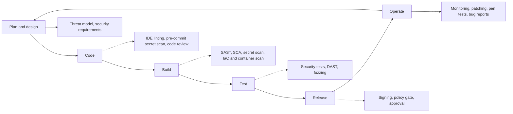
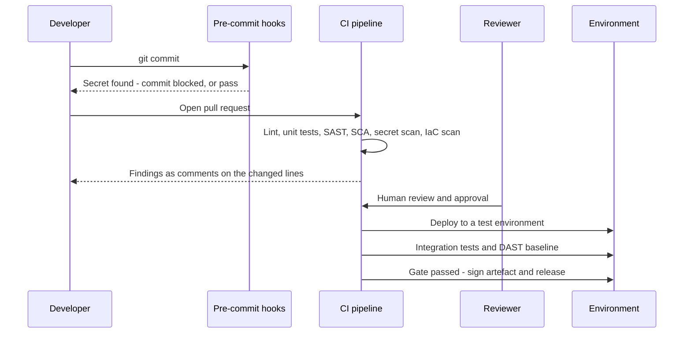

# Security in the SDLC: SAST, DAST and CI gates

> **Before this lesson:** read [Secure code review and input validation](#/lesson/web-security/code-review-validation) (sources and sinks), [Vulnerable dependencies and the supply chain](#/lesson/web-security/dependencies-supply-chain) (SCA and lock files) and [Security misconfiguration and secrets management](#/lesson/web-security/misconfiguration-secrets) (secret scanning). No experience of build pipelines is assumed.

## In plain words

A car factory does not build an entire car and only then check whether the brakes work. It inspects the steel when it arrives, tests each weld on the line, checks the wiring before the dashboard goes in, and road-tests the finished vehicle. A fault found at the welding station costs minutes. The same fault found after delivery costs a recall.

Software is built on a similar line, called the **software development life cycle (SDLC)**: plan, design, write, build, test, release, run. For a long time security was a single inspection at the very end — a consultant testing the finished product a week before launch. Problems found that late are expensive, sometimes impossible, to fix, and the pressure is always to ship anyway.

The modern approach puts small, automatic security checks at *every* station. This is known as **shifting left** — on a timeline drawn from left (idea) to right (production), the checks move towards the start — and, when it is woven into the team's delivery pipeline, as **DevSecOps**. Machines do the repetitive detection, so that people can spend their attention on design and logic, where machines are weak.

For a developer this is daily life: the scanner comment on your pull request, the build that fails because of a vulnerable package. Knowing what each tool can and cannot see — and how to set them up so that people do not learn to ignore them — is what interviewers mean by "how do you build security into the development process?"

## The life cycle and where each check lives



| Stage | Security activity | Covered in |
|---|---|---|
| Plan / design | Security requirements, threat modelling, abuse cases | Threat modelling lesson |
| Code | Secure defaults, linters in the editor, pre-commit hooks, peer review | Code review lesson |
| Build | Static analysis, dependency and secret scanning, configuration scanning | This lesson |
| Test | Security unit and integration tests, dynamic scanning, fuzzing | This lesson |
| Release | Artefact signing, policy gates | Supply chain lesson |
| Operate | Logging, monitoring, patching, penetration tests, disclosure | Next lesson |

The cost argument is the reason for the whole arrangement: the same flaw becomes more expensive at each step to the right, because more work has been built on top of it and more people must be involved in undoing it.

## The automated tools, one at a time

A whole alphabet of abbreviations exists. Each names a tool that looks at the software from a different angle. Start with the question each one answers.

### SAST — reading the code

**Static application security testing (SAST)** analyses source code *without running it*. "Static" means the program is at rest. The tool parses the code and looks for dangerous patterns; the better ones follow data from sources to sinks across functions and files (*taint analysis*), exactly as a human reviewer does, but tirelessly.

- **Finds well:** injection built by string concatenation, `eval`, `shell=True`, unsafe deserialisation, weak cryptographic functions, disabled TLS verification, hard-coded credentials.
- **Finds badly or not at all:** missing authorisation, business-logic flaws, anything depending on configuration or on how components interact at runtime.
- **Characteristic weakness:** **false positives** — warnings about code that is in fact safe, because the tool cannot always tell whether a value was validated.
- **Examples:** Bandit (Python), Semgrep (many languages, custom rules), CodeQL, SonarQube, ESLint security plugins.

A toy version makes the mechanism — and its limits — concrete:

```python-run
import ast

SOURCE = '''
import subprocess, hashlib, pickle

def resize(name):
    subprocess.run("convert " + name + " out.png", shell=True)

def fingerprint(password):
    return hashlib.md5(password.encode()).hexdigest()

def load(blob):
    return pickle.loads(blob)

def safe(name):
    subprocess.run(["convert", name, "out.png"])
'''

class Finder(ast.NodeVisitor):
    def __init__(self):
        self.findings = []

    def visit_Call(self, node):
        name = ast.unparse(node.func)                       # e.g. "subprocess.run"
        for keyword in node.keywords:
            if keyword.arg == "shell" and getattr(keyword.value, "value", None) is True:
                self.findings.append((node.lineno, "shell=True: possible command injection"))
        if name == "hashlib.md5":
            self.findings.append((node.lineno, "MD5 is not suitable for security purposes"))
        if name in ("pickle.loads", "pickle.load"):
            self.findings.append((node.lineno, "unpickling untrusted data runs code"))
        self.generic_visit(node)                            # keep walking into nested calls

finder = Finder()
finder.visit(ast.parse(SOURCE))
for line, message in sorted(finder.findings):
    print(f"line {line}: {message}")
```

`ast.parse` turns source text into an **abstract syntax tree**: a structured representation of the program in which every function call, assignment and name is a node. `Finder` inherits from `ast.NodeVisitor`, whose `visit` method walks the tree and calls `visit_Call` for each function call. Inside, `ast.unparse(node.func)` gives the called name as text, and the loop inspects keyword arguments. Three findings are printed; the last function, which uses an argument list, is not flagged. This is the principle behind real SAST: the program is examined as a structure, not as text — which is why such tools are not fooled by spacing or line breaks the way a plain text search is.

Now notice what it cannot know. Is `blob` in `load` untrusted, or does it come from a file the application wrote itself? Is `fingerprint` used for passwords or for cache keys? The tool reports the pattern; a person supplies the judgement.

### SCA — checking the ingredients

**Software composition analysis** compares your dependencies with databases of known vulnerabilities, as covered in the supply-chain lesson. It has a low false-positive rate for "is this version affected?", but cannot say whether your code actually reaches the vulnerable function. Examples: `pip-audit`, `npm audit`, OSV-Scanner, Dependabot.

### Secret scanning — catching credentials

Searches code and history for keys and passwords. Fast, cheap, and best run in three places: a **pre-commit hook** (a script that runs on the developer's machine before a commit is recorded), the pipeline, and periodically across history. Examples: gitleaks, trufflehog.

### IaC and container scanning — checking the environment

Reads Terraform, Kubernetes and Dockerfile definitions for misconfigurations (public buckets, containers running as root), and inspects container images for vulnerable operating-system packages. Examples: Checkov, tfsec, Trivy, Hadolint.

### DAST — attacking the running application

**Dynamic application security testing (DAST)** runs against a *deployed, running* copy of the application, from the outside, with no knowledge of the source. It crawls the pages and API, sends probing inputs to every parameter, and inspects the responses.

- **Finds well:** missing security headers, cookie flags, reflected input, error disclosure, some injection, exposed files and debug pages — anything observable over HTTP, including problems created by configuration and deployment that no source scan sees.
- **Finds badly:** flaws behind complicated logins or multi-step flows it cannot navigate; authorisation rules; stored issues that surface in another user's view.
- **Characteristic weaknesses:** slow (minutes to hours); needs a realistic test environment and test accounts; may create junk data — never aim it at production without care, and never at systems you are not authorised to test.
- **Examples:** OWASP ZAP, Burp Suite's scanner, Nuclei.

### IAST, RASP and fuzzing — in brief

- **IAST** (interactive AST) places an agent *inside* the running application during tests, so it sees both the request and which code handled it. Fewer false positives; language-specific.
- **RASP** (runtime application self-protection) is a similar agent in production that blocks suspicious behaviour — a protective layer more than a testing tool.
- **Fuzzing** feeds enormous numbers of random and malformed inputs to a function or endpoint and watches for crashes or `500` errors. Excellent for parsers, file handling and input validation.

### The comparison table to remember

| | SAST | SCA | DAST |
|---|---|---|---|
| Looks at | Your source code | Your dependency list | The running application |
| Needs a running app | No | No | Yes |
| Speed | Seconds to minutes | Seconds | Minutes to hours |
| Points to the exact line | Yes | To the package | No — to a URL and parameter |
| Sees configuration and deployment issues | No | No | Yes |
| Typical noise | False positives | Unreachable findings | Missed coverage |
| Finds business-logic flaws | No | No | No |

The last row is the important one. **No scanner finds broken access control or logic flaws reliably**, because none of them knows your rules. Those are covered by threat modelling, human review and tests you write yourself.

## Security tests you write yourself

Automated scanners are generic. The highest-value automated checks are specific to your application and live in your ordinary test suite:

```python
# Security regression tests - run with every build, like any other test

def test_other_users_invoice_is_not_readable(client, ann, bob_invoice):
    response = client.get(f"/invoices/{bob_invoice.id}", headers=ann.auth)
    assert response.status_code == 404

def test_csrf_token_required(client, ann):
    response = client.post("/account/email", data={"email": "x@example.org"}, cookies=ann.cookies)
    assert response.status_code == 403

def test_search_treats_quotes_as_data(client):
    response = client.get("/search", params={"q": "O'Brien"})
    assert response.status_code == 200

def test_security_headers_present(client):
    headers = client.get("/").headers
    assert headers["X-Content-Type-Options"] == "nosniff"
    assert "frame-ancestors" in headers["Content-Security-Policy"]
```

Each test encodes one rule from an earlier lesson: object-level authorisation, CSRF protection, parameterised queries, baseline headers. Every vulnerability ever found in your product — by a scanner, a reviewer, a penetration tester or an outside researcher — should gain a **regression test** that fails if the flaw returns. Fixed bugs otherwise have a habit of coming back during refactoring.

## The pipeline and its gates

**Continuous integration (CI)** is a service that automatically builds and tests every proposed change. A **gate** is a rule in that pipeline that stops a change from progressing — being merged or deployed — until a condition is met.



A reasonable arrangement, fastest checks first:

| When | What runs | Gate? |
|---|---|---|
| In the editor | Linter with security rules | Advisory |
| Pre-commit | Secret scan, formatting | Blocks the commit |
| Every pull request (minutes) | Unit and security tests, SAST on changed code, SCA, secret scan, IaC scan | Blocks merge on new high-severity findings and failed tests |
| After merge, on a test environment | Integration tests, DAST baseline scan, container scan | Blocks release |
| Nightly or weekly | Full SAST and DAST, full-history secret scan, dependency re-scan | Creates tickets |
| Periodically | Penetration test, threat-model review | Planned work |

### Writing a gate people can live with

A gate that blocks on everything is switched off within a month. A gate that blocks on nothing is decoration. The workable policy has four properties:

1. **Block on new, high-confidence, high-severity findings**; report the rest.
2. **Compare with a baseline**, so that existing problems in old code do not block unrelated changes (they are tracked and worked down separately).
3. **Allow documented exceptions** — a specific finding, suppressed with a reason, an owner and an expiry date — instead of forcing people to disable the tool.
4. **Be fast and clear**: results in minutes, shown on the offending line, with a fix suggestion.

That policy is small enough to express in code:

```python-run
SEVERITY = {"low": 1, "medium": 2, "high": 3, "critical": 4}

def gate(findings, baseline, exceptions, today, block_at="high"):
    blocking, reported = [], []
    for f in findings:
        if f["id"] in baseline:
            continue                                       # known debt: tracked elsewhere
        waiver = exceptions.get(f["id"])
        if waiver and waiver["expires"] >= today:
            reported.append((f["id"], "waived: " + waiver["reason"]))
            continue
        if SEVERITY[f["severity"]] >= SEVERITY[block_at]:
            blocking.append(f["id"])
        else:
            reported.append((f["id"], "below blocking threshold"))
    return ("FAIL" if blocking else "PASS"), blocking, reported

findings = [
    {"id": "sast-sql-concat-orders.py:41", "severity": "high"},
    {"id": "sast-md5-legacy.py:9",         "severity": "medium"},
    {"id": "sca-ADV-101-requests",         "severity": "critical"},
    {"id": "sast-weak-random-tests.py:3",  "severity": "low"},
]
baseline = {"sast-md5-legacy.py:9"}
exceptions = {"sca-ADV-101-requests": {"reason": "not reachable; upgrade scheduled", "expires": "2026-12-15"}}

for today in ("2026-12-01", "2026-12-20"):
    result, blocking, reported = gate(findings, baseline, exceptions, today)
    print(today, "->", result, "| blocking:", blocking)
```

`gate` walks through the findings. One that is in the baseline is skipped. One with a waiver that has not expired is reported but does not block. Anything else at or above the threshold blocks. Dates written as `YYYY-MM-DD` compare correctly as text, which is why the simple `>=` works. On 1 December the build fails because of the new SQL finding alone. On 20 December the waiver for the dependency has **expired**, so it blocks too — an exception that quietly lasts for ever is not an exception, it is a hole.

> [!WARNING]
> A green pipeline means "the automated checks found nothing they are able to find". It does not mean the change is secure. The most common serious flaws — missing authorisation, broken business rules — pass every scanner.

> [!TIP]
> Introduce tools one at a time, in report-only mode first. Tune the rules until the findings are nearly all real, fix or baseline what exists, and only then turn on blocking. Developer trust in the tool is the scarce resource; spend it carefully.

## Dealing with findings

A finding is the start of a small process, not the end of one.

1. **Triage**: is it real? Reachable with untrusted input? How severe *here*?
2. **Decide**: fix now; fix by a deadline tied to severity; or suppress with a recorded reason.
3. **Fix the class, not the instance**: add a helper, a lint rule or a framework setting so that the same mistake cannot be written again. Ten findings of string-built SQL are one problem — the absence of a safe data-access pattern.
4. **Add a regression test.**
5. **Measure**: time to fix by severity, number of open findings, how many issues escaped to production and which stage should have caught them.

False positives deserve a short note. Suppress them *in the code next to the line*, with a comment explaining why (`# nosec B303 - MD5 used for cache key, not security`), so the reasoning is reviewed and visible. Tune or remove rules that are wrong most of the time. A tool whose output is ignored is worse than no tool, because it creates the impression of coverage.

## People and process

Tools are the smaller half. The practices that make the difference:

- **Security requirements written with the feature**: "only the owner may view an invoice" belongs in the ticket, with a test.
- **Threat modelling** for new designs.
- **Paved roads**: shared, secure-by-default building blocks — an authentication library, a data-access layer, a logging helper that redacts — so that the easy way is the safe way.
- **Security champions**: one interested developer per team who acts as the first point of contact and brings knowledge in.
- **Training that uses your own code and incidents.**
- **Blameless reviews** after incidents, aimed at fixing the system that let the mistake through.

Frameworks describing a full programme exist for when you need one: OWASP SAMM (Software Assurance Maturity Model), NIST's Secure Software Development Framework (SSDF), and the OWASP Application Security Verification Standard (ASVS) as a detailed checklist of requirements.

> [!INTERVIEW]
> "How would you integrate security into CI/CD?" Describe the stations: pre-commit secret scanning; on each pull request, fast SAST, SCA, secret and IaC scans plus security unit tests, with results as inline comments; after deploy to a test environment, integration tests and a DAST baseline; scheduled deep scans. Explain the gate policy — block on new high-severity findings, baseline for legacy code, time-limited documented exceptions. Then give the limitation that shows judgement: tools miss authorisation and logic flaws, so threat modelling, review and application-specific tests remain essential. Explaining SAST versus DAST in one sentence each is often a direct follow-up.

## Defence in depth

Each technique sees what the others miss:

- **Design review** catches flaws in the plan.
- **Human code review** catches missing checks and wrong assumptions.
- **SAST** catches dangerous code patterns.
- **SCA and secret scanning** catch what was imported or pasted.
- **Your own security tests** catch violations of your rules.
- **DAST** catches what deployment and configuration introduced.
- **Monitoring, penetration tests and outside reports** catch what everything else missed.

## How to test the testing

- **Plant a canary.** In a test branch add a deliberately vulnerable line — an f-string SQL query, a fake credential in a recognised format — and confirm the pipeline flags it and the gate blocks. If it does not, the tool is misconfigured or not running on that path.
- **Check coverage.** Which repositories, languages and directories does each scanner actually examine? Is the DAST scan authenticated, and how many of your routes did it reach?
- **Check the fail-safe.** If a scanner crashes or times out, does the pipeline pass or fail? A security step that fails open is easily lost without anyone noticing.
- **Review the suppressions** periodically: how many, how old, still justified?
- **Trace escapes.** For each vulnerability found in production, identify the earliest stage that could have caught it and add the check there.

## Pitfalls

- **Security as a final phase** before release.
- **Turning every tool on at maximum sensitivity** and drowning the team.
- **Blocking on existing debt**, so that nobody can merge anything and the gate is removed.
- **Permanent, unexplained suppressions.**
- **Scans that run but whose results nobody reads.**
- **Treating scanner output as a to-do list** without triage or prioritisation.
- **Unauthenticated DAST** that only ever sees the login page.
- **Pointing an active scanner at production** or at third-party systems.
- **Believing "we have SAST and DAST" equals "we do security".**
- **Leaving the pipeline itself unprotected** — it holds deployment credentials and can modify what is shipped.

## Summary

- Security belongs at every stage of the development life cycle; the earlier a flaw is found, the cheaper it is to fix.
- SAST reads source code for dangerous patterns; SCA checks dependencies against advisories; secret and configuration scanners catch credentials and unsafe settings; DAST probes the running application from outside.
- Each tool has blind spots, and none finds authorisation or business-logic flaws reliably — those need threat modelling, human review and your own tests.
- Application-specific security tests and regression tests for every past vulnerability are the most valuable automation you can write.
- CI gates should block on new, high-severity findings, use a baseline for old code, allow documented time-limited exceptions, and give fast, precise feedback.
- Triage findings, fix classes of problems, measure, and keep people — champions, paved roads, training — at the centre.

## Glossary

- **SDLC** — software development life cycle: the stages from planning to operation.
- **Shift left** — moving security activities earlier in the life cycle.
- **DevSecOps** — integrating security into development and operations practices and pipelines.
- **SAST** — static application security testing: analysing source code without running it.
- **DAST** — dynamic application security testing: testing a running application from outside.
- **SCA** — software composition analysis: checking dependencies for known vulnerabilities.
- **IAST / RASP** — instrumentation inside the running application for testing / for protection.
- **Fuzzing** — testing with large volumes of random or malformed input.
- **Abstract syntax tree (AST)** — a structured representation of source code used by analysers.
- **Taint analysis** — tracking untrusted data from sources to sinks.
- **False positive / false negative** — a reported problem that is not real / a real problem that is not reported.
- **CI/CD** — continuous integration and continuous delivery: automated build, test and release.
- **Pre-commit hook** — a script run locally before a commit is recorded.
- **Gate** — a pipeline rule that blocks progress until a condition is met.
- **Baseline** — the recorded set of existing findings, used to detect new ones.
- **Regression test** — a test ensuring a fixed defect does not return.
- **Security champion** — a team member who promotes and coordinates security practice.

```quiz
[
  {"q": "What does 'shifting left' mean?",
   "options": ["Moving servers to a different region", "Performing security activities earlier in the development life cycle", "Writing code from right to left", "Delaying testing until after release"], "answer": 1,
   "explain": "On a timeline from design to production, earlier is to the left. Earlier detection is cheaper."},
  {"q": "Which statement distinguishes SAST from DAST?",
   "options": ["SAST runs the application; DAST reads the source", "SAST analyses source code without running it; DAST tests the running application from outside", "They are the same", "SAST is only for JavaScript"], "answer": 1,
   "explain": "Static means at rest, dynamic means in execution. They see different classes of problem."},
  {"q": "Which tool type is most likely to detect a missing security header caused by a proxy misconfiguration?",
   "options": ["SAST", "SCA", "DAST", "Secret scanning"], "answer": 2,
   "explain": "The problem exists only in the deployed system's responses. Source-level tools cannot see it."},
  {"q": "Which kind of flaw do automated scanners generally fail to find?",
   "options": ["Use of eval", "A known-vulnerable library version", "A user being able to read another user's records", "A hard-coded access key"], "answer": 2,
   "explain": "Authorisation depends on application-specific rules that generic tools do not know."},
  {"q": "A new SAST gate blocks every pull request because of hundreds of old findings. What is the usual remedy?",
   "options": ["Disable the tool permanently", "Record a baseline and block only on new high-severity findings while working down the old ones", "Lower all severities", "Skip tests"], "answer": 1,
   "explain": "A baseline lets the gate protect new code immediately without halting work on unrelated changes."},
  {"q": "Why should a waiver for a finding have an expiry date?",
   "options": ["To make the pipeline slower", "So the exception is revisited instead of silently becoming permanent", "Because scanners require dates", "To hide the finding"], "answer": 1,
   "explain": "Circumstances change. An expiring exception forces a fresh decision."},
  {"q": "A vulnerability reported by an outside researcher has been fixed. What should be added to prevent its return?",
   "options": ["A longer password policy", "A regression test that fails if the flaw is reintroduced", "A new firewall", "Nothing"], "answer": 1,
   "explain": "Refactoring often resurrects old bugs. A test that encodes the fix keeps guarding it."},
  {"q": "What does a fully green security pipeline prove?",
   "options": ["The application is secure", "The automated checks found nothing within their capabilities", "No penetration test is needed", "There are no dependencies"], "answer": 1,
   "explain": "Tools have blind spots, notably design and logic. Passing them is necessary, not sufficient."}
]
```

> **Source:** Hoffman, *Web Application Security*, ch. 17 (securing modern web applications), ch. 20 (vulnerability discovery: security automation, static analysis, dynamic analysis, vulnerability regression testing), in original wording with original examples. OWASP DevSecOps Guideline — https://owasp.org/www-project-devsecops-guideline/ ; OWASP SAMM — https://owaspsamm.org/ ; OWASP Source Code Analysis Tools — https://owasp.org/www-community/Source_Code_Analysis_Tools ; OWASP ZAP — https://www.zaproxy.org/ ; NIST Secure Software Development Framework (SP 800-218) — https://csrc.nist.gov/projects/ssdf ; OWASP CI/CD Security Cheat Sheet — https://cheatsheetseries.owasp.org/cheatsheets/CI_CD_Security_Cheat_Sheet.html
