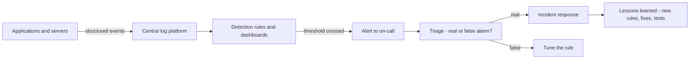
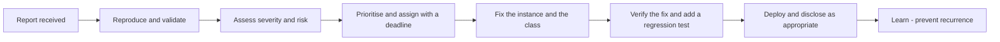

# Logging, monitoring and vulnerability management

> **Before this lesson:** read [Security in the SDLC: SAST, DAST and CI gates](#/lesson/web-security/sdlc-automation) for how findings are produced, and [Secure architecture and threat modelling (STRIDE)](#/lesson/web-security/threat-modelling) for risk rating and the *repudiation* threat. The log-injection idea builds on [SQL injection and parameterised queries](#/lesson/web-security/sql-injection).

## In plain words

A shop has locks on the doors — and also a security camera, an alarm, and a procedure for what to do when the alarm rings. The locks are *prevention*. The camera and alarm are *detection*. The procedure is *response*. A shop with excellent locks and no camera will, one day, be burgled without anyone knowing how, when, or what was taken.

Every lesson so far has been about locks. This one is about the camera and the procedure. **Logging** is the application's camera: a written record of what happened. **Monitoring** is somebody — or something — actually watching the footage and raising the alarm. **Vulnerability management** is the procedure for the other kind of bad news: a report that one of your locks is faulty. It covers how such reports arrive, how you decide which to fix first, and how you fix them and make sure they stay fixed.

OWASP lists *Security Logging and Monitoring Failures* in its Top 10 for a sobering reason: studies of real breaches keep finding that intruders were inside for weeks or months before being noticed, and were often noticed by an outsider. And every engineer will at some point receive a message beginning "I think I found a security problem in your site." Handling that well is a professional skill, and interviewers ask about both.

## Part 1: logging

### What to record

A **log** is a time-ordered list of **events**. For security, the events worth recording are the ones that answer "who did what, to what, when, from where, and did it work?"

| Category | Events |
|---|---|
| **Authentication** | Login success and failure, logout, password change and reset, MFA enrolment and failure, lockouts |
| **Authorisation** | Access denied (403/404 on protected resources), permission and role changes |
| **Sensitive actions** | Payments, refunds, exports, account deletion, administrative operations, impersonation |
| **Input validation failures** | Rejected requests, especially bursts of them |
| **Security controls firing** | Rate limit exceeded, CSRF token mismatch, signature verification failure |
| **System and configuration** | Start-up with configuration summary, deployments, changes to security settings |
| **Errors** | Unhandled exceptions with a correlation ID |

Each event should carry: a timestamp in UTC from a synchronised clock; the user or service identity; the source address; the action; the object acted on; the outcome; and a **correlation ID** — a random identifier attached to a request as it enters the system and passed along to every service that handles it, so that one request can be followed across many log files.

### Structured logs

Write logs as data, not as sentences. A **structured log** entry is a set of named fields, normally one JSON object per line:

```python
# VULNERABLE (as engineering): free text is hard to search and easy to forge
logger.info("User " + email + " failed login from " + ip)
```

```python
# FIXED: named fields
logger.info("login_failed", extra={"user_id": user_id, "ip": ip, "reason": "bad_password",
                                   "request_id": request_id})
```

With fields, a monitoring system can count `login_failed` events per `ip` without guessing at sentence structure.

### What never to record

Logs are copied to many systems, kept for a long time and read by many people. Whatever is in them is, in effect, widely shared. Never log:

- passwords — including *failed* attempts, which are often the right password with one typo;
- session identifiers, access tokens, API keys, `Authorization` and `Cookie` headers;
- full payment card numbers, security codes;
- secrets and encryption keys;
- more personal data than the investigation needs.

The safe design is an allow-list: log named fields that you chose, not whole request bodies or headers. As a second layer, pass every event through a **redaction** step.

```python-run
import json, re

SENSITIVE_KEYS = {"password", "token", "authorization", "cookie", "secret", "api_key", "card_number"}
CARD_LIKE = re.compile(r"(?<!\d)\d{13,19}(?!\d)")          # a run of 13 to 19 digits

def redact(value):
    if isinstance(value, dict):
        return {key: ("[REDACTED]" if key.lower() in SENSITIVE_KEYS else redact(item))
                for key, item in value.items()}
    if isinstance(value, list):
        return [redact(item) for item in value]
    if isinstance(value, str):
        masked = CARD_LIKE.sub(lambda m: "*" * (len(m.group()) - 4) + m.group()[-4:], value)
        return masked.replace("\r", "\\r").replace("\n", "\\n")      # one event = one line
    return value

event = {
    "event": "checkout_failed",
    "user_id": 7,
    "headers": {"Authorization": "Bearer eyJhbGciOi...", "Accept": "application/json"},
    "form": {"email": "ann@shop.example", "Password": "hunter2", "note": "card 4111111111111111 declined"},
    "message": "gateway timeout\n2026-11-21 INFO admin login ok user=root",
}
print(json.dumps(redact(event), indent=2))
print("original untouched:", event["form"]["Password"])
```

`redact` is recursive: for a dictionary it builds a **new** dictionary, replacing the value of any key whose lower-cased name is on the sensitive list and calling itself on the rest; for a list it processes each element; for a string it masks card-like digit runs, keeping the last four, and then turns real line breaks into the visible two-character sequences `\r` and `\n`. Other values pass through. The output shows `Authorization` and `Password` hidden regardless of capitalisation, the card number masked, and the multi-line message flattened. The last line confirms the original event was not modified.

### Log injection

Why flatten line breaks? Because logs have an injection problem of their own. If user-supplied text is written into a line-based log unaltered, a value containing a newline followed by something shaped like a log entry — as in the `message` field above — creates a **forged entry**: a fake "admin login ok" line that could mislead an investigator or a detection rule. Log viewers that render HTML add a second risk: script in a logged value becomes stored XSS against whoever views the logs.

Defences: structured logging (the JSON encoder escapes newlines and quotes for you), neutralising control characters, and output encoding in any log viewer.

### Protecting the logs

Logs are evidence, and an intruder's first wish is to erase their tracks.

- **Ship logs off the machine** immediately to a central, separate system; a compromised server should not be able to delete its own history.
- **Append-only** storage with restricted access; few people may read, almost nobody may delete.
- **Integrity protection** where it matters — write-once storage or signed log batches.
- **Retention** long enough to investigate (often many months for security logs) and no longer than privacy rules allow.
- **Synchronised clocks** across servers, or events cannot be put in order.

## Part 2: monitoring and detection

A log nobody reads is a diary, not an alarm. **Monitoring** turns events into signals; **alerting** brings a person in when a signal crosses a line.



Large organisations run a **SIEM** (security information and event management) platform for this; a small team can start with the alerting features of its logging service.

### What to alert on

Aim at behaviour, mapped to the attacks from this track:

| Signal | What it may indicate |
|---|---|
| Many failed logins for one account | Brute force |
| Failed logins across many accounts from few addresses | Password spraying, credential stuffing |
| A successful login after many failures | A guessed password |
| Bursts of 403/404 on object URLs from one user | IDOR enumeration |
| Spike in validation errors or `500`s on one endpoint | Injection probing, fuzzing |
| CSRF or signature failures | Forgery attempts — or a broken client |
| Requests for `/.env`, `/.git/`, admin paths | Automated reconnaissance |
| Unusually large export or data volume by one account | Data theft |
| New administrator created; MFA disabled; security setting changed | Persistence after a compromise |
| Login from a new country followed by a password or email change | Account takeover |
| Outbound connections from the web tier to unexpected hosts | SSRF or a compromised dependency |

A detection rule is, at heart, a small program over the event stream:

```python-run
from collections import defaultdict

events = [
    {"t": 0,   "type": "login_failed", "account": "ann",   "ip": "198.51.100.7"},
    {"t": 5,   "type": "login_failed", "account": "bob",   "ip": "198.51.100.7"},
    {"t": 9,   "type": "login_failed", "account": "carol", "ip": "198.51.100.7"},
    {"t": 14,  "type": "login_failed", "account": "dave",  "ip": "198.51.100.7"},
    {"t": 20,  "type": "login_failed", "account": "erin",  "ip": "198.51.100.7"},
    {"t": 300, "type": "login_failed", "account": "ann",   "ip": "203.0.113.50"},   # Ann mistypes once
    {"t": 320, "type": "login_ok",     "account": "ann",   "ip": "203.0.113.50"},
]

def spraying_alerts(events, window=60, distinct_accounts=5):
    failures = defaultdict(list)                       # ip -> list of (time, account)
    alerts = []
    for e in events:
        if e["type"] != "login_failed":
            continue
        recent = [(t, a) for t, a in failures[e["ip"]] if t > e["t"] - window]
        recent.append((e["t"], e["account"]))
        failures[e["ip"]] = recent
        accounts = {a for _, a in recent}
        if len(accounts) >= distinct_accounts:
            alerts.append((e["t"], e["ip"], len(accounts)))
    return alerts

for when, ip, count in spraying_alerts(events):
    print(f"t={when}: possible password spraying from {ip} - {count} different accounts in 60 s")
```

`defaultdict(list)` is a dictionary that creates an empty list the first time a key is used. For each failed login the function keeps that address's failures from the last 60 seconds and counts the **distinct accounts** among them. Five different accounts from one address within a minute raises an alert; Ann's single typo from her own address does not. Counting distinct accounts instead of raw failures is what separates an attack from a forgetful user.

### Alerts that people can act on

- Every alert must be **actionable**: it says what happened and links to a short **runbook** describing what to check and do.
- Tune relentlessly. Too many false alarms cause **alert fatigue**, and the real one is missed.
- Use severity levels: page a person for the critical few; send the rest to a queue.
- Test detection: deliberately trigger each rule in a test environment and confirm the alert arrives.

### Incident response in one paragraph

When an alert is real, follow a plan prepared in advance. The standard phases: **prepare** (contacts, access, runbooks, practice); **identify** (confirm and scope); **contain** (stop the bleeding — revoke sessions and keys, block the path, isolate the system, while preserving evidence); **eradicate** (remove the cause); **recover** (restore service, watch closely); and **learn** (a blameless review that produces fixes, tests and new detections). Depending on the data and jurisdiction there may also be legal duties to notify regulators and affected users within a fixed time — one more reason to know quickly what happened.

## Part 3: vulnerability management

### Where vulnerability reports come from

| Source | Notes |
|---|---|
| Your own tools | SAST, SCA, DAST, configuration scanners |
| Code review and threat modelling | Design and logic issues |
| **Penetration tests** | Hired specialists attack the system, with permission and a defined scope, and write a report |
| **Responsible disclosure / bug bounty** | Outside researchers report what they find |
| Vendors and public advisories | CVEs in products and libraries you use |
| Incidents | A flaw discovered because it was used |

### The process



**Reproduce.** Confirm the report in a safe environment. Reproducing establishes that the issue is real, shows its true reach, and gives you the test case you will later automate.

**Assess severity.** The common language is **CVSS**, the Common Vulnerability Scoring System, which produces a score from 0.0 to 10.0. Its *base* score derives from characteristics of the flaw: can it be exploited over the network or only locally? How complex is the attack? Are privileges or user interaction required? What is the impact on confidentiality, integrity and availability? Scores map to labels:

| Score | Rating |
|---|---|
| 0.1 – 3.9 | Low |
| 4.0 – 6.9 | Medium |
| 7.0 – 8.9 | High |
| 9.0 – 10.0 | Critical |

A base score describes the flaw *in general*. Your priority must also consider **your** context: Is the affected system internet-facing? Does it hold sensitive data? Is the vulnerable code reachable? Is the flaw being actively exploited in the wild (public "known exploited" lists and probability scores such as EPSS help here)? A critical-rated flaw on an isolated internal tool may reasonably wait behind a medium one on the public login page.

**Prioritise with deadlines.** Agree **remediation targets** by severity in advance, so the discussion is not repeated for every finding:

```python-run
SLA_DAYS = {"critical": 2, "high": 14, "medium": 45, "low": 90}

def triage(findings, today):
    rows = []
    for f in findings:
        priority = f["severity"]
        # Context can raise priority: exposure and known exploitation
        if f.get("actively_exploited") and priority != "critical":
            priority = "critical"
        elif f.get("internet_facing") and priority == "medium":
            priority = "high"
        due = f["reported_day"] + SLA_DAYS[priority]
        status = "OVERDUE" if today > due else f"due in {due - today} d"
        rows.append((list(SLA_DAYS).index(priority), due, f["id"], priority, status))
    return sorted(rows)

findings = [
    {"id": "V-1 IDOR on invoices",          "severity": "high",   "reported_day": 0,  "internet_facing": True},
    {"id": "V-2 old TLS on admin intranet", "severity": "medium", "reported_day": 0},
    {"id": "V-3 library flaw, exploited",   "severity": "high",   "reported_day": 8,  "actively_exploited": True},
    {"id": "V-4 verbose error on API",      "severity": "medium", "reported_day": 2,  "internet_facing": True},
    {"id": "V-5 missing header",            "severity": "low",    "reported_day": 1},
]
for _, due, name, priority, status in triage(findings, today=12):
    print(f"{priority:8} {status:12} {name}")
```

Each finding starts at its reported severity; two context rules can raise it. The due date is the report day plus the agreed number of days. `list(SLA_DAYS).index(priority)` gives 0 for critical through 3 for low, so sorting the tuples lists the most urgent first, and earlier deadlines first within a level. V-3 jumps to critical because it is being exploited, and at day 12 it is already overdue.

**Fix the class.** Patch the reported instance, then search for the same mistake elsewhere and remove the *possibility* of it — a shared helper, a lint rule, a framework default.

**Verify and regress.** Confirm the original reproduction no longer works; add it to the test suite; ask the reporter to confirm where appropriate.

**Record.** Keep a register: what, where, severity, owner, dates, decision. Risks accepted instead of fixed are recorded with an owner and a review date.

### CVSS in depth

The severity step above mentioned CVSS in one paragraph. Since vulnerability reports, advisories and scanner output all quote it, you should be able to read it fluently and know its limits.

**CVSS** (Common Vulnerability Scoring System) is maintained by FIRST, a forum of security teams. It turns a description of a flaw into a number from 0.0 to 10.0 and a compact text code called a **vector string**. The point is a shared language: two teams reading "CVSS 9.8" mean the same *kind* of flaw. This section describes version 3.1, the one you will meet most often, and then notes how version 4.0 differs.

#### Three groups of metrics

A **metric** is one question with a fixed set of answers. CVSS arranges its questions in three groups, each building on the one before.

| Group | Describes | Who fills it in | Changes over time? |
|---|---|---|---|
| **Base** | The flaw itself, independent of any organisation | The reporter or the software vendor | No (it is the permanent score) |
| **Temporal** (called **Threat** in v4.0) | The state of the world around the flaw: is exploit code available, is a fix released, how sure are we it is real | Updated by whoever tracks it | Yes |
| **Environmental** | How the flaw lands in *your* environment: how important the affected system is, and what protections you already have | You | Per organisation |

Think of a fire-safety rating for a type of heater. The *base* rating says how dangerous the heater is in general. The *temporal* part says whether a recall is out and whether fires have been reported. The *environmental* part says whether you put the heater in a stone cellar or beside the curtains.

#### The base metrics, one by one

Eight questions make the base score. Learn them in two sets: how the attack is carried out (exploitability), and what it achieves (impact).

**How it is carried out**

- **Attack Vector (AV)** — from where can the attacker reach the flaw? *Network* (N: across the internet), *Adjacent* (A: same local network segment), *Local* (L: on the machine itself), *Physical* (P: touching the device). Network scores highest because the most people can try it.
- **Attack Complexity (AC)** — does success depend on conditions the attacker cannot control? *Low* (L: repeatable at will) or *High* (H: needs a race, a special configuration or other luck).
- **Privileges Required (PR)** — what access must the attacker already have? *None* (N), *Low* (L: an ordinary account) or *High* (H: administrator).
- **User Interaction (UI)** — must a human do something, such as click a link? *None* (N) or *Required* (R).
- **Scope (S)** — can the flaw affect resources *beyond* the component that holds it? *Unchanged* (U) or *Changed* (C). A flaw in a web page that lets the attacker act inside the user's browser session crosses a security boundary, which is why many XSS flaws are marked Changed.

**What it achieves**

- **Confidentiality (C)**, **Integrity (I)** and **Availability (A)**, each *None*, *Low* or *High*: how much data can be read, how much can be altered, how much can the service be disrupted. These are the three goals of security from the first lesson of this track.

#### Reading a vector string

The vector string lists every base metric as `abbreviation:value`, separated by slashes, after a version tag:

```text
CVSS:3.1/AV:N/AC:L/PR:N/UI:N/S:U/C:H/I:H/A:H     score 9.8  Critical
CVSS:3.1/AV:N/AC:L/PR:N/UI:R/S:C/C:L/I:L/A:N     score 6.1  Medium
```

Read the first one aloud: "attackable over the network, low complexity, no privileges needed, no user interaction, scope unchanged, high impact on confidentiality, integrity and availability". That is the shape of an unauthenticated remote takeover, and it is why such flaws sit at the top of every list. The second reads: "network, easy, no account, but a user must click, and it crosses into the browser session with low confidentiality and integrity impact": the classic profile of a reflected XSS, and a typical Medium.

The vector is better than the number for communication, because it shows *why* a score is what it is and lets you spot a disagreement ("you rated privileges as none, but an account is needed").

#### From metrics to a score

The base score is computed with a published formula: exploitability is a product of the weights for AV, AC, PR and UI; impact comes from C, I and A (with a different curve when scope is Changed); the two are combined and rounded up to one decimal place. You never need to do it by hand, but the following small program shows that it is just arithmetic. It implements the version 3.1 base formula.

```python-run
import math

AV = {"N": 0.85, "A": 0.62, "L": 0.55, "P": 0.20}
AC = {"L": 0.77, "H": 0.44}
UI = {"N": 0.85, "R": 0.62}
CIA = {"H": 0.56, "L": 0.22, "N": 0.0}

def roundup(x):
    # CVSS rounds UP to one decimal, using integers to avoid float noise
    n = round(x * 100000)
    return n / 100000.0 if n % 10000 == 0 else (math.floor(n / 10000) + 1) / 10.0

def base_score(vector):
    m = dict(p.split(":") for p in vector.split("/")[1:])
    changed = m["S"] == "C"
    pr = {"N": 0.85, "L": 0.68 if changed else 0.62, "H": 0.50 if changed else 0.27}[m["PR"]]
    iss = 1 - (1 - CIA[m["C"]]) * (1 - CIA[m["I"]]) * (1 - CIA[m["A"]])
    if changed:
        impact = 7.52 * (iss - 0.029) - 3.25 * (iss - 0.02) ** 15
    else:
        impact = 6.42 * iss
    expl = 8.22 * AV[m["AV"]] * AC[m["AC"]] * pr * UI[m["UI"]]
    if impact <= 0:
        return 0.0
    total = impact + expl
    return roundup(min((1.08 if changed else 1.0) * total, 10))

def band(score):
    if score == 0: return "None"
    if score < 4: return "Low"
    if score < 7: return "Medium"
    if score < 9: return "High"
    return "Critical"

for v in ["CVSS:3.1/AV:N/AC:L/PR:N/UI:N/S:U/C:H/I:H/A:H",
          "CVSS:3.1/AV:N/AC:L/PR:N/UI:R/S:C/C:L/I:L/A:N",
          "CVSS:3.1/AV:L/AC:H/PR:H/UI:R/S:U/C:L/I:N/A:N"]:
    s = base_score(v)
    print(s, band(s), v)
```

`dict(p.split(":") for p in ...)` turns each `AV:N` piece into a key and a value. The `iss` ("impact sub-score") grows as more of C, I and A are affected. When scope is Changed, two things differ: the impact curve and the weight for privileges, because crossing a boundary makes a low-privilege attacker more dangerous. The first two vectors print 9.8 and 6.1, matching the published scores for those profiles; the third, a local flaw needing high privileges, a click and a rare condition, lands near the bottom of the Low band.

#### Severity bands

The qualitative labels in version 3.x are:

| Score | Rating |
|---|---|
| 0.0 | None |
| 0.1 – 3.9 | Low |
| 4.0 – 6.9 | Medium |
| 7.0 – 8.9 | High |
| 9.0 – 10.0 | Critical |

#### Temporal and environmental metrics

**Temporal** metrics adjust the base score *downward* (never above the base) for facts that change:

- **Exploit Code Maturity (E)** — is there no known exploit, a proof of concept, a functional exploit, or a high-reliability one?
- **Remediation Level (RL)** — is there an official fix, a temporary fix, a workaround, or nothing?
- **Report Confidence (RC)** — how certain is it that the flaw is real and understood?

**Environmental** metrics let you restate the base metrics for your setting (the "Modified" base metrics, for example Modified Attack Vector when a service is only reachable from an internal network) and add three *requirements* ratings, Confidentiality, Integrity and Availability Requirement (CR, IR, AR), saying how much each goal matters to the affected system. A flaw that leaks data from a system holding nothing sensitive deserves a lower environmental score than the same flaw in a payments database.

#### What changed in CVSS 4.0

Version 4.0 (2023) keeps the idea and tightens the naming, so you will see both in the wild:

- Scores are labelled by which groups are included: **CVSS-B** (base only), **CVSS-BT** (base plus threat), **CVSS-BE** (base plus environmental) and **CVSS-BTE** (all three). The label tells you how much context the number contains; a plain "CVSS 9.8" with no label is almost always base only.
- *Temporal* is renamed **Threat**, and it is reduced to one metric, Exploit Maturity.
- A new base metric, **Attack Requirements (AT)**, separates "the target must be in a particular state" from complexity.
- User Interaction distinguishes *Passive* from *Active* involvement.
- **Scope is removed.** Impact is instead stated twice: for the **vulnerable system** itself and for **subsequent systems** that are affected downstream, which expresses boundary-crossing more precisely.
- A **Supplemental** group adds extra information (such as whether the flaw is automatable or how urgent a provider considers it) that does not change the score.
- The vector starts with `CVSS:4.0/` and uses metric names such as `VC`, `VI` and `VA`.

#### CVSS is not risk

This is the single most important point, and a common interview question. **Severity** answers "how bad is this class of flaw in general?". **Risk** answers "how likely is harm *to us*, and how large would it be?". Risk combines *likelihood* (is it reachable, is it being exploited, are our controls in the way?) with *business impact* (what does this system hold and do?). CVSS base scores contain neither your exposure nor your assets.

So the habit is to use CVSS as **one input**:

1. Start from the base score and vector to understand the flaw.
2. Add threat intelligence: is it on a known-exploited list, what does a probability score such as EPSS say?
3. Add your context: internet-facing or internal, what data, which compensating controls.
4. Record the final priority and the reasoning, so a later reader can see why a 9.8 was scheduled behind a 6.5.

> [!WARNING]
> Do not turn "Critical means fix today, Medium means fix someday" into the whole policy. Teams that rely only on the base number spend their effort on flaws that are unreachable for them and neglect moderate ones that are being exploited right now.

### Responsible disclosure

Sooner or later someone outside your organisation will find a flaw. Whether they tell *you* depends on how easy and safe you make it.

**Coordinated (responsible) vulnerability disclosure** is the practice in which a researcher reports privately, the organisation fixes the issue within a reasonable time, and details are published — if at all — afterwards, usually with credit to the finder. To receive such reports well:

- **Publish a contact.** The convention is a file at `/.well-known/security.txt` listing a security contact and a link to your policy:

```text
Contact: mailto:security@shop.example
Expires: 2027-12-31T23:59:59Z
Policy: https://shop.example/security-policy
Preferred-Languages: en
```

- **Publish a policy** stating what is in scope, what testing is not acceptable (denial of service, accessing other users' data, social engineering of staff), and a **safe-harbour** commitment that you will not pursue legal action against good-faith research within those rules.
- **Acknowledge quickly** — within a few days — and keep the reporter informed.
- **Fix within an agreed window.** Ninety days is a widely used norm before public disclosure.
- **Give credit**, if the reporter wants it.

A **bug bounty programme** adds payment for valid reports, often run through a platform that handles intake and triage. It suits organisations that already fix findings promptly; opening one before your own scanning and review are in order produces a flood you cannot handle.

And from the other side — if *you* stumble on a flaw in someone else's product: stop as soon as you have enough to describe it; do not access, copy or change other people's data; report privately through the published channel; give reasonable time. Testing systems without permission is illegal in most countries, whatever your intentions.

> [!WARNING]
> The worst responses to an outside report are silence and legal threats. Both teach researchers to publish first or to say nothing — and the flaw remains for someone less friendly to find.

> [!TIP]
> When something goes wrong, the first question is always "what do the logs say?" Decide *now* which questions you would need answered — who accessed this record, from where, what else did that session do — and check today that your logs can answer them. Discovering mid-incident that a crucial event was never recorded is a very common and very avoidable experience.

> [!INTERVIEW]
> Two frequent questions. **"What would you log for security, and what would you never log?"** — authentication and authorisation events, sensitive actions, control failures, with who/what/when/where/outcome and a correlation ID; never passwords, tokens, session IDs, card data or secrets; centralise, protect and alert. **"A researcher emails you about a vulnerability — what do you do?"** — thank them and acknowledge promptly; reproduce in a safe environment; rate severity in context; contain if it is being exploited; fix the instance and the class; add a regression test; check logs for earlier exploitation; keep the reporter informed and credit them; review how it got through.

## Defence in depth

1. **Prevent** — everything in the earlier lessons.
2. **Record** — structured, redacted, centralised, tamper-resistant logs of security-relevant events.
3. **Detect** — tuned rules with runbooks; tested regularly.
4. **Respond** — a practised incident plan; the ability to revoke sessions and rotate secrets fast.
5. **Find weaknesses first** — scanning, review, penetration tests, a disclosure channel.
6. **Fix by risk** — severity in context, agreed deadlines, tracked to closure.
7. **Learn** — every incident and finding leaves behind a test, a rule or a design change.

## How to test for it

**In code review:**

- For each authentication, authorisation and sensitive handler: is there a log event for success *and* failure, with identity, object and outcome?
- Search logging calls for request bodies, headers, passwords, tokens and whole objects.
- Is user-controlled text written into logs through a structured logger?
- Are correlation IDs generated and propagated?

**In practice:**

- Perform a failed login, an access-denied request and an admin action in a test environment, then find all three in the central log platform. How long did it take? Were the fields sufficient to say who and what?
- Search stored logs for the test account's password and session token; expect no matches.
- Submit a value containing a line break and check the stored entry is still one event.
- Trigger each alert rule deliberately; confirm it fires and reaches a person.
- Run a **tabletop exercise**: talk through a scenario ("a customer says their account was taken over") step by step and note every point where information or access was missing.
- Review the vulnerability register for overdue items, and try your own `security.txt` contact address to see that someone answers.

## Pitfalls

- **Logging only errors**, not security-relevant successes such as logins and permission changes.
- **Logs kept only on the server that was compromised.**
- **Secrets and personal data in logs**, turning the log store into a breach target.
- **No alerting** — events are recorded and never examined.
- **Alert floods** that are muted.
- **Clocks out of sync.**
- **Treating CVSS as the priority** without considering exposure and exploitation.
- **Fixing the reported instance only.**
- **No named owner or deadline** for findings, so they age indefinitely.
- **No public security contact**, leaving researchers to guess — or to post publicly.
- **Blame after incidents**, which teaches people to hide mistakes.

## Summary

- Prevention is never complete; logging, monitoring and response determine how soon and how well you recover.
- Log authentication, authorisation, sensitive actions and control failures as structured events with who, what, when, where and outcome.
- Never log credentials, tokens, card data or secrets; redact by key and pattern, and neutralise line breaks to prevent forged entries.
- Centralise and protect logs; alert on behaviour patterns with tuned, actionable rules backed by runbooks.
- Vulnerability management is a loop: receive, reproduce, rate in context, prioritise with deadlines, fix the class, verify with a regression test, record and learn.
- CVSS gives a common severity scale; exposure and active exploitation determine real priority.
- Make it easy and safe for outsiders to report problems: a published contact, a clear policy, prompt and courteous handling.

## Glossary

- **Log / event** — a time-ordered record / one entry in it.
- **Structured logging** — writing events as named fields instead of free text.
- **Correlation ID** — an identifier linking all events of one request.
- **Redaction** — removing or masking sensitive values before storage.
- **Log injection (log forging)** — inserting crafted input that creates false log entries.
- **Audit log** — a record of who performed which sensitive actions.
- **Monitoring / alerting** — observing signals / notifying a person when a threshold is crossed.
- **SIEM** — a platform collecting and analysing security events.
- **Alert fatigue** — desensitisation caused by too many alerts.
- **Runbook** — written steps for handling a specific alert or incident.
- **Incident response** — the organised handling of a security incident.
- **Vulnerability management** — the continuous process of finding, assessing, fixing and tracking vulnerabilities.
- **CVSS** — Common Vulnerability Scoring System, a 0–10 severity scale.
- **Remediation target (SLA)** — the agreed time to fix findings of a given severity.
- **Penetration test** — an authorised simulated attack by specialists.
- **Responsible (coordinated) disclosure** — privately reporting a flaw and allowing time to fix before publication.
- **Bug bounty** — a programme rewarding outside reports of vulnerabilities.
- **`security.txt`** — a standard file publishing an organisation's security contact.
- **Safe harbour** — a promise not to take legal action against good-faith research within the policy.
- **Metric** — one scoring question with a fixed set of answers.
- **Base / Temporal (Threat) / Environmental metrics** — CVSS groups describing the flaw itself / its changing real-world state / its effect in your setting.
- **Vector string** — a compact text code listing every metric value, such as `CVSS:3.1/AV:N/AC:L/...`.
- **Attack Vector, Attack Complexity, Privileges Required, User Interaction** — base metrics describing how an attack is carried out.
- **Scope** — whether a flaw can affect components beyond the vulnerable one (CVSS 3.1).
- **Exploit Code Maturity / Remediation Level / Report Confidence** — the temporal metrics.
- **EPSS** — a probability score estimating the chance a flaw will be exploited soon.
- **Risk** — likelihood of harm to your organisation combined with its business impact; not the same as severity.

```quiz
[
  {"q": "Why does OWASP treat insufficient logging and monitoring as a top risk?",
   "options": ["Logs slow down applications", "Without them breaches go undetected for long periods and cannot be investigated", "Logging is required by browsers", "It causes SQL injection"], "answer": 1,
   "explain": "Detection and response depend on records. Many real intrusions lasted months because nobody was watching."},
  {"q": "Which of these should never be written to a log?",
   "options": ["The user ID that performed an action", "The outcome of a login attempt", "The password a user typed in a failed login", "A correlation ID"], "answer": 2,
   "explain": "Failed attempts are often the real password with a typo. Credentials, tokens and secrets must stay out of logs."},
  {"q": "A user-supplied value containing a newline followed by text shaped like a log entry is written unaltered to a line-based log. What is the risk?",
   "options": ["The log file is deleted", "A forged log entry that may mislead investigators or detection rules", "The server restarts", "No risk"], "answer": 1,
   "explain": "This is log injection. Structured logging or neutralising line breaks keeps one event on one line."},
  {"q": "Why should logs be shipped to a separate central system?",
   "options": ["To save disk space only", "So an intruder who compromises a server cannot erase or alter the evidence", "Because local logs are illegal", "To make logs public"], "answer": 1,
   "explain": "Logs are evidence and a target. Off-host, append-only storage preserves them."},
  {"q": "Which detection signal best distinguishes password spraying from a forgetful user?",
   "options": ["One failed login", "Failed logins against many different accounts from the same source in a short time", "A successful login", "A password change"], "answer": 1,
   "explain": "A legitimate user fails on their own account. Many accounts from one source indicates an attack."},
  {"q": "A flaw has a CVSS base score of 9.8 but exists only on an isolated internal test tool. Another scores 6.5 and is on the public login page, with exploitation observed elsewhere. Which is usually fixed first?",
   "options": ["Always the 9.8", "The 6.5, because exposure and active exploitation raise its real risk", "Neither", "Whichever was reported first"], "answer": 1,
   "explain": "Base scores describe the flaw generically. Priority must reflect context: exposure, data, reachability and exploitation."},
  {"q": "An external researcher privately reports a vulnerability. What is the appropriate first response?",
   "options": ["Ignore it", "Threaten legal action", "Acknowledge promptly, thank them, and begin reproducing the issue", "Publish the details immediately"], "answer": 2,
   "explain": "Courteous, prompt handling encourages responsible reporting. Reproduction confirms and scopes the issue."},
  {"q": "After fixing a reported SQL injection in one endpoint, what else should be done?",
   "options": ["Nothing", "Search for the same pattern elsewhere, remove the possibility with a safe data-access pattern, and add a regression test", "Disable logging", "Lower the severity"], "answer": 1,
   "explain": "One instance usually signals a class. Fix the class and guard the fix with a test."},
  {"q": "In the vector CVSS:3.1/AV:N/AC:L/PR:N/UI:N/S:U/C:H/I:H/A:H, what does AV:N mean?",
   "options": ["The attacker must be at the keyboard", "The flaw can be attacked remotely across a network", "No availability impact", "The flaw needs no patch"], "answer": 1,
   "explain": "Attack Vector Network means it is reachable over a network, the widest and highest-scoring reach."},
  {"q": "Which CVSS group describes how the flaw lands in your own environment, including how important the affected system is?",
   "options": ["Base", "Temporal or Threat", "Environmental", "Supplemental"], "answer": 2,
   "explain": "Environmental metrics restate base values for your setting and add Confidentiality, Integrity and Availability Requirements."},
  {"q": "A vendor publishes a patch and there is no known exploit. Which group's metrics change as a result?",
   "options": ["Base metrics", "Temporal (Threat in v4.0) metrics", "Scope", "None, CVSS never changes"], "answer": 1,
   "explain": "Exploit maturity and remediation level are temporal facts that change over time; the base score stays fixed."},
  {"q": "What does the label CVSS-BT tell you in CVSS 4.0?",
   "options": ["The score includes base and threat metrics", "The score is for a batch of tests", "The flaw is in Bluetooth", "The score was computed twice"], "answer": 0,
   "explain": "v4.0 names scores by the groups they include: B, BT, BE or BTE."},
  {"q": "Why is CVSS not the same as risk?",
   "options": ["It is calculated incorrectly", "It describes the flaw generically and contains neither your exposure nor the value of your assets", "It only covers old software", "Risk is always lower"], "answer": 1,
   "explain": "Risk needs likelihood and business impact in your context. CVSS is one input alongside exploitation data and your own exposure."}
]
```

> **Source:** Hoffman, *Web Application Security*, ch. 20 (vulnerability discovery: regression testing, responsible disclosure programmes, bug bounty programmes, third-party penetration testing) and ch. 21 (vulnerability management: reproducing vulnerabilities, ranking severity, CVSS), in original wording with original examples. OWASP Logging Cheat Sheet — https://cheatsheetseries.owasp.org/cheatsheets/Logging_Cheat_Sheet.html ; OWASP Top 10 A09 Security Logging and Monitoring Failures — https://owasp.org/Top10/A09_2021-Security_Logging_and_Monitoring_Failures/ ; OWASP Vulnerability Disclosure Cheat Sheet — https://cheatsheetseries.owasp.org/cheatsheets/Vulnerability_Disclosure_Cheat_Sheet.html ; FIRST, CVSS — https://www.first.org/cvss/ ; security.txt (RFC 9116) — https://securitytxt.org/
