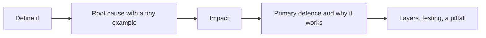
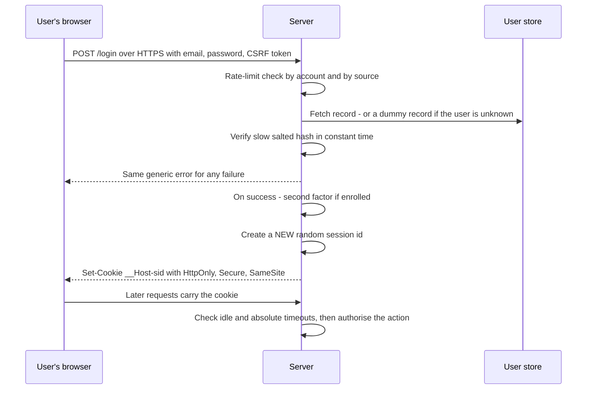

# Security interview essentials

> **Before this lesson:** this is the capstone of the track. It assumes you have worked through the earlier lessons; each answer below links back to the lesson that teaches the topic from zero. If a term here is unfamiliar, follow the link first.

## In plain words

A driving test does not ask you to recite the highway code from cover to cover. The examiner watches whether you check your mirrors without being told, and asks a few questions to see whether you understand *why* the rules exist. Someone who has memorised stopping distances but never looks over their shoulder fails.

Security questions in a software interview work the same way. Outside specialist roles, nobody expects you to be a penetration tester. The interviewer wants to know three things: do you recognise the common ways software gets broken; can you explain a defence clearly and say why it works; and do you *think* about misuse without being prompted — when designing a login, reviewing a pull request, or adding an endpoint.

This lesson turns the track into interview-ready form. It gives you a way of structuring any security answer, then worked answers to the questions that come up most often — "how would you store passwords?", "explain XSS versus CSRF", "design a login system", "review this code" — plus a set of quick-fire explanations and a revision map.

## A structure for any security answer

When a security question arrives, resist the urge to list buzzwords. Use the same five steps every time; they fit a one-minute answer or a ten-minute discussion.

1. **Define** the thing in one sentence, in plain words.
2. **Explain how it arises** — the root cause, ideally with a one-line example.
3. **State the impact** — what could an attacker actually do?
4. **Give the primary defence**, and say *why it works*.
5. **Add depth** — second-layer defences, how you would test for it, and one pitfall.



Three habits lift an answer from adequate to strong:

- **Name the trust boundary.** "This value comes from the request, so it's untrusted" shows the mindset.
- **Distinguish the primary control from the extra layers.** Output encoding fixes XSS; CSP limits the damage. Saying CSP first suggests you have confused them.
- **Admit trade-offs and limits.** "SameSite helps a lot but treats sibling subdomains as same-site, so I'd still use tokens." Interviewers trust candidates who know where a defence stops.

And if you do not know something, say so and reason from principles: "I haven't used that, but it accepts untrusted input and reaches an interpreter, so I'd look for a way to keep data and commands separate."

## The principles behind every answer

Almost every correct answer in this track is one of nine ideas applied to a situation. Being able to name them lets you reason about questions you have never seen.

| Principle | One-line meaning | Appears as |
|---|---|---|
| Never trust the client | Every check that matters is repeated on the server | Validation, authorisation |
| Separate data from code | Do not build commands by pasting in input | Parameterised queries, argument lists, fixed templates |
| Encode for the destination | Make data inert for the context it lands in | Output encoding against XSS |
| Allow-list, not block-list | Describe what is good; refuse the rest | Redirect hosts, sort columns, file types |
| Deny by default | No access unless a rule grants it | Routing, RBAC, firewalls |
| Least privilege | Give each user and program only what it needs | Database accounts, tool permissions, scopes |
| Defence in depth | Assume each layer fails; add another | Encoding plus CSP; hashing plus rate limits |
| Fail securely | Errors lead to denial, not access | Exception handling, missing configuration |
| Detect and respond | Record, watch, and be ready | Logging, alerts, incident plans |

## Worked answer 1: "How would you store passwords?"

**A model answer.**

"I'd never store the password itself, or anything reversible such as an encrypted copy. I'd store a hash produced by a function designed for passwords — Argon2id as first choice, or scrypt, bcrypt, or PBKDF2 with a high iteration count where a standard library or compliance requires it.

Two properties matter. First, a unique random **salt** per user, stored next to the hash, so that identical passwords give different hashes and precomputed tables are useless. Second, the function must be deliberately **slow**, with a tunable cost, so that if the database leaks an attacker gets a few guesses per second per hash instead of billions. General-purpose hashes like SHA-256 are designed to be fast, which is exactly wrong here.

I'd store the algorithm, parameters, salt and digest together in one string. That lets me raise the cost later and re-hash a user's password transparently the next time they log in successfully. Verification uses a constant-time comparison.

Around that: screen new passwords against breached-password lists and require length instead of composition rules; rate-limit login attempts; offer multi-factor authentication, ideally passkeys; and never log passwords or include them in error reports. Optionally add a pepper kept outside the database."

**Why this answer works.** It leads with the conclusion, explains salt and slowness as *reasons*, mentions upgradeability (which most candidates omit), and widens to the surrounding system. Taught in [Authentication failures, password storage and MFA](#/lesson/web-security/authentication-passwords).

The mechanics, in a form you could write on a whiteboard:

```python-run
import hashlib, hmac, secrets

def hash_password(password, iterations=100_000):
    salt = secrets.token_bytes(16)                                   # unique per user
    digest = hashlib.pbkdf2_hmac("sha256", password.encode(), salt, iterations)   # deliberately slow
    return f"pbkdf2_sha256${iterations}${salt.hex()}${digest.hex()}"  # self-describing record

def verify_password(password, record):
    try:
        name, iterations, salt_hex, digest_hex = record.split("$")
        candidate = hashlib.pbkdf2_hmac("sha256", password.encode(), bytes.fromhex(salt_hex), int(iterations))
    except ValueError:
        return False
    return name == "pbkdf2_sha256" and hmac.compare_digest(candidate.hex(), digest_hex)

record = hash_password("correct horse battery")
print(record[:40] + "...")
print(verify_password("correct horse battery", record), verify_password("wrong", record))
print("two users, same password, same record?", hash_password("x" * 12) == hash_password("x" * 12))
```

`hash_password` draws a fresh salt, runs PBKDF2, and returns the four parts joined by `$`. `verify_password` splits the record, repeats the computation with the record's own salt and iteration count, and compares in constant time; a malformed record returns `False` instead of raising. The last line prints `False`: equal passwords, different records.

**Likely follow-ups.** *What is a pepper?* A secret mixed into every hash and stored outside the database. *Why not encrypt?* Encryption is reversible by whoever has the key. *How do you migrate from MD5?* Re-hash on next login; optionally wrap existing digests in a strong hash meanwhile; force resets for dormant accounts.

## Worked answer 2: "Explain XSS versus CSRF"

**A model answer.**

"Both abuse the browser's trust relationships, in opposite directions.

**Cross-site scripting** is when an attacker gets their script to run inside *my* site's origin, because my application put untrusted data into a page without encoding it. Since the script runs as my origin, it can read the page, call my APIs with the user's session, and exfiltrate data. The same-origin policy does not help — as far as the browser is concerned the script is mine. The fix is context-aware **output encoding**, normally through auto-escaping templates and safe DOM APIs like `textContent`, with a strict Content Security Policy and `HttpOnly` cookies as extra layers.

**Cross-site request forgery** is when another site makes the *victim's browser* send a request to my site, and the browser attaches the victim's cookies automatically. The attacker's code stays on its own origin; it cannot read my responses, but it can cause state changes — a transfer, an email change. The fix is to require something a foreign page cannot supply: an **anti-CSRF token** bound to the session, plus `SameSite` cookies, and never changing state on GET.

So: XSS is a failure to encode *output* and lets the attacker **read and act**; CSRF is a failure to verify *request intent* and lets the attacker **act but not read**. And they are related asymmetrically — an XSS hole defeats CSRF protection, because script on my origin can read the token."

| | XSS | CSRF |
|---|---|---|
| Whose origin does the attacker's code run in? | The victim site's | The attacker's own |
| Root cause | Untrusted data rendered without encoding | Cookies sent automatically; request is predictable |
| Can read responses? | Yes | No |
| Primary defence | Output encoding | Anti-CSRF token |
| Secondary | CSP, `HttpOnly`, sanitisation | `SameSite`, Origin / Fetch Metadata checks |
| Needs the user to be logged in? | Not necessarily | Yes |

Taught in [Cross-site scripting (XSS) and output encoding](#/lesson/web-security/xss) and [Cross-site request forgery (CSRF)](#/lesson/web-security/csrf).

**Likely follow-ups.** *Types of XSS?* Stored, reflected, DOM-based. *Does HTTPS prevent either?* No. *Is an API using bearer tokens in a header vulnerable to CSRF?* Not to the classic form, because the browser does not attach that header automatically — but the token's storage then becomes an XSS concern.

## Worked answer 3: "Design a login system"

This is a design question; structure matters more than any single fact. Walk through the life cycle and name a control at each step.



**A model answer, by stage.**

*Transport.* "Everything over HTTPS with HSTS, so credentials and cookies are never sent in the clear."

*Registration.* "Validate input on the server. Enforce a length-based password policy and reject breached passwords. Hash with Argon2id and a per-user salt. Verify the email address. Respond identically whether or not the address is already registered, to avoid revealing who has an account."

*Login.* "Accept the credentials by POST with a CSRF token. Before checking the password, apply rate limits keyed on both the account and the source address, with progressive delays instead of a hard lockout that could be used to lock victims out. Look the user up; if they don't exist, verify against a dummy hash so the timing matches. Return one generic message for every failure."

*Second factor.* "If enabled, require it before creating the full session — TOTP at minimum, WebAuthn passkeys preferably, since they resist phishing. Rate-limit code entry and protect the recovery path as strongly as the factor itself."

*Session.* "On success, issue a brand-new session identifier from a cryptographic generator — that prevents session fixation — stored server-side so it can be revoked. Send it in a cookie with `HttpOnly`, `Secure`, `SameSite=Lax` and the `__Host-` prefix. Enforce idle and absolute timeouts on the server."

*After login.* "Every request is authenticated from the session, then authorised: role and object-level checks, deny by default. Require the password or second factor again for sensitive changes such as email or password."

*Logout and reset.* "Logout deletes the server-side session. Password reset uses a random, single-use, short-lived token stored hashed, the same response for any email, and invalidates existing sessions when the password changes."

*Detection.* "Log successes, failures, lockouts and factor changes — never the password — and alert on patterns like many accounts failing from one source. Notify users of new-device logins."

*Alternative.* "If the organisation already has an identity provider, I'd delegate to it with OpenID Connect using the authorisation code flow with PKCE, and keep my own session after validating the ID token."

**Why this answer works.** It is organised, covers prevention *and* detection, and names specific attacks each control stops. Drawn from the lessons on [authentication](#/lesson/web-security/authentication-passwords), [sessions](#/lesson/web-security/session-management), [rate limiting](#/lesson/web-security/dos-rate-limiting) and [OAuth and OIDC](#/lesson/web-security/oauth-oidc).

The uniform-response and fresh-session ideas, in a few runnable lines:

```python-run
import hashlib, hmac, secrets

def slow_hash(password, salt):
    return hashlib.pbkdf2_hmac("sha256", password.encode(), salt, 50_000)

USERS = {"ann@shop.example": {"salt": b"s-ann", "hash": slow_hash("correct horse battery", b"s-ann")}}
DUMMY = {"salt": b"s-dummy", "hash": slow_hash("never-used", b"s-dummy")}
SESSIONS = {}

def login(email, password, old_session_id=None):
    record = USERS.get(email.strip().lower(), DUMMY)                 # unknown user -> same work
    matches = hmac.compare_digest(slow_hash(password, record["salt"]), record["hash"])
    if not matches or record is DUMMY:
        return {"status": 401, "body": "Email or password is incorrect"}
    SESSIONS.pop(old_session_id, None)                               # discard any pre-login session
    sid = secrets.token_urlsafe(32)                                  # brand-new identifier
    SESSIONS[sid] = {"user": email.strip().lower()}
    cookie = f"__Host-sid={sid[:8]}...; Path=/; HttpOnly; Secure; SameSite=Lax"
    return {"status": 200, "set_cookie": cookie}

print(login("ann@shop.example", "wrong"))
print(login("nobody@shop.example", "wrong"))
print(login(" Ann@Shop.example ", "correct horse battery", old_session_id="pre-login-id"))
```

The first two calls return byte-for-byte identical responses, and both performed the same slow hash. The third normalises the email, succeeds, discards the old session identifier and issues a new one in a hardened cookie.

## Worked answer 4: "Review this code"

You are shown something like this and asked what you see.

```python
# The code under review
@app.post("/api/profile/avatar")
def set_avatar(request: Request, user_id: int, image_url: str, redirect: str = "/"):
    user = db.execute(f"SELECT * FROM users WHERE id = {user_id}").fetchone()
    data = requests.get(image_url).content
    path = "static/avatars/" + image_url.split("/")[-1]
    open(path, "wb").write(data)
    db.execute(f"UPDATE users SET avatar = '{path}' WHERE id = {user_id}")
    print(f"avatar set by {request.cookies}")
    return RedirectResponse(redirect)
```

**Method: narrate the trace.** "First, what comes from the client? `user_id`, `image_url`, `redirect`, and the cookies. I'll follow each to where it is used."

| # | Finding | Class | Fix |
|---|---|---|---|
| 1 | No authentication dependency; `user_id` is taken from the request | Missing authentication; IDOR | Identity from the session; no `user_id` parameter |
| 2 | f-string SQL in both queries; `path` contains user text inside quotes | SQL injection | Bound parameters |
| 3 | `requests.get(image_url)` on any URL | SSRF | Scheme and host checks, resolved-address validation, no redirects, timeout and size cap |
| 4 | File name derived from the URL | Path traversal; file overwrite | Generated file name |
| 5 | No check of type or size; stored under `static/` | Unrestricted upload; stored XSS via HTML/SVG | Allow-list by magic bytes; store outside the web root; serve with `nosniff` from a separate origin |
| 6 | Cookies written to output | Sensitive data in logs | Log the user ID only, through the logger |
| 7 | `RedirectResponse(redirect)` | Open redirect | Local-path or allow-list validation |
| 8 | No CSRF protection on a state-changing POST | CSRF | Framework CSRF middleware; `SameSite` cookies |
| 9 | No timeout, no size limit | Denial of service | Limits |

Then prioritise: "The most serious are the unauthenticated IDOR, the SQL injection and the SSRF — any of them alone is critical. I'd fix those first, then the upload handling."

```python
# After review
@app.post("/api/profile/avatar")
def set_avatar(body: AvatarIn, user=Depends(current_user)):          # authenticated; CSRF via middleware
    image = fetch_public_image(body.image_url, timeout=5, max_bytes=2_000_000)   # SSRF-hardened fetch
    kind = detect_image_type(image)                                  # magic bytes: png or jpeg only
    if kind is None:
        raise HTTPException(400, "Unsupported image")
    key = secrets.token_hex(16) + "." + kind                         # generated name
    (PRIVATE_STORAGE / key).write_bytes(image)
    db.execute("UPDATE users SET avatar_key = ? WHERE id = ?", (key, user.id))
    logger.info("avatar_updated", extra={"user_id": user.id})
    return {"ok": True}                                              # no redirect needed
```

**Why this answer works.** Interviewers score the *process* — sources, sinks, controls — the correct naming of each class, and the prioritisation, more than the raw count. Mentioning what is *absent* (authentication, CSRF protection, limits) is what separates strong candidates. Taught in [Secure code review and input validation](#/lesson/web-security/code-review-validation).

## Quick-fire questions

Short, complete answers to learn by heart.

**What is the same-origin policy?** A browser rule that script from one origin — scheme, host and port — cannot read data from another. It restricts reading, not sending. ([Lesson](#/lesson/web-security/http-same-origin))

**What is CORS?** A way for a server to let named origins read its responses; a relaxation of the same-origin policy. Dangerous when the origin is reflected together with credentials. ([Lesson](#/lesson/web-security/headers-csp-cors))

**How do you prevent SQL injection?** Parameterised queries, so values are sent separately from the query text and can never be parsed as SQL; allow-lists for identifiers; least-privilege database accounts. ([Lesson](#/lesson/web-security/sql-injection))

**Authentication versus authorisation?** Who you are versus what you may do; 401 versus 403. Authorisation must consider the specific object. ([Lesson](#/lesson/web-security/authn-authz))

**What is IDOR?** Reaching another user's object by changing an identifier because the server does not check ownership. Fix with scoped queries or a policy check; random IDs are not enough. ([Lesson](#/lesson/web-security/broken-access-control))

**`HttpOnly`, `Secure`, `SameSite`?** Hidden from JavaScript; HTTPS only; restricted on cross-site requests. ([Lesson](#/lesson/web-security/cookies-sessions))

**Session versus JWT?** A session is a random ID with state on the server — easy to revoke. A JWT carries signed claims and needs no lookup — hard to revoke, so keep it short-lived. ([Lesson](#/lesson/web-security/jwt))

**JWT pitfalls?** Decoding without verifying; letting the header choose the algorithm (`none`, RS256/HS256 confusion); weak secrets; missing `exp`, `aud`, `iss` checks; no revocation; secrets in the payload. ([Lesson](#/lesson/web-security/jwt))

**What is SSRF?** Tricking the server into requesting an attacker-chosen address, reaching internal services or cloud metadata. Allow-list hosts or validate the resolved address; block redirects; restrict egress. ([Lesson](#/lesson/web-security/ssrf))

**What is CSP?** A response header listing where scripts and other resources may load from; a second layer against XSS. Strict, nonce-based policies without `'unsafe-inline'` are effective. ([Lesson](#/lesson/web-security/headers-csp-cors))

**Hashing versus encryption versus encoding?** Hashing is one-way; encryption is reversible with a key; encoding (base64, URL-encoding) is reversible by anyone and offers no secrecy.

**Symmetric versus asymmetric cryptography?** One shared key for both operations, versus a public/private key pair. HMAC is symmetric; RS256 signatures and TLS certificates are asymmetric.

**What does HTTPS provide?** Confidentiality, integrity and server authentication for data in transit. It does not protect against application flaws.

**OAuth versus OpenID Connect?** OAuth delegates authorisation (access tokens for APIs). OIDC adds authentication (an ID token saying who logged in). ([Lesson](#/lesson/web-security/oauth-oidc))

**What is STRIDE?** Spoofing, tampering, repudiation, information disclosure, denial of service, elevation of privilege — a checklist for threat modelling. ([Lesson](#/lesson/web-security/threat-modelling))

**SAST versus DAST?** SAST analyses source without running it; DAST probes the running application. Neither finds authorisation or logic flaws reliably. ([Lesson](#/lesson/web-security/sdlc-automation))

**Where do you keep secrets?** Outside the code: injected at runtime from a secrets manager, least-privilege, rotated; scanned for in CI. If one leaks, rotate first. ([Lesson](#/lesson/web-security/misconfiguration-secrets))

**What is prompt injection?** Text that makes an LLM follow the input's instructions instead of the developer's. Contain it with least-privilege tools, authorisation in code, human confirmation and treating output as untrusted. ([Lesson](#/lesson/web-security/llm-security))

**What is a race condition in a web application?** Two concurrent requests both pass a check before either updates state — double-spending a voucher. Make check-and-update atomic. ([Lesson](#/lesson/web-security/business-logic))

**You find a critical bug an hour before release. What do you do?** State the risk in concrete terms to whoever owns the decision; propose the smallest safe mitigation (disable the feature, a flag, a targeted fix); do not ship silently. Security is a risk conversation, not a veto.

## Test yourself: classify the scenario

A useful drill is to read a one-line incident description and name the weakness and its primary fix. Cover the right-hand side and try.

```python-run
SCENARIOS = [
    ("Changing ?invoice=1041 to 1042 shows another customer's invoice",
     "IDOR / broken access control", "check ownership on the server (scoped query)"),
    ("A product review containing markup runs a script for every visitor",
     "stored XSS", "encode output; add CSP"),
    ("A hidden form on another site changes the logged-in user's email",
     "CSRF", "anti-CSRF token; SameSite cookies"),
    ("A single quote in the search box produces a database error",
     "SQL injection", "parameterised queries"),
    ("The link-preview feature returns the cloud metadata endpoint",
     "SSRF", "validate destination address; restrict egress"),
    ("A login link ends in ?next=//evil.example and sends users there",
     "open redirect", "allow only local paths or allow-listed hosts"),
    ("The download endpoint serves ../../config/settings.env",
     "path traversal", "resolve and check containment; or use IDs"),
    ("Twenty parallel requests redeem one voucher twenty times",
     "race condition (business logic)", "atomic conditional update"),
    ("A token with alg set to none is accepted",
     "JWT validation failure", "server-side algorithm allow-list"),
    ("An API key is found in the repository history",
     "secret exposure", "rotate now; move to a secrets manager; scan"),
]
for number, (story, weakness, fix) in enumerate(SCENARIOS, start=1):
    print(f"{number:2}. {story}\n    -> {weakness}: {fix}")
```

The list is a table of ten incidents in everyday language, each with the name an interviewer expects and the one defence to state first. Edit the list and add scenarios from your own experience; describing a real bug you met, how it arose and how you fixed it, is the most convincing material you can bring.

## Behavioural and judgement questions

Not every question is technical.

- **"Tell me about a security issue you found or fixed."** Use situation, action, result. Include how it got in and what you changed so it could not recur — a test, a lint rule, a shared helper.
- **"How do you balance security with delivery speed?"** Risk-based prioritisation; secure defaults and paved roads that make the safe way the fast way; automation in CI; fixing classes of bug instead of instances.
- **"A colleague wants to disable a security check to hit a deadline."** Understand the need; quantify the risk; look for a narrower alternative; if the risk is accepted, make it explicit, owned and time-limited.
- **"How do you keep up to date?"** OWASP resources, vendor advisories for your stack, post-incident write-ups, and — most persuasive — applying what you read to your own code.

> [!TIP]
> Prepare two or three short stories from your own work or projects: a vulnerability you found in review, a dependency upgrade forced by an advisory, a validation rule you added after a bug. Concrete experience, even small, outweighs perfectly recited definitions.

> [!WARNING]
> Three things lose marks quickly: confusing the primary defence with a secondary one ("I'd prevent SQL injection with a web application firewall"); proposing block-lists or client-side checks as controls; and absolutism ("that makes it completely secure"). Speak in layers and in risk.

> [!INTERVIEW]
> When a design question does not mention security at all — "design a URL shortener", "design a file-sharing service" — spend one minute on it unprompted near the end: who can create and who can read (authorisation); what untrusted input reaches where (validation, encoding, SSRF, uploads); abuse and limits (rate limiting, quotas); secrets and data protection; logging. Volunteering this is one of the clearest signals of seniority an interviewer sees.

## A revision map

| If asked about… | Lead with… | Lesson |
|---|---|---|
| Passwords | Salted, slow hash; Argon2id; upgrade on login | [Authentication](#/lesson/web-security/authentication-passwords) |
| Sessions | New ID at login; hardened cookie; server-side expiry and revocation | [Session management](#/lesson/web-security/session-management) |
| XSS | Output encoding for the context; CSP as a layer | [XSS](#/lesson/web-security/xss) |
| CSRF | Token bound to the session; SameSite; no state change on GET | [CSRF](#/lesson/web-security/csrf) |
| Injection | Separate code from data: parameters, argument lists, fixed templates | [SQL](#/lesson/web-security/sql-injection), [command and template](#/lesson/web-security/command-template-injection) |
| Access control | Server-side, deny by default, object-level checks | [Broken access control](#/lesson/web-security/broken-access-control) |
| SSRF | Allow-list or resolved-address validation; egress control | [SSRF](#/lesson/web-security/ssrf) |
| Files | Generated names; containment; allow-listed types; separate origin | [Path traversal and uploads](#/lesson/web-security/path-traversal-uploads) |
| Rate limiting | Key, limit, algorithm, shared store, `429` | [Denial of service](#/lesson/web-security/dos-rate-limiting) |
| Headers / CORS | HSTS, nosniff, CSP, framing; exact-origin CORS | [Headers, CSP and CORS](#/lesson/web-security/headers-csp-cors) |
| Tokens | Verify signature with server-chosen algorithm; `exp`, `aud`, `iss`; short-lived | [JWT](#/lesson/web-security/jwt) |
| OAuth / OIDC | Code flow with PKCE; state; exact redirect URIs; ID token for identity | [OAuth and OIDC](#/lesson/web-security/oauth-oidc) |
| Dependencies | Lock, scan, update, verify integrity | [Supply chain](#/lesson/web-security/dependencies-supply-chain) |
| Secrets | Out of code; manager; rotate | [Misconfiguration and secrets](#/lesson/web-security/misconfiguration-secrets) |
| Design | Four questions; STRIDE; risk rating | [Threat modelling](#/lesson/web-security/threat-modelling) |
| Process | Shift left; SAST, SCA, DAST; gates; regression tests | [SDLC](#/lesson/web-security/sdlc-automation) |
| Operations | Structured logs without secrets; alerts; disclosure handling | [Logging and vulnerability management](#/lesson/web-security/logging-vuln-management) |
| AI features | Model output is untrusted; authorise tools in code | [LLM security](#/lesson/web-security/llm-security) |

## Pitfalls in interviews

- **Listing tools instead of explaining causes.** "We'd use a scanner" is not an answer to "how does XSS happen?"
- **Starting with the secondary layer.**
- **Forgetting the server.** Any answer that relies on JavaScript validation, hidden fields or disabled buttons is wrong.
- **Stopping at authentication** in a design question and never mentioning authorisation.
- **Ignoring detection.** Mention logging and monitoring once in any design answer.
- **Over-claiming.** Say "reduces" and "mitigates"; reserve "prevents" for controls that structurally remove the flaw, like parameterised queries.
- **Reciting without understanding.** Expect "why?" after every statement, and be able to answer it.
- **Going silent when unsure**, instead of reasoning aloud from the principles.

## Summary

- Structure security answers: define, root cause, impact, primary defence and why it works, then layers, testing and a pitfall.
- Nine principles generate most correct answers: never trust the client; separate data from code; encode for the destination; allow-list; deny by default; least privilege; defence in depth; fail securely; detect and respond.
- Passwords: salted, slow, upgradeable hashes, surrounded by breached-password screening, rate limiting and MFA.
- XSS runs attacker script in your origin (fix: encoding); CSRF sends requests with the victim's cookies (fix: tokens and SameSite); XSS defeats CSRF protection.
- A login design covers transport, registration, throttled and uniform login, second factor, fresh hardened sessions, authorisation, reset, logout and monitoring.
- In a code review, trace every client-controlled value to its sinks, name each weakness, note what is missing, and prioritise.
- Volunteer security considerations in design questions, speak in terms of risk and layers, and bring your own concrete examples.

## Glossary

- **Primary control** — the defence that removes the root cause of a weakness.
- **Compensating / secondary control** — an additional layer that reduces likelihood or impact when the primary control fails.
- **Root cause** — the underlying mistake that makes a vulnerability possible.
- **Impact** — what an attacker gains or what the organisation loses.
- **Trade-off** — a cost accepted in exchange for a benefit, such as convenience versus strictness.
- **Follow-up question** — the interviewer's probe after an answer, usually "why?" or "what if?".
- **Whiteboard design** — an interview exercise in sketching and explaining a system.
- **Situation–action–result** — a structure for answering behavioural questions.
- **Risk-based prioritisation** — ordering work by likelihood and impact.
- **Paved road** — a secure-by-default, easy path provided to developers.

```quiz
[
  {"q": "What is the best order for answering 'explain vulnerability X' in an interview?",
   "options": ["List tools, then acronyms", "Define it, give the root cause, state the impact, give the primary defence and why it works, then add layers and testing", "Start with the rarest edge case", "Describe a penetration-testing tool"], "answer": 1,
   "explain": "A consistent structure shows understanding of cause and effect, and distinguishes the main fix from supporting layers."},
  {"q": "Which answer to 'how do you prevent SQL injection?' leads with the primary control?",
   "options": ["Use a web application firewall", "Validate input in JavaScript", "Use parameterised queries so values are never parsed as SQL", "Hide database errors"], "answer": 2,
   "explain": "Parameterisation removes the root cause. The others are secondary layers or not controls at all."},
  {"q": "In one sentence, what is the key difference between XSS and CSRF?",
   "options": ["XSS needs HTTPS; CSRF does not", "XSS runs attacker script in the victim site's origin and can read and act; CSRF makes the victim's browser send a request and can act but not read", "They are the same attack", "CSRF steals passwords; XSS does not"], "answer": 1,
   "explain": "The origin in which the attacker's code runs determines what it can do, and therefore the defence."},
  {"q": "In a login design, why verify a dummy hash when the user does not exist?",
   "options": ["To create the account automatically", "So that response time does not reveal whether the account exists", "To slow down all users", "It is unnecessary"], "answer": 1,
   "explain": "Without it, fast responses for unknown users leak which accounts are registered (a timing side channel)."},
  {"q": "Why issue a new session identifier at the moment of login?",
   "options": ["To save memory", "To prevent session fixation, where an attacker pre-sets an identifier they know", "Because cookies expire at login", "To change the user's role"], "answer": 1,
   "explain": "Any identifier planted before authentication becomes worthless when the server rotates it."},
  {"q": "During a 'review this code' exercise, what distinguishes a strong answer?",
   "options": ["Finding only syntax errors", "Tracing each client-controlled value to its use, naming each weakness, noting missing controls and prioritising", "Rewriting everything in another language", "Saying it looks fine"], "answer": 1,
   "explain": "Interviewers assess method and judgement: sources, sinks, missing checks and which issues matter most."},
  {"q": "Which statement would lose marks in an interview?",
   "options": ["CSP reduces the impact of XSS", "SameSite helps against CSRF but I would still use tokens", "Disabling the button in the UI prevents users from performing the action", "Random IDs help against enumeration but are not authorisation"], "answer": 2,
   "explain": "Client-side controls are not security controls. The server must enforce the rule."},
  {"q": "A design question never mentions security. What should a strong candidate do?",
   "options": ["Ignore security entirely", "Briefly cover authorisation, untrusted input, abuse limits, secrets and logging unprompted", "Refuse to answer until security is specified", "Talk only about encryption"], "answer": 1,
   "explain": "Volunteering the security view of a design demonstrates the mindset interviewers look for."}
]
```

> **Source:** Hoffman, *Web Application Security* — this lesson consolidates the whole book: ch. 9–15 (how the vulnerability classes arise), ch. 17–19 (secure architecture and code review) and ch. 22–27 (the corresponding defences), restated in original wording as interview answers. OWASP Top 10 — https://owasp.org/www-project-top-ten/ ; OWASP Cheat Sheet Series index — https://cheatsheetseries.owasp.org/ ; OWASP Application Security Verification Standard — https://owasp.org/www-project-application-security-verification-standard/ ; MDN, Security on the web — https://developer.mozilla.org/en-US/docs/Web/Security
