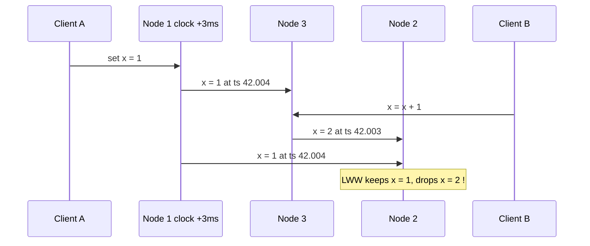

# Unreliable clocks and process pauses

Applications depend on clocks to answer two kinds of question:

- **Durations**: has this request timed out? What is the 99th percentile response time? How long did the user spend on the page?
- **Points in time**: when was this article published? When does this cache entry expire? What is the timestamp on this error message?

In a distributed system time is tricky, because communication is not instantaneous and **each machine has its own clock**: a hardware device, usually a quartz crystal oscillator, that is not perfectly accurate. Each machine has its own notion of time, which may be slightly faster or slower than the others. Clocks can be synchronised to some degree, most commonly with the **Network Time Protocol (NTP)**, which adjusts a computer's clock according to the time reported by a group of servers, which in turn get their time from a more accurate source such as a GPS receiver.

## 1. Monotonic vs time-of-day clocks

Modern computers have at least two different kinds of clock. They serve different purposes.

### 1.1 Time-of-day clocks

A **time-of-day clock** returns the current date and time according to some calendar (*wall-clock time*). `clock_gettime(CLOCK_REALTIME)` on Linux and `System.currentTimeMillis()` in Java return the number of seconds or milliseconds since the **epoch**, midnight UTC on 1 January 1970, not counting leap seconds. In Python this is `time.time()`.

Time-of-day clocks are usually synchronised with NTP, so a timestamp from one machine ideally means the same as a timestamp on another. They have oddities, though. If the local clock is too far ahead of the NTP server, it may be forcibly reset and appear to **jump back** to an earlier point in time. These jumps, and the fact that leap seconds are often ignored, make time-of-day clocks **unsuitable for measuring elapsed time**.

### 1.2 Monotonic clocks

A **monotonic clock** is suitable for measuring a duration, such as a timeout or a service's response time. `clock_gettime(CLOCK_MONOTONIC)` on Linux, `System.nanoTime()` in Java and `time.monotonic()` in Python are monotonic clocks. The name comes from the guarantee that they always move forward, whereas a time-of-day clock may jump back.

You check the value at one point, do something, check again, and the **difference** tells you how much time elapsed. The **absolute value is meaningless**: it might be nanoseconds since the computer started, or something equally arbitrary. Comparing monotonic clock values from two different computers makes no sense.

NTP may adjust the *frequency* at which the monotonic clock moves forward (called **slewing**) if it detects that the computer's quartz is running fast or slow. By default NTP lets the rate be sped up or slowed down by up to 0.05%, but it cannot make the monotonic clock jump forward or backward. In a distributed system, using a monotonic clock to measure elapsed time (for timeouts, say) is usually fine, because it assumes no synchronisation between nodes' clocks.

```python-run
import time
t_wall, t_mono = time.time(), time.monotonic()
sum(range(200_000))
print(f"elapsed by wall clock     : {(time.time() - t_wall)*1000:.3f} ms  (may jump if NTP steps the clock!)")
print(f"elapsed by monotonic clock: {(time.monotonic() - t_mono)*1000:.3f} ms  (safe for timeouts)")
print("monotonic absolute value is meaningless:", round(time.monotonic(), 2))
```

## 2. Clock synchronisation and accuracy

Monotonic clocks need no synchronisation, but time-of-day clocks must be set from an NTP server or another external source to be useful. Our methods for getting a clock to tell the correct time are not nearly as reliable or accurate as you might hope:

- The quartz clock in a computer **drifts** (runs faster or slower than it should). Drift depends on the machine's temperature. Google assumes a clock drift of **200 ppm** (parts per million) for its servers, which is equivalent to 6 ms drift for a clock resynchronised every 30 seconds, or **17 seconds** drift for a clock resynchronised once a day.
- If a computer's clock differs too much from an NTP server, it may refuse to synchronise, or the local clock will be forcibly reset. Applications observing the time before and after this reset may see time **go backward** or suddenly jump forward.
- If a node is accidentally **firewalled off** from NTP servers, the misconfiguration may go unnoticed for some time.
- NTP synchronisation can only be as good as the **network delay**. One experiment found that a minimum error of 35 ms is achievable when synchronising over the internet, though occasional spikes in network delay lead to errors of around a second.
- Some NTP servers are **wrong or misconfigured**, reporting time that is off by hours. NTP clients are fairly robust because they query several servers and ignore outliers.
- **Leap seconds** result in a minute that is 59 or 61 seconds long, which messes up timing assumptions in systems not designed with leap seconds in mind. Leap seconds have crashed many large systems. The best way of handling them may be to make NTP servers "lie" by performing the adjustment gradually over the course of a day (known as **smearing**).
- In **virtual machines**, the hardware clock is virtualised. When a CPU core is shared between VMs, each VM is paused for tens of milliseconds while another VM is running. From an application's point of view, this pause shows up as the clock suddenly jumping forward.
- If you run software on **devices you do not fully control** (mobile or embedded devices), you probably cannot trust the device's hardware clock at all. Some users deliberately set their clock to an incorrect date and time, for example to get around timing limitations in games.

Good clock accuracy is achievable if you care enough to invest significant resources. The MiFID II European regulation for financial institutions requires high-frequency trading funds to synchronise their clocks to within 100 microseconds of UTC. Such accuracy can be achieved with GPS receivers, the Precision Time Protocol (PTP), and careful deployment and monitoring.

## 3. Relying on synchronised clocks

Clocks look simple and easy to use, but they have a surprising number of pitfalls. A day may not have exactly 86,400 seconds, time-of-day clocks may move backward, and the time on one node may be quite different from the time on another.

Part of the problem is that incorrect clocks **easily go unnoticed**. If a machine's CPU is defective or its network is misconfigured, it most likely will not work at all, so it will quickly be noticed and fixed. If its quartz clock is defective or its NTP client is misconfigured, most things will seem to work fine, even though its clock gradually drifts further from reality. If some piece of software relies on an accurately synchronised clock, the result is more likely to be **silent and subtle data loss** than a dramatic crash. If you use software that requires synchronised clocks, it is essential that you carefully **monitor the clock offsets** between all the machines. Any node whose clock drifts too far from the others should be declared dead and removed from the cluster.

### 3.1 Timestamps for ordering events

Consider one situation in which it is tempting but dangerous to rely on clocks: ordering events across several nodes. If two clients write to a distributed database, who got there first? Which write is the more recent one?

DDIA illustrates a dangerous use of time-of-day clocks in a database with multi-leader replication. Client A writes `x = 1` on node 1. The write is replicated to node 3. Client B increments `x` on node 3 (so now `x = 2`). Finally, both writes are replicated to node 2. When a write is replicated, it is tagged with a timestamp according to the time-of-day clock on the node where the write originated. Clock synchronisation is very good in this example: the skew between node 1 and node 3 is less than 3 ms.

Nevertheless, the timestamps fail to order the events correctly. The write `x = 1` has a timestamp of 42.004 seconds, but the write `x = 2` has a timestamp of 42.003 seconds, even though `x = 2` occurred unambiguously later. When node 2 receives these two events, it will incorrectly conclude that `x = 1` is the more recent value and drop the write `x = 2`. Client B's increment is lost.



This conflict resolution strategy is **last write wins (LWW)**, widely used in both multi-leader and leaderless databases such as Cassandra and Riak. Some implementations generate timestamps on the client rather than the server, but this does not change the fundamental problems with LWW:

- Database writes can **mysteriously disappear**. A node with a lagging clock is unable to overwrite values previously written by a node with a fast clock until the clock skew between the nodes has elapsed. This can cause arbitrary amounts of data to be silently dropped without any error being reported to the application.
- LWW cannot distinguish between writes that occurred **sequentially in quick succession** and writes that were truly **concurrent**. Additional causality tracking mechanisms, such as version vectors, are needed to prevent violations of causality.
- Two nodes can independently generate writes with the **same timestamp**, especially when the clock only has millisecond resolution. An additional tiebreaker value is required, which can also lead to violations of causality.

It is tempting to resolve conflicts by keeping the most "recent" value and discarding others, but the definition of "recent" depends on a local time-of-day clock, which may well be incorrect. Could NTP synchronisation be made accurate enough? Probably not, because NTP's accuracy is itself limited by the network round-trip time, in addition to other sources of error such as quartz drift. For correct ordering, you would need the clock source to be significantly more accurate than the thing you are measuring (network delay).

**Logical clocks**, which are based on incrementing counters rather than an oscillating quartz crystal, are a safer alternative for ordering events. Logical clocks do not measure the time of day or the number of seconds elapsed. They measure only the relative ordering of events (whether one event happened before or after another). In contrast, time-of-day and monotonic clocks, which measure actual elapsed time, are also known as **physical clocks**. Chapter 9 covers logical clocks.

```python-run
# LWW with skewed clocks silently drops a causally-later write
def lww(store, key, value, ts):
    if key not in store or ts > store[key][1]:
        store[key] = (value, ts); return "applied"
    return "DROPPED"

true_time = 42.000
skew = {"node1": +0.004, "node3": 0.000}
node2 = {}
w1 = ("x", 1, true_time + 0.000 + skew["node1"])       # A writes x=1 on node1 at t=42.000
w2 = ("x", 2, true_time + 0.003 + skew["node3"])       # B increments on node3 at t=42.003 (later!)
for name, w in (("x=2 (later write)", w2), ("x=1 (earlier write)", w1)):
    print(f"node2 receives {name:<20} ts={w[2]:.3f} ->", lww(node2, *w))
print("node2 final:", node2["x"], "<- the increment is lost")
```

### 3.2 Clock readings have a confidence interval

You may be able to read a machine's time-of-day clock with microsecond or even nanosecond resolution. Even if you can get such a fine-grained measurement, that does not mean the value is actually accurate to such precision. With an NTP server on the public internet, the best possible accuracy is probably tens of milliseconds, and the error may easily spike to over 100 ms when there is network congestion.

It does not make sense to think of a clock reading as a point in time. It is more like a **range of times**, within a confidence interval. A system may be 95% confident that the time now is between 10.3 and 10.5 seconds past the minute, but it does not know any more precisely than that.

Most systems do not expose this uncertainty. When you call `clock_gettime()`, the return value does not tell you the expected error of the timestamp, so you do not know whether its confidence interval is five milliseconds or five years.

An interesting exception is Google's **TrueTime API** in **Spanner**, which explicitly reports the confidence interval on the local clock. When you ask it for the current time, you get back two values: `[earliest, latest]`, which are the *earliest possible* and the *latest possible* timestamp. Based on its uncertainty calculations, the clock knows that the actual current time is somewhere within that interval.

### 3.3 Synchronised clocks for global snapshots

Snapshot isolation needs a **monotonically increasing transaction ID**. On a single-node database, a simple counter is enough. When a database is distributed across many machines, potentially in several datacenters, a global, monotonically increasing transaction ID (across all partitions) is difficult to generate, because it requires coordination. The transaction ID must reflect causality: if transaction B reads a value that was written by transaction A, then B must have a higher transaction ID than A, otherwise the snapshot would not be consistent.

Can we use the timestamps from synchronised time-of-day clocks as transaction IDs? If we could get the synchronisation good enough, they would have the right properties: later transactions have a higher timestamp. The problem, of course, is the uncertainty about clock accuracy.

Spanner implements snapshot isolation across datacenters in this way. It uses the clock's confidence interval as reported by the TrueTime API, and is based on the following observation: if you have two confidence intervals, each consisting of an earliest and latest possible timestamp ($A = [A_{earliest}, A_{latest}]$ and $B = [B_{earliest}, B_{latest}]$), and those two intervals **do not overlap** (that is, $A_{earliest} < A_{latest} < B_{earliest} < B_{latest}$), then B definitely happened after A. Only if the intervals overlap are we unsure in which order A and B happened.

To ensure that transaction timestamps reflect causality, Spanner **deliberately waits for the length of the confidence interval before committing a read-write transaction** (called *commit wait*). By doing so, it ensures that any transaction that may read the data is at a sufficiently later time, so their confidence intervals do not overlap. To keep the wait time as short as possible, Spanner needs to keep the clock uncertainty as small as possible. For this purpose, Google deploys a **GPS receiver or atomic clock in each datacenter**, allowing clocks to be synchronised to within about 7 ms.

```python-run
def definitely_before(a, b):
    """a, b are (earliest, latest) TrueTime intervals."""
    return a[1] < b[0]

A = (100.000, 100.007)
for B in [(100.004, 100.011), (100.008, 100.015)]:
    if definitely_before(A, B):   print(A, "->", B, ": A definitely before B")
    elif definitely_before(B, A): print(A, "->", B, ": B definitely before A")
    else:                         print(A, "->", B, ": UNCERTAIN (intervals overlap)")
eps = A[1] - A[0]
print(f"Spanner commit-wait: hold the commit for ~{eps*1000:.0f} ms so later txns cannot overlap")
```

## 4. Process pauses

Consider another dangerous use of clocks: a database with a single leader per partition. Only the leader may accept writes. How does a node know that it is still the leader (that it has not been declared dead by the others), and that it may safely accept writes?

One option is for the leader to obtain a **lease** from the other nodes, which is similar to a lock with a timeout. Only one node can hold the lease at any one time, so when a node obtains a lease, it knows that it is the leader for some amount of time, until the lease expires. To remain leader, the node must periodically renew the lease before it expires. If the node fails, it stops renewing the lease, so another node can take over when it expires. You can imagine the request-handling loop looking something like this:

```java
while (true) {
    request = getIncomingRequest();
    // Ensure that the lease always has at least 10 seconds remaining
    if (lease.expiryTimeMillis - System.currentTimeMillis() < 10000) {
        lease = lease.renew();
    }
    if (lease.isValid()) {
        process(request);
    }
}
```

What is wrong with this code? First, it relies on **synchronised clocks**: the expiry time on the lease is set by a different machine, and it is being compared to the local system clock. If the clocks are out of sync by more than a few seconds, this code will start doing strange things.

Second, even if we change the protocol to only use the local monotonic clock, there is another problem: the code assumes that very little time passes between the point that it checks the time (`System.currentTimeMillis()`) and the time when the request is processed (`process(request)`). Normally this code runs very quickly, so the 10-second buffer is more than enough to ensure that the lease does not expire in the middle of processing a request.

What if there is an **unexpected pause** in the execution of the program? For example, imagine the thread stops for 15 seconds around the line `lease.isValid()` before finally continuing. In that case, it is likely that the lease will have expired by the time the request is processed, and another node has already taken over as leader. Nothing tells this thread that it was paused for so long, so this code will not notice that the lease has expired until the next iteration of the loop, by which time it may have already done something unsafe by processing the request.

Is it crazy to assume that a thread might be paused for so long? Unfortunately not. There are various reasons this could happen:

- Many programming language runtimes (such as the Java Virtual Machine) have a **garbage collector (GC)** that occasionally needs to stop all running threads. These *stop-the-world* GC pauses have sometimes been known to last for **several minutes**.
- In virtualised environments, a virtual machine can be **suspended** (pausing the execution of all processes and saving the contents of memory to disk) and **resumed**. This is sometimes used for live migration of virtual machines from one host to another without a reboot.
- On end-user devices such as laptops, execution may also be suspended and resumed arbitrarily, for example when the user closes the lid.
- When the operating system context-switches to another thread, or when the hypervisor switches to a different virtual machine, the currently running thread can be paused at any arbitrary point in the code. In the case of a virtual machine, the CPU time spent in other virtual machines is known as **steal time**.
- If the application performs synchronous disk access, a thread may be paused waiting for a slow disk I/O operation to complete. In many languages, disk access can happen surprisingly, even if the code does not explicitly mention file access. The Java classloader lazily loads class files when they are first used.
- If the operating system is configured to allow **swapping to disk (paging)**, a simple memory access may result in a page fault that requires a page from disk to be loaded into memory. The thread is paused while this slow I/O operation takes place. In extreme circumstances, the operating system may spend most of its time swapping pages in and out of memory and getting little actual work done (known as **thrashing**).
- A Unix process can be paused by sending it the **SIGSTOP** signal, for example by pressing Ctrl-Z in a shell.

All of these occurrences can **preempt** the running thread at any point and resume it at some later time, without the thread even noticing. The problem is similar to making multi-threaded code on a single machine thread-safe: you cannot assume anything about timing, because arbitrary context switches and parallelism may occur.

A node in a distributed system must assume that its execution can be paused for a significant length of time at any point, even in the middle of a function. During the pause, the rest of the world keeps moving and may even declare the paused node dead because it is not responding. Eventually, the paused node may continue running, without even noticing that it was asleep until it checks its clock sometime later.

```python-run
# A leader with a lease gets paused; when it wakes up it still believes it is leader.
class Lease:
    def __init__(self, holder, expires): self.holder, self.expires = holder, expires

now = 0.0
lease = Lease("node-A", expires=10.0)
storage_log = []

def node_a_handle_write(pause):
    global now, lease
    if lease.holder == "node-A" and lease.expires - now > 2.0:     # "plenty of time left"
        now += pause                                              # <-- stop-the-world GC pause here
        storage_log.append((round(now, 1), "node-A writes"))      # acts on a stale belief

node_a_handle_write(pause=0.01)
print("normal:", storage_log[-1], "| lease valid until", lease.expires)

now = 7.0
# during the pause below, the lease expires at t=10 and node-B takes over at t=11
node_a_handle_write(pause=15.0)
lease = Lease("node-B", expires=21.0)
print("after 15s GC pause:", storage_log[-1], "| but leader since t=11 is", lease.holder)
print("=> two nodes acted as leader. The fix is fencing tokens (next lesson).")
```

### 4.1 Response time guarantees

In many programming languages and operating systems, threads and processes may pause for an unbounded amount of time. Those reasons for pausing can be eliminated if you try hard enough. Some software runs in environments where a failure to respond within a specified time can cause serious damage: computers that control aircraft, rockets, robots, cars and other physical objects must respond quickly and predictably to their sensor inputs. In these systems, there is a specified **deadline** by which the software must respond. If it does not meet the deadline, that may cause a failure of the entire system. These are so-called **hard real-time** systems.

Providing real-time guarantees in a system requires support from all levels of the software stack: a **real-time operating system (RTOS)** that allows processes to be scheduled with a guaranteed allocation of CPU time in specified intervals, library functions that document their worst-case execution times, dynamic memory allocation that is restricted or disallowed entirely, and an enormous amount of testing and measurement. All of this requires a large amount of additional work and severely restricts the range of programming languages, libraries and tools that can be used. For these reasons, developing real-time systems is very expensive, and they are most commonly used in safety-critical embedded devices. "Real-time" is not the same as "high-performance". Real-time systems may have lower throughput, since they have to prioritise timely responses above all else. For most server-side data processing systems, real-time guarantees are simply not economical or appropriate. Consequently, these systems must suffer the pauses and clock instability that come from operating in a non-real-time environment.

### 4.2 Limiting the impact of garbage collection

The negative effects of process pauses can be mitigated without resorting to expensive real-time scheduling guarantees. An emerging idea is to treat GC pauses like **brief planned outages of a node**, and to let other nodes handle requests from clients while one node is collecting its garbage. If the runtime can warn the application that a node soon requires a GC pause, the application can stop sending new requests to that node, wait for it to finish processing outstanding requests, and then perform the GC while no requests are in progress. This trick hides GC pauses from clients and reduces the high percentiles of response time. Some latency-sensitive financial trading systems use this approach.

A variant of this idea is to use the garbage collector only for short-lived objects (which are fast to collect) and to **restart processes periodically**, before they accumulate enough long-lived objects to require a full GC of long-lived objects. One node can be restarted at a time, and traffic can be shifted away from the node before the planned restart, as in a rolling upgrade.

> [!INTERVIEW]
> "Can you use wall-clock timestamps to order events / implement a distributed lock?" No. Clocks drift and jump, so LWW by timestamp silently loses writes. And a lease holder can be **paused** past expiry and wake up believing it still holds the lock. Use **logical clocks or version vectors** for ordering, **monotonic clocks** for local durations, and **fencing tokens** to make lease-based locks safe. Mention Spanner's TrueTime (bounded uncertainty plus commit wait) as the exception that makes physical time usable.

## 5. Summary

- Use **monotonic** clocks for durations and **time-of-day** clocks for timestamps. Never use time-of-day for elapsed time.
- NTP accuracy is limited by network delay. Clocks drift, jump, and fail silently. **Monitor clock offsets.**
- Timestamps from different nodes cannot safely order events. LWW drops writes under skew. Use **logical clocks**.
- A clock reading is an **interval**. Spanner's TrueTime exposes it and waits out the uncertainty.
- A process can be **paused** at any point (GC, VM suspend, swapping, SIGSTOP) without noticing, so "check lease, then act" is unsafe.

```quiz
[
  {"q": "Which clock should you use to measure a timeout?",
   "options": ["Time-of-day clock", "Monotonic clock", "NTP server time", "Any; they are equivalent"],
   "answer": 1,
   "explain": "Time-of-day clocks can jump backward or forward when NTP steps them; monotonic clocks only move forward."},
  {"q": "Why is the absolute value of a monotonic clock meaningless across machines?",
   "options": ["It is encrypted", "It counts from an arbitrary origin such as boot time; only differences on the same machine are meaningful", "It is in a different time zone", "It includes leap seconds"],
   "answer": 1,
   "explain": "Monotonic clocks are for measuring elapsed time locally."},
  {"q": "With a 200 ppm drift and resynchronisation once a day, how far can a clock drift?",
   "options": ["About 6 ms", "About 17 seconds", "About 2 minutes", "About 1 microsecond"],
   "answer": 1,
   "explain": "200e-6 x 86,400 s is about 17 s; with 30 s resync it would be 6 ms."},
  {"q": "What goes wrong with last-write-wins using time-of-day timestamps?",
   "options": ["Nothing if NTP is used", "A node with a lagging clock can have its causally later writes silently discarded", "Writes are duplicated", "Timestamps overflow"],
   "answer": 1,
   "explain": "Even 3 ms of skew can reorder writes; the loser is dropped without any error."},
  {"q": "What does Google's TrueTime API return?",
   "options": ["A single exact timestamp", "An interval [earliest, latest] bounding the true time", "A Lamport timestamp", "A version vector"],
   "answer": 1,
   "explain": "Spanner waits out the uncertainty (commit wait) so non-overlapping intervals reflect causality."},
  {"q": "Why is 'if lease.isValid() then process(request)' unsafe?",
   "options": ["Leases are always invalid", "The thread may be paused (e.g., GC) between the check and the action, during which the lease expires and another node takes over", "process() is slow", "Clocks are monotonic"],
   "answer": 1,
   "explain": "A paused process does not notice the pause; it acts on a stale belief."},
  {"q": "Which is NOT a cause of process pauses listed in DDIA?",
   "options": ["Stop-the-world garbage collection", "VM suspension / steal time", "Swapping (page faults)", "Use of a monotonic clock"],
   "answer": 3,
   "explain": "Clock choice does not pause processes; GC, virtualization, I/O, paging and SIGSTOP do."},
  {"q": "How can GC pauses be hidden from clients?",
   "options": ["Use a bigger heap", "Treat a pending GC as a planned outage: drain the node's requests, collect, then return it to rotation", "Disable timeouts", "Use LWW"],
   "answer": 1,
   "explain": "Other nodes serve traffic while one node collects, reducing tail latency."}
]
```

> **Source:** DDIA ch. 8, "Unreliable Clocks" (monotonic vs time-of-day clocks, clock synchronization and accuracy, relying on synchronized clocks, process pauses).
