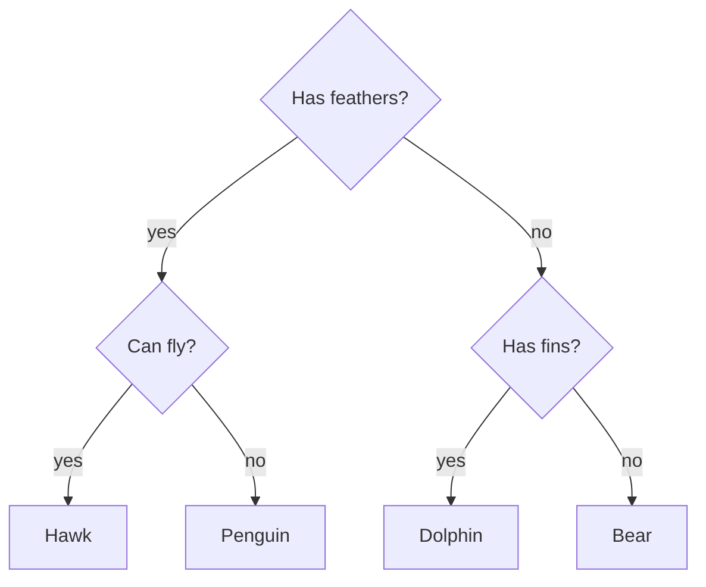

# Naive Bayes, decision trees and ensembles of trees

This lesson covers three families from chapter 2 of Müller & Guido. Naive Bayes is the fastest classifier
you will ever train. Decision trees learn if/else rules. Tree **ensembles** (random forests and gradient
boosting) are the default winners on tabular data and a staple of ML interviews.

## 1. Naive Bayes classifiers

Naive Bayes classifiers are similar in spirit to linear models but train even faster. The price is that
their generalisation is often slightly worse than that of `LogisticRegression` or `LinearSVC`. They are
efficient because they learn parameters by looking at **each feature individually** and collecting simple
per-class statistics.

The model is Bayes' rule with the "naive" assumption that features are conditionally independent given the
class:

$$P(y\mid x)\ \propto\ P(y)\prod_{j=1}^p P(x_j\mid y)\quad\Longrightarrow\quad \hat y = \arg\max_y\Big[\log P(y) + \sum_j \log P(x_j\mid y)\Big].$$

scikit-learn has three main variants:

| class | data it assumes | what it stores per class |
|---|---|---|
| `GaussianNB` | any continuous data | mean and standard deviation of each feature |
| `BernoulliNB` | binary features | how often each feature is non-zero |
| `MultinomialNB` | count data (e.g. word counts) | average value of each feature |

`BernoulliNB` and `MultinomialNB` are mostly used for text. Their one parameter, **`alpha`**, adds that many
virtual data points with positive values for every feature. This is additive (Laplace) smoothing. It keeps a
word never seen with a class from zeroing out the whole product. Larger `alpha` gives more smoothing and a
simpler model. Performance is fairly robust to its value.

```python-run
import numpy as np
X = np.array([[0, 1, 0, 1],
              [1, 0, 1, 1],
              [0, 0, 0, 1],
              [1, 0, 1, 0]])
y = np.array([0, 1, 0, 1])
# what BernoulliNB "learns": count non-zero entries per feature, per class
for label in np.unique(y):
    print("class", label, "feature counts:", X[y == label].sum(axis=0))

from sklearn.naive_bayes import BernoulliNB
nb = BernoulliNB(alpha=1.0).fit(X, y)
print("P(feature=1 | class), smoothed:\n", np.exp(nb.feature_log_prob_).round(2))
print("prediction for [1,0,1,1]:", nb.predict([[1, 0, 1, 1]]), nb.predict_proba([[1, 0, 1, 1]]).round(3))
```

`GaussianNB` is mostly used on very high-dimensional data. The other two are widely used for sparse counts,
and `MultinomialNB` usually beats `BernoulliNB` on long documents. In summary: they are very fast to train
and predict, easy to understand, work well on high-dimensional sparse data, and are robust to their
parameter. They make good **baselines**, and are used on datasets so large that even a linear model would
take too long.

> [!NOTE]
> Naive Bayes is a **generative** model (it models $P(x\mid y)$ and $P(y)$). Logistic regression is
> **discriminative** (it models $P(y\mid x)$ directly). Because the independence assumption is wrong,
> naive Bayes probabilities tend to be over-confident, even when the argmax is right.

## 2. Decision trees

A decision tree learns a hierarchy of **if/else questions** that lead to a decision, like a game of 20
Questions. The book's example distinguishes bears, hawks, penguins and dolphins by asking "has feathers?",
"can fly?", "has fins?".



For continuous data the questions (called **tests**) have the form "is feature $j$ ≤ threshold $t$?".

### Building a tree

Learning means searching over all possible tests and choosing the one that is **most informative about the
target**. The data is split, and the process recurses on each side. Each test cuts the feature space with an
axis-parallel line. The recursion continues until each leaf holds a single class (a **pure** leaf) or a
single regression value. To predict, find the leaf a point falls into, and return its majority class, or
the mean target for regression.

"Most informative" is measured by an **impurity** criterion. For class proportions $p_c$ in a node:

$$\text{Gini} = 1-\sum_c p_c^2\qquad\qquad \text{Entropy} = -\sum_c p_c\log_2 p_c$$

The chosen split maximises the impurity decrease (information gain when using entropy):

$$\Delta = I(\text{parent}) - \frac{n_L}{n}I(L) - \frac{n_R}{n}I(R).$$

For regression trees, the impurity is the variance (MSE) of the targets in the node. You implement the
split search in *ml-gini-best-split* and *ml-info-gain*.

```python-run
import numpy as np
def gini(labels):
    _, c = np.unique(labels, return_counts=True); p = c / c.sum(); return 1 - (p ** 2).sum()
def entropy(labels):
    _, c = np.unique(labels, return_counts=True); p = c / c.sum(); return -(p * np.log2(p)).sum()

parent = np.array([0] * 5 + [1] * 5)
for name, left, right in [("perfect split", parent[:5], parent[5:]),
                          ("weak split", np.array([0, 0, 0, 0, 1]), np.array([0, 1, 1, 1, 1])),
                          ("useless split", np.array([0, 1] * 2), np.array([0, 1] * 3))]:
    w = lambda f: len(left) / 10 * f(left) + len(right) / 10 * f(right)
    print(f"{name:14s} gini gain={gini(parent) - w(gini):.3f}  info gain={entropy(parent) - w(entropy):.3f} bits")
```

### Controlling complexity

Growing a tree until all leaves are pure gives 100% training accuracy and a model that is far too complex.
Two strategies prevent this:

- **Pre-pruning**: stop early by limiting `max_depth`, `max_leaf_nodes`, or requiring `min_samples_leaf` /
  `min_samples_split`.
- **Post-pruning**: build the full tree, then remove or collapse nodes that carry little information.
  scikit-learn supports this through cost-complexity pruning, `ccp_alpha`.

```python-run
from sklearn.datasets import load_breast_cancer
from sklearn.tree import DecisionTreeClassifier, export_text
from sklearn.model_selection import train_test_split

data = load_breast_cancer()
X_tr, X_te, y_tr, y_te = train_test_split(data.data, data.target, stratify=data.target, random_state=42)
for depth in [None, 4, 2]:
    t = DecisionTreeClassifier(max_depth=depth, random_state=0).fit(X_tr, y_tr)
    print(f"max_depth={depth}: train={t.score(X_tr, y_tr):.3f} test={t.score(X_te, y_te):.3f} leaves={t.get_n_leaves()}")
tree = DecisionTreeClassifier(max_depth=2, random_state=0).fit(X_tr, y_tr)
print(export_text(tree, feature_names=list(data.feature_names)))
```

### Feature importances

`feature_importances_` summarises how much each feature contributed to impurity reduction. The values lie
between 0 and 1 and sum to 1. Two cautions from the book: a low importance does not mean a feature is
uninformative, because the tree may simply have picked a correlated one. And importances are always
positive, so they don't tell you **which class** a feature points to.

### Trees can't extrapolate

On the book's RAM-price example, a tree regressor predicts a constant outside the range of the training
data. It can only return averages of the training targets it has seen. A linear model on log-prices
extrapolates the trend. All tree-based models share this limit.

```python-run
import numpy as np
from sklearn.tree import DecisionTreeRegressor
from sklearn.linear_model import LinearRegression
X = np.arange(0, 20).reshape(-1, 1).astype(float)
y = 3 * X[:, 0] + 5
tree = DecisionTreeRegressor().fit(X, y)
lin = LinearRegression().fit(X, y)
print("x=30  truth=95  tree:", tree.predict([[30]])[0], " linear:", lin.predict([[30]])[0].round(1))
```

### Strengths and weaknesses

- **Easy to visualise and explain** (for small trees).
- **Invariant to feature scaling**: no normalisation needed, and trees work with features on completely
  different scales and with mixes of binary and continuous features.
- **Main downside**: even with pre-pruning they tend to overfit and generalise poorly, so in most
  applications ensembles are used instead.

## 3. Random forests

An **ensemble** combines multiple models into a more powerful one. A random forest is a collection of
decision trees, each slightly different from the others. Each tree might predict well but overfit on part
of the data. If we build many trees that overfit in *different* ways and **average** them, the overfitting
cancels out while the predictive power stays.

Randomness is injected in two ways:

1. **Bootstrap samples** (bagging): each tree trains on $n$ points drawn *with replacement* from the
   $n$ training points. About a third of the points are left out of each sample.
2. **Feature subsampling**: at each node, only a random subset of `max_features` features is considered for
   the split. `max_features=n_features` removes this randomness. `max_features=1` leaves no choice of
   feature at all. Small values make the trees very different, and they then need to be deep to fit the data.

Prediction is a **soft vote**: average the trees' predicted probabilities for classification, or the
predicted values for regression.

Why averaging works: for $B$ models each with variance $\sigma^2$ and pairwise correlation $\rho$, the
variance of their mean is $\rho\sigma^2 + \frac{1-\rho}{B}\sigma^2$. More trees shrink the second term, and
feature subsampling lowers $\rho$.

```python-run
from sklearn.datasets import load_breast_cancer
from sklearn.ensemble import RandomForestClassifier
from sklearn.tree import DecisionTreeClassifier
from sklearn.model_selection import train_test_split
import numpy as np

data = load_breast_cancer()
X_tr, X_te, y_tr, y_te = train_test_split(data.data, data.target, random_state=0)
tree = DecisionTreeClassifier(random_state=0).fit(X_tr, y_tr)
print(f"single tree            test={tree.score(X_te, y_te):.3f}")
for n in [1, 5, 25, 100]:
    rf = RandomForestClassifier(n_estimators=n, random_state=0).fit(X_tr, y_tr)
    print(f"forest of {n:3d} trees    test={rf.score(X_te, y_te):.3f}")
top = np.argsort(rf.feature_importances_)[::-1][:5]
print("top features:", [(data.feature_names[i], round(rf.feature_importances_[i], 3)) for i in top])
```

**Parameters and advice (from the book).**

- `n_estimators`: **larger is always better**. More trees reduce overfitting, with diminishing returns and
  more time and memory. Build as many as you can afford.
- `max_features`: controls how random each tree is. The defaults are a good rule of thumb: $\sqrt{p}$ for
  classification. For regression the book quotes $\log_2 p$, while current scikit-learn defaults to all
  features.
- Pre-pruning (`max_depth`, `max_leaf_nodes`) can sometimes help and saves memory.
- `n_jobs=-1` uses all CPU cores, since trees are built independently. Set `random_state` for
  reproducibility.
- Forests need **no scaling**, work well with little tuning, and give more reliable feature importances
  than a single tree.
- They do **not** do well on very high-dimensional sparse data such as text. They also need more memory and
  are slower than linear models.

> [!TIP]
> Each tree leaves out roughly 37% of the rows, the **out-of-bag** samples. Setting `oob_score=True` gives a
> free validation estimate without a separate hold-out set.

## 4. Gradient boosted trees

Gradient boosting also combines many trees, but builds them **serially**: each new tree tries to **correct
the mistakes of the ensemble so far**. There is no randomisation by default. Instead it relies on strong
pre-pruning, with very shallow trees of depth 1 to 5 called **weak learners**. Each tree gives good
predictions on only part of the data, and adding more and more of them improves performance step by step.

For squared error the algorithm is simple:

1. Start with a constant prediction $F_0(x) = \bar y$.
2. For $m = 1..M$: compute residuals $r_i = y_i - F_{m-1}(x_i)$, fit a small regression tree $h_m$ to the
   residuals, and update $F_m(x) = F_{m-1}(x) + \eta\,h_m(x)$.

In general the "residuals" are the **negative gradient of the loss** with respect to the current
predictions, hence the name. The **`learning_rate`** $\eta$ controls how strongly each tree corrects its
predecessors.

```python-run
import numpy as np
from sklearn.tree import DecisionTreeRegressor
rng = np.random.RandomState(0)
X = rng.uniform(-3, 3, (200, 1)); y = np.sin(X[:, 0]) + 0.2 * rng.randn(200)

F = np.full(200, y.mean()); lr = 0.3
for m in range(1, 31):
    residual = y - F                                   # negative gradient of 1/2 (y - F)^2
    stump = DecisionTreeRegressor(max_depth=2).fit(X, residual)
    F += lr * stump.predict(X)
    if m in (1, 5, 10, 30):
        print(f"after {m:2d} trees: training MSE = {np.mean((y - F) ** 2):.4f}")
```

**Parameters and advice.**

- `n_estimators` and `learning_rate` are tightly linked: a lower learning rate needs more trees. Unlike in
  random forests, **more trees can overfit**. Common practice: fix `n_estimators` by your time budget, then
  search over `learning_rate`, or use early stopping.
- `max_depth` is usually kept very low, often not deeper than five.
- Strengths: among the most powerful and widely used supervised models. No scaling needed; works with
  mixed binary and continuous features.
- Weaknesses: needs careful tuning, can take long to train, and like other trees is poor on
  high-dimensional sparse data.
- The book's advice: try a random forest first, because it is robust. Move to gradient boosting if you need
  the last bit of accuracy or faster prediction.

```python-run
from sklearn.datasets import load_breast_cancer
from sklearn.ensemble import GradientBoostingClassifier
from sklearn.model_selection import train_test_split
X, y = load_breast_cancer(return_X_y=True)
X_tr, X_te, y_tr, y_te = train_test_split(X, y, random_state=0)
for kw in [dict(), dict(max_depth=1), dict(learning_rate=0.01)]:
    gb = GradientBoostingClassifier(n_estimators=60, random_state=0, **kw).fit(X_tr, y_tr)
    print(f"{str(kw):25s} train={gb.score(X_tr, y_tr):.3f} test={gb.score(X_te, y_te):.3f}")
```

### XGBoost, LightGBM, CatBoost and HistGradientBoosting

The book mentions `xgboost` as the package to reach for at scale. Today the common choices are:

| library | key ideas |
|---|---|
| **XGBoost** | second-order (Newton) boosting, explicit L1/L2 penalties on leaf weights, sparsity-aware splits, histogram mode, GPU support |
| **LightGBM** | histogram binning, **leaf-wise** growth (grow the leaf with the largest gain), gradient-based sampling; very fast on big data |
| **CatBoost** | ordered boosting and built-in handling of categorical features (ordered target statistics) |
| `HistGradientBoostingClassifier` | scikit-learn's own histogram implementation; native missing-value and categorical support |

All of them bin features into at most 256 buckets so that finding a split costs $O(\text{bins})$, not
$O(n)$. They add regularisation (`subsample`, `colsample_bytree`, `min_child_weight`, `reg_lambda`) and
support **early stopping** on a validation set.

> [!INTERVIEW]
> **"Bagging vs boosting?"** Bagging (random forest) trains deep, low-bias, high-variance trees
> independently on bootstrap samples and averages them, which **reduces variance**. It is parallel and
> hard to overfit by adding trees. Boosting trains shallow, high-bias trees sequentially on the errors of
> the previous ones, which **reduces bias**. It is more accurate when tuned, but sensitive to the learning
> rate, the number of trees and noisy labels. Follow-ups: why trees don't need scaling (splits depend only
> on the ordering of values) and why they can't extrapolate.

## Summary

- Naive Bayes: per-feature statistics plus Bayes' rule. Extremely fast, good for sparse text, with `alpha`
  smoothing.
- Decision trees: greedy axis-parallel splits chosen by Gini or entropy. Interpretable and scale-invariant,
  but they overfit and cannot extrapolate.
- Random forests: bagging + feature subsampling → variance reduction. More trees is always better.
- Gradient boosting: shallow trees fitted sequentially to residuals (gradients). Tune `learning_rate`,
  `n_estimators` and `max_depth`.
- XGBoost and LightGBM are the engineered, regularised, histogram-based versions used in practice.

```quiz
[
  {"q": "What is the 'naive' assumption in naive Bayes?", "options": ["Features are conditionally independent given the class", "All classes are equally likely", "Features are normally distributed", "The decision boundary is linear"], "answer": 0,
   "explain": "It lets P(x|y) factor into a product of per-feature terms, which is why training only needs per-feature statistics."},
  {"q": "A node contains 8 samples of class A and 2 of class B. Its Gini impurity is…", "options": ["0.32", "0.5", "0.2", "0.72"], "answer": 0,
   "explain": "1 − (0.8² + 0.2²) = 1 − 0.68 = 0.32."},
  {"q": "Why don't tree-based models need feature scaling?", "options": ["Splits depend only on the ordering of values within each feature", "They scale features internally with StandardScaler", "They use cosine distance", "They only work on binary features"], "answer": 0,
   "explain": "A threshold test x ≤ t is unaffected by monotonic rescaling of the feature."},
  {"q": "In a random forest, increasing n_estimators…", "options": ["never hurts accuracy (apart from compute); it reduces variance with diminishing returns", "eventually overfits badly", "increases bias", "reduces the depth of each tree"], "answer": 0,
   "explain": "Averaging more de-correlated trees only stabilises the prediction. In boosting, by contrast, more trees can overfit."},
  {"q": "In gradient boosting with squared error, each new tree is fitted to…", "options": ["the residuals of the current ensemble", "a bootstrap sample of the original targets", "random noise", "the predictions of the previous tree"], "answer": 0,
   "explain": "Residuals are the negative gradient of the squared loss w.r.t. current predictions."},
  {"q": "A decision tree regressor trained on x in [0, 20] is asked to predict at x = 30. It returns…", "options": ["the value of the leaf covering the largest training x (a constant)", "a linear extrapolation", "NaN", "zero"], "answer": 0,
   "explain": "Trees predict averages of training targets in a leaf; outside the training range the prediction stays flat."},
  {"q": "Lowering learning_rate in gradient boosting typically requires…", "options": ["more trees to reach the same training fit", "fewer trees", "deeper trees only", "no other change"], "answer": 0,
   "explain": "Each tree contributes less, so more of them are needed; the two parameters must be tuned together."},
  {"q": "Which statement about feature_importances_ is correct?", "options": ["They are non-negative, sum to 1, and do not indicate the direction of the effect", "Negative values mean the feature lowers the prediction", "A zero importance proves the feature is useless", "They are the same as linear coefficients"], "answer": 0,
   "explain": "Importances measure impurity reduction only; a correlated feature may have been used instead."}
]
```

> **Source:** Müller & Guido, *Introduction to Machine Learning with Python*, ch. 2 ("Naive Bayes Classifiers", "Decision Trees", "Ensembles of Decision Trees": random forests, gradient boosted regression trees); scikit-learn User Guide, "Ensembles: Gradient boosting, random forests, bagging"; XGBoost and LightGBM documentation.
