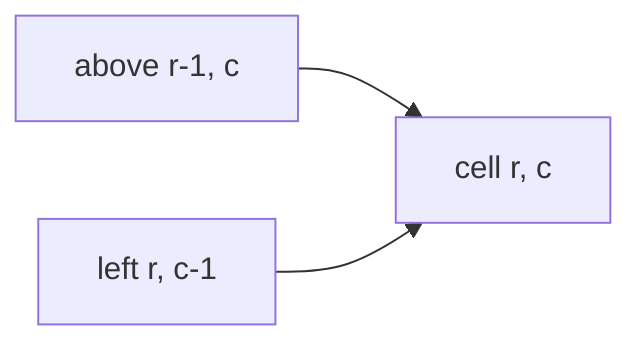
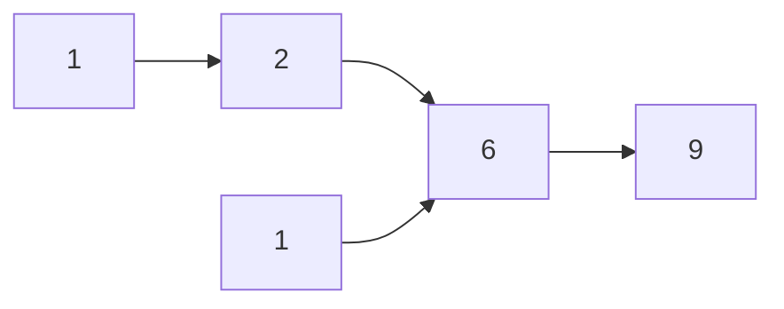

# Grid DP and DP on DAGs

Grids are the gentlest introduction to two-dimensional state. A cell `(r, c)` is the state; the
recurrence looks at neighbouring cells; the table *is* the grid. This lesson covers the right/down
family (Unique Paths, Minimum Path Sum, Maximal Square) and then the general idea that makes all DP
work — **the dependency graph must be acyclic** — through Longest Increasing Path in a Matrix.

## Unique Paths: counting monotone routes

A robot moves only **right** or **down** from the top-left to the bottom-right of an `m × n` grid.
How many routes?

Classify by the **last move** into `(r, c)`: it came from above `(r-1, c)` or from the left
`(r, c-1)`. Those cases are disjoint and exhaustive:

$$paths(r, c) = paths(r-1, c) + paths(r, c-1), \qquad paths(0, c) = paths(r, 0) = 1$$



Table for `m = 3, n = 4`:

| | c0 | c1 | c2 | c3 |
|---|---|---|---|---|
| r0 | 1 | 1 | 1 | 1 |
| r1 | 1 | 2 | 3 | 4 |
| r2 | 1 | 3 | 6 | **10** |

```python-run
def unique_paths(m, n):
    row = [1] * n
    for _ in range(1, m):
        for c in range(1, n):
            row[c] += row[c - 1]        # row[c] (old) = above, row[c-1] (new) = left
    return row[-1]

import math
for m, n in [(3, 7), (3, 2), (3, 4), (17, 17)]:
    print(m, n, unique_paths(m, n), math.comb(m + n - 2, m - 1))
```

The one-row trick deserves a slow look. Before the update, `row[c]` still holds the value from the
previous row — the cell **above**. `row[c-1]` was already updated in this pass — the cell to the
**left**. So `row[c] += row[c-1]` computes exactly `above + left`. This "single array, left-to-right"
pattern recurs in every right/down grid problem.

The closed form: any route is a sequence of `m-1` downs and `n-1` rights in some order, so the count
is $\binom{m+n-2}{m-1}$. Nice to mention, but interviewers usually want the DP.

### Obstacles

Unique Paths II adds blocked cells: set `paths = 0` on obstacles and the recurrence handles the rest.

```python-run
def unique_paths_obstacles(grid):
    n = len(grid[0])
    row = [0] * n
    row[0] = 1
    for r in grid:
        for c in range(n):
            if r[c] == 1:
                row[c] = 0
            elif c > 0:
                row[c] += row[c - 1]
    return row[-1]

print(unique_paths_obstacles([[0, 0, 0], [0, 1, 0], [0, 0, 0]]))   # 2
```

## Minimum Path Sum: from counting to optimising

Same moves, but each cell has a cost and we minimise the total along the route (both ends included).
Replace `+` by `min` and add the cell's cost:

$$best(r, c) = grid[r][c] + \min\big(best(r-1, c),\; best(r, c-1)\big)$$

with missing neighbours treated as ∞.

| grid | | | | best | | |
|---|---|---|---|---|---|---|
| 1 | 3 | 1 | | 1 | 4 | 5 |
| 1 | 5 | 1 | | 2 | 7 | 6 |
| 4 | 2 | 1 | | 6 | 8 | **7** |

```python-run
def min_path_sum(grid):
    n = len(grid[0])
    INF = float("inf")
    row = [INF] * n
    row[0] = 0
    for r in grid:
        row[0] += r[0]
        for c in range(1, n):
            row[c] = min(row[c], row[c - 1]) + r[c]
    return row[-1]

print(min_path_sum([[1, 3, 1], [1, 5, 1], [4, 2, 1]]))
print(min_path_sum([[1, 2, 3], [4, 5, 6]]))
```

> [!WARNING]
> Greedy ("step to the cheaper neighbour") fails: a cheap first step can lead into an expensive
> region. On `[[1, 1, 9], [2, 9, 9], [1, 1, 1]]` greedy steps right (1 < 2) and is then forced through
> two 9s for a total of 21, while going down first costs 1 + 2 + 1 + 1 + 1 = 6. The DP evaluates every
> route implicitly.

## Maximal Square: anchoring at a corner

Find the largest all-`"1"` square in a binary matrix. The key is choosing the state well:

> `side(r, c)` = side length of the largest all-ones square whose **bottom-right corner** is `(r, c)`.

A square of side `k` with corner `(r, c)` exists iff the cell is `1` and squares of side `k−1` end at
the **top**, **left** and **top-left** neighbours. So:

$$side(r, c) = 1 + \min\big(side(r-1, c),\; side(r, c-1),\; side(r-1, c-1)\big) \quad \text{if cell is 1, else } 0$$

Why all three? Top and left alone don't guarantee the top-left corner region is filled: in
`[["0","1"],["1","1"]]`, top and left of the bottom-right cell each have side 1, but the top-left cell
is 0 — the true answer is side 1, not 2.

```python-run
def maximal_square(matrix):
    n = len(matrix[0])
    prev = [0] * (n + 1)
    best = 0
    for row in matrix:
        cur = [0] * (n + 1)
        for c in range(1, n + 1):
            if row[c - 1] == "1":
                cur[c] = 1 + min(prev[c], cur[c - 1], prev[c - 1])
                best = max(best, cur[c])
        prev = cur
    return best * best

m = [list("10100"), list("10111"), list("11111"), list("10010")]
print(maximal_square(m))                       # 4
print(maximal_square([list("01"), list("11")]))  # 1
```

Side table for the first example:

| | c0 | c1 | c2 | c3 | c4 |
|---|---|---|---|---|---|
| r0 | 1 | 0 | 1 | 0 | 0 |
| r1 | 1 | 0 | 1 | 1 | 1 |
| r2 | 1 | 1 | 1 | **2** | **2** |
| r3 | 1 | 0 | 0 | 1 | 0 |

The problem asks for the **area**: `2² = 4`.

> [!TIP]
> "Anchor the shape at a corner (or an end)" is the same trick as LIS's "ending at i". It gives the
> recurrence something concrete to extend.

## When moves go in every direction: DP on a DAG

The right/down problems had an obvious fill order because every dependency pointed up or left. What if
moves can go in all four directions?

**Longest Increasing Path in a Matrix:** find the longest path that moves to orthogonal neighbours with
**strictly increasing** values.

Define `lip(r, c)` = length of the longest increasing path **starting** at `(r, c)`:

$$lip(r, c) = 1 + \max\big(\{0\} \cup \{\, lip(r', c') : (r', c') \text{ neighbour},\ v(r', c') > v(r, c) \,\}\big)$$

Is this well-defined? A recurrence is safe exactly when its dependency graph is **acyclic** — otherwise
`lip(a)` could depend on `lip(b)` which depends on `lip(a)`. Here every dependency goes to a strictly
larger value, so you can never return to where you started. The cells with edges "to a larger
neighbour" form a **DAG**.



Any DAG can be processed in a **topological order**. Three practical ways:

1. **Memoized DFS** — recursion resolves the order automatically.
2. **Sort cells by value descending** and compute `lip` in that order (larger neighbours are done
   first).
3. **Kahn-style peeling** — repeatedly remove cells with no larger neighbour; the number of rounds is
   the answer.

```python-run
from functools import cache

def lip_memo(M):
    m, n = len(M), len(M[0])

    @cache
    def lip(r, c):
        best = 0
        for dr, dc in ((1, 0), (-1, 0), (0, 1), (0, -1)):
            a, b = r + dr, c + dc
            if 0 <= a < m and 0 <= b < n and M[a][b] > M[r][c]:
                best = max(best, lip(a, b))
        return 1 + best

    return max(lip(r, c) for r in range(m) for c in range(n))

def lip_sorted(M):
    m, n = len(M), len(M[0])
    cells = sorted(((M[r][c], r, c) for r in range(m) for c in range(n)), reverse=True)
    lip = [[1] * n for _ in range(m)]
    for v, r, c in cells:
        for dr, dc in ((1, 0), (-1, 0), (0, 1), (0, -1)):
            a, b = r + dr, c + dc
            if 0 <= a < m and 0 <= b < n and M[a][b] > v:
                lip[r][c] = max(lip[r][c], 1 + lip[a][b])
    return max(map(max, lip))

M = [[9, 9, 4], [6, 6, 8], [2, 1, 1]]
print(lip_memo(M), lip_sorted(M))
M2 = [[3, 4, 5], [3, 2, 6], [2, 2, 1]]
print(lip_memo(M2), lip_sorted(M2))
```

The memoized DFS is the shortest to write, but on a "snake" grid where one increasing path visits
every cell, recursion depth reaches `m·n`. The sorted and peeling versions are iterative and safe.
Time is O(mn) for memo/peeling and O(mn log mn) for the sort-based version.

> [!NOTE]
> No `visited` set is needed: strict increase already forbids cycles. If the problem allowed
> **equal** neighbours, the graph could have cycles and DP would no longer apply directly.

### The general lesson

Every DP is a computation over a DAG of states. Tabulation picks a topological order you can express
with nested loops (rows, lengths, capacities). When the DAG is irregular, memoized recursion or an
explicit topological sort does the job. If the "DAG" has cycles, you need something else — shortest
paths (Dijkstra/Bellman–Ford) are the generalisation of DP to graphs with cycles.

## Grid DP checklist

| Question | Right/down grids | Four-direction grids |
|---|---|---|
| Why acyclic? | moves only increase `r + c` | problem-specific (e.g. strictly increasing values) |
| Order | row-major | memo DFS / sort by value / topological peeling |
| Space | one row | full table |
| Classic | Unique Paths, Min Path Sum, Maximal Square | Longest Increasing Path |

## Pitfalls

- Initialising the first row/column wrongly (1s for counting, prefix sums for min-cost).
- Forgetting the diagonal neighbour in Maximal Square, or returning the side instead of the area.
- Strings `"1"` vs integers `1` in matrix inputs.
- Recursion depth in memoized grid DFS.

## Summary

- Grid DP states are cells; right/down moves give an up/left dependency pattern and a one-row solution.
- Anchoring a shape at its bottom-right corner turns "largest square" into a three-neighbour min.
- DP needs an acyclic dependency graph; with four-direction moves, find the reason for acyclicity and
  process in topological order.

## Check yourself

```quiz
[
  {"q": "In the one-row Unique Paths update row[c] += row[c-1], what does the old row[c] represent?", "options": ["The cell to the left", "The cell above (previous row)", "The diagonal cell", "The answer"], "answer": 1, "explain": "Before the update the array still holds the previous row; row[c-1] has already been updated to the current row (the left cell)."},
  {"q": "How many monotone right/down paths cross a 3 × 4 grid?", "options": ["7", "10", "12", "20"], "answer": 1, "explain": "C(3+4−2, 3−1) = C(5, 2) = 10, matching the table."},
  {"q": "Why does Maximal Square use the top-left neighbour as well?", "options": ["For speed", "Top and left alone don't guarantee the corner region is filled", "To handle the first row", "It doesn't need it"], "answer": 1, "explain": "In [[0,1],[1,1]] top and left have side 1, but the top-left zero prevents a 2×2 square."},
  {"q": "Why is Longest Increasing Path in a Matrix solvable by DP despite four-direction moves?", "options": ["Grids are always acyclic", "Strictly increasing moves can never return to a cell, so dependencies form a DAG", "Because of memoization", "It isn't — it needs backtracking"], "answer": 1, "explain": "Acyclicity of the dependency graph is what makes the recurrence well-defined."},
  {"q": "Which processing order works for the longest increasing path DP lip(r, c) (paths starting at a cell)?", "options": ["Row-major", "Cells sorted by value in descending order", "Random", "Cells sorted by value ascending"], "answer": 1, "explain": "lip of a cell depends on larger neighbours, so larger values must be computed first."},
  {"q": "What does Maximal Square return for a matrix whose largest all-ones square has side 3?", "options": ["3", "6", "9", "27"], "answer": 2, "explain": "It returns the area, 3² = 9."}
]
```

> **Source:** NeetCode 150 roadmap (Unique Paths, Longest Increasing Path in a Matrix); LeetCode
> Minimum Path Sum and Maximal Square; Goodrich, Tamassia & Goldwasser, *Data Structures and Algorithms
> in Python*, §13.3 and ch. 14 (DAGs and topological ordering).
